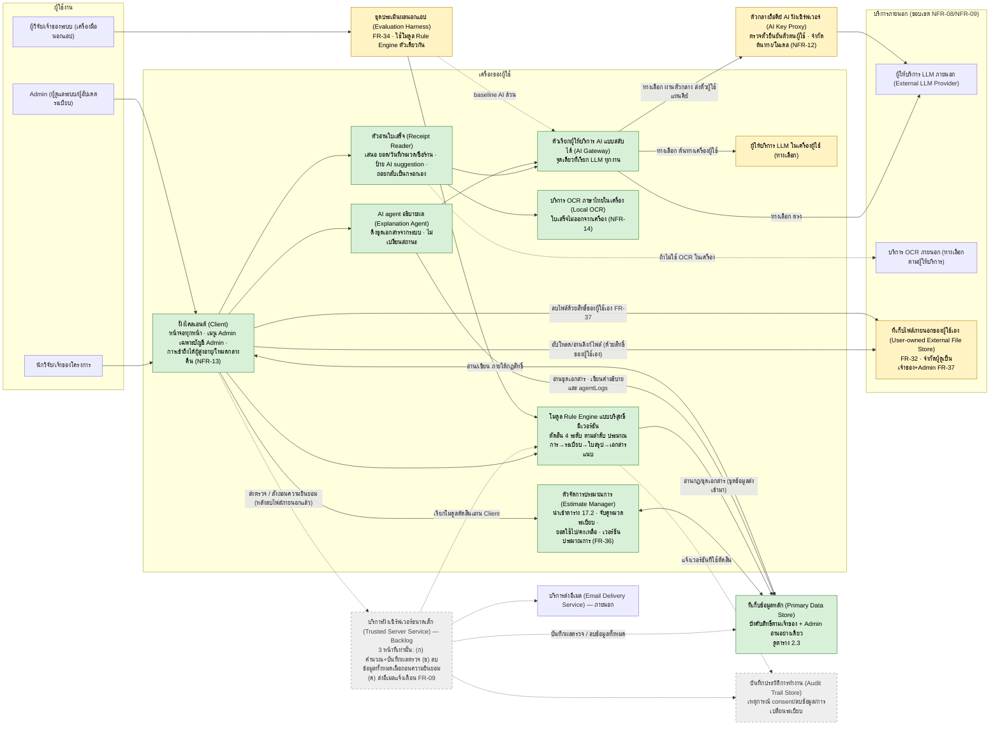
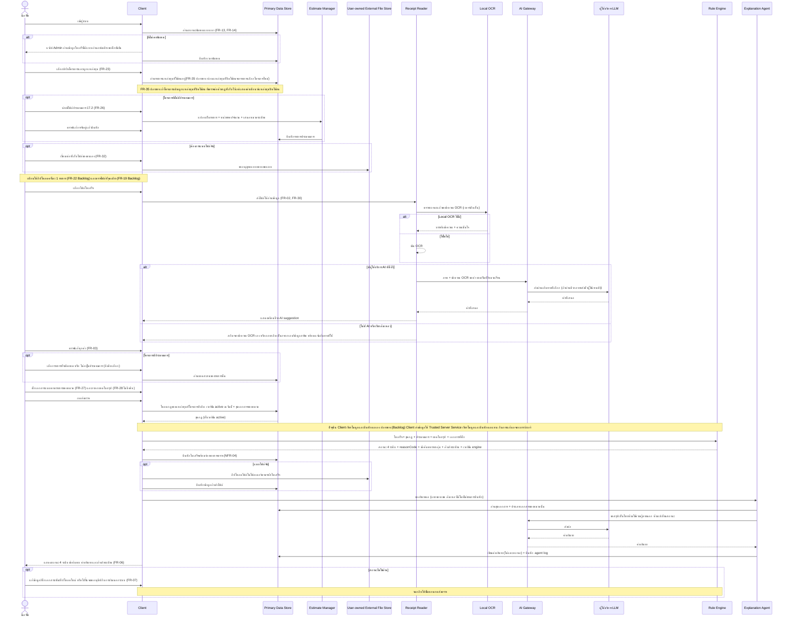
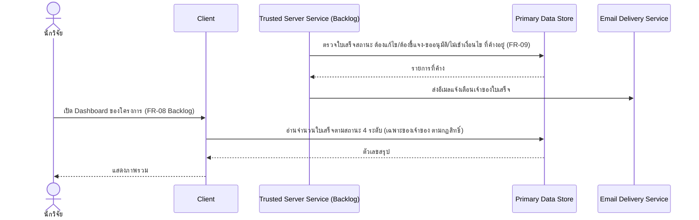
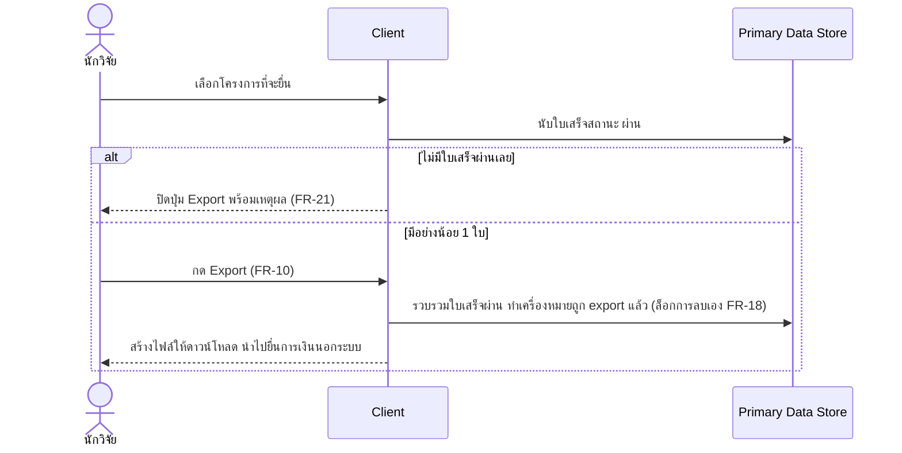
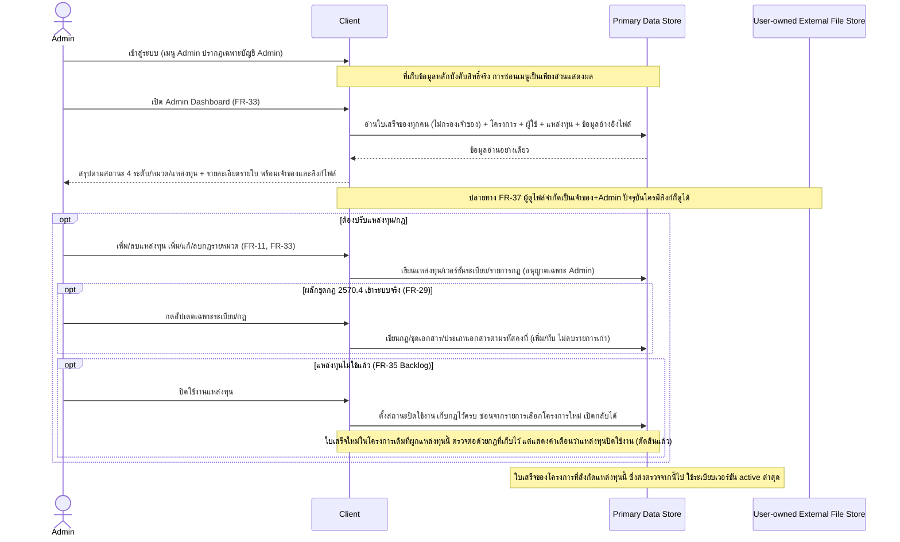
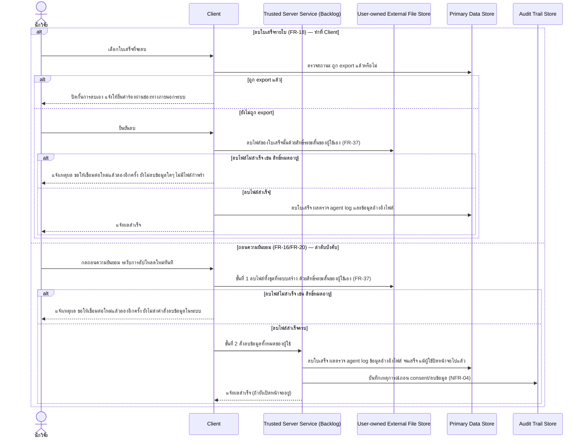
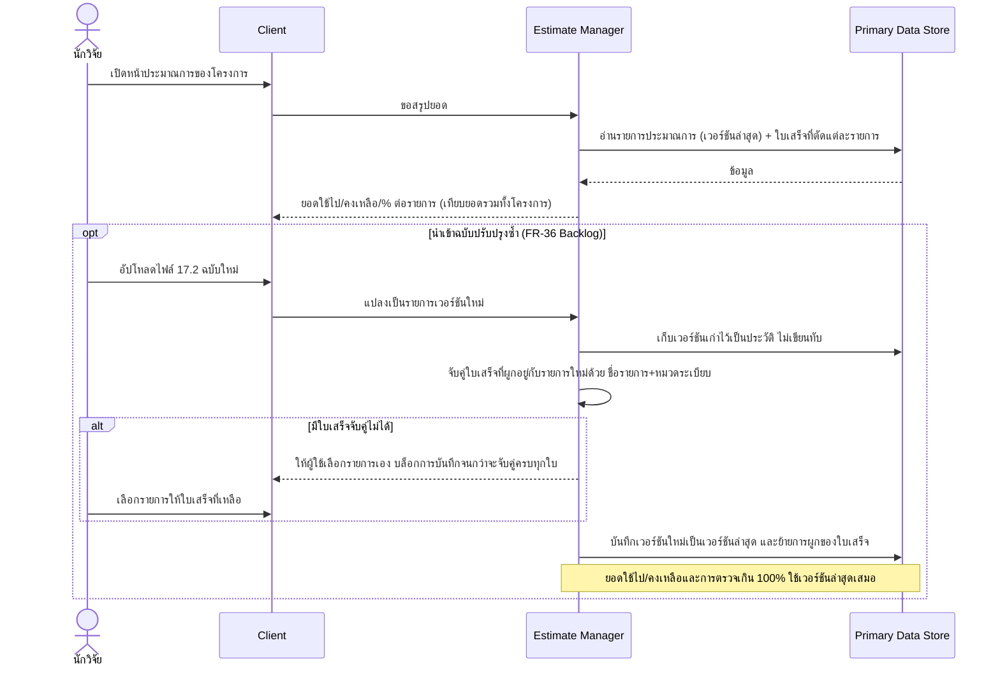
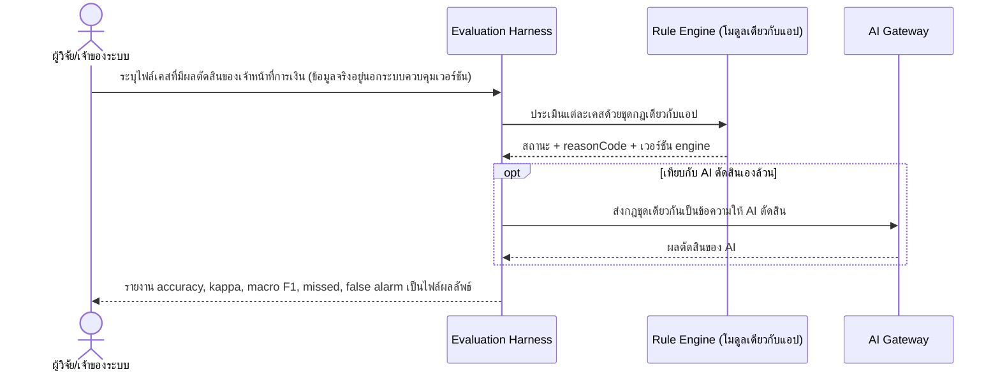

# Architecture — Grant Receipt Assistant

> เอกสารสถาปัตยกรรมระดับ **logical/conceptual** เท่านั้น แปลงจาก [[feature-list]] +
> [[user-journey]] (พร้อม NFR จาก [[backlog]]) — **ไม่ผูก technology/framework/database
> engine/ผู้ให้บริการคลาวด์/ผู้ให้บริการ AI ใดๆ** เพราะ [[technology-stack]] ยังไม่มีเนื้อหา (ตรวจแล้วเมื่อ
> 2026-11-17: ไฟล์นี้ยังไม่มีอยู่จริงใน `02-technical/`) ทุก component เรียกด้วยบทบาท เช่น "ที่เก็บข้อมูลหลัก",
> "ผู้ให้บริการ LLM ภายนอก", "ที่เก็บไฟล์ภายนอกของผู้ใช้" เมื่อมีการตัดสิน tech stack แล้วจึงค่อยอ้างอิงชื่อจริงในหัวข้อ
> "ประเด็นรอตัดสินใจ" ท้ายเอกสาร

## 0. สถานะเอกสารนี้

- สร้างครั้งแรก 2026-08-23 (FR-01–FR-22, NFR-01–NFR-11) แก้รอบ 2–3 วันเดียวกัน (ยืนยันตำแหน่งตรวจไฟล์, การสื่อสารแบบ
  synchronous, FR-22 หลายไฟล์ 1:N สูงสุด 5 ไฟล์ ≤5 MB/ไฟล์) และ 2026-09-03 (แยก FundSource / Project / Researcher, FR-23)
- **อัปเดต 2026-11-17 (รอบนี้):** sync กับ [[feature-list]] (23 ฟีเจอร์), [[user-journey]] (10 journey), [[backlog]]
  (FR-01–FR-37, NFR-01–NFR-15) และ spec ใหม่ [[20261117-01-implemented-rule-engine-ai-and-admin]] (FR-24–FR-34,
  NFR-12–NFR-14 สร้างแล้ว) กับ [[20261117-02-fund-source-deactivation-estimate-versioning-drive-privacy]] (FR-35–FR-37,
  NFR-15 **ยังเป็น Backlog ทั้งหมด**) การเปลี่ยนแปลงหลัก:
  1. **สิทธิ์ Admin กลับคำตัดสินใจ (FR-33):** Admin อ่านใบเสร็จของทุกคนได้แบบ**อ่านอย่างเดียว** เขียน/แก้ของผู้อื่นไม่ได้
     (เดิมเอกสารนี้ระบุว่า Admin ห้ามเข้าถึงใบเสร็จเลย) — แก้หัวข้อ 1, 2.2 และ NFR-05
  2. **ผลตรวจ 4 ระดับ** (ผ่าน / ต้องแก้ไข / ต้องชี้แจง/ขออนุมัติ / ไม่เข้าเงื่อนไข) แทน 3 ระดับ (FR-25)
  3. **เพิ่ม component ใหม่:** โมดูล Rule Engine แบบบริสุทธิ์มีเวอร์ชัน (FR-24), ตัวจัดการประมาณการและเวอร์ชันประมาณการ
     (FR-26/FR-36), แค็ตตาล็อกชุดเอกสาร Evidence Chain (FR-27), การเทียบใบสรุปรายรับ-จ่าย (FR-28), ตัวอ่านใบเสร็จ + ตัวเรียก AI
     แบบสลับผู้ให้บริการได้ + OCR ในเครื่องผู้ใช้ (FR-30, NFR-14), ตัวกลางถือคีย์ AI ฝั่งเซิร์ฟเวอร์ (NFR-12), AI agent อธิบายผล +
     audit log (FR-31), ที่เก็บไฟล์ภายนอกของผู้ใช้ (FR-32/FR-37, NFR-15), ชุดประเมินผลนอกแอป (FR-34), การปิดใช้งานแหล่งทุน (FR-35)
  4. **ระบุสถานะการสร้างของทุก component** (สร้างแล้ว / สร้างบางส่วน / Backlog) — พฤติกรรมจริงอ้างอิงจาก
     สถานะที่ระบุใน [[backlog]] และ spec ข้างต้น
- **ข้อสังเกตสำคัญ (สถานะที่สร้างแล้วเทียบกับการออกแบบเดิม):** ในระบบที่สร้างจริง **ยังไม่มี Backend Service ที่เป็นบริการ
  แยกต่างหากสำหรับตรรกะธุรกิจ** — หน้าที่ที่เอกสารรุ่นก่อนวางไว้ที่ Backend Service ถูกทำโดย Client ร่วมกับกฎการเข้าถึงที่
  **ที่เก็บข้อมูลหลักบังคับเอง** (ตามเจ้าของข้อมูล/Admin อ่านอย่างเดียว) ส่วน component ฝั่งเซิร์ฟเวอร์ตัวเดียวที่เขียนแล้วคือ
  "ตัวกลางถือคีย์ AI" (ยังไม่ deploy)
- **ผู้ใช้ตัดสินแล้ว 2026-11-17 — สถาปัตยกรรมแบบผสม (หัวข้อ 5.4):** แทนแผน Backend Service เต็มรูปแบบเดิม (5.1/5.2)
  ให้มี**บริการฝั่งเซิร์ฟเวอร์ขนาดเล็ก (Trusted Server Service)** เพียง 3 หน้าที่ที่ต้องไม่พึ่งเบราว์เซอร์ ได้แก่
  (ก) คำนวณและบันทึกผลตรวจใบเสร็จ กันการแก้ไขผลจากฝั่งเบราว์เซอร์ (ข) ลบข้อมูลทั้งหมดเมื่อถอนความยินยอมให้เสร็จแม้ผู้ใช้ปิดหน้าจอ
  (ค) ส่งอีเมลแจ้งเตือน — ทั้ง 3 หน้าที่ **Backlog ยังไม่ได้สร้าง** (ปัจจุบันผลตรวจคำนวณที่ Client) ส่วนที่เหลือทั้งหมดอยู่ที่ Client
  โดยกฎสิทธิ์ของที่เก็บข้อมูลหลักบังคับสิทธิ์เหมือนเดิม; "ตัวกลางถือคีย์ AI" เป็น component ฝั่งเซิร์ฟเวอร์ขนาดเล็กชนิดเดียวกัน
  (ต่างกันที่หน้าที่) ดูหัวข้อ 5.4

## 1. ภาพรวมสถาปัตยกรรม

**Grant Receipt Assistant** เป็นระบบ "ด่านตรวจก่อนสอบ" ให้นักวิจัยตรวจใบเสร็จก่อนยื่นเบิกจริงกับเจ้าหน้าที่การเงินของ
มหาวิทยาลัย (ซึ่งอยู่นอกระบบ) มี 2 บทบาทในแอป: **นักวิจัย/เจ้าของโครงการ** และ **Admin**
(ดู [[20260816-01-grant-receipt-verification#3. บทบาทผู้ใช้ (User Roles)]]) บวก**เครื่องมือนอกแอป**สำหรับผู้วิจัย/เจ้าของระบบ
(ชุดประเมินผล FR-34 — ไม่ใช่บทบาทที่ 3 ในแอป) หลักการออกแบบที่มีผลต่อโครงสร้าง:

- **โมเดลข้อมูลแยก 3 concept:** **แหล่งทุน (FundSource)** — Admin นำเข้า/ดูแลระเบียบ 1 แหล่งให้ทุนได้หลายโครงการ;
  **โครงการวิจัย (Project)** — นักวิจัยสร้างเอง เจ้าของ 1 คน ผูกกับแหล่งทุน (FR-23); **นักวิจัย (Researcher)** — ใบเสร็จผูกกับ
  Project ไม่ใช่ FundSource ตรงๆ Rule Engine ตรวจตามระเบียบของ FundSource ที่ Project สังกัด เวอร์ชัน active ณ วันที่ตรวจ
- **กฎตัดสิน AI ไม่ตัดสิน:** Rule Engine เป็น**โมดูลบริสุทธิ์** (ไม่แตะที่เก็บข้อมูล/หน้าจอ/เครือข่าย) ตัดสินผลทั้งหมด AI มีหน้าที่ 2 อย่างเท่านั้น
  คือ **เสนอค่าที่อ่านจากใบเสร็จ** (ผู้ใช้ตรวจแก้ได้ทุกค่า) และ **อธิบายผล** ที่กฎตัดสินแล้ว (ห้ามเปลี่ยนสถานะ ห้ามใช้ความรู้ภายนอก
  ห้ามอ้างว่าตรวจไฟล์ที่แนบ) — ความล้มเหลวของ AI ต้องไม่ขวางการบันทึกใบเสร็จ
- **ตรวจตามลำดับและแสดงข้อค้นพบทุกกลุ่ม:** ประมาณการที่อนุมัติ → ระเบียบแหล่งทุน → ใบสรุปรายรับ-จ่าย → เอกสารแนบ (Evidence Chain)
  สถานะที่แสดงคือข้อค้นพบที่รุนแรงที่สุด ทุกผลตรวจบันทึก reasonCode, เวอร์ชัน engine และกฎที่ใช้ (FR-24/FR-25, NFR-04)
- **ข้อมูลอ้างอิงที่กฎใช้อยู่ในที่เก็บข้อมูลหลัก** (แหล่งทุน/เวอร์ชันระเบียบ/รายการกฎ, ชุดเอกสาร, ประเภทเอกสาร) agent อธิบายผลดึงจากข้อมูลนี้
  เท่านั้น ทำให้ "ไม่แต่งกฎเอง" เป็นจริงโดยโครงสร้าง ไม่ใช่แค่คำสั่งใน prompt
- **ข้อมูลใบเสร็จของนักวิจัยอ่านได้โดยเจ้าของ และโดย Admin แบบอ่านอย่างเดียว (FR-33, NFR-05)** นักวิจัยต้องได้รับแจ้งเรื่องนี้ก่อนอัปโหลดครั้งแรก
  (ยินยอมแบบเบา FR-13/FR-14) ผู้ใช้ทั่วไปไม่เห็นเมนู Admin และการเลื่อนสิทธิ์เป็น Admin ทำนอกระบบเท่านั้น
- **ความเป็นส่วนตัวของเนื้อหาใบเสร็จ:** ผู้ให้บริการ AI/OCR เป็นของภายนอกหรือรันในเครื่องผู้ใช้ก็ได้ — ทางเลือกที่รันในเครื่องทำให้ใบเสร็จ
  ไม่ออกจากเครื่อง (NFR-14) ส่วนทางเลือกภายนอกยังต้องพิจารณา NFR-08/NFR-09 ที่ตั้งผู้ให้บริการยังเป็น open point
- **ไฟล์จริงของใบเสร็จอยู่ในที่เก็บไฟล์ภายนอกที่เป็นของผู้ใช้เอง** (FR-32) ไม่ใช่ในที่เก็บข้อมูลหลัก ที่เก็บข้อมูลหลักเก็บเพียงข้อมูลอ้างอิงไฟล์
- **ไม่มีบทบาท "เจ้าหน้าที่การเงิน"/"ผู้อนุมัติ" ในระบบ** (ตัดออกจากขอบเขตแล้ว) การ "ชี้แจง/ขออนุมัติ" เกิดนอกระบบ จุดสิ้นสุดของ flow
  คือไฟล์ export ที่ดาวน์โหลดออกไปนอกระบบ (FR-10 ยังเป็น Backlog)

## 2. Component Diagram

เส้นประ/สีเทา = Backlog (ยังไม่สร้าง) สีเหลือง = สร้างบางส่วน สีเขียว = สร้างแล้ว (ตามสถานะใน [[backlog]])

### 2.1 ขอบเขตความรับผิดชอบต่อ Component

| Component | ขอบเขตความรับผิดชอบ | FR/NFR ที่เกี่ยวข้อง | สถานะ |
|---|---|---|---|
| **Client** | เรนเดอร์ทุกหน้าจอ (Project Setup, อัปโหลด, ตรวจทานค่าที่ AI/OCR เสนอ, เลือกรายการประมาณการ, checklist เอกสารแนบ, ช่องยอดใบสรุป, ผลตรวจ 4 ระดับ, รายการใบเสร็จ, หน้าประมาณการ, Admin Dashboard, จัดการแหล่งทุน/กฎ); แสดงสถานะด้วยสี+ไอคอน+ข้อความ ไม่พึ่งสีอย่างเดียว; ซ่อนเมนู Admin จากผู้ใช้ทั่วไป (การซ่อนเป็นเพียงส่วนแสดงผล — การบังคับสิทธิ์จริงอยู่ที่ที่เก็บข้อมูลหลัก); ขอความยินยอมแบบเบาก่อนอัปโหลดครั้งแรกพร้อมแจ้งว่า Admin อ่านข้อมูลได้; ตัวจัดการโมดูลที่อยู่ในเครื่องผู้ใช้ทั้งหมดในหัวข้อ 2 | FR-01, FR-03, FR-12, FR-13, FR-14, FR-18, FR-23, FR-33, NFR-02, NFR-13 | สร้างแล้ว (FR-07 แก้ไข/ส่งตรวจซ้ำและ FR-08 Dashboard ของนักวิจัยยังเป็น Backlog) |
| **Receipt Reader** | รับไฟล์ที่แนบ (ภาพ หรือ PDF หน้าแรกแปลงเป็นภาพ) เรียก Local OCR ถ้าเปิดอยู่ (ตรวจสถานะก่อนด้วยเวลาจำกัดสั้น) ส่งข้อความ OCR + ภาพให้ AI Gateway เสนอค่า; ถ้าไม่มี AI ให้สกัดยอด/วันที่ (พ.ศ.→ค.ศ.)/ชื่อร้านจากข้อความ OCR เอง; ถ้าไม่มีทั้งคู่หรือล้มเหลว ถอยกลับเป็นกรอกเอง/ข้อมูลสาธิตพร้อมแจ้งว่าใช้เส้นทางใด; แสดงป้าย "AI suggestion" เฉพาะเมื่อ AI ทำงานจริง | FR-02, FR-30, NFR-01, NFR-06, NFR-14 | สร้างแล้ว |
| **AI Gateway** | จุดเดียวที่เรียก LLM ทั้งการอ่านใบเสร็จและการอธิบายผล เลือกผู้ให้บริการได้ 4 รูปแบบเชิงบทบาท: ผู้ให้บริการภายนอกด้วยคีย์, ผู้ให้บริการในเครื่องผู้ใช้, ผ่านตัวกลางถือคีย์ (ส่งตั๋วยืนยันตัวตนผู้ใช้แทนคีย์), ปลายทางที่กำหนดเอง; ทุกรูปแบบสื่อสารแบบถามตอบเดียวกัน; แยกเป็นโมดูลเพื่อให้ชุดประเมินผลนอกแอปใช้ซ้ำได้ | FR-30, FR-31, FR-34, NFR-12, NFR-14 | สร้างแล้ว |
| **Local OCR** | อ่านข้อความภาษาไทยจากภาพ/PDF ในเครื่องผู้ใช้ ตอบเฉพาะต้นทางที่อนุญาตและรับเฉพาะการเรียกจากเครื่องเดียวกัน ส่งคืนบรรทัดข้อความพร้อมความมั่นใจ (ไม่ใช่ฟิลด์) การแยกฟิลด์เป็นงานของ Receipt Reader | FR-30, NFR-14 | สร้างแล้ว (ทางเลือก ผู้ใช้ต้องเปิดเอง) |
| **AI Key Proxy** | (component ฝั่งเซิร์ฟเวอร์ขนาดเล็กชนิดเดียวกับ Trusted Server Service แต่คนละหน้าที่) ถือคีย์ผู้ให้บริการ LLM ไว้ฝั่งเซิร์ฟเวอร์ ตรวจลายเซ็นและอายุของตั๋วยืนยันตัวตนผู้ใช้ จำกัดต้นทางและรายชื่อโมเดลที่อนุญาต ส่งต่อคำขอ — ทำให้คีย์ไม่ปรากฏฝั่ง Client และรับเฉพาะผู้ที่ล็อกอิน | NFR-12 | **สร้างบางส่วน** (เขียนและทดสอบแล้ว ยังไม่ deploy; คีย์ที่ใช้อยู่ปัจจุบันเป็นของคลาสเท่านั้น) |
| **Estimate Manager** | นำเข้าตารางประมาณการ 17.2 (ไฟล์ตาราง) ต่อโครงการ: อ่านกลุ่มหมวด/รายการ/ตัวคูณ/งวด/ยอดรวม, แยก "หน่วยราคา" และ "จำนวน" จากช่องตัวคูณ, เตือนถ้า หน่วยราคา×จำนวน ≠ ยอดรวม, เสนอการจับคู่กับหมวดระเบียบให้ผู้ใช้แก้ก่อนบันทึก; คำนวณยอดใช้ไป/คงเหลือ/% ต่อรายการจากใบเสร็จที่ตัดรายการนั้น; **ปลายทาง (FR-36 Backlog):** นำเข้าซ้ำแบบเก็บเวอร์ชันเก่า ย้ายใบเสร็จที่ผูกอยู่ไปรายการของเวอร์ชันล่าสุดโดยจับคู่ ชื่อรายการ+หมวดระเบียบ ให้ผู้ใช้เลือกเองเมื่อจับคู่ไม่ได้ และบล็อกการบันทึกจนกว่าจะครบ | FR-26, FR-36 | FR-26 สร้างแล้ว (การนำเข้าซ้ำปัจจุบันแทนที่ทุกรายการตามลำดับ ใบเสร็จเก่าอาจผูกผิดรายการ ระบบแค่เตือน) / **FR-36 Backlog** |
| **Rule Engine (โมดูลบริสุทธิ์)** | (ปัจจุบันรันที่ Client ปลายทางรันที่ Trusted Server Service เพื่อผลที่แก้ไม่ได้) รับ (ใบเสร็จ + ชุดกฎที่ถูกโหลดมาให้ + บริบทประมาณการ + ยอดใบสรุป + เอกสารแนบที่ผู้ใช้ยืนยัน) คืนผล: สถานะ 4 ระดับ, reasonCode, autoVerified, ข้อค้นพบรายกลุ่ม (ประมาณการ/ระเบียบ/ใบสรุป/เอกสารแนบ), ข้อระเบียบที่อ้างอิง, รหัสกฎ/เวอร์ชันกฎ/แหล่งทุน, เวอร์ชัน engine **ไม่มีผลข้างเคียง** ไม่อ่านที่เก็บข้อมูล หน้าจอ หรือเครือข่ายเอง — ผู้เรียกเป็นผู้โหลดชุดกฎ ทำให้ทดสอบได้ ย้ายที่รันได้ (Client / Trusted Server Service ปลายทาง / ชุดประเมินผล) และเปรียบเทียบข้ามเวอร์ชัน engine ได้; ต้องเพิ่มเวอร์ชัน engine ทุกครั้งที่ตรรกะตัดสินเปลี่ยน; ตัดสินเฉพาะจากกฎที่ Admin ป้อนไว้ ไม่แต่งกฎ | FR-04, FR-06, FR-24, FR-25, FR-26, FR-27, FR-28, FR-29, NFR-03, NFR-04 | สร้างแล้ว |
| **Explanation Agent** | หลังกฎตัดสิน: (1) อ่านชุดเอกสารของหมวดนั้นและประเภทเอกสารที่เกี่ยวข้องจากที่เก็บข้อมูล (2) ให้ AI สรุปเป็นภาษาไทยพร้อมวิธีแก้ โดยห้ามใช้ความรู้ภายนอก ห้ามแต่งกฎ/เอกสาร ห้ามอ้างว่าเห็นไฟล์ที่แนบ (3) เขียนคำอธิบายทับคำอธิบายจากกฎล้วน **โดยไม่แตะสถานะ** (4) บันทึก agent log ทุกครั้ง (ใช้ AI หรือไม่, โมเดล, ชุดเอกสาร, คำอธิบายสุดท้าย, ระยะเวลา) ถ้า AI ใช้ไม่ได้ ถอยกลับเป็นคำอธิบายจากกฎ + รายการเอกสารที่ต้องมี และยังบันทึก log; ความล้มเหลวทั้งหมดของ agent แยกขอบเขตจากการบันทึกใบเสร็จ ไม่ขวางการบันทึก | FR-05, FR-31, NFR-02, NFR-03 | สร้างแล้ว |
| **Trusted Server Service (บริการฝั่งเซิร์ฟเวอร์ขนาดเล็ก)** | **เฉพาะ 3 หน้าที่** (ผู้ใช้ตัดสินแล้ว 2026-11-17): (ก) รับใบเสร็จจาก Client แล้วเรียกโมดูล Rule Engine คำนวณผลตรวจและบันทึกเอง เพื่อให้เบราว์เซอร์แก้ผลไม่ได้ (ข) ลบข้อมูลทั้งหมดของผู้ใช้เมื่อถอนความยินยอมจนเสร็จ แม้ผู้ใช้ปิดหน้าจอ — ลบเฉพาะข้อมูลในระบบ ส่วนไฟล์ในที่เก็บไฟล์ภายนอก Client ลบก่อนด้วยสิทธิ์ของผู้ใช้ (ค) ส่งอีเมลแจ้งเตือนใบเสร็จที่ค้าง (ผ่านบริการส่งอีเมลภายนอก) และเขียน audit event ของงานเหล่านี้; **ไม่ถือสิทธิ์/ข้อมูลรับรองของผู้ใช้ต่อที่เก็บไฟล์ภายนอก** หน้าที่อื่นทั้งหมด (ตรวจไฟล์ FR-19/22, Dashboard, Export, สำเนาข้อมูล, ลบรายใบ, consent record) อยู่ที่ Client ภายใต้กฎสิทธิ์ของที่เก็บข้อมูลหลัก (ผลคือการตรวจไฟล์ที่ authoritative เต็มรูปแบบตามมติเดิม 5.1 ไม่ถูกสร้างบนเซิร์ฟเวอร์ — ดู 5.4) | FR-04(การบันทึกผล), FR-09, FR-16, FR-20, NFR-04, NFR-05, NFR-10, NFR-11 | **Backlog** (ปัจจุบันผลตรวจคำนวณและบันทึกที่ Client) |
| **Primary Data Store** | ที่เก็บข้อมูลหลักและ**จุดบังคับสิทธิ์**: เจ้าของอ่าน/เขียนข้อมูลของตนเองเท่านั้น; Admin อ่านข้อมูลข้ามผู้ใช้ได้ แต่ไม่มีสิทธิ์เขียนข้อมูลของผู้ใช้อื่น; การเขียนแหล่งทุน/กฎ/ชุดเอกสารต้องเป็น Admin; ผู้ใช้เลื่อนสิทธิ์ตนเองเป็น Admin ไม่ได้ (ตรวจที่ชั้นกฎสิทธิ์ ไม่ใช่แค่ซ่อนใน UI); ระเบียนที่ต้องค้นข้ามโครงการต้องมีตัวระบุเจ้าของซ้ำในระเบียนเอง เพื่อให้กฎสิทธิ์ตรวจได้โดยไม่ต้อง join | FR-01–FR-04, FR-11, FR-12, FR-23–FR-33, NFR-04, NFR-05, NFR-11 | สร้างแล้ว |
| **Audit Trail Store** | บันทึกที่ไม่ลบ/แก้ทับของเหตุการณ์ consent (ให้/ถอน/ลบ), การลบข้อมูล, การนำเข้า/เปลี่ยนระเบียบ **หมายเหตุ:** NFR-04 (ผลตรวจย้อนไปยังกฎ/เวอร์ชัน engine ได้) สร้างแล้วผ่านข้อมูลผลตรวจที่ผูกกับใบเสร็จ + agent log ใน Primary Data Store ส่วน store บันทึกเหตุการณ์ consent/ลบข้อมูลแยกต่างหากยังไม่ได้สร้าง | NFR-04, NFR-10 | **Backlog** (NFR-04 ส่วนผลตรวจสร้างแล้ว) |
| **User-owned External File Store** | เก็บไฟล์จริงของใบเสร็จในพื้นที่ของผู้ใช้เอง โดยระบบขออนุญาตแบบขอบเขตแคบ (เห็น/จัดการเฉพาะไฟล์ที่ระบบสร้างเอง) จัดโฟลเดอร์ตามรหัสใบเสร็จ; ข้อมูลอ้างอิงไฟล์เก็บใน Primary Data Store เพื่อแสดงเป็นลิงก์ใน Client/Admin Dashboard; การอนุญาตหมดอายุภายในไม่นานและไม่มีตัวต่ออายุ — ต้องขอใหม่ และ Client ต้องเตือนถ้าแนบไฟล์แต่ยังไม่ได้เชื่อมต่อ; **ปลายทาง (FR-37/NFR-15):** จำกัดผู้ดูเป็นเจ้าของ+Admin เท่านั้น, ลบไฟล์ตามเมื่อลบใบเสร็จ/ถอนความยินยอม, ถอนการแชร์ลิงก์สาธารณะของไฟล์เก่าอัตโนมัติเมื่อผู้ใช้เชื่อมต่อครั้งถัดไป; **ผู้ลบคือ Client ด้วยสิทธิ์ระยะสั้นของนักวิจัยเอง** (ตัดสินแล้ว) ถ้าสิทธิ์หมดอายุ ผู้ใช้เชื่อมต่อใหม่แล้วลองอีกครั้ง และไม่ลบข้อมูลในระบบจนกว่าไฟล์จะถูกลบ (FR-37 ข้อ 4) เซิร์ฟเวอร์ไม่เก็บข้อมูลรับรองของผู้ใช้; **ผู้ดูของ Admin:** ค่าเริ่มต้นออกแบบคือแชร์ตรงให้บัญชี Admin (รายละเอียดยังเปิด) | FR-32, FR-37, NFR-08, NFR-14, NFR-15 | FR-32 สร้างแล้ว (ปัจจุบัน**ใครมีลิงก์ก็เปิดดูได้** และการลบใบเสร็จไม่ลบไฟล์) / **FR-37, NFR-15 Backlog** |
| **External LLM Provider / External OCR** | ผู้ให้บริการภายนอกที่ระบบควบคุมได้จำกัด ต้องพิจารณา NFR-08/NFR-09 ตามที่ตั้งจริง; ไม่มีสิทธิ์เปลี่ยนผลตัดสิน | FR-02, FR-05, FR-30, NFR-01, NFR-08, NFR-09, NFR-12 | สร้างแล้ว (เชื่อมต่อได้ผ่าน AI Gateway) |
| **Evaluation Harness (นอกแอป)** | เครื่องมือบรรทัดคำสั่งของผู้วิจัย: อ่านไฟล์เคสที่มีผลตัดสินของเจ้าหน้าที่การเงิน รัน**โมดูล Rule Engine ตัวเดียวกับแอป**กับชุดกฎเดียวกัน เทียบผล รายงาน accuracy/kappa/macro F1/missed/false alarm; ทางเลือก baseline: ให้ AI ตัดสินเองล้วนจากกฎชุดเดียวกันเป็นข้อความ (ผ่าน AI Gateway); เขียนรายงานเป็นไฟล์; **ข้อมูลเคสจริงต้องไม่เข้าระบบควบคุมเวอร์ชัน**; ไม่ได้เชื่อมกับที่เก็บข้อมูลของแอป ไม่ใช่บทบาทในแอป | FR-34, FR-24 | **สร้างบางส่วน** (มีเฉพาะเคสสมมติ รอข้อมูลจริง ยังไม่ได้รัน baseline กับผู้ให้บริการที่เสียเงิน) |

### 2.2 ตารางสิทธิ์การเข้าถึง (Access Control)

| ข้อมูล | เจ้าของ (นักวิจัย) | นักวิจัยคนอื่น | Admin | หมายเหตุ |
|---|---|---|---|---|
| โปรไฟล์ผู้ใช้ | อ่าน/เขียน (ห้ามเปลี่ยนสถานะ Admin ของตนเอง) | ไม่มีสิทธิ์ | อ่านอย่างเดียว | การเลื่อนสิทธิ์ทำนอกระบบเท่านั้น (FR-33, NFR-05) |
| โครงการ/ประมาณการของโครงการ | อ่าน/เขียน | ไม่มีสิทธิ์ | อ่านอย่างเดียว | |
| ใบเสร็จ/ข้อมูลอ้างอิงไฟล์/agent log | อ่าน/เขียน/ลบ | ไม่มีสิทธิ์ | **อ่านอย่างเดียว** (เห็นเจ้าของ) | กลับคำตัดสินเดิม FR-12→FR-33 นักวิจัยต้องได้รับแจ้งก่อนอัปโหลดครั้งแรก |
| แหล่งทุน/เวอร์ชันระเบียบ/รายการกฎ/ชุดเอกสาร/ประเภทเอกสาร | อ่าน | อ่าน | อ่าน/เขียน | นักวิจัยต้องเห็นรายชื่อแหล่งทุนเพื่อเลือกผูกโครงการ |
| ไฟล์ในที่เก็บไฟล์ภายนอก | เจ้าของ | ปลายทาง: ไม่มีสิทธิ์ | ปลายทาง: ดูได้ | **ปัจจุบัน:** ใครมีลิงก์ดูได้ — FR-37/NFR-15 Backlog |

### 2.3 แนวคิดข้อมูลหลักใน Primary Data Store (ระดับ conceptual — โครงสร้างจริงอยู่ที่ [[db-spec]])

- **Researcher/ผู้ใช้**, **FundSource** (+ เวอร์ชันระเบียบ + รายการกฎต่อหมวด, ปัจจุบันบางหมวดอ้างชุดเอกสาร), **Project** (เจ้าของ 1 คน, ผูก FundSource)
- **รายการประมาณการของโครงการ** (กลุ่ม/ชื่อรายการ/ตัวคูณ/หน่วยราคา/จำนวน/ยอดรวม/หมวดระเบียบที่จับคู่) — ปลายทาง FR-36: มี**เวอร์ชัน**ของประมาณการและเวอร์ชันล่าสุดเป็นตัวที่ใช้ตรวจ
- **ใบเสร็จ** (ผูก Project, ผูกรายการประมาณการหรือ "ไม่อยู่ในประมาณการ", ยอด/วันที่/หมวด/ร้าน, ยอดตามใบสรุป, เอกสารแนบที่ผู้ใช้ยืนยัน, คำอธิบาย, ผลตรวจพร้อมร่องรอยย้อนไปยังกฎ/เวอร์ชัน engine/ข้อค้นพบ) → ข้อมูลอ้างอิงไฟล์ (1:N, ลิงก์ในที่เก็บไฟล์ภายนอก) และ **agent log** (ประวัติการทำงานของ agent ต่อใบเสร็จ)
- **ชุดเอกสาร (Evidence Chain)** — ลำดับขั้นของประเภทเอกสาร/ตราที่ต้องมีตามหมวด (ก่อน/หลัง/พร้อมกัน, ทางเลือก, บังคับหรือไม่, ขั้นแบบมีเงื่อนไขตามยอด เช่น กรรมการตรวจรับเมื่อยอดเกินเกณฑ์) และ**ประเภทเอกสาร** (ฟิลด์ที่ต้องมี/ข้อตรวจความถูกต้อง/ที่มาของข้อกำหนด) — ใช้ร่วมข้ามแหล่งทุน
- **สถานะการยินยอมแบบเบา** (เวลาที่ยอมรับ) — ปลายทาง FR-15: Consent Record พร้อมเวอร์ชัน Privacy Notice
- **แหล่งทุน: สถานะใช้งาน/ปิดใช้งาน** (FR-35 Backlog) — แหล่งทุนที่ปิดใช้งานเก็บกฎไว้ครบ ไม่ปรากฏในรายการเลือกของโครงการใหม่ โครงการเดิมแสดงชื่อต่อได้

## 3. Data Flow Diagram ต่อ Journey หลัก

อ้างอิง [[user-journey]] — Journey 6 (ขอสำเนาข้อมูลส่วนบุคคล, FR-17, Backlog) มี pattern เหมือน Journey 3 (รวบรวมข้อมูลจาก Data Store แล้วส่งไฟล์ให้
ดาวน์โหลด ต่างที่ขอบเขตข้อมูล) จึงไม่วาดซ้ำ; ฟีเจอร์ที่ 13 (FR-23) เป็นส่วนต่อยอดของ Journey 1 จึงเป็น gate ใน 3.1 ไม่แยกหัวข้อ

### 3.1 Journey 1 — อัปโหลดใบเสร็จ ตรวจ 4 กลุ่ม และรับคำอธิบายจนผ่านเกณฑ์

ลำดับตามการใช้งานจริง: เลือกโครงการ → (นำเข้าประมาณการ) → (เชื่อมต่อที่เก็บไฟล์) → อัปโหลด → อ่านด้วย AI/OCR → ตรวจทาน + เลือกรายการประมาณการ
+ ติ๊กเอกสาร + ยอดใบสรุป → กฎตัดสิน → agent อธิบาย ส่วนการตรวจไฟล์ (FR-19/FR-22 ตรวจที่ Client ตามมติผสม 5.4) ยังเป็น Backlog จึงวาดเป็นกล่องแยก

### 3.2 Journey 2 — ติดตามภาพรวมและแจ้งเตือน (ส่วนใหญ่ Backlog)

ปัจจุบันนักวิจัยดูภาพรวมผ่านรายการใบเสร็จรายโครงการและหน้าประมาณการ (Journey 8) ส่วน Dashboard เฉพาะนักวิจัย (FR-08) และการแจ้งเตือน (FR-09) ยังเป็น Backlog

### 3.3 Journey 3 — Export รายงานใบเสร็จที่ผ่านตรวจแล้ว (Backlog)

### 3.4 Journey 4 และ 9 — Admin จัดการแหล่งทุน/กฎ และดู Admin Dashboard (อ่านอย่างเดียว)

### 3.5 Journey 5 และ 7 — ถอนความยินยอม / ลบใบเสร็จของตนเอง (ปลายทางตาม FR-37)

ปัจจุบันสร้างเพียงปุ่มลบใบเสร็จ (ลบข้อมูลและข้อมูลอ้างอิงไฟล์ในที่เก็บข้อมูลหลักทันที ไม่ลบไฟล์จริง ไม่มีเงื่อนไข export-lock เพราะ Export ยังไม่มี ไม่มี Audit Trail)
การถอนความยินยอม (FR-16/FR-20) ยังเป็น Backlog แผนภาพนี้คือพฤติกรรมปลายทางที่ spec กำหนด

### 3.6 Journey 8 — ติดตามยอดใช้ไป/คงเหลือ และนำเข้าประมาณการซ้ำแบบเก็บเวอร์ชัน

ส่วน "นำเข้าซ้ำ" (FR-36) **ยังเป็น Backlog** ปัจจุบันการนำเข้าซ้ำแทนที่ทุกรายการตามลำดับ ใบเสร็จเก่าอาจผูกผิดรายการ ระบบแค่เตือน

### 3.7 Journey 10 — ชุดประเมินผลนอกแอป

## 4. NFR Mapping

| รหัส | คำอธิบายสั้น | Component ที่รับผิดชอบหลัก | แนวทางเชิงหลักการที่ต้องคำนึงถึง | สถานะ |
|---|---|---|---|---|
| NFR-01 | OCR/LLM รองรับภาษาไทยเต็มรูปแบบ | Local OCR / External OCR, AI Gateway, Explanation Agent | เลือกผู้ให้บริการและโมเดลที่รองรับภาษาไทย; ผลลัพธ์ของ OCR อาจตกวรรณยุกต์ ผู้ใช้จึงต้องตรวจทานค่าก่อนส่งเสมอ (FR-03) | Backlog (ตามสถานะใน backlog) |
| NFR-02 | ภาษาเข้าใจง่ายสำหรับคนไม่มีพื้นฐานการเงิน | Explanation Agent, Client, Rule Engine | คำอธิบายของ agent และข้อความผลตรวจจากกฎต้องเป็นภาษาชาวบ้าน; error ของการตรวจไฟล์ (Client) ต้องเป็นไทยที่ชัดเจนด้วย; เมื่อตรวจไม่ได้ (ไม่มีประมาณการ/ไม่มีจำนวนหน่วย) ต้องบอกให้ผู้ใช้ทำอะไรต่อ ไม่ปล่อยผ่านเงียบ | Backlog |
| NFR-03 | Explainability — อ้างอิงข้อระเบียบเสมอ | Rule Engine, Explanation Agent | Rule Engine ต้องคืนข้อระเบียบที่ใช้พร้อมคำตัดสินทุกครั้ง; agent ได้รับผลตัดสินและข้อระเบียบนั้นเป็นข้อมูลนำเข้า ห้ามสร้างคำอธิบายที่ไม่มีฐานอ้างอิง กฎที่ตัวเลขไม่มีในคู่มือต้องบอกไว้ในหมายเหตุของกฎ ไม่แต่งตัวเลข | เสร็จแล้ว |
| NFR-04 | Audit Trail — กฎ/เวอร์ชัน/ผลลัพธ์ต่อใบเสร็จ | Rule Engine, Primary Data Store, Explanation Agent (agent log), Audit Trail Store | ทุกผลตรวจต้องผูกกับรหัสกฎ เวอร์ชันระเบียบ และเวอร์ชัน engine ที่ใช้ รวมข้อค้นพบรายกลุ่ม (ใบเสร็จเก่าก่อนมีฟิลด์นี้จะไม่มีร่องรอย); agent log เป็นประวัติแยกจากตัวใบเสร็จ; เมื่อ FR-35 สร้างแล้ว การปิดใช้งานแหล่งทุนต้องไม่ทำลายกฎที่ใช้ย้อนตรวจ; เหตุการณ์ consent/ลบข้อมูลต้องไปที่ Audit Trail Store (Backlog) | เสร็จแล้ว (ส่วนผลตรวจ) |
| NFR-05 | Security/Access Control | Primary Data Store (จุดบังคับ), Client | บังคับสิทธิ์ที่ชั้นข้อมูล ไม่ใช่แค่ซ่อนใน UI: เจ้าของเขียน/อ่านของตนเอง, **Admin อ่านข้ามผู้ใช้ได้แต่เขียนของผู้อื่นไม่ได้** (แก้ตาม FR-33), เขียนระเบียบ/แหล่งทุนได้เฉพาะ Admin, ห้ามเลื่อนสิทธิ์ตนเอง; การค้นข้ามโครงการของนักวิจัยต้องมีเงื่อนไขกรองเจ้าของมิฉะนั้นถูกปฏิเสธ | เสร็จแล้ว |
| NFR-06 | Performance ของ OCR/Rule Engine (เป้าหมายยังไม่กำหนด) | Receipt Reader, Local OCR, Rule Engine, Client | ตรวจสถานะ Local OCR ด้วยเวลาจำกัดสั้นก่อนเรียก; Rule Engine เป็นการคำนวณในหน่วยความจำจากชุดกฎที่โหลดมาครั้งเดียว; ขนาดไฟล์/จำนวนไฟล์สูงสุดที่ตรวจก่อนส่งเข้า OCR (≤5 MB, ≤5 ไฟล์ — ตรวจที่ Client ตามมติผสม 5.4) เป็นมาตรการป้องกันน้ำหนักงาน OCR | Backlog |
| NFR-07 | Scalability (เป้าหมายยังไม่กำหนด) | Primary Data Store, Trusted Server Service | โครงสร้างข้อมูลแบบซ้อนตามเจ้าของ ทำให้ปริมาณโตตามจำนวนโครงการ/ใบเสร็จต่อผู้ใช้ ไม่ใช่ต่อทั้งระบบ; รูปแบบสื่อสารแบบ synchronous (หัวข้อ 5.2) ยังไม่ถูกทดสอบกับเป้าหมายจริง | Backlog |
| NFR-08 | Cross-border Data Transfer (conditional) | External LLM Provider, External OCR, User-owned External File Store | จุดเชื่อมต่อกับบริการภายนอกคือขอบเขตที่ต้องพิจารณามาตรการ; ที่ตั้งจริงยังเป็น open point; ทางเลือกในเครื่องผู้ใช้ (NFR-14) ลดความเสี่ยงนี้ | Backlog |
| NFR-09 | Data Processing Agreement (Organizational) | External LLM Provider, External OCR | เป็นข้อตกลงระดับองค์กร ไม่ใช่ฟังก์ชันของ component — ขอบเขตการเชื่อมต่อผ่าน AI Gateway คือจุดที่ DPA ต้องครอบคลุม | Backlog |
| NFR-10 | Data Breach Notification (Process) | Audit Trail Store, Trusted Server Service | ต้องมีบันทึกการเข้าถึง/เปลี่ยนแปลงข้อมูลเพียงพอให้กระบวนการแจ้งเหตุอ้างอิงได้ (ยังไม่มี store นี้) — ไม่มี FR/NFR ที่กำหนดให้บันทึกการเข้าถึงของ Admin เป็นรายการ ดูหัวข้อ 5.5 | Backlog |
| NFR-11 | Data Retention & Deletion Policy (ตัวเลข TBD) | Client, Trusted Server Service, Primary Data Store | ลบไฟล์ภายนอกที่ Client ก่อน แล้วลบข้อมูลในระบบ (ถอนความยินยอม: Trusted Server Service ลบจนเสร็จ ลบรายใบ: Client) ตัวเลขระยะเวลาเก็บยังเป็น TBD | Backlog |
| NFR-12 | Security — ตัวกลางถือคีย์ AI ฝั่งเซิร์ฟเวอร์ รับเฉพาะผู้ล็อกอิน | AI Key Proxy, AI Gateway | คีย์ไม่ปรากฏฝั่ง Client; ตัวกลางตรวจลายเซ็น/ผู้รับ/ผู้ออก/อายุของตั๋วยืนยันตัวตนผู้ใช้ จำกัดต้นทางและโมเดลที่อนุญาต; AI Gateway ส่งตั๋วผู้ใช้แทนคีย์เมื่อเลือกเส้นทางนี้ | เสร็จบางส่วน (ยังไม่ deploy) |
| NFR-13 | Accessibility (ผู้ใช้สูงอายุ ≥16px โหมดกลางคืน สถานะไม่พึ่งสีอย่างเดียว) | Client | ขนาดตัวอักษร/ปุ่ม/ช่องกรอกขั้นต่ำ, สถานะ 4 ระดับต้องมีไอคอนและข้อความกำกับ, โหมดสว่าง/มืด/ตามระบบ; ทุกหน้าใหม่ต้องใช้ตัวแปรสีกลางแทนสีตรง | เสร็จแล้ว |
| NFR-14 | Privacy — ประมวลผลในเครื่อง | Local OCR, AI Gateway (เส้นทางผู้ให้บริการในเครื่อง), Receipt Reader | เมื่อใช้ OCR และ LLM ในเครื่อง เนื้อหาใบเสร็จไม่ออกจากเครื่องผู้ใช้; Local OCR ต้องรับเฉพาะการเรียกจากเครื่องเดียวกันและต้นทางที่อนุญาต; ต้องมีทางถอยกลับเมื่อไม่มี component นี้ | เสร็จบางส่วน |
| NFR-15 | Privacy — ขอบเขตการเข้าถึงและการลบไฟล์แนบ | User-owned External File Store, Client | ไฟล์ดูได้เฉพาะเจ้าของ+Admin ไม่ใช่ใครก็ตามที่มีลิงก์; ลบไฟล์จริงตามสิทธิ์ลบ; ลำดับ "ลบไฟล์ภายนอกก่อน แล้วค่อยลบข้อมูลในระบบ" เพื่อไม่ให้เหลือไฟล์กำพร้า; ไฟล์เก่าที่เคยแชร์สาธารณะต้องถูกถอนการแชร์อัตโนมัติเมื่อผู้ใช้เชื่อมต่อครั้งถัดไป | **Backlog** |

## 5. ประเด็นรอตัดสินใจ

### 5.1 ตำแหน่งของการตรวจสอบไฟล์อัปโหลด (FR-19) — มติ 2026-08-23 (เก็บเป็นประวัติ ถูกแทนที่บางส่วนโดย 5.4)

> **ถูกแทนที่ 2026-11-17:** มติผสมในหัวข้อ 5.4 ไม่สร้าง Backend Service เต็มรูปแบบ ผลคือการตรวจไฟล์ (FR-19/FR-22) อยู่ที่ Client
> ไม่ใช่เซิร์ฟเวอร์ — เนื้อหาด้านล่างเป็นประวัติการตัดสินใจเดิมเท่านั้น

เลือกในครั้งนั้น **แนวทาง B: Backend Service ตรวจสอบเท่านั้น (authoritative จุดเดียว)** Client ไม่ pre-check ขนาดไฟล์สูงสุด **5 MB ต่อไฟล์** และ
**5 ไฟล์ต่อรายการ** (FR-19/FR-22, เชื่อม NFR-06) ตัวเลือกที่เคยพิจารณา:

| แนวทาง | ข้อดี | ข้อเสีย |
|---|---|---|
| A. ตรวจที่ Client เท่านั้น | feedback เร็วที่สุด | หลีกเลี่ยง/ปลอมแปลงได้ ไม่ authoritative |
| **B. ตรวจที่ Backend Service เท่านั้น — เลือก** | เชื่อถือได้ จุดเดียวดูแลง่าย | ต้องรออัปโหลดเสร็จก่อนรู้ว่าผิด — บรรเทาด้วยขนาดสูงสุดที่เหมาะสม |
| C. ทั้งสองฝั่ง | UX เร็วและปลอดภัย | logic 2 ที่ต้องตรงกัน |

### 5.2 รูปแบบการสื่อสารกับ OCR/Rule Engine/LLM — ตัดสินใจแล้ว 2026-08-23: Synchronous

ยืนยัน **แนวทาง A: Synchronous request-response** ตลอด pipeline (ปัจจุบัน flow ที่สร้างแล้วเป็นแบบนี้ และมีทางถอยกลับเมื่อ AI/OCR ล้มเหลว)
แนวทาง B (asynchronous + สถานะกำลังประมวลผล) และ C (hybrid) เก็บไว้ทบทวนเมื่อ NFR-06/NFR-07 มีตัวเลขเป้าหมาย

### 5.3 ประเด็นสืบทอดจาก [[backlog]]

- ที่ตั้งผู้ให้บริการ OCR/LLM จริง (ในไทย/ต่างประเทศ) — กระทบ NFR-08/NFR-09
- ตัวเลขระยะเวลาเก็บข้อมูล (NFR-11) ยังเป็น TBD
- **[[technology-stack]] ยังไม่มีเนื้อหา** — เอกสารนี้ต้องคงความเป็น logical/conceptual แม้ตัดสิน stack แล้ว

### 5.4 ตำแหน่งฝั่งเซิร์ฟเวอร์ — **ตัดสินใจแล้ว 2026-11-17: แบบผสม** (ยืนยันโดยผู้ใช้ผ่าน AskUserQuestion)

เลือก **ตัวเลือก ค (ผสม)** "ผสม: 3 เรื่องนี้ไปเซิร์ฟเวอร์" — **แทนที่แผน Backend Service เต็มรูปแบบของ 5.1/5.2** (เก็บ 5.1/5.2 ไว้เป็นประวัติ)
ตัวเลือกที่เสนอ: ก) Backend Service เต็มรูปแบบ (บังคับกฎได้จริง แต่ต้องสร้าง/ดูแลมาก), ข) Client ทั้งหมด (ง่ายแต่ผลตรวจและการลบพึ่งเบราว์เซอร์),
ค) ผสม (สมดุล แต่มี 2 รูปแบบให้ดูแลคู่กัน)

**ไปอยู่ที่ Trusted Server Service ขนาดเล็ก (3 เรื่อง — ทั้งหมด Backlog ยังไม่ได้สร้าง):**
1. **คำนวณและบันทึกผลตรวจใบเสร็จ** เพื่อให้เบราว์เซอร์แก้ผลไม่ได้ (ปัจจุบันคำนวณที่ Client)
2. **ลบข้อมูลทั้งหมดเมื่อถอนความยินยอม** ให้เสร็จแม้ผู้ใช้ปิดหน้าจอ (FR-20)
3. **ส่งอีเมลแจ้งเตือน** (FR-09)

**ที่เหลือทั้งหมดอยู่ที่ Client** โดยกฎสิทธิ์ของที่เก็บข้อมูลหลักบังคับสิทธิ์เหมือนเดิม รวมถึงการตรวจไฟล์ (FR-19/FR-22), Export, Dashboard, สำเนาข้อมูล และการลบรายใบ
"ตัวกลางถือคีย์ AI" (NFR-12) เป็น component ฝั่งเซิร์ฟเวอร์ขนาดเล็กชนิดเดียวกัน (คนละหน้าที่) — ยอมรับข้อจำกัดว่าการตรวจไฟล์ที่ authoritative ฝั่งเซิร์ฟเวอร์ตามมติ 5.1 เดิมไม่เกิดขึ้น

**ลำดับบังคับของการถอนความยินยอม (FR-37 ข้อ 4):** Client ลบไฟล์ในที่เก็บไฟล์ภายนอกด้วยสิทธิ์ของนักวิจัยเอง **ก่อน** เมื่อสำเร็จครบจึงสั่ง Trusted Server Service
ลบข้อมูลในระบบ (เซิร์ฟเวอร์ลบเฉพาะข้อมูลในระบบ ไม่ถือข้อมูลรับรองของผู้ใช้) ถ้าลบไฟล์ไม่สำเร็จ ไม่ลบข้อมูลใดๆ ให้ผู้ใช้เชื่อมต่อใหม่แล้วลองอีกครั้ง

### 5.5 การตัดสินใจเรื่องฟีเจอร์ที่ยังเป็น Backlog (2026-11-17)

1. **FR-35 — ตัดสินแล้ว "ตรวจต่อ แต่เตือน":** ใบเสร็จใหม่ในโครงการเดิมที่ผูกแหล่งทุนที่ปิดใช้งานแล้ว ตรวจต่อด้วยกฎที่เก็บไว้ พร้อมคำเตือนว่าแหล่งทุนปิดใช้งาน
2. **FR-36 — ยังเปิด (ส่งต่อ db-spec):** รูปแบบเก็บเวอร์ชันประมาณการ (เก็บทั้งชุดต่อเวอร์ชัน หรือเก็บเฉพาะส่วนต่าง) และการแสดงประวัติ ตัดสินตอนออกแบบ [[db-spec]]
3. **FR-37 — ตัดสินแล้ว "ใช้สิทธิ์ของนักวิจัยเอง":** Client ลบไฟล์ด้วยสิทธิ์ระยะสั้นของนักวิจัย ถ้าหมดอายุให้เชื่อมต่อใหม่ ไม่เก็บข้อมูลรับรองผู้ใช้ไว้ที่เซิร์ฟเวอร์
   **ยังเปิด (รายละเอียด):** วิธีที่ Admin ดูไฟล์เมื่อเลิกแชร์แบบลิงก์ — ค่าเริ่มต้นออกแบบคือ**แชร์ตรงให้บัญชี Admin** (ยังไม่ได้ถามผู้ใช้ ต้องยืนยันรายละเอียดภายหลัง)
4. **NFR-10/NFR-04:** ไม่มีการบันทึกการเข้าถึงของ Admin ต่อใบเสร็จของนักวิจัยเป็นรายการ — ถ้าต้องการต้องเสนอเป็น requirement ผ่านผู้ใช้

## เอกสารที่เกี่ยวข้อง

- [[backlog]] — FR/NFR ทั้งหมด (FR-01–FR-37, NFR-01–NFR-15)
- [[feature-list]] — 23 ฟีเจอร์ที่ map เข้ากับ component ในหัวข้อ 2.1
- [[user-journey]] — 10 journey ต้นทางของ Data Flow Diagram ในหัวข้อ 3 (Journey 6 ไม่วาดแยก)
- [[20260816-01-grant-receipt-verification]] — spec ต้นทาง FR-01–FR-12/FR-19/FR-21–FR-23/NFR-01–NFR-07
- [[20260816-02-pdpa-compliance]] — spec ต้นทาง FR-13–FR-18/FR-20/NFR-08–NFR-11
- [[20261117-01-implemented-rule-engine-ai-and-admin]] — spec ต้นทาง FR-24–FR-34/NFR-12–NFR-14 (สร้างแล้ว)
- [[20261117-02-fund-source-deactivation-estimate-versioning-drive-privacy]] — spec ต้นทาง FR-35–FR-37/NFR-15 (Backlog)
- [[db-spec]] — โครงสร้างข้อมูลเชิงลึก (ยังไม่ sync กับการกลับสิทธิ์ Admin/ประมาณการ/ชุดเอกสาร — ไม่ใช่งานของเอกสารนี้)
- [[technology-stack]] — ยังไม่มีเนื้อหา (ไฟล์ยังไม่ถูกสร้าง ตรวจเมื่อ 2026-11-17)
