# DB Spec — Grant Receipt Assistant (Entity-Attribute-Relationship เชิง Logical)

> เอกสารโมเดลข้อมูลระดับ **logical** เท่านั้น แปลงจาก [[architecture]] + [[feature-list]] +
> [[user-journey]] (พร้อม FR/NFR จาก [[backlog]]) — **ห้ามใช้ SQL type (เช่น `VARCHAR(255)`,
> `INT`, `TIMESTAMP`) และห้ามระบุว่าเป็น SQL/NoSQL หรือ database engine ใดๆ** เพราะ
> [[technology-stack]] ยังไม่มีเนื้อหา (ตรวจแล้วเมื่อ 2026-11-17: ไฟล์นี้ยังไม่มีอยู่จริง) ชนิดข้อมูลทั้งหมดใช้คำเชิงตรรกะเท่านั้น:
> **ข้อความ, ตัวเลข, วันที่, วันที่-เวลา, จริง/เท็จ, ตัวระบุ (identifier), รายการของ… (ค่าหลายค่าในแอตทริบิวต์เดียว),
> อ้างอิงถึง Entity อื่น** ทุก field ต้องตรงกับ field ที่ใช้ใน [[api-spec]] เสมอ (เขียนคู่กันในงานเดียวกัน)

## 0. สถานะเอกสารนี้

- สร้างครั้งแรก 2026-08-23 (FR-01–FR-22) แก้รอบ 2–3 วันเดียวกัน (FR-22 หลายไฟล์ 1:N ≤5 ไฟล์ ≤5 MB/ไฟล์, ตัดสถานะ "รอผลตรวจ")
  และ 2026-09-03 (แยก FundSource / Project / Researcher, FR-23) รายละเอียดเหตุผลของรอบเก่าอยู่ในหัวข้อ 5
- **อัปเดต 2026-11-17 (รอบนี้):** sync กับ [[architecture]] (อัปเดตวันเดียวกัน), [[feature-list]] (23 ฟีเจอร์), [[backlog]]
  (FR-01–FR-37, NFR-01–NFR-15), spec [[20261117-01-implemented-rule-engine-ai-and-admin]] (FR-24–FR-34 สร้างแล้ว) และ
  [[20261117-02-fund-source-deactivation-estimate-versioning-drive-privacy]] (FR-35–FR-37 **Backlog ทั้งหมด**)
  การเปลี่ยนแปลงหลัก:
  1. **ผลตรวจ 4 ระดับ** (ผ่าน / ต้องแก้ไข / ต้องชี้แจง/ขออนุมัติ / ไม่เข้าเงื่อนไข) แทน 3 ระดับ (FR-25) — แก้ `Receipt.status`,
     `VerificationResult.decisionStatus` และตัด "รอ OCR"/"รอตรวจทาน" ออกจากค่าที่บันทึกถาวร (หัวข้อ 5.4)
  2. **เพิ่ม entity ใหม่ E-15–E-24:** เวอร์ชันประมาณการ/รายการประมาณการ/การย้ายใบเสร็จข้ามเวอร์ชัน (FR-26/FR-36),
     ชุดเอกสาร/ขั้น/ประเภทเอกสาร/ตรา (FR-27), ข้อค้นพบรายกลุ่มของผลตรวจ (FR-24/FR-25), บันทึกการทำงานของ AI agent (FR-31)
  3. **ขยาย entity เดิม:** `Receipt` (รายการประมาณการที่ตัดยอด, ยอดใบสรุป, เอกสาร/ตราที่ยืนยัน), `VerificationResult`
     (เวอร์ชัน engine, reasonCode, autoVerified, กฎหลัก, เวอร์ชันประมาณการที่ใช้ตรวจ), `RuleItem` (ประเภทอัตรา/หน่วย/ชุดเอกสาร),
     `FundSource` (สถานะใช้งาน FR-35), `ReceiptFile` (ขอบเขตการแชร์ FR-37), `User` (เวลายินยอมแบบเบา), `AuditLogEntry`
  4. **สิทธิ์ Admin กลับคำตัดสิน (FR-33):** Admin อ่านข้อมูลใบเสร็จของทุกคนได้แบบอ่านอย่างเดียว — ไม่กระทบโครงสร้าง entity
     แต่กระทบกฎการเข้าถึงในหัวข้อ 4 (ข้อ 22)
  5. **ระบุสถานะการสร้างของทุก entity** (สร้างแล้ว / สร้างบางส่วน / Backlog) ตาม [[architecture#2.1 ขอบเขตความรับผิดชอบต่อ Component|architecture 2.1]]
- **การตัดสินใจที่กำหนดแล้วโดยผู้ใช้ (ไม่ถามซ้ำ):** FR-36 เก็บเวอร์ชันประมาณการแบบ **"สำเนาทั้งชุดต่อเวอร์ชัน" (snapshot)** ไม่ใช่เก็บส่วนต่าง
  เหตุผล: ประมาณการมีแค่หลักสิบรายการ ข้อมูลเล็ก และย้อนตรวจใบเสร็จเก่ากับเวอร์ชันที่ใช้ตอนนั้นได้ตรงๆ — ใบเสร็จอ้างรายการของ**เวอร์ชันล่าสุด**
  (หลังจับคู่ใหม่) และบันทึก**เวอร์ชันที่ใช้ตอนตรวจ**ไว้ในผลตรวจด้วย
- **หมายเหตุสถาปัตยกรรมที่กระทบข้อมูล:** ตาม [[architecture#5.4 ตำแหน่งฝั่งเซิร์ฟเวอร์ — ตัดสินใจแล้ว 2026-11-17: แบบผสม (ยืนยันโดยผู้ใช้ผ่าน AskUserQuestion)|architecture 5.4]]
  ปัจจุบันผลตรวจคำนวณและบันทึกที่ Client ปลายทางคือ Trusted Server Service (Backlog) เป็นผู้บันทึก `VerificationResult`/`Receipt.status` เพื่อกันการแก้จากเบราว์เซอร์
- **หมายเหตุรหัส entity:** รหัส E-01–E-14 คงเดิม (เอกสารอื่นอาจอ้างอิงอยู่) entity ใหม่ต่อท้ายเป็น E-15–E-24 ไม่แทรกกลาง
- ประเด็นที่ค้างจากรอบแรกได้รับคำตอบแล้วและบันทึกในหัวข้อ 5.6 (เหลือเพียงรายละเอียดอีเมลแจ้งเตือน FR-09)

- **อัปเดต 2026-11-27 (ปรับทิศทาง 2026-11-24 — [[20261127-02-llm-verdict-research-direction]]):** ตั้งแต่ 2026-11-24 แอปตัดขั้นตรวจ/แก้ค่าและขั้นติ๊กเอกสารออก
  ระบบหาเอกสาร/ตราจาก OCR เอง (FR-39) และค่าตั้งต้นให้ LLM ตัดสินผล (FR-38) โดย Rule Engine ยังรันทุกใบ เหตุผล: งานวิจัยต้องวัดความถูกต้องของ LLM
  ที่ตัดสินเองเทียบกับแบบที่ใช้เทคนิคอื่น **คำอธิบายตามแผนแรก (ค่าที่นักวิจัยยืนยัน/ติ๊กเอง, "AI ไม่ตัดสิน") ไม่ได้ลบ** เก็บไว้ในฐานะแผนแรก
  แล้วเติมหมายเหตุ "ตั้งแต่ 2026-11-24" ต่อท้าย เพิ่มฟิลด์ `Receipt.ocrRaw`, `Receipt.documentClassification`, `ReceiptFile.documentTypeId`,
  `VerificationResult.verdictMode`, `VerificationResult.llmVerdict` (การนำเข้าไฟล์สแกนทั้งโครงการ FR-40 ยังไม่มี entity — ดูหัวข้อ 5.6)

## 1. ER Diagram (ภาพรวมความสัมพันธ์)

```mermaid
erDiagram
    USER {
        ตัวระบุ id PK
        ข้อความ fullName
        ข้อความ email
        ข้อความ roleType "นักวิจัยเจ้าของโครงการ หรือ Admin"
        วันที่เวลา privacyConsentAcceptedAt
        วันที่เวลา createdAt
    }
    FUNDSOURCE {
        ตัวระบุ id PK
        ข้อความ fundSourceName
        ข้อความ fundSourceCode
        จริงเท็จ isActive "FR-35 Backlog"
        วันที่เวลา deactivatedAt
        วันที่เวลา createdAt
    }
    PROJECT {
        ตัวระบุ id PK
        ข้อความ projectName
        ตัวระบุ ownerUserId FK
        ตัวระบุ fundSourceId FK
        วันที่เวลา createdAt
    }
    ESTIMATEVERSION {
        ตัวระบุ id PK
        ตัวระบุ projectId FK
        ตัวเลข versionNumber
        จริงเท็จ isLatest
        ข้อความ sourceFileName
        ตัวระบุ importedByUserId FK
        วันที่เวลา importedAt
    }
    ESTIMATELINE {
        ตัวระบุ id PK
        ตัวระบุ estimateVersionId FK
        ตัวเลข orderNo
        ข้อความ groupName
        ข้อความ itemName
        ข้อความ multiplierText
        รายการตัวเลข installmentAmounts
        ตัวเลข total
        ตัวเลข unitPrice
        ตัวเลข quantity
        ข้อความ ruleCategory
    }
    ESTIMATELINEREMAP {
        ตัวระบุ id PK
        ตัวระบุ receiptId FK
        ตัวระบุ fromEstimateLineId FK
        ตัวระบุ toEstimateLineId FK
        ข้อความ matchMethod
        ตัวระบุ remappedByUserId FK
        วันที่เวลา remappedAt
    }
    RECEIPT {
        ตัวระบุ id PK
        ตัวระบุ projectId FK
        ตัวระบุ estimateLineId FK
        ข้อความ status
        ตัวเลข summaryAmount
        รายการตัวระบุ providedDocumentTypeIds
        รายการข้อความ confirmedAttestationKeys
        จริงเท็จ isExported
        วันที่เวลา uploadedAt
    }
    RECEIPTFILE {
        ตัวระบุ id PK
        ตัวระบุ receiptId FK
        ข้อความ fileType
        ตัวเลข fileSizeBytes
        ข้อความ sharingScope
        ตัวเลข sortOrder
    }
    RULEVERSION {
        ตัวระบุ id PK
        ตัวระบุ fundSourceId FK
        ข้อความ versionLabel
        จริงเท็จ isActive
        ตัวระบุ importedByUserId FK
        วันที่เวลา importedAt
    }
    RULEITEM {
        ตัวระบุ id PK
        ตัวระบุ ruleVersionId FK
        ตัวระบุ evidenceChainId FK
        ข้อความ categoryName
        ข้อความ rateType
        ตัวเลข rateAmount
        ข้อความ unit
        จริงเท็จ isActive "Backlog"
    }
    EVIDENCECHAIN {
        ตัวระบุ id PK
        ข้อความ chainName
    }
    EVIDENCECHAINSTEP {
        ตัวระบุ id PK
        ตัวระบุ evidenceChainId FK
        ตัวเลข stepOrder
        ข้อความ timing
        จริงเท็จ isRequired
        ข้อความ conditionField
        ข้อความ conditionOperator
        ตัวเลข conditionValue
    }
    EVIDENCECHAINSTEPDOCUMENT {
        ตัวระบุ id PK
        ตัวระบุ evidenceChainStepId FK
        ตัวระบุ documentTypeId FK
    }
    DOCUMENTTYPE {
        ตัวระบุ id PK
        ข้อความ documentName
        ข้อความ formCode
        รายการข้อความ requiredFields
        รายการข้อความ validityChecks
        ข้อความ sourceExcerpt
    }
    ATTESTATION {
        ตัวระบุ id PK
        ตัวระบุ evidenceChainId FK
        ข้อความ attestationKey
        ข้อความ attestationText
    }
    VERIFICATIONRESULT {
        ตัวระบุ id PK
        ตัวระบุ receiptId FK
        ตัวระบุ ruleVersionId FK
        ตัวระบุ ruleItemId FK
        ตัวระบุ estimateVersionId FK
        ข้อความ decisionStatus
        ข้อความ reasonCode
        จริงเท็จ autoVerified
        ข้อความ engineVersion
        วันที่เวลา decidedAt
    }
    VERIFICATIONFINDING {
        ตัวระบุ id PK
        ตัวระบุ verificationResultId FK
        ข้อความ findingGroup
        ข้อความ findingStatus
        ข้อความ reasonCode
        ตัวเลข sortOrder
    }
    VERIFICATIONRULECITATION {
        ตัวระบุ id PK
        ตัวระบุ verificationResultId FK
        ตัวระบุ ruleItemId FK
    }
    AGENTLOG {
        ตัวระบุ id PK
        ตัวระบุ receiptId FK
        จริงเท็จ usedAi
        ข้อความ model
        ข้อความ category
        ตัวเลข amount
        ข้อความ deterministicStatus
        ตัวเลข durationMs
        วันที่เวลา createdAt
    }
    PRIVACYNOTICEVERSION {
        ตัวระบุ id PK
        ข้อความ versionLabel
        วันที่ effectiveDate
    }
    CONSENTRECORD {
        ตัวระบุ id PK
        ตัวระบุ userId FK
        ตัวระบุ privacyNoticeVersionId FK
        ข้อความ actionType
        วันที่เวลา actionAt
    }
    EXPORTBATCH {
        ตัวระบุ id PK
        ตัวระบุ projectId FK
        ตัวระบุ exportedByUserId FK
        วันที่เวลา exportedAt
    }
    EXPORTBATCHRECEIPT {
        ตัวระบุ id PK
        ตัวระบุ exportBatchId FK
        ตัวระบุ receiptId FK
    }
    AUDITLOGENTRY {
        ตัวระบุ id PK
        ตัวระบุ actorUserId FK
        ข้อความ eventType
        วันที่เวลา occurredAt
    }

    USER ||--o{ PROJECT : "เป็นเจ้าของ (1 โครงการ : 1 เจ้าของ)"
    USER ||--o{ CONSENTRECORD : "ให้/ถอนความยินยอม"
    USER ||--o{ RULEVERSION : "นำเข้า (Admin เท่านั้น)"
    USER ||--o{ ESTIMATEVERSION : "นำเข้าประมาณการ"
    USER ||--o{ EXPORTBATCH : "สั่ง export"
    USER ||--o{ AUDITLOGENTRY : "เป็นผู้กระทำ"
    FUNDSOURCE ||--o{ PROJECT : "ให้ทุนแก่ (1 แหล่งทุน : หลายโครงการ)"
    FUNDSOURCE ||--o{ RULEVERSION : "มีระเบียบเป็นของตัวเอง"
    PROJECT ||--o{ RECEIPT : "มี"
    PROJECT ||--o{ ESTIMATEVERSION : "มีประมาณการหลายเวอร์ชัน (สำเนาทั้งชุดต่อเวอร์ชัน FR-36)"
    PROJECT ||--o{ EXPORTBATCH : "ถูก export"
    ESTIMATEVERSION ||--o{ ESTIMATELINE : "ประกอบด้วย"
    ESTIMATELINE |o--o{ RECEIPT : "ถูกตัดยอด (เวอร์ชันล่าสุดหลังจับคู่)"
    ESTIMATEVERSION |o--o{ VERIFICATIONRESULT : "ใช้ตรวจ (snapshot)"
    RECEIPT ||--o{ ESTIMATELINEREMAP : "ถูกย้ายรายการ (FR-36)"
    ESTIMATELINE ||--o{ ESTIMATELINEREMAP : "เป็นรายการต้นทาง/ปลายทาง"
    RECEIPT ||--o{ RECEIPTFILE : "มีไฟล์ประกอบ (1 ถึง 5 ไฟล์ต่อรายการ — FR-22)"
    RECEIPT ||--o{ AGENTLOG : "มีประวัติ agent (FR-31)"
    PRIVACYNOTICEVERSION ||--o{ CONSENTRECORD : "ถูกอ้างอิงเวอร์ชัน"
    RECEIPT ||--o{ VERIFICATIONRESULT : "ถูกตรวจหลายรอบ (ทุกครั้งที่ส่งซ้ำ FR-07)"
    RULEVERSION ||--o{ RULEITEM : "ประกอบด้วย"
    RULEVERSION ||--o{ VERIFICATIONRESULT : "ใช้ตัดสิน (snapshot เวอร์ชัน ณ ขณะตรวจ)"
    RULEITEM |o--o{ VERIFICATIONRESULT : "กฎหลักที่ใช้ตัดสิน"
    EVIDENCECHAIN |o--o{ RULEITEM : "ชุดเอกสารของหมวด (หลายหมวดใช้ชุดเดียวกันได้)"
    EVIDENCECHAIN ||--o{ EVIDENCECHAINSTEP : "ประกอบด้วยขั้น"
    EVIDENCECHAIN ||--o{ ATTESTATION : "กำหนดตราที่ต้องมี"
    EVIDENCECHAINSTEP ||--o{ EVIDENCECHAINSTEPDOCUMENT : "รับเอกสารทางเลือก"
    DOCUMENTTYPE ||--o{ EVIDENCECHAINSTEPDOCUMENT : "ถูกใช้ในขั้น"
    VERIFICATIONRESULT ||--o{ VERIFICATIONFINDING : "มีข้อค้นพบรายกลุ่ม"
    VERIFICATIONRESULT ||--o{ VERIFICATIONRULECITATION : "อ้างอิง"
    RULEITEM ||--o{ VERIFICATIONRULECITATION : "ถูกอ้างอิงโดย"
    EXPORTBATCH ||--o{ EXPORTBATCHRECEIPT : "รวม"
    RECEIPT ||--o{ EXPORTBATCHRECEIPT : "ถูกรวมใน export (อาจถูกรวมได้มากกว่า 1 รอบ)"
```

> หมายเหตุสัญกรณ์: ไดอะแกรมใช้ `จริงเท็จ`/`วันที่เวลา`/`รายการ…` (ไม่มีเครื่องหมาย `/`หรือ `-`) เป็นชื่อ token เพื่อความเข้ากันได้ของ Mermaid parser —
> ในตารางรายละเอียด (หัวข้อ 2) ใช้รูปแบบ `จริง/เท็จ`, `วันที่-เวลา`, `รายการของ…` ตามกฎของงานนี้ ไดอะแกรมแสดง attribute หลักเท่านั้น
> (ครบทุก attribute ในหัวข้อ 2)
>
> **cardinality ที่ Mermaid แสดงไม่ได้ตรงตัว:** `RECEIPT ||--o{ RECEIPTFILE` เงื่อนไขจริงคือ **1 ถึง 5 ไฟล์ต่อใบเสร็จ** (กฎข้อ 9);
> `PROJECT ||--o{ ESTIMATEVERSION` มี `isLatest` เป็นจริงได้ **เพียง 1 เวอร์ชันต่อโครงการ** (กฎข้อ 13);
> `EVIDENCECHAINSTEP` ที่มี `conditionField` เป็นขั้นแบบมีเงื่อนไข (เทียบเท่า "ขั้นเพิ่มเมื่อยอดเกินเกณฑ์");
> `RECEIPT.estimateLineId` ว่างได้ (ไม่อยู่ในประมาณการ หรือโครงการยังไม่มีประมาณการ)
>
> หมายเหตุ cardinality ของ `USER ||--o{ PROJECT` และ `FUNDSOURCE ||--o{ PROJECT`: โครงการมีเจ้าของได้เพียง 1 คน (finalize 2026-09-03)
> และผูกแหล่งทุนได้เพียง 1 แหล่ง

## 2. รายละเอียด Entity

> ป้ายสถานะ: **[สร้างแล้ว]** / **[สร้างบางส่วน]** / **[Backlog]** ตามสถานะใน [[backlog]] และ [[architecture]]
> ชื่อฟิลด์ที่ตรงกับระบบที่สร้างไว้ใช้ชื่อเดียวกัน เพื่อให้ [[api-spec]] อ้างได้ตรง

### E-01 ผู้ใช้ระบบ (User) — [สร้างแล้ว]

บัญชีผู้ใช้แบบรวมทั้ง 2 บทบาท (**นักวิจัย/เจ้าของโครงการ** และ **Admin**) ไม่มี entity "Researcher" แยก (Researcher คือ `User` ที่ `roleType` = "นักวิจัย/เจ้าของโครงการ")
**อัปเดต 2026-11-17:** เพิ่ม `privacyConsentAcceptedAt` (ยินยอมแบบเบา FR-13/FR-14) และบันทึกกฎการเปลี่ยน `roleType` (FR-33)

| Attribute | ชนิดข้อมูลเชิงตรรกะ | จำเป็นต้องมีค่า | คำอธิบาย |
|---|---|---|---|
| id | ตัวระบุ | ใช่ | รหัสอ้างอิงเฉพาะของผู้ใช้ |
| fullName | ข้อความ | ใช่ | ชื่อ-นามสกุลผู้ใช้ (ผู้ใช้กรอกเองตอนสมัคร ไม่ใช้อีเมลแทน) |
| email | ข้อความ | ใช่ | อีเมล/ชื่อเข้าใช้งาน — ไม่ซ้ำกันในระบบ |
| roleType | ข้อความ ("นักวิจัย/เจ้าของโครงการ", "Admin") | ใช่ | กำหนดสิทธิ์ (FR-12, FR-33, NFR-05) — **ผู้ใช้เปลี่ยนค่านี้ของตนเองไม่ได้ผ่านการเขียนปกติ** การเลื่อนเป็น Admin ทำนอกระบบเท่านั้น (บังคับที่ชั้นกฎสิทธิ์ของที่เก็บข้อมูลหลัก) |
| privacyConsentAcceptedAt | วันที่-เวลา | ไม่ | เวลาที่ผู้ใช้ติ๊กยอมรับครั้งแรกว่า Admin อ่านข้อมูลใบเสร็จได้แบบอ่านอย่างเดียว (ยินยอมแบบเบา — ไม่มีค่า = ยังไม่เคยยินยอม ต้องแสดงก่อนอัปโหลดครั้งแรก) **ปลายทาง FR-15:** แทนที่ด้วย `ConsentRecord` (E-11) |
| createdAt | วันที่-เวลา | ใช่ | วันที่สร้างบัญชี |

**FR/NFR:** [[20260816-01-grant-receipt-verification#4. Functional Requirements|FR-12]],
[[20260816-01-grant-receipt-verification#4. Functional Requirements|FR-23]],
[[20261117-01-implemented-rule-engine-ai-and-admin#2. Functional Requirements|FR-33]],
[[20260816-02-pdpa-compliance#4. Functional Requirements|FR-13]],
[[20260816-02-pdpa-compliance#4. Functional Requirements|FR-14]],
[[20260816-01-grant-receipt-verification#5. Non-Functional Requirements|NFR-05]]

### E-02 แหล่งทุน (FundSource) — [สร้างบางส่วน] (FR-35 Backlog)

ข้อมูลระดับองค์กร ไม่มีเจ้าของเป็นนักวิจัยคนใด Admin ดูแล มีระเบียบเป็นของตัวเอง ให้ทุนได้หลายโครงการ (ดู [[feature-list#8. นำเข้า/อัปเดตระเบียบของแหล่งทุนเข้าสู่ Rule Engine (Admin)|ฟีเจอร์ที่ 8]])
**อัปเดต 2026-11-17:** เพิ่มสถานะใช้งาน/ปิดใช้งานตาม FR-35 (แทนการลบถาวร)

| Attribute | ชนิดข้อมูลเชิงตรรกะ | จำเป็นต้องมีค่า | คำอธิบาย |
|---|---|---|---|
| id | ตัวระบุ | ใช่ | รหัสอ้างอิงเฉพาะของแหล่งทุน |
| fundSourceName | ข้อความ | ใช่ | ชื่อแหล่งทุน |
| fundSourceCode | ข้อความ | ไม่ | รหัสแหล่งทุน (ถ้ามี) |
| isActive | จริง/เท็จ | ใช่ (ค่าตั้งต้น จริง) | **[Backlog FR-35]** ใช้งานอยู่หรือไม่ — เท็จ = ปิดใช้งาน: ไม่ปรากฏในรายการเลือกแหล่งทุนตอนสร้างโครงการใหม่ แต่กฎ (`RuleVersion`/`RuleItem`) เก็บไว้ครบ โครงการเดิมยังแสดงชื่อแหล่งทุนต่อได้ เปิดกลับได้ ปัจจุบัน (ยังไม่มีฟิลด์นี้) ระบบลบแหล่งทุนถาวรพร้อมกฎทั้งหมด |
| deactivatedAt | วันที่-เวลา | ไม่ | **[Backlog FR-35]** เวลาที่ปิดใช้งานล่าสุด (ว่างเมื่อ `isActive` = จริง) |
| createdAt | วันที่-เวลา | ใช่ | วันที่ Admin นำเข้าแหล่งทุนครั้งแรก |

**FR/NFR:** [[20260816-01-grant-receipt-verification#4. Functional Requirements|FR-11]],
[[20260816-01-grant-receipt-verification#4. Functional Requirements|FR-23]],
[[20261117-01-implemented-rule-engine-ai-and-admin#2. Functional Requirements|FR-33]],
[[20261117-02-fund-source-deactivation-estimate-versioning-drive-privacy#2. Functional Requirements|FR-35]],
[[20260816-01-grant-receipt-verification#5. Non-Functional Requirements|NFR-04]]

**สมมติฐาน:** FundSource ไม่เกี่ยวกับ consent ของนักวิจัยคนใด เมื่อถอนความยินยอม (FR-20) จึงไม่ถูกลบ

### E-03 โครงการวิจัย (Project) — [สร้างแล้ว]

สิ่งที่นักวิจัยเป็นเจ้าของจริง ได้รับทุนจากแหล่งทุนหนึ่ง (`fundSourceId`) และเป็นสิ่งที่**ใบเสร็จผูกด้วยโดยตรง** นักวิจัยต้องสร้าง/เลือกโครงการก่อนอัปโหลดใบเสร็จเสมอ (FR-23)

| Attribute | ชนิดข้อมูลเชิงตรรกะ | จำเป็นต้องมีค่า | คำอธิบาย |
|---|---|---|---|
| id | ตัวระบุ | ใช่ | รหัสอ้างอิงเฉพาะของโครงการ |
| projectName | ข้อความ | ใช่ | ชื่อโครงการวิจัย |
| ownerUserId | อ้างอิงถึง Entity อื่น (User) | ใช่ | นักวิจัยเจ้าของ — **1 โครงการมี 1 เจ้าของ** (finalize 2026-09-03) |
| fundSourceId | อ้างอิงถึง Entity อื่น (FundSource) | ใช่ | แหล่งทุนที่โครงการได้รับ เลือกจากแหล่งทุนที่ **ใช้งานอยู่ (`isActive` = จริง)** เท่านั้นเมื่อสร้างโครงการใหม่ (FR-35 ปลายทาง) โครงการเดิมที่ผูกแหล่งทุนที่ปิดใช้งานยังอ้างอิงต่อได้ |
| createdAt | วันที่-เวลา | ใช่ | วันที่สร้างโครงการ |

**FR/NFR:** [[20260816-01-grant-receipt-verification#4. Functional Requirements|FR-23]],
[[20260816-01-grant-receipt-verification#4. Functional Requirements|FR-01]],
[[20260816-01-grant-receipt-verification#4. Functional Requirements|FR-08]],
[[20260816-01-grant-receipt-verification#4. Functional Requirements|FR-12]]

**สมมติฐาน:** เมื่อถอนความยินยอม (FR-20) `Project` **ไม่ถูกลบ** (FR-20 ระบุเฉพาะข้อมูลใบเสร็จ/ผลตรวจ) นักวิจัยกลับมาใช้โครงการเดิมได้

### E-04 ใบเสร็จ (Receipt) — [สร้างแล้ว] (ส่วน export Backlog; FR-07 สร้างแล้ว 2026-11-26)

record ระดับ "ค่าใช้จ่าย 1 เรื่อง" (ผูกไฟล์ได้ 1–5 ไฟล์ผ่าน E-05) เก็บค่าที่นักวิจัยยืนยันแล้วเป็นหลัก
**อัปเดต 2026-11-17:** (1) `status` เป็น 4 ระดับ ค่านี้ตั้งตอนสร้างจากผลตรวจแล้วคงอยู่ (ไม่มีหน้าจอแก้สถานะ) (2) เพิ่มรายการประมาณการที่ตัดยอด, ยอดตามใบสรุป,
เอกสาร/ตราที่นักวิจัยยืนยัน (3) ใบเสร็จถูกสร้างตอน**ส่งตรวจ** ไม่ใช่ตอนเลือกไฟล์ จึงไม่มีสถานะ "รอ OCR"/"รอตรวจทาน" ที่บันทึกถาวร (หัวข้อ 5.4)
(4) ค่าที่ AI/OCR เสนอ (`ocr*`) ไม่ถูกบันทึก เก็บเฉพาะค่าที่ยืนยัน

**ตั้งแต่ 2026-11-24 (FR-38/FR-39):** ไม่มีขั้นให้นักวิจัยยืนยันแล้ว ค่า `confirmed*` คือค่าที่ OCR/AI อ่านได้โดยตรง และเอกสาร/ตราเป็นผลที่ระบบตรวจพบ
ข้อความ "ค่าที่นักวิจัยยืนยัน/ติ๊ก" ในตารางนี้คือ**แผนแรก**ที่เก็บไว้ ชื่อฟิลด์ไม่เปลี่ยน

| Attribute | ชนิดข้อมูลเชิงตรรกะ | จำเป็นต้องมีค่า | คำอธิบาย |
|---|---|---|---|
| id | ตัวระบุ | ใช่ | รหัสอ้างอิงเฉพาะของใบเสร็จ (ออกเป็นลำดับต่อเนื่องภายในเจ้าของแต่ละคน) |
| projectId | อ้างอิงถึง Entity อื่น (Project) | ใช่ | โครงการที่ใบเสร็จผูกอยู่ (FR-01, FR-23) |
| ownerUserId | อ้างอิงถึง Entity อื่น (User) | ใช่ | **ตัวระบุเจ้าของซ้ำในระเบียนเอง** (denormalized) เท่ากับ `Project.ownerUserId` เสมอ — จำเป็นให้กฎสิทธิ์ตรวจและให้ค้นข้ามโครงการได้โดยไม่ต้อง join (architecture 2.1 Primary Data Store, NFR-05) |
| uploadedAt | วันที่-เวลา | ใช่ | วันที่-เวลาที่สร้าง record |
| confirmedAmount | ตัวเลข | ใช่ | ยอดเงินที่นักวิจัยยืนยัน/แก้ไขแล้ว — ค่านี้เท่านั้นส่งเข้า Rule Engine **ตั้งแต่ 2026-11-24:** ค่าที่ OCR/AI อ่านได้ ไม่ผ่านการยืนยัน — อ่านไม่ได้บันทึกเป็นค่าว่าง |
| confirmedDate | วันที่ | ใช่ | วันที่ที่ยืนยัน |
| confirmedCategory | ข้อความ | ใช่ | หมวดค่าใช้จ่าย (ชื่อหมวดระดับรายการตามระเบียบ — เท่ากับ `RuleItem.categoryName`) |
| confirmedVendorName | ข้อความ | ไม่ | ชื่อร้าน/ผู้ขาย |
| estimateLineId | อ้างอิงถึง Entity อื่น (EstimateLine) | ไม่ | **[สร้างแล้ว FR-26]** รายการในประมาณการที่ใบเสร็จนี้ตัดยอด — ว่าง = "ไม่อยู่ในประมาณการ" หรือโครงการยังไม่มีประมาณการ; **ต้องชี้รายการของเวอร์ชันล่าสุดเสมอ** (หลังย้ายตาม FR-36) ถ้าโครงการมีประมาณการ ผู้ใช้ต้องเลือกค่านี้หรือเลือก "ไม่อยู่ในประมาณการ" อย่างชัดเจนก่อนส่งตรวจ |
| summaryAmount | ตัวเลข | ไม่ | **[สร้างแล้ว FR-28]** ยอดที่นักวิจัยลงไว้ในใบสรุปรายรับ-จ่าย (ไม่บังคับ — ว่าง = ไม่มีข้อค้นพบกลุ่มใบสรุป) |
| providedDocumentTypeIds | รายการของตัวระบุ (อ้างอิง DocumentType) | ไม่ | **[สร้างแล้ว FR-27]** ประเภทเอกสารที่นักวิจัยติ๊กว่ามีแล้ว — **ว่างเปล่าแบบไม่มีค่า (null)** เมื่อหมวดนี้ไม่มีชุดเอกสาร (ต่างจาก "ติ๊กไม่ครบ" ที่เป็นรายการสั้นกว่าที่ต้องมี) **ตั้งแต่ 2026-11-24:** ระบบจำแนกจากข้อความ OCR เอง (FR-39) ไม่ใช่นักวิจัยติ๊ก |
| confirmedAttestationKeys | รายการของข้อความ (`Attestation.attestationKey`) | ไม่ | **[สร้างแล้ว FR-27]** ตราที่นักวิจัยยืนยันว่ามีบนเอกสาร (เช่น ตรา "จ่ายแล้ว", ตรา "ตรวจรับพัสดุ") — null เมื่อหมวดไม่มีชุดเอกสาร; ตีความภายใต้ชุดเอกสารของหมวดนั้น (คีย์ไม่ซ้ำภายในชุดเดียวกัน) ปัจจุบันเป็นการยืนยันด้วยตนเอง ไม่ได้ตรวจจากไฟล์จริง **ตั้งแต่ 2026-11-24:** ระบบหาคำสำคัญของตราจากข้อความ OCR เอง (FR-39); ชื่อฟิลด์ในระบบจริงคือ `confirmedAttestations` |
| ocrRaw | รายการของ {ชื่อไฟล์, ข้อความ, รายการบรรทัด {ข้อความ, ความมั่นใจ}} | ไม่ | **[สร้างแล้ว FR-39, 2026-11-24]** ข้อความ OCR ดิบของทุกไฟล์ที่ใช้ตรวจ เก็บเสมอแม้ขั้นถัดไปล้มเหลว — ว่างสำหรับใบเสร็จจากการนำเข้าไฟล์สแกนทั้งโครงการ (ข้อความอยู่ที่ชุดนำเข้า) |
| documentClassification | รายการของ {ชื่อไฟล์, ตัวระบุ DocumentType หรือว่าง} | ไม่ | **[สร้างแล้ว FR-39, 2026-11-24]** ประเภทเอกสารที่ระบบจำแนกได้ต่อไฟล์ (ว่าง = จำแนกไม่ได้) — ใบเสร็จจากการนำเข้าทั้งโครงการมีช่วงหน้าด้วย |
| status | ข้อความ ("ผ่าน", "ต้องแก้ไข", "ต้องชี้แจง/ขออนุมัติ", "ไม่เข้าเงื่อนไข") | ใช่ | สถานะ 4 ระดับ (เรียงเบา→หนัก) เท่ากับ `decisionStatus` ของผลตรวจล่าสุด = ข้อค้นพบที่รุนแรงที่สุด (FR-25, FR-06) |
| revisionCount | ตัวเลข | ไม่ | **[สร้างแล้ว FR-07]** จำนวนครั้งที่ส่งฉบับแก้ไข (ว่าง/0 = ยังไม่เคยแก้) เพิ่มทีละ 1 ต่อการส่ง; เลขนี้คือ `revision` ของฉบับล่าสุดและใช้เป็น `ReceiptFile.revision` |
| revisedAt | วันที่-เวลา | ไม่ | **[สร้างแล้ว FR-07]** เวลาที่ส่งฉบับแก้ไขล่าสุด |
| isExported | จริง/เท็จ | ใช่ (ค่าตั้งต้น เท็จ) | **[Backlog FR-10]** เคยถูกรวมใน export batch หรือไม่ — เป็นจริงแล้วห้ามกลับเป็นเท็จ (ล็อกการลบ FR-18) |
| firstExportedAt | วันที่-เวลา | ไม่ | **[Backlog FR-10]** วันที่-เวลา export ครั้งแรก |
| ~~ocrAmount, ocrDate, ocrCategory, ocrVendorName~~ | — | — | **ไม่บันทึก (ตัดสินแล้ว 2026-11-17):** ค่าที่ AI/OCR เสนอไม่ถูกเก็บในใบเสร็จ เก็บเฉพาะค่าที่นักวิจัยยืนยัน (`confirmed*`) — ตรวจกับโค้ดแล้ว ถ้าต้องการเก็บค่าดิบในอนาคตให้เพิ่มเป็นข้อกำหนดใหม่ **ตั้งแต่ 2026-11-24:** ยังไม่มีฟิลด์ `ocr*` แยก เพราะ `confirmed*` เป็นค่าที่อ่านได้อยู่แล้ว และข้อความดิบอยู่ใน `ocrRaw` |

**ข้อสังเกต:** ผลตรวจ/ข้อค้นพบ/engine ไม่เก็บใน `Receipt` แต่ใน `VerificationResult` (E-08) ที่ผูก `receiptId` — ระบบที่สร้างแล้วเก็บผลตรวจ **ล่าสุด** 1 ชุดฝังในใบเสร็จ (ใบเสร็จก่อน 2026-11-14 ไม่มีร่องรอยนี้) และผลตรวจรอบก่อนๆ ในประวัติต่อท้ายอย่างเดียวบนใบเสร็จเดียวกัน (ดู E-08 หัวข้อ "การแมปเชิงตรรกะกับเชิงกายภาพ")

**การแก้ไขสถานะหลังสร้าง (FR-07 สร้างแล้ว 2026-11-26):** `status` เปลี่ยนได้ทางเดียวคือการส่งฉบับแก้ไข (OP-06) ซึ่งทำได้เฉพาะใบเสร็จที่ `status` ≠ "ผ่าน" และผู้เรียกเป็นเจ้าของ (Admin อ่านอย่างเดียว) การส่งฉบับแก้ไขใช้ `Receipt.id`/`projectId` เดิมเสมอ ค่าที่ยืนยันแล้ว (`confirmed*`) คงเดิมในโหมด "เพิ่มเอกสารที่ขาด" และถูกอ่านใหม่จากไฟล์ใหม่ในโหมด "แทนที่ทั้งชุด" — ไม่มีช่องให้ผู้ใช้พิมพ์แก้ค่าเอง (ตามการเปลี่ยนทิศทาง 2026-11-24)

**FR/NFR:** [[20260816-01-grant-receipt-verification#4. Functional Requirements|FR-01]],
[[20260816-01-grant-receipt-verification#4. Functional Requirements|FR-02]],
[[20260816-01-grant-receipt-verification#4. Functional Requirements|FR-03]],
[[20260816-01-grant-receipt-verification#4. Functional Requirements|FR-06]],
[[20260816-01-grant-receipt-verification#4. Functional Requirements|FR-07]],
[[20260816-01-grant-receipt-verification#4. Functional Requirements|FR-22]],
[[20260816-01-grant-receipt-verification#4. Functional Requirements|FR-23]],
[[20261117-01-implemented-rule-engine-ai-and-admin#2. Functional Requirements|FR-25]],
[[20261117-01-implemented-rule-engine-ai-and-admin#2. Functional Requirements|FR-26]],
[[20261117-01-implemented-rule-engine-ai-and-admin#2. Functional Requirements|FR-27]],
[[20261117-01-implemented-rule-engine-ai-and-admin#2. Functional Requirements|FR-28]],
[[20261117-01-implemented-rule-engine-ai-and-admin#2. Functional Requirements|FR-30]],
[[20260816-02-pdpa-compliance#4. Functional Requirements|FR-18]],
[[20260816-02-pdpa-compliance#4. Functional Requirements|FR-20]],
[[20260816-01-grant-receipt-verification#5. Non-Functional Requirements|NFR-05]]

### E-05 ไฟล์ประกอบใบเสร็จ (ReceiptFile) — [สร้างบางส่วน]

ข้อมูลอ้างอิงไฟล์หลักฐาน 1–5 ไฟล์ต่อใบเสร็จ (FR-22 — การตรวจจำนวน/ชนิด/ขนาดยังเป็น Backlog FR-19) **ตัวไฟล์จริงเก็บในที่เก็บไฟล์ภายนอกที่เป็นของผู้ใช้เอง (FR-32)**
ไม่ใช่ในที่เก็บข้อมูลหลัก ที่นี่เก็บเฉพาะข้อมูลอ้างอิงเพื่อแสดงเป็นลิงก์

| Attribute | ชนิดข้อมูลเชิงตรรกะ | จำเป็นต้องมีค่า | คำอธิบาย |
|---|---|---|---|
| id | ตัวระบุ | ใช่ | รหัสอ้างอิงเฉพาะของไฟล์ |
| receiptId | อ้างอิงถึง Entity อื่น (Receipt) | ใช่ | ใบเสร็จที่ไฟล์เป็นส่วนหนึ่ง (ความเป็นเจ้าของอนุมานจาก `Receipt.ownerUserId`) |
| fileReference | ข้อความ | ใช่ | ลิงก์ไปยังไฟล์ในที่เก็บไฟล์ภายนอกของผู้ใช้ (ถ้าไม่ได้แนบไฟล์จริง ระบบแสดงว่าเป็นโหมดสาธิต) |
| externalFileId | ข้อความ | ไม่ | **[Backlog FR-37]** ตัวระบุไฟล์ในที่เก็บไฟล์ภายนอก จำเป็นเพื่อให้ลบไฟล์/ถอนการแชร์ตามเมื่อลบใบเสร็จหรือถอนความยินยอม (ไฟล์เก่าก่อนมีฟิลด์นี้ต้องหาจากลิงก์/โฟลเดอร์รหัสใบเสร็จ) |
| sharingScope | ข้อความ ("ผู้ที่มีลิงก์ดูได้", "เจ้าของและ Admin เท่านั้น") | ใช่ | ขอบเขตผู้ดูไฟล์ **ปัจจุบัน = "ผู้ที่มีลิงก์ดูได้"** ทุกไฟล์ **ปลายทาง FR-37/NFR-15 = "เจ้าของและ Admin เท่านั้น"** และไฟล์เก่าต้องถูกปรับอัตโนมัติเมื่อผู้ใช้เชื่อมต่อที่เก็บไฟล์ครั้งถัดไป |
| originalFileName | ข้อความ | ใช่ | ชื่อไฟล์ต้นฉบับ |
| fileType | ข้อความ ("jpg", "png", "pdf") | ใช่ | ชนิดไฟล์ (FR-19) |
| fileSizeBytes | ตัวเลข | ใช่ | ขนาดไฟล์ — ต้องไม่เกิน **5 MB** (finalize แล้ว หัวข้อ 5.1) |
| sortOrder | ตัวเลข | ไม่ | ลำดับแสดงผลในชุด |
| uploadedAt | วันที่-เวลา | ใช่ | วันที่-เวลาที่อัปโหลด |
| revision | ตัวเลข | ไม่ | **[สร้างแล้ว FR-07]** เลขฉบับแก้ไขที่เพิ่มไฟล์นี้ (ว่าง = ไฟล์จากการส่งครั้งแรก) ตรงกับ `Receipt.revisionCount` ณ ตอนส่ง |
| supersededAt | วันที่-เวลา | ไม่ | **[สร้างแล้ว FR-07]** ตั้งเมื่อไฟล์ถูกแทนที่ด้วยโหมด "แทนที่ทั้งชุด" — ว่าง = ไฟล์ยังใช้งาน |
| supersededByRevision | ตัวเลข | ไม่ | **[สร้างแล้ว FR-07]** เลขฉบับแก้ไขที่แทนที่ไฟล์นี้ |
| documentTypeId | อ้างอิงถึง Entity อื่น (DocumentType) | ไม่ | **[สร้างแล้ว FR-39, 2026-11-24]** ประเภทเอกสารที่ระบบจำแนกจากข้อความ OCR ของไฟล์นี้ (ว่าง = จำแนกไม่ได้) |

**กฎ FR-07 ต่อไฟล์:** โหมดแทนที่ **ไม่ลบ** `ReceiptFile` เดิมและไม่ลบไฟล์ในที่เก็บภายนอก (เก็บร่องรอยเพื่อตรวจสอบ/วิจัย — เบี่ยงจากเป้าหมายเดิมที่จะลบไฟล์เดิมผ่าน OP-37 ก่อน) ไฟล์ที่ `supersededAt` มีค่า **ไม่แสดงในหน้าจอและไม่นับในจำนวนไฟล์ฝั่ง Admin** แต่ยังถูกลบพร้อมใบเสร็จ (รวมไฟล์ภายนอก) เมื่อลบใบเสร็จหรือถอนความยินยอม ข้อจำกัด 1–5 ไฟล์ (กฎข้อ 9) นับเฉพาะไฟล์ที่ยังใช้งาน

**FR/NFR:** [[20260816-01-grant-receipt-verification#4. Functional Requirements|FR-01]],
[[20260816-01-grant-receipt-verification#4. Functional Requirements|FR-07]],
[[20260816-01-grant-receipt-verification#4. Functional Requirements|FR-19]],
[[20260816-01-grant-receipt-verification#4. Functional Requirements|FR-22]],
[[20261117-01-implemented-rule-engine-ai-and-admin#2. Functional Requirements|FR-32]],
[[20261117-02-fund-source-deactivation-estimate-versioning-drive-privacy#2. Functional Requirements|FR-37]],
[[20261117-02-fund-source-deactivation-estimate-versioning-drive-privacy#3. Non-Functional Requirements|NFR-15]],
[[20260816-01-grant-receipt-verification#5. Non-Functional Requirements|NFR-06]]

### E-06 เวอร์ชันระเบียบ (RuleVersion) — [สร้างบางส่วน]

ระเบียบเป็นของแหล่งทุนแต่ละแหล่ง มี `isActive` ได้เพียง 1 เวอร์ชันต่อแหล่งทุน ปัจจุบันตัวที่ Admin ใช้อัปเดตกฎคือเวอร์ชัน active เวอร์ชันเดียว (ไม่มี UI ประวัติเวอร์ชัน) และชุดกฎปัจจุบันมีป้ายเวอร์ชัน "2570.4" (FR-29)

| Attribute | ชนิดข้อมูลเชิงตรรกะ | จำเป็นต้องมีค่า | คำอธิบาย |
|---|---|---|---|
| id | ตัวระบุ | ใช่ | รหัสอ้างอิงเฉพาะ |
| fundSourceId | อ้างอิงถึง Entity อื่น (FundSource) | ใช่ | แหล่งทุนที่ระเบียบนี้เป็นของ |
| versionLabel | ข้อความ | ใช่ | ป้ายเวอร์ชันชุดกฎที่ Admin กำหนด (เช่น "2570.4") |
| importedByUserId | อ้างอิงถึง Entity อื่น (User) | ใช่ | Admin ผู้นำเข้า |
| importedAt | วันที่-เวลา | ใช่ | วันที่-เวลานำเข้า (NFR-04) |
| isActive | จริง/เท็จ | ใช่ | เป็นเวอร์ชันที่ใช้ตรวจของ `fundSourceId` นี้อยู่หรือไม่ — จริงได้ไม่เกิน 1 record ต่อแหล่งทุน (กฎข้อ 7) |

**FR/NFR:** [[20260816-01-grant-receipt-verification#4. Functional Requirements|FR-11]],
[[20260816-01-grant-receipt-verification#4. Functional Requirements|FR-23]],
[[20261117-01-implemented-rule-engine-ai-and-admin#2. Functional Requirements|FR-29]],
[[20260816-01-grant-receipt-verification#5. Non-Functional Requirements|NFR-04]]

### E-07 ข้อกำหนดย่อยระเบียบ (RuleItem) — [สร้างแล้ว]

ข้อกำหนดต่อ**หมวดรายการ** (ระดับรายการตามคู่มือ ไม่ใช่หมวดงบ 5 กลุ่มกว้างๆ) ภายในเวอร์ชันระเบียบ ผลตรวจต้องอ้างกลับได้เสมอ (NFR-03)
**อัปเดต 2026-11-17:** แทน `maxAmount` เดี่ยวด้วยโครงสร้างอัตรา (ประเภท/จำนวน/หน่วย) ตามที่ระบบใช้จริง และเพิ่มการอ้างอิงชุดเอกสาร

| Attribute | ชนิดข้อมูลเชิงตรรกะ | จำเป็นต้องมีค่า | คำอธิบาย |
|---|---|---|---|
| id | ตัวระบุ | ใช่ | รหัสอ้างอิงเฉพาะ |
| ruleVersionId | อ้างอิงถึง Entity อื่น (RuleVersion) | ใช่ | เวอร์ชันระเบียบที่ข้อกำหนดนี้เป็นส่วนหนึ่ง |
| categoryName | ข้อความ | ใช่ | ชื่อหมวดรายการที่ครอบคลุม (หมวดที่คู่มือไม่สนับสนุนไม่มี RuleItem เลย → ผลตรวจ "ไม่เข้าเงื่อนไข" เหตุผล "หมวดไม่อยู่ในกฎ") |
| rateType | ข้อความ ("เพดานตามจริง", "เหมาจ่าย", "ต่อหน่วย", "ตามข้อเสนอโครงการ") | ใช่ | ลักษณะอัตรา — "ต่อหน่วย"/"ตามข้อเสนอโครงการ" ไม่มีเพดานรวมตายตัว จึงไม่แต่งตัวเลข |
| rateAmount | ตัวเลข | ไม่ | จำนวนเงินตามอัตรา (ว่างเมื่อ `rateType` = "ตามข้อเสนอโครงการ") ข้อมูลเก่าที่มีแต่ค่าเพดานเดียว (`maxAmount`) ตีความเป็น `rateType` = "เพดานตามจริง" |
| unit | ข้อความ | ไม่ | หน่วยของอัตรา (เช่น คน/มื้อ, คืน, วัน, กม., ชั่วโมง) — ว่าง = เพดานทั้งใบเสร็จ; มีค่า = อัตราต่อหน่วยที่ต้องคูณจำนวนหน่วยจากประมาณการ (`EstimateLine.quantity`) |
| requiredEvidenceType | ข้อความ | ไม่ | คำอธิบายเอกสารประกอบเชิงอ้างอิง (เก็บไว้แสดง ไม่ใช้ตัดสิน — การตัดสินใช้ `evidenceChainId`) |
| evidenceChainId | อ้างอิงถึง Entity อื่น (EvidenceChain) | ไม่ | ชุดเอกสารของหมวดนี้ — หลายหมวดใช้ชุดเดียวกันได้ (many-to-one) ว่าง = ไม่ตรวจเอกสารแนบ |
| isActive | จริง/เท็จ | ใช่ (ค่าตั้งต้น จริง) | **[Backlog — G-5]** เท็จ = ปิดใช้งาน: ไม่ใช้ตัดสินใบเสร็จใหม่ แต่ยังอ่านได้เพื่ออธิบายผลตรวจเก่า (NFR-04) `RuleItem` ที่ถูก `VerificationResult`/`VerificationRuleCitation` อ้างอิงแล้วลบจริงไม่ได้ ปิดใช้งานเท่านั้น (สอดคล้องแนวทาง FR-35); ที่ยังไม่มีใครอ้างอิงลบจริงได้ **ปัจจุบัน (ช่องว่างที่ทราบ):** ยังไม่มีฟิลด์นี้ ลบจริงทุกกรณี |
| note | ข้อความ | ไม่ | หมายเหตุ/ที่มาของกฎ (ข้อ/หน้าของคู่มือ) — ใช้เป็นข้ออ้างอิงตอนอธิบายผล (NFR-03); ถ้าตัวเลขไม่มีในคู่มือต้องบอกไว้ตรงนี้ ไม่แต่งตัวเลข |

**FR/NFR:** [[20260816-01-grant-receipt-verification#4. Functional Requirements|FR-04]],
[[20260816-01-grant-receipt-verification#4. Functional Requirements|FR-11]],
[[20261117-01-implemented-rule-engine-ai-and-admin#2. Functional Requirements|FR-27]],
[[20261117-01-implemented-rule-engine-ai-and-admin#2. Functional Requirements|FR-29]],
[[20260816-01-grant-receipt-verification#5. Non-Functional Requirements|NFR-03]]

### E-08 ผลตรวจใบเสร็จ (VerificationResult) — [สร้างบางส่วน]

ผลตัดสินของ Rule Engine ต่อ**การส่งตรวจแต่ละครั้ง** (append-only ยกเว้น `explanationText` ตามกฎข้อ 3) ใบเสร็จหนึ่งใบมีได้หลายผลเมื่อส่งตรวจซ้ำ (FR-07 สร้างแล้ว 2026-11-26 — การส่งฉบับแก้ไขแต่ละครั้งเกิดผลตรวจใหม่ ไม่เขียนทับของเดิม)

**การแมปเชิงตรรกะกับเชิงกายภาพ (FR-07):** เชิงตรรกะ = `VerificationResult` ใหม่ 1 record ต่อการส่งแต่ละครั้ง (ตามกฎข้อ 3) เชิงกายภาพปัจจุบัน **ผลล่าสุด** ยังฝังอยู่บนใบเสร็จ
ส่วนผลรอบก่อนๆ เก็บเป็นรายการต่อท้ายอย่างเดียว (append-only) ในใบเสร็จเดียวกัน (ประวัติผลตรวจ) ก่อนเขียนผลใหม่ แต่ละรายการเก็บ: ชนิด = "ฉบับแก้ไข", เลขฉบับ, โหมด (เพิ่มเอกสาร/แทนที่), สถานะเดิม,
คำอธิบายเดิม, โหมดตัดสิน, ร่องรอยการตรวจของ Rule Engine, ผลของ LLM, รายการประมาณการที่ตัดยอด, ค่าที่ยืนยัน (`confirmed*`), ตราที่ยืนยัน, ประเภทเอกสารที่พบ, ข้อความ OCR รายไฟล์ (**ไม่เก็บความเชื่อมั่นรายบรรทัด** เพื่อไม่ให้ระเบียนใหญ่เกินขีดจำกัดขนาดเอกสารของที่เก็บข้อมูล 1 MB) และเวลาตรวจ
ผู้ออกแบบฝั่ง implementation ที่ย้ายไป Trusted Server Service ควรแยกเป็น record `VerificationResult` จริงตามรูปตรรกะข้างต้น (ประเด็นรอตัดสินใจ: ขีดจำกัดขนาดนี้จำกัดจำนวนฉบับแก้ไขที่เก็บได้ในรูปฝังเมื่อ OCR ยาว — อ้างอิง `technology-stack.md` เมื่อตัดสินแล้ว)
**อัปเดต 2026-11-17:** เพิ่มข้อมูลย้อนรอยครบตาม FR-24/NFR-04 ใบเสร็จก่อน 2026-11-14 ไม่มีฟิลด์เหล่านี้
(ปลายทาง: Trusted Server Service เป็นผู้บันทึก — OP-34)

| Attribute | ชนิดข้อมูลเชิงตรรกะ | จำเป็นต้องมีค่า | คำอธิบาย |
|---|---|---|---|
| id | ตัวระบุ | ใช่ | รหัสอ้างอิงเฉพาะของผลตรวจ |
| receiptId | อ้างอิงถึง Entity อื่น (Receipt) | ใช่ | ใบเสร็จที่ถูกตรวจ |
| fundSourceId | อ้างอิงถึง Entity อื่น (FundSource) | ไม่ | แหล่งทุนที่ใช้ตัดสิน ณ ขณะตรวจ (snapshot) |
| ruleVersionId | อ้างอิงถึง Entity อื่น (RuleVersion) | ไม่ | เวอร์ชันระเบียบที่ active ณ ขณะตรวจ — **snapshot** ไม่ใช่ live reference (ว่างเมื่อไม่มีแหล่งทุนหรือไม่มีเวอร์ชัน active) |
| ruleItemId | อ้างอิงถึง Entity อื่น (RuleItem) | ไม่ | กฎหลักที่ใช้ตัดสิน (ว่างเมื่อหมวดไม่อยู่ในกฎ) |
| estimateVersionId | อ้างอิงถึง Entity อื่น (EstimateVersion) | ไม่ | **[FR-36]** เวอร์ชันประมาณการที่ใช้ตอนตรวจ (snapshot) — ว่างเมื่อโครงการยังไม่มีประมาณการ; ผลตรวจเก่าชี้เวอร์ชันเก่าต่อไปแม้ใบเสร็จถูกย้ายไปรายการของเวอร์ชันใหม่แล้ว |
| decisionStatus | ข้อความ ("ผ่าน", "ต้องแก้ไข", "ต้องชี้แจง/ขออนุมัติ", "ไม่เข้าเงื่อนไข") | ใช่ | คำตัดสินจาก Rule Engine เท่านั้น — เท่ากับสถานะของข้อค้นพบที่รุนแรงที่สุด (FR-25) ไม่ใช่จาก AI **ตั้งแต่ 2026-11-24:** ข้อความ "จาก Rule Engine เท่านั้น" คือแผนแรก — โหมด `llm` (ค่าตั้งต้น) ใช้คำตัดสินของ LLM (`fail` = "ต้องแก้ไข") ผลของ Rule Engine ยังเก็บในฟิลด์อื่นของผลตรวจนี้เสมอ |
| reasonCode | ข้อความ (รหัสเหตุผลแบบ machine-readable) | ใช่ | รหัสของข้อค้นพบหลัก — ข้อค้นพบแรกที่ไม่ใช่ประเภท "ยังไม่ได้ตรวจ" ของระดับที่รุนแรงที่สุด ตามลำดับกลุ่ม ประมาณการ→ระเบียบ→ใบสรุป→เอกสารแนบ ค่าที่ engine ใช้ ได้แก่ NO_FUND_SOURCE, NO_ACTIVE_RULE_VERSION, CATEGORY_NOT_IN_RULES, INVALID_AMOUNT, AMOUNT_EXCEEDS_CAP, WITHIN_CAP, NO_FIXED_CAP, NOT_IN_ESTIMATE, OVER_ESTIMATE, ESTIMATE_NOT_CHECKED, PER_UNIT_CAP_VIA_ESTIMATE, PER_PROPOSAL_VIA_ESTIMATE, OVER_RATE_ALLOWANCE, WITHIN_RATE_ALLOWANCE, SUMMARY_AMOUNT_MISMATCH, SUMMARY_MATCHES, MISSING_EVIDENCE, MISSING_ATTESTATION, EVIDENCE_NOT_CHECKED |
| autoVerified | จริง/เท็จ | ใช่ | จริง = ตรวจตัวเลข/เอกสารจริงทุกด้านที่เกี่ยวข้อง; เท็จ = ผ่านเพราะตรงหมวดเท่านั้นหรือมีด้านที่ตรวจไม่ได้ (เช่น ไม่มีประมาณการ ไม่มีจำนวนหน่วย ไม่ได้ส่งข้อมูลเอกสาร) |
| engineVersion | ข้อความ | ใช่ | เวอร์ชันของ Rule Engine ที่คำนวณ — ต้องเพิ่มทุกครั้งที่ตรรกะตัดสินเปลี่ยน (FR-24) |
| decidedAt | วันที่-เวลา | ใช่ | วันที่-เวลาที่ตัดสิน |
| explanationText | ข้อความ | ไม่ | คำอธิบายภาษาไทยพร้อมข้ออ้างอิงระเบียบ — เริ่มจากคำอธิบายของกฎ แล้ว **agent เขียนทับ** ด้วยคำอธิบายที่เสริมจากชุดเอกสาร (FR-31) **ไม่เปลี่ยน `decisionStatus`** เป็นฟิลด์เดียวของผลตรวจที่แก้ได้หลังบันทึก **ตั้งแต่ 2026-11-24:** โหมด `llm` ใช้คำแนะนำ+ข้อสังเกตของ LLM และ agent ไม่ทำงาน |
| verdictMode | ข้อความ ("llm", "rule") | ไม่ | **[สร้างแล้ว FR-38, 2026-11-24]** โหมดที่ใช้ตัดสินผลครั้งนี้ — ใบเสร็จเก่าและใหม่อาจตัดสินต่างวิธีกัน |
| llmVerdict | ข้อมูลประกอบ {คำตัดสิน, checklist 4 ข้อพร้อมข้อความหลักฐาน, ข้อสังเกต, คำแนะนำ, รหัสอ้างอิงกฎ, รุ่นโมเดล, เวอร์ชัน prompt, เวลาที่ใช้, ข้อผิดพลาด} | ไม่ | **[สร้างแล้ว FR-38, 2026-11-24]** คำตอบดิบของ LLM ทั้งก้อน รวมคำตัดสินที่ LLM รายงานเองก่อนตัวกันขัดแย้งแก้ — ว่างในโหมด `rule` |

**FR/NFR:** [[20260816-01-grant-receipt-verification#4. Functional Requirements|FR-04]],
[[20260816-01-grant-receipt-verification#4. Functional Requirements|FR-05]],
[[20260816-01-grant-receipt-verification#4. Functional Requirements|FR-06]],
[[20261117-01-implemented-rule-engine-ai-and-admin#2. Functional Requirements|FR-24]],
[[20261117-01-implemented-rule-engine-ai-and-admin#2. Functional Requirements|FR-25]],
[[20261117-01-implemented-rule-engine-ai-and-admin#2. Functional Requirements|FR-31]],
[[20261117-02-fund-source-deactivation-estimate-versioning-drive-privacy#2. Functional Requirements|FR-36]],
[[20260816-01-grant-receipt-verification#5. Non-Functional Requirements|NFR-01]],
[[20260816-01-grant-receipt-verification#5. Non-Functional Requirements|NFR-02]],
[[20260816-01-grant-receipt-verification#5. Non-Functional Requirements|NFR-03]],
[[20260816-01-grant-receipt-verification#5. Non-Functional Requirements|NFR-04]]

### E-09 ข้อระเบียบที่อ้างอิงในผลตรวจ (VerificationRuleCitation) — [สร้างบางส่วน]

Join entity ระหว่างผลตรวจหนึ่งครั้งกับข้อกำหนดย่อยที่ใช้อ้างอิง (อาจมากกว่า 1 ข้อ) ทำให้ NFR-03 เป็นจริงระดับโครงสร้างข้อมูล
**ข้อยกเว้น:** ผลตรวจที่ไม่มีกฎเกี่ยวข้อง (NO_FUND_SOURCE, NO_ACTIVE_RULE_VERSION, CATEGORY_NOT_IN_RULES) ไม่มี citation ได้ ต้องมีคำอธิบายแทน

| Attribute | ชนิดข้อมูลเชิงตรรกะ | จำเป็นต้องมีค่า | คำอธิบาย |
|---|---|---|---|
| id | ตัวระบุ | ใช่ | รหัสอ้างอิงเฉพาะ |
| verificationResultId | อ้างอิงถึง Entity อื่น (VerificationResult) | ใช่ | ผลตรวจที่อ้างอิง |
| ruleItemId | อ้างอิงถึง Entity อื่น (RuleItem) | ใช่ | ข้อกำหนดย่อยที่ถูกอ้างอิง |

**FR/NFR:** [[20260816-01-grant-receipt-verification#4. Functional Requirements|FR-06]],
[[20260816-01-grant-receipt-verification#5. Non-Functional Requirements|NFR-03]]

### E-10 เวอร์ชันประกาศความเป็นส่วนตัว (PrivacyNoticeVersion) — [Backlog FR-15]

| Attribute | ชนิดข้อมูลเชิงตรรกะ | จำเป็นต้องมีค่า | คำอธิบาย |
|---|---|---|---|
| id | ตัวระบุ | ใช่ | รหัสอ้างอิงเฉพาะ |
| versionLabel | ข้อความ | ใช่ | หมายเลข/ชื่อเวอร์ชัน |
| content | ข้อความ | ใช่ | เนื้อหาเต็ม: วัตถุประสงค์, ตัวตนผู้ควบคุมข้อมูล, ระยะเวลาเก็บ (NFR-11), สิทธิ์เจ้าของข้อมูล (FR-13) **และข้อความว่า Admin อ่านข้อมูลใบเสร็จได้แบบอ่านอย่างเดียว (FR-33)** |
| effectiveDate | วันที่ | ใช่ | วันที่มีผลใช้บังคับ |

**FR/NFR:** [[20260816-02-pdpa-compliance#4. Functional Requirements|FR-13]],
[[20260816-02-pdpa-compliance#4. Functional Requirements|FR-15]],
[[20260816-02-pdpa-compliance#5. Non-Functional Requirements|NFR-11]]

### E-11 ประวัติความยินยอม (ConsentRecord) — [Backlog FR-15/FR-16]

Log append-only ทุกครั้งที่ให้/ถอนความยินยอม สถานะปัจจุบันคือ record ล่าสุด (ปัจจุบันสร้างแล้วเฉพาะ `User.privacyConsentAcceptedAt`)

| Attribute | ชนิดข้อมูลเชิงตรรกะ | จำเป็นต้องมีค่า | คำอธิบาย |
|---|---|---|---|
| id | ตัวระบุ | ใช่ | รหัสอ้างอิงเฉพาะ |
| userId | อ้างอิงถึง Entity อื่น (User) | ใช่ | ผู้ให้/ถอนความยินยอม |
| privacyNoticeVersionId | อ้างอิงถึง Entity อื่น (PrivacyNoticeVersion) | ใช่ | เวอร์ชันที่ผู้ใช้เห็น |
| actionType | ข้อความ ("ให้ความยินยอม", "ถอนความยินยอม") | ใช่ | ประเภทการกระทำ |
| actionAt | วันที่-เวลา | ใช่ | วันที่-เวลาที่กระทำ |

**FR/NFR:** [[20260816-02-pdpa-compliance#4. Functional Requirements|FR-14]],
[[20260816-02-pdpa-compliance#4. Functional Requirements|FR-15]],
[[20260816-02-pdpa-compliance#4. Functional Requirements|FR-16]],
[[20260816-01-grant-receipt-verification#5. Non-Functional Requirements|NFR-04]]

### E-12 รอบการ Export (ExportBatch) — [Backlog FR-10]

หนึ่ง record ต่อการกด Export หนึ่งครั้ง (รายโครงการ)

| Attribute | ชนิดข้อมูลเชิงตรรกะ | จำเป็นต้องมีค่า | คำอธิบาย |
|---|---|---|---|
| id | ตัวระบุ | ใช่ | รหัสอ้างอิงเฉพาะ |
| projectId | อ้างอิงถึง Entity อื่น (Project) | ใช่ | โครงการที่ถูก export |
| exportedByUserId | อ้างอิงถึง Entity อื่น (User) | ใช่ | นักวิจัยผู้กด Export (ต้องเป็นเจ้าของโครงการ) |
| exportedAt | วันที่-เวลา | ใช่ | วันที่-เวลา export |
| fileReference | ข้อความ | ใช่ | ตัวชี้ไปยังไฟล์รายงาน |

**FR/NFR:** [[20260816-01-grant-receipt-verification#4. Functional Requirements|FR-10]],
[[20260816-01-grant-receipt-verification#4. Functional Requirements|FR-21]]

### E-13 ใบเสร็จในรอบ Export (ExportBatchReceipt) — [Backlog FR-10]

Join entity: ใบเสร็จหนึ่งใบถูกรวมได้หลายรอบ แต่ `Receipt.isExported` เป็นจริงตั้งแต่ครั้งแรกและไม่กลับ

| Attribute | ชนิดข้อมูลเชิงตรรกะ | จำเป็นต้องมีค่า | คำอธิบาย |
|---|---|---|---|
| id | ตัวระบุ | ใช่ | รหัสอ้างอิงเฉพาะ |
| exportBatchId | อ้างอิงถึง Entity อื่น (ExportBatch) | ใช่ | รอบ export |
| receiptId | อ้างอิงถึง Entity อื่น (Receipt) | ใช่ | ใบเสร็จที่ถูกรวม |

**FR/NFR:** [[20260816-01-grant-receipt-verification#4. Functional Requirements|FR-10]],
[[20260816-02-pdpa-compliance#4. Functional Requirements|FR-18]]

### E-14 บันทึกเหตุการณ์ตรวจสอบย้อนหลัง (AuditLogEntry) — [Backlog] (Audit Trail Store)

บันทึกเหตุการณ์ที่ไม่มี entity เฉพาะรองรับ **บันทึกเฉพาะ meta ไม่บันทึกเนื้อหาใบเสร็จ** (NFR-04/NFR-10) — ผู้เขียนปลายทางคือ Trusted Server Service (ลบทั้งหมด) และ Client (ลบรายใบ)
**อัปเดต 2026-11-17:** เพิ่มเหตุการณ์ "นำเข้า/เปลี่ยนระเบียบ" ตามที่ [[architecture]] ระบุให้ Audit Trail Store เก็บ **ไม่มี**การบันทึกการเข้าถึงของ Admin ต่อใบเสร็จเป็นรายการ (ไม่มี FR/NFR กำหนด — architecture 5.5 ข้อ 4)

| Attribute | ชนิดข้อมูลเชิงตรรกะ | จำเป็นต้องมีค่า | คำอธิบาย |
|---|---|---|---|
| id | ตัวระบุ | ใช่ | รหัสอ้างอิงเฉพาะ |
| actorUserId | อ้างอิงถึง Entity อื่น (User) | ใช่ | ผู้กระทำ |
| eventType | ข้อความ ("ลบใบเสร็จรายเดียว (FR-18)", "ปฏิเสธการลบเพราะถูก export แล้ว (FR-18)", "ถอนความยินยอม+ลบข้อมูลทั้งหมด (FR-20)", "นำเข้า/เปลี่ยนระเบียบ (NFR-04)", "ส่งอีเมลแจ้งเตือนไม่สำเร็จ" [Backlog FR-09 — เขียนโดย OP-36 ผู้กระทำคือเจ้าของใบเสร็จที่ควรได้รับอีเมล]) | ใช่ | ประเภทเหตุการณ์ (เหตุการณ์ "ถอนความยินยอม+ลบข้อมูลทั้งหมด" เขียนโดย OP-35 เพียงรายเดียว) |
| occurredAt | วันที่-เวลา | ใช่ | วันที่-เวลาเกิดเหตุการณ์ |
| affectedProjectId | อ้างอิงถึง Entity อื่น (Project) | ไม่ | โครงการที่เกี่ยวข้อง |
| affectedFundSourceId | อ้างอิงถึง Entity อื่น (FundSource) | ไม่ | แหล่งทุนที่เกี่ยวข้อง (กรณีนำเข้า/เปลี่ยนระเบียบ) |
| affectedReceiptCount | ตัวเลข | ไม่ | จำนวนใบเสร็จที่ถูกลบ (แทนการเก็บรหัสใบเสร็จ) |
| detailText | ข้อความ | ไม่ | รายละเอียดเชิง meta เท่านั้น |

**FR/NFR:** [[20260816-02-pdpa-compliance#4. Functional Requirements|FR-18]],
[[20260816-02-pdpa-compliance#4. Functional Requirements|FR-20]],
[[20260816-01-grant-receipt-verification#5. Non-Functional Requirements|NFR-04]],
[[20260816-02-pdpa-compliance#5. Non-Functional Requirements|NFR-10]]

### E-15 เวอร์ชันประมาณการ (EstimateVersion) — [FR-26 สร้างแล้ว แบบเวอร์ชันเดียว / FR-36 Backlog]

**เพิ่มใหม่ 2026-11-17** — การนำเข้าตารางประมาณการ 17.2 หนึ่งครั้งของโครงการ **การตัดสินใจที่กำหนดแล้ว:** เก็บเป็น **สำเนาทั้งชุดต่อเวอร์ชัน** (snapshot) ไม่เก็บส่วนต่าง
การนำเข้าซ้ำสร้างเวอร์ชันใหม่และ `isLatest` ของเวอร์ชันเก่าเป็นเท็จ เวอร์ชันเก่าไม่ถูกแก้/ลบ ปัจจุบัน (ก่อน FR-36) ระบบมีชุดรายการของโครงการชุดเดียวที่ถูกแทนที่ทั้งชุดเมื่อนำเข้าใหม่ — ตีความเป็น "เวอร์ชันล่าสุดเวอร์ชันเดียวไม่มีประวัติ"

| Attribute | ชนิดข้อมูลเชิงตรรกะ | จำเป็นต้องมีค่า | คำอธิบาย |
|---|---|---|---|
| id | ตัวระบุ | ใช่ | รหัสอ้างอิงเฉพาะ |
| projectId | อ้างอิงถึง Entity อื่น (Project) | ใช่ | โครงการเจ้าของประมาณการ (ความเป็นเจ้าของอนุมานจาก `Project.ownerUserId`) |
| versionNumber | ตัวเลข | ใช่ | ลำดับเวอร์ชันของโครงการ (เริ่มที่ 1 เพิ่มทีละ 1) |
| isLatest | จริง/เท็จ | ใช่ | เวอร์ชันล่าสุดที่ใช้ตรวจ/คำนวณยอด — จริงได้เพียง 1 เวอร์ชันต่อโครงการ |
| sourceFileName | ข้อความ | ไม่ | ชื่อไฟล์ที่นำเข้า |
| importedByUserId | อ้างอิงถึง Entity อื่น (User) | ใช่ | ผู้นำเข้า |
| importedAt | วันที่-เวลา | ใช่ | วันที่-เวลานำเข้า |

**FR/NFR:** [[20261117-01-implemented-rule-engine-ai-and-admin#2. Functional Requirements|FR-26]],
[[20261117-02-fund-source-deactivation-estimate-versioning-drive-privacy#2. Functional Requirements|FR-36]],
[[20260816-01-grant-receipt-verification#5. Non-Functional Requirements|NFR-04]]

**สมมติฐาน:** เมื่อถอนความยินยอม (FR-20) ประมาณการเป็นข้อมูลโครงการ ไม่ถูกลบ (เหมือน `Project`) — ตัดสินแล้ว หัวข้อ 5.6 ข้อ 5

### E-16 รายการประมาณการ (EstimateLine) — [สร้างแล้ว FR-26]

**เพิ่มใหม่ 2026-11-17** — หนึ่งแถวของตารางประมาณการ ผูกกับเวอร์ชันหนึ่งเท่านั้น (สำเนาแยกต่อเวอร์ชัน)

| Attribute | ชนิดข้อมูลเชิงตรรกะ | จำเป็นต้องมีค่า | คำอธิบาย |
|---|---|---|---|
| id | ตัวระบุ | ใช่ | รหัสอ้างอิงเฉพาะ (ต่างกันในแต่ละเวอร์ชันแม้เป็นรายการเดียวกันในความหมาย) |
| estimateVersionId | อ้างอิงถึง Entity อื่น (EstimateVersion) | ใช่ | เวอร์ชันที่รายการนี้อยู่ |
| orderNo | ตัวเลข | ใช่ | ลำดับแถวในตาราง |
| groupName | ข้อความ | ไม่ | กลุ่มหมวดในตาราง (เช่น ค่าจ้าง/ค่าใช้สอย/ค่าวัสดุ) |
| itemName | ข้อความ | ใช่ | ชื่อรายการตามตาราง 17.2 |
| multiplierText | ข้อความ | ไม่ | ข้อความช่องตัวคูณ (เช่น "60 บาท x 100 ชม.") |
| installmentAmounts | รายการของตัวเลข (3 งวด) | ไม่ | ยอดแต่ละงวด เก็บไว้เฉยๆ ไม่ใช้ตรวจ (ตัดสินใจ: ตรวจกับยอดรวมทั้งโครงการ) |
| total | ตัวเลข | ใช่ | ยอดรวมทั้งโครงการของรายการนี้ — ฐานของการตรวจ "เกิน 100%" |
| unitPrice | ตัวเลข | ไม่ | ราคาต่อหน่วยที่แยกได้จากช่องตัวคูณ (ว่างเมื่อแยกไม่ได้) |
| quantity | ตัวเลข | ไม่ | จำนวนหน่วยรวม (ผลคูณของตัวประกอบอื่นนอกจากราคา) — Rule Engine ใช้คำนวณ อัตรา×จำนวน เทียบเพดานระเบียบ ว่างเมื่อแยกไม่ได้ (รายการก่อนมีฟิลด์นี้ต้องนำเข้าใหม่จึงตรวจจำนวนหน่วยได้) |
| ruleCategory | ข้อความ | ไม่ | หมวดระเบียบที่จับคู่ (เท่ากับ `RuleItem.categoryName`) — ระบบเสนอ ผู้ใช้แก้ได้ก่อนบันทึก |

**FR/NFR:** [[20261117-01-implemented-rule-engine-ai-and-admin#2. Functional Requirements|FR-26]]

### E-17 การย้ายใบเสร็จข้ามเวอร์ชันประมาณการ (EstimateLineRemap) — [Backlog FR-36]

**เพิ่มใหม่ 2026-11-17** — ร่องรอยของการย้ายใบเสร็จที่ผูกอยู่ไปยังรายการของเวอร์ชันใหม่ เพื่อรองรับ FR-36 ข้อ (4) "ต้องไม่มีใบเสร็จผูกผิดรายการโดยไม่มีใครรู้"
(ตัดสินแล้วให้คงเป็น entity แยกเพื่อตรวจย้อนได้ — หัวข้อ 5.6 ข้อ 4) append-only

| Attribute | ชนิดข้อมูลเชิงตรรกะ | จำเป็นต้องมีค่า | คำอธิบาย |
|---|---|---|---|
| id | ตัวระบุ | ใช่ | รหัสอ้างอิงเฉพาะ |
| receiptId | อ้างอิงถึง Entity อื่น (Receipt) | ใช่ | ใบเสร็จที่ถูกย้าย |
| fromEstimateLineId | อ้างอิงถึง Entity อื่น (EstimateLine) | ใช่ | รายการเดิม (เวอร์ชันเก่า) |
| toEstimateLineId | อ้างอิงถึง Entity อื่น (EstimateLine) | ไม่ | รายการใหม่ (เวอร์ชันล่าสุด) — ว่างเมื่อผู้ใช้เลือก "ไม่อยู่ในประมาณการ" |
| matchMethod | ข้อความ ("จับคู่อัตโนมัติด้วยชื่อรายการ+หมวดระเบียบ", "ผู้ใช้เลือกเอง") | ใช่ | วิธีจับคู่ |
| remappedByUserId | อ้างอิงถึง Entity อื่น (User) | ใช่ | ผู้ยืนยันการนำเข้า |
| remappedAt | วันที่-เวลา | ใช่ | เวลาที่ย้าย |

**FR/NFR:** [[20261117-02-fund-source-deactivation-estimate-versioning-drive-privacy#2. Functional Requirements|FR-36]]

### E-18 ชุดเอกสาร (EvidenceChain) — [สร้างแล้ว FR-27]

**เพิ่มใหม่ 2026-11-17** — ลำดับขั้นของเอกสาร/ตราที่หมวดค่าใช้จ่ายต้องมี ใช้ร่วมข้ามแหล่งทุน (ข้อมูลระดับองค์กรเช่นเดียวกับ FundSource — Admin เขียน ทุกคนอ่าน)

| Attribute | ชนิดข้อมูลเชิงตรรกะ | จำเป็นต้องมีค่า | คำอธิบาย |
|---|---|---|---|
| id | ตัวระบุ | ใช่ | รหัสอ้างอิงเฉพาะ |
| chainName | ข้อความ | ใช่ | ชื่อชุดเอกสาร (เช่น ชุดการเดินทาง, ชุดค่าตอบแทน, ชุดจัดซื้อวัสดุ, ชุดชำระค่าธรรมเนียม) |

**FR/NFR:** [[20261117-01-implemented-rule-engine-ai-and-admin#2. Functional Requirements|FR-27]],
[[20261117-01-implemented-rule-engine-ai-and-admin#2. Functional Requirements|FR-29]],
[[20261117-01-implemented-rule-engine-ai-and-admin#2. Functional Requirements|FR-31]]

### E-19 ขั้นในชุดเอกสาร (EvidenceChainStep) — [สร้างแล้ว FR-27]

**เพิ่มใหม่ 2026-11-17** — หนึ่งขั้นที่ต้องมีเอกสาร ขั้นที่ `conditionField` มีค่าคือ **ขั้นแบบมีเงื่อนไข** (เช่น ยอดเกิน 100,000 บาทต้องมีใบรับรองคณะกรรมการตรวจรับ) ใช้เงื่อนไขกับค่าของใบเสร็จแต่ละใบ ไม่ใช่คุณสมบัติคงที่ของหมวด

| Attribute | ชนิดข้อมูลเชิงตรรกะ | จำเป็นต้องมีค่า | คำอธิบาย |
|---|---|---|---|
| id | ตัวระบุ | ใช่ | รหัสอ้างอิงเฉพาะ |
| evidenceChainId | อ้างอิงถึง Entity อื่น (EvidenceChain) | ใช่ | ชุดเอกสารที่ขั้นนี้อยู่ |
| stepOrder | ตัวเลข | ใช่ | ลำดับขั้น |
| timing | ข้อความ ("ก่อน", "หลัง", "พร้อมกัน") | ใช่ | เอกสารนี้ต้องมีก่อน/หลัง/พร้อมการใช้จ่าย |
| isRequired | จริง/เท็จ | ใช่ | เท็จ = ขั้นไม่บังคับ ไม่ทำให้ไม่ผ่านแม้ขาด |
| conditionField | ข้อความ (ค่าที่ใช้อยู่: "amount") | ไม่ | ฟิลด์ของใบเสร็จที่ใช้ตัดสินว่าขั้นนี้มีผล (ว่าง = ขั้นปกติเสมอ) |
| conditionOperator | ข้อความ (เช่น ">") | ไม่ | ตัวดำเนินการเปรียบเทียบ |
| conditionValue | ตัวเลข | ไม่ | ค่าเกณฑ์ (เช่น 100000) |
| note | ข้อความ | ไม่ | หมายเหตุ/ที่มา (หน้าคู่มือ) |

**FR/NFR:** [[20261117-01-implemented-rule-engine-ai-and-admin#2. Functional Requirements|FR-27]]

### E-20 เอกสารที่รับได้ในขั้น (EvidenceChainStepDocument) — [สร้างแล้ว FR-27]

**เพิ่มใหม่ 2026-11-17** — Join entity (N:M) ระหว่างขั้นกับประเภทเอกสาร: ขั้นหนึ่งรับเอกสารทางเลือกได้หลายแบบ (เช่น จ่ายเงินสดให้บุคคลใช้ วจ.1 **หรือ** วจ.2) เอกสารหนึ่งประเภทใช้ได้หลายขั้น/หลายชุด ขั้นถือว่าครบเมื่อมี**อย่างน้อย 1** ประเภทที่รับได้

| Attribute | ชนิดข้อมูลเชิงตรรกะ | จำเป็นต้องมีค่า | คำอธิบาย |
|---|---|---|---|
| id | ตัวระบุ | ใช่ | รหัสอ้างอิงเฉพาะ |
| evidenceChainStepId | อ้างอิงถึง Entity อื่น (EvidenceChainStep) | ใช่ | ขั้น |
| documentTypeId | อ้างอิงถึง Entity อื่น (DocumentType) | ใช่ | ประเภทเอกสารที่รับได้ในขั้นนี้ |

**FR/NFR:** [[20261117-01-implemented-rule-engine-ai-and-admin#2. Functional Requirements|FR-27]]

### E-21 ประเภทเอกสาร (DocumentType) — [สร้างแล้ว FR-27]

**เพิ่มใหม่ 2026-11-17** — นิยามว่าเอกสารแบบหนึ่งต้องมีอะไรจึงถือว่าถูกต้อง (แบบฟอร์ม วจ.1–วจ.8 และเอกสารทั่วไป เช่น สำเนาบัตรประชาชน ใบกำกับภาษี หนังสืออนุมัติจากคณะกรรมการ รูปถ่ายตรวจรับพัสดุ) ใช้ร่วมข้ามแหล่งทุนและชุดเอกสาร

| Attribute | ชนิดข้อมูลเชิงตรรกะ | จำเป็นต้องมีค่า | คำอธิบาย |
|---|---|---|---|
| id | ตัวระบุ | ใช่ | รหัสอ้างอิงเฉพาะ |
| documentName | ข้อความ | ใช่ | ชื่อเอกสาร |
| formCode | ข้อความ | ใช่ | รหัสแบบฟอร์ม (เช่น "วจ.1") หรือเครื่องหมายว่าไม่มีรหัสสำหรับเอกสารทั่วไป |
| requiredFields | รายการของข้อความ | ไม่ | ชื่อช่องที่ต้องมีในเอกสาร (ภาษาไทยอ่านเข้าใจได้ ไม่ใช่ภาษาตรวจสอบ) |
| validityChecks | รายการของข้อความ | ไม่ | ข้อกำหนดความถูกต้องแบบข้อความอิสระ (เช่น บัตรต้องไม่หมดอายุในวันจ่ายเงิน; ใบกำกับ/ใบส่งของอย่างเดียวไม่ถือเป็นหลักฐานโดยลำพัง) |
| sourceExcerpt | ข้อความ | ไม่ | ที่มาของข้อกำหนด (หน้า/ข้อของคู่มือ) |

**FR/NFR:** [[20261117-01-implemented-rule-engine-ai-and-admin#2. Functional Requirements|FR-27]],
[[20261117-01-implemented-rule-engine-ai-and-admin#2. Functional Requirements|FR-31]],
[[20260816-01-grant-receipt-verification#5. Non-Functional Requirements|NFR-03]]

### E-22 ตราที่ต้องมีบนเอกสาร (Attestation) — [สร้างแล้ว FR-27]

**เพิ่มใหม่ 2026-11-17** — สิ่งที่ต้อง**อยู่บน**เอกสารมากกว่าเป็นเอกสารแยก (เช่น ตรา "จ่ายแล้ว" ซึ่งทุกชุดเอกสารต้องมี, ตราตรวจรับพัสดุ)

| Attribute | ชนิดข้อมูลเชิงตรรกะ | จำเป็นต้องมีค่า | คำอธิบาย |
|---|---|---|---|
| id | ตัวระบุ | ใช่ | รหัสอ้างอิงเฉพาะ |
| evidenceChainId | อ้างอิงถึง Entity อื่น (EvidenceChain) | ใช่ | ชุดเอกสารที่กำหนดตรานี้ |
| attestationKey | ข้อความ | ใช่ | รหัสสั้นของตรา (ไม่ซ้ำภายในชุดเดียวกัน) — `Receipt.confirmedAttestationKeys` อ้างถึงค่านี้ |
| attestationText | ข้อความ | ใช่ | ข้อความอธิบายตราที่แสดงใน checklist |

**FR/NFR:** [[20261117-01-implemented-rule-engine-ai-and-admin#2. Functional Requirements|FR-27]]

### E-23 ข้อค้นพบรายกลุ่มของผลตรวจ (VerificationFinding) — [สร้างแล้ว FR-24/FR-25]

**เพิ่มใหม่ 2026-11-17** — ผลตรวจหนึ่งครั้งมีข้อค้นพบได้หลายข้อ แสดงทุกกลุ่มไม่ใช่เฉพาะข้อแรกที่พบ ตามลำดับกลุ่ม ประมาณการ → ระเบียบ → ใบสรุป → เอกสารแนบ (ใบเสร็จก่อน 2026-11-14 ไม่มี)

| Attribute | ชนิดข้อมูลเชิงตรรกะ | จำเป็นต้องมีค่า | คำอธิบาย |
|---|---|---|---|
| id | ตัวระบุ | ใช่ | รหัสอ้างอิงเฉพาะ |
| verificationResultId | อ้างอิงถึง Entity อื่น (VerificationResult) | ใช่ | ผลตรวจที่ข้อค้นพบนี้อยู่ |
| findingGroup | ข้อความ ("ประมาณการ", "ระเบียบ", "ใบสรุป", "เอกสารแนบ") | ใช่ | กลุ่มของข้อค้นพบ |
| findingStatus | ข้อความ ("ผ่าน", "ต้องแก้ไข", "ต้องชี้แจง/ขออนุมัติ", "ไม่เข้าเงื่อนไข") | ใช่ | ระดับของข้อค้นพบนี้ |
| reasonCode | ข้อความ | ใช่ | รหัสเหตุผล (ชุดเดียวกับ `VerificationResult.reasonCode`) |
| messageText | ข้อความ | ไม่ | ข้อความอธิบายสั้นภาษาไทย ที่บอกด้วยว่าผู้ใช้ต้องทำอะไรต่อเมื่อตรวจไม่ได้ |
| sortOrder | ตัวเลข | ใช่ | ลำดับแสดง |

**FR/NFR:** [[20261117-01-implemented-rule-engine-ai-and-admin#2. Functional Requirements|FR-24]],
[[20261117-01-implemented-rule-engine-ai-and-admin#2. Functional Requirements|FR-25]],
[[20260816-01-grant-receipt-verification#5. Non-Functional Requirements|NFR-02]],
[[20260816-01-grant-receipt-verification#5. Non-Functional Requirements|NFR-04]]

### E-24 บันทึกการทำงานของ AI agent (AgentLog) — [สร้างแล้ว FR-31]

**เพิ่มใหม่ 2026-11-17** — ประวัติทุกครั้งที่ agent อธิบายผล (ใช้ AI หรือถอยกลับก็ตาม) เก็บแยกจากตัวใบเสร็จ append-only ความล้มเหลวของ agent ต้องไม่ขวางการบันทึกใบเสร็จ

| Attribute | ชนิดข้อมูลเชิงตรรกะ | จำเป็นต้องมีค่า | คำอธิบาย |
|---|---|---|---|
| id | ตัวระบุ | ใช่ | รหัสอ้างอิงเฉพาะ |
| receiptId | อ้างอิงถึง Entity อื่น (Receipt) | ใช่ | ใบเสร็จที่ agent อธิบาย |
| usedAi | จริง/เท็จ | ใช่ | เท็จ = ถอยกลับเป็นคำอธิบายจากกฎ + รายการเอกสารที่ต้องมี |
| model | ข้อความ | ไม่ | ชื่อโมเดล AI ที่ใช้ (ว่างเมื่อไม่ใช้ AI) |
| category | ข้อความ | ใช่ | หมวดของใบเสร็จ ณ ตอนที่ agent ทำงาน |
| amount | ตัวเลข | ใช่ | ยอดของใบเสร็จ ณ ตอนที่ agent ทำงาน |
| deterministicStatus | ข้อความ (4 ระดับ) | ใช่ | สถานะที่กฎตัดสินไว้ก่อน agent ทำงาน (agent ไม่เปลี่ยนค่านี้) |
| evidenceChainId | อ้างอิงถึง Entity อื่น (EvidenceChain) | ไม่ | ชุดเอกสารที่ agent อ่าน |
| documentTypeIds | รายการของตัวระบุ (อ้างอิง DocumentType) | ไม่ | ประเภทเอกสารที่ agent อ่านประกอบ |
| finalExplanation | ข้อความ | ใช่ | คำอธิบายสุดท้ายที่เขียนลงผลตรวจ |
| durationMs | ตัวเลข | ไม่ | ระยะเวลาทำงานของ agent (มิลลิวินาที) |
| createdAt | วันที่-เวลา | ใช่ | เวลาที่บันทึก |

**หมายเหตุ:** ฟิลด์ของระบบจริงตรวจกับโค้ดแล้ว มีเพียง createdAt, usedAi, model, category, amount, deterministicStatus, evidenceChainId, documentTypeIds, finalExplanation, durationMs (ไม่มีลิงก์ไปยังผลตรวจ — ผูกกับใบเสร็จผ่าน `receiptId`)
**ช่องว่างที่ทราบ (FR-18):** เจตนาคือลบ `AgentLog` พร้อมใบเสร็จ แต่ปุ่มลบปัจจุบันลบเฉพาะระเบียบไฟล์และตัวใบเสร็จ **ทิ้ง `AgentLog` ไว้** (ดูหัวข้อ 5.6 ข้อ 2)

**FR/NFR:** [[20261117-01-implemented-rule-engine-ai-and-admin#2. Functional Requirements|FR-31]],
[[20260816-01-grant-receipt-verification#5. Non-Functional Requirements|NFR-03]],
[[20260816-01-grant-receipt-verification#5. Non-Functional Requirements|NFR-04]]

## 3. สรุปความสัมพันธ์ (Relationship Summary)

| จาก Entity | ไป Entity | Cardinality | ความหมาย |
|---|---|---|---|
| User | Project | 1 : N | นักวิจัย 1 คนเป็นเจ้าของได้หลายโครงการ — แต่ละโครงการมีเจ้าของ 1 คน |
| FundSource | Project | 1 : N | แหล่งทุน 1 แหล่งให้ทุนได้หลายโครงการ (แหล่งทุนปิดใช้งานแล้วโครงการเดิมยังอ้างต่อได้) |
| User | ConsentRecord | 1 : N | ประวัติให้/ถอนความยินยอมหลายครั้ง |
| User | RuleVersion | 1 : N | Admin นำเข้าได้หลายเวอร์ชัน |
| User | EstimateVersion | 1 : N | ผู้ใช้นำเข้าประมาณการได้หลายเวอร์ชัน (ตามโครงการของตน) |
| User | ExportBatch | 1 : N | export ได้หลายครั้ง |
| User | AuditLogEntry | 1 : N | เป็นผู้กระทำเหตุการณ์ได้หลายครั้ง |
| Project | Receipt | 1 : N | โครงการ 1 โครงการมีใบเสร็จหลายใบ |
| Project | EstimateVersion | 1 : N | โครงการมีประมาณการหลายเวอร์ชัน (สำเนาทั้งชุดต่อเวอร์ชัน) โดยมีเวอร์ชันล่าสุดได้ 1 เวอร์ชัน |
| Project | ExportBatch | 1 : N | export ได้หลายครั้ง |
| EstimateVersion | EstimateLine | 1 : N | เวอร์ชันหนึ่งมีหลายรายการ (สำเนาแยกต่อเวอร์ชัน) |
| EstimateLine | Receipt | 1 : N (ทางเลือก) | รายการของเวอร์ชันล่าสุดถูกใบเสร็จตัดยอดได้หลายใบ ใบเสร็จหนึ่งใบตัดได้ 0 หรือ 1 รายการ |
| EstimateVersion | VerificationResult | 1 : N (ทางเลือก) | เวอร์ชันหนึ่งถูกใช้ตรวจหลายครั้ง (snapshot) |
| Receipt | EstimateLineRemap | 1 : N | ใบเสร็จถูกย้ายรายการได้หลายครั้งตามจำนวนเวอร์ชัน |
| EstimateLine | EstimateLineRemap | 1 : N (ทั้งฝั่งต้นทาง/ปลายทาง) | รายการหนึ่งเป็นต้นทางหรือปลายทางของการย้ายได้หลายครั้ง |
| FundSource | RuleVersion | 1 : N | หลายเวอร์ชันตามเวลา (active ได้ 1 เวอร์ชัน) |
| RuleVersion | RuleItem | 1 : N | ระเบียบเวอร์ชันหนึ่งมีหลายข้อกำหนด |
| EvidenceChain | RuleItem | 1 : N (ทางเลือก) | หลายหมวดใช้ชุดเอกสารเดียวกัน |
| EvidenceChain | EvidenceChainStep | 1 : N | ชุดเอกสารมีหลายขั้น |
| EvidenceChain | Attestation | 1 : N | ชุดเอกสารกำหนดตราได้หลายตรา |
| EvidenceChainStep | DocumentType | N : M (ผ่าน EvidenceChainStepDocument) | ขั้นรับเอกสารทางเลือกได้หลายประเภท ประเภทหนึ่งใช้ได้หลายขั้น |
| Receipt | ReceiptFile | 1 : N (จำกัด 1 ถึง 5) | ใบเสร็จ 1 ใบมีไฟล์ 1–5 ไฟล์ (FR-22) |
| Receipt | VerificationResult | 1 : N | ถูกตรวจหลายครั้ง (FR-07 ปลายทาง) |
| Receipt | AgentLog | 1 : N | agent อธิบายผลได้หลายครั้ง |
| RuleVersion | VerificationResult | 1 : N | ถูกใช้ตัดสินหลายครั้ง |
| RuleItem | VerificationResult | 1 : N (ทางเลือก) | กฎหลักที่ใช้ตัดสินหลายครั้ง |
| VerificationResult | VerificationFinding | 1 : N | ผลตรวจหนึ่งครั้งมีหลายข้อค้นพบ |
| VerificationResult | RuleItem | N : M (ผ่าน VerificationRuleCitation) | ผลตรวจอ้างกฎหลายข้อ |
| PrivacyNoticeVersion | ConsentRecord | 1 : N | เวอร์ชันหนึ่งถูกอ้างอิงในหลาย record |
| ExportBatch | Receipt | N : M (ผ่าน ExportBatchReceipt) | รอบ export รวมหลายใบ ใบหนึ่งถูกรวมหลายรอบ |

## 4. กฎทางธุรกิจที่กระทบโครงสร้างข้อมูล (Business Rules)

0. **การลบ `RuleItem` (NFR-04, G-5 Backlog):** `RuleItem` ที่ถูกผลตรวจอ้างอิงแล้วต้องปิดใช้งาน (`isActive` = เท็จ) ไม่ลบจริง; ที่ไม่ถูกอ้างอิงลบจริงได้ ปัจจุบันลบจริงทุกกรณี (ช่องว่างที่ทราบ)
1. **เก็บเฉพาะค่าที่นักวิจัยยืนยัน (`Receipt.confirmed*`)** — ค่าที่ AI/OCR เสนอเป็นเพียงข้อเสนอชั่วคราวบนหน้าจอ ไม่บันทึก (ตัดสินแล้ว 2026-11-17 ตรงกับระบบจริง) ค่าที่เข้า Rule Engine คือค่าที่ยืนยันเท่านั้น (FR-03) ถ้าอนาคตเก็บค่าดิบ ต้องแยกจากค่าที่ยืนยันและไม่เขียนทับ
    **ตั้งแต่ 2026-11-24 (แผนปัจจุบัน):** ไม่มีขั้นยืนยันแล้ว ค่าที่เก็บคือค่าที่อ่านได้ และเก็บข้อความ OCR ดิบไว้ใน `ocrRaw` — ข้อนี้คือแผนแรก
2. **VerificationResult.ruleVersionId (และ `estimateVersionId`, `ruleItemId`, `engineVersion`) เป็น snapshot ไม่ใช่ live reference** —
   ชี้ไปยังเวอร์ชันที่ใช้ตัดสินจริงตอนนั้น แม้ Admin นำเข้าเวอร์ชันใหม่ Project เปลี่ยนแหล่งทุน หรือนำเข้าประมาณการใหม่ ผลตรวจเก่าต้องอธิบายได้ (NFR-04)
3. **VerificationResult เป็น append-only** — การส่งตรวจซ้ำ (FR-07) สร้าง record ใหม่ ไม่แก้/ลบของเดิม **ข้อยกเว้นเดียว: `explanationText`**
   ที่ agent เขียนทับคำอธิบายจากกฎได้ (FR-31) โดยไม่แตะ `decisionStatus` หรือฟิลด์ตัดสินอื่น; `VerificationFinding` ผูกกับผลตรวจและไม่แก้เช่นกัน
4. **Receipt.isExported เปลี่ยนจากเท็จเป็นจริงได้ทางเดียว** (FR-10 Backlog) ยกเว้น record ถูกลบทั้งแถวกรณี FR-20
5. **การลบใบเสร็จรายเดียว (FR-18):** อนุญาตเมื่อ `isExported` = เท็จ (เมื่อ Export สร้างแล้ว; ปัจจุบัน Export ยังไม่มีจึงไม่มีเงื่อนไขนี้) —
   ลบ `Receipt`, `ReceiptFile`, `VerificationResult`/`VerificationFinding`/`VerificationRuleCitation`, `AgentLog`, `EstimateLineRemap` ที่ผูกอยู่ทั้งหมด แล้วสร้าง `AuditLogEntry`
   **ลำดับ (FR-37 ข้อ 4):** ต้องลบไฟล์ในที่เก็บไฟล์ภายนอกให้สำเร็จก่อน ถ้าไม่สำเร็จ**ไม่ลบข้อมูลใดๆ** (ไม่มีไฟล์กำพร้าและไม่ล้มเหลวเงียบ)
6. **การถอนความยินยอมทั้งหมด (FR-20):** ลบ `Receipt` ทุกใบของผู้ใช้ (ทุกโครงการ) **โดยไม่ตรวจ `isExported`** พร้อม `ReceiptFile`, ผลตรวจและข้อค้นพบ/citation, `AgentLog`,
   `EstimateLineRemap`, `ExportBatchReceipt` — **ไม่ลบ** `Project`, `FundSource`, `EstimateVersion`/`EstimateLine` และไม่ลบ `ExportBatch` ตัวมันเอง แล้วสร้าง `AuditLogEntry` พร้อม `affectedReceiptCount`
   **ลำดับบังคับ:** ลบไฟล์ภายนอกก่อน (Client ด้วยสิทธิ์ของผู้ใช้) เมื่อสำเร็จครบจึงให้ Trusted Server Service ลบข้อมูลในระบบจนเสร็จแม้ผู้ใช้ปิดหน้าจอ
7. **RuleVersion.isActive จริงได้เพียง 1 record ต่อ FundSource** — นำเข้าเวอร์ชันใหม่ต้องตั้งเวอร์ชันเดิมของแหล่งทุนนั้นเป็นเท็จในการดำเนินการเดียวกัน
8. **ConsentRecord เป็น append-only** — สถานะปัจจุบันคำนวณจาก record ล่าสุด (ปัจจุบันใช้ `User.privacyConsentAcceptedAt` แทนจนกว่า FR-15 จะสร้าง)
9. **Receipt : ReceiptFile ต้องมี 1 ถึง 5 record** (FR-22) — ห้ามมี Receipt ไร้ไฟล์ (ยกเว้นโหมดสาธิตที่ไม่แนบไฟล์จริง ซึ่งระบบปัจจุบันยอมให้บันทึกได้) และห้ามเกิน 5 ไฟล์ ตรวจในคำขอเดียว
   แก้ชุดไฟล์ได้โดยแทนที่ทั้งชุดเท่านั้น **(FR-07 สร้างแล้ว 2026-11-26)** เพิ่มโหมด "เพิ่มเอกสารที่ขาด" ที่ต่อไฟล์ใหม่เข้าชุดเดิม (ยังไม่เกิน 5 ไฟล์ที่ใช้งาน) และโหมดแทนที่ทำเครื่องหมายไฟล์เดิมเป็น superseded แทนการลบ (ดู E-05) ต้องมีไฟล์ใหม่อย่างน้อย 1 ไฟล์ทุกครั้ง
10. **ค่า OCR/สถานะ/isExported เป็นระดับ `Receipt`** ไม่ใช่ระดับไฟล์ — export/ลบกระทบไฟล์ทุกไฟล์ในชุดพร้อมกัน
11. **การเลือก RuleVersion ที่ใช้ตรวจ (FR-04, FR-23):** ใช้ `RuleVersion` ที่ `fundSourceId` = `Project.fundSourceId` และ `isActive` = จริง **ณ เวลาที่ส่งตรวจ**
    ผลตรวจเก่าไม่เปลี่ยนตาม (ข้อ 2/3) **แหล่งทุนที่ปิดใช้งาน (FR-35):** ยังใช้กฎที่เก็บไว้ตรวจต่อได้ (ตัดสินแล้ว "ตรวจต่อ แต่เตือน") แต่ต้องแสดงคำเตือนว่าแหล่งทุนปิดใช้งาน
    คำเตือนนี้คำนวณตอนแสดงผลจาก `FundSource.isActive` ไม่เก็บเป็นฟิลด์ของผลตรวจ
12. **ความเป็นเจ้าของ Project:** `Project.ownerUserId` ต้องมีค่าและชี้ User 1 คน (finalize 2026-09-03) User 1 คนเป็นเจ้าของได้หลายโครงการ
13. **เวอร์ชันประมาณการแบบสำเนาทั้งชุด (FR-36 — ตัดสินแล้ว):** การนำเข้าประมาณการแต่ละครั้งสร้าง `EstimateVersion` ใหม่พร้อม `EstimateLine` ชุดใหม่ทั้งชุด **ไม่เก็บส่วนต่าง**
    `isLatest` เป็นจริงได้เพียง 1 เวอร์ชันต่อโครงการ เวอร์ชันเก่าห้ามแก้/ลบ (เก็บเป็นประวัติ) ยอดใช้ไป/คงเหลือและการตรวจ "เกิน 100%" ใช้เวอร์ชันที่ `isLatest` เสมอ
    (ปัจจุบันก่อน FR-36: ชุดรายการเดียวถูกแทนที่ทั้งชุดเมื่อนำเข้าใหม่ ใบเสร็จเก่าอาจผูกผิดรายการ ระบบเตือน)
14. **การผูกใบเสร็จกับประมาณการ (FR-36):** `Receipt.estimateLineId` ต้องชี้รายการของเวอร์ชันที่ `isLatest` เสมอ (หลังย้าย) ขณะที่ `VerificationResult.estimateVersionId`
    คงเวอร์ชันที่ใช้ตอนตรวจครั้งนั้นไว้ไม่เปลี่ยน เมื่อสร้างเวอร์ชันใหม่ ใบเสร็จที่ผูกรายการอยู่ต้องถูกจับคู่ด้วย **ชื่อรายการ + หมวดระเบียบ**
    จับคู่ไม่ได้ → ผู้ใช้เลือกรายการเองหรือ "ไม่อยู่ในประมาณการ" และ **บล็อกการบันทึกเวอร์ชันใหม่จนกว่าใบเสร็จทุกใบที่ผูกอยู่จะถูกจับคู่ครบ** ทุกการย้ายสร้าง `EstimateLineRemap`
15. **ลำดับและระดับของผลตรวจ (FR-25):** ระดับเรียงเบา→หนัก ผ่าน < ต้องแก้ไข < ต้องชี้แจง/ขออนุมัติ < ไม่เข้าเงื่อนไข `decisionStatus`/`Receipt.status` = ระดับของข้อค้นพบที่รุนแรงที่สุด
    ตรวจเรียงกลุ่ม ประมาณการ → ระเบียบ → ใบสรุป → เอกสารแนบ และเก็บข้อค้นพบทุกกลุ่มใน `VerificationFinding` ไม่ใช่เฉพาะข้อแรก ถ้าจำนวนเงินไม่ผ่านอยู่แล้ว ข้อค้นพบเอกสารที่ขาดยังเก็บเป็นข้อค้นพบเพิ่ม
16. **ผลที่ตรวจไม่ได้ต้องไม่ผ่านเงียบ (NFR-02):** กรณีไม่มีประมาณการ/ไม่มีจำนวนหน่วย/ไม่ได้ส่งเอกสาร ให้ `autoVerified` = เท็จและมีข้อค้นพบ "ยังไม่ได้ตรวจ" พร้อมข้อความบอกผู้ใช้ว่าต้องทำอะไร
17. **อัตรา × จำนวนจากประมาณการ:** เมื่อใบเสร็จผูกรายการที่มี `quantity` เพดานตามระเบียบ = `RuleItem.rateAmount` × `quantity` เทียบกับยอดสะสมของรายการ
    (ใช้กับ `rateType` "ต่อหน่วย" และเพดานที่มี `unit`) ส่วนเพดานทั้งใบเสร็จ (`unit` ว่าง) ใช้เทียบทั้งใบ ถ้า `quantity` ว่างให้ยังไม่ถือว่าตรวจตัวเลขได้
18. **AI ไม่ตัดสิน:** ค่าที่ AI/OCR เสนอเป็นเพียงข้อเสนอที่ผู้ใช้ตรวจแก้ได้ทุกค่า (FR-03/FR-30) และ agent (FR-31) ห้ามเปลี่ยน `decisionStatus` ห้ามอ้างว่าเห็นไฟล์ที่แนบ
    ห้ามใช้ความรู้ภายนอก `AgentLog` ต้องถูกเขียนทุกครั้งที่ agent ทำงาน (ใช้ AI หรือถอยกลับ) และความล้มเหลวของ agent ต้องไม่ขวางการบันทึกใบเสร็จ
    **ตั้งแต่ 2026-11-24 (แผนปัจจุบัน):** ค่าตั้งต้นให้ LLM ตัดสิน (FR-38) เพื่องานวิจัยที่ต้องวัดความถูกต้องของ LLM เทียบกับแบบที่ใช้เทคนิคอื่น Rule Engine ยังรันทุกใบและเก็บผลไว้เทียบ ใช้แทนเมื่อ LLM ล้มเหลว — หลัก "AI ไม่ตัดสิน" ข้อนี้คือแผนแรกและยังใช้ในโหมด `rule`
19. **เอกสารแนบตามชุดเอกสาร (FR-27):** ขั้นถือว่าครบเมื่อมีเอกสารที่ติ๊กอย่างน้อย 1 ประเภทจากที่ขั้นรับได้ ขั้น `isRequired` = เท็จไม่ทำให้ไม่ผ่าน ขั้นแบบมีเงื่อนไขมีผลเมื่อค่าของใบเสร็จตรงเงื่อนไข
    ตราที่ชุดกำหนดต้องถูกยืนยันครบ เอกสาร/ตราที่ขาดทำให้ผลเป็น "ต้องแก้ไข" ปัจจุบันเป็นการยืนยันด้วยตนเอง (ปลายทางการจำแนกเอกสารจากไฟล์ด้วย OCR เติมค่าเดียวกันได้โดยไม่เปลี่ยนโครงสร้าง)
    **ตั้งแต่ 2026-11-24:** เอกสาร/ตราที่ "มี" มาจากการตรวจพบจากข้อความ OCR (FR-39) แทนการติ๊ก เกณฑ์ครบ/ขาดยังเหมือนเดิม
20. **ใบสรุปรายรับ-จ่าย (FR-28):** `Receipt.summaryAmount` ไม่เท่ากับ `confirmedAmount` → ข้อค้นพบ "ต้องแก้ไข"; เท่ากัน → ผ่านข้อนี้; ว่าง → ไม่มีข้อค้นพบ ตรวจรายใบเท่านั้น ไม่ตรวจยอดรวมรายหมวดทั้งชุด
21. **การปิดใช้งานแหล่งทุน (FR-35):** `FundSource.isActive` = เท็จ ต้องคง `RuleVersion`/`RuleItem` ทั้งหมด ไม่ปรากฏในรายการเลือกโครงการใหม่ แต่ `Project` เดิมแสดงชื่อต่อ เปิดกลับได้ ห้ามทำให้ `Project` กลายเป็น "ไม่พบแหล่งทุน" ซึ่งต่างจากพฤติกรรมปัจจุบันที่ลบถาวร
22. **ข้อมูลที่ Admin อ่านได้ (FR-33):** Admin อ่าน `User`, `Project`, `EstimateVersion`/`EstimateLine`, `Receipt`, `ReceiptFile`, ผลตรวจ/ข้อค้นพบ, `AgentLog` ของทุกคนได้แบบอ่านอย่างเดียว เขียน/แก้ของผู้อื่นไม่ได้
    เขียน `FundSource`/`RuleVersion`/`RuleItem`/`EvidenceChain`/`DocumentType` ได้เฉพาะ Admin ผู้ใช้เลื่อนสิทธิ์ตนเองไม่ได้ ข้อมูลที่ต้องค้นข้ามโครงการ (ปัจจุบันคือ `Receipt`) มี `ownerUserId` ซ้ำในระเบียนเพื่อให้กฎสิทธิ์ตรวจได้โดยไม่ต้อง join
23. **ขอบเขตผู้ดูไฟล์ (FR-37/NFR-15):** ปัจจุบัน `ReceiptFile.sharingScope` = "ผู้ที่มีลิงก์ดูได้"; ปลายทางต้องเป็น "เจ้าของและ Admin เท่านั้น" และไฟล์เก่าต้องถูกปรับอัตโนมัติตอนผู้ใช้เชื่อมต่อที่เก็บไฟล์ครั้งถัดไป

## 5. ประเด็นรอตัดสินใจ

### 5.1 ขนาดไฟล์อัปโหลดสูงสุดและจำนวนไฟล์สูงสุดต่อรายการ (finalize แล้ว)

**ตัดสินใจแล้ว 2026-08-23** ผ่าน FR-19(3)(4)/FR-22: **ขนาด ≤ 5 MB ต่อไฟล์** และ **≤ 5 ไฟล์ต่อใบเสร็จ** (รวมสูงสุด 25 MB/รายการ ไม่กระทบ NFR-06) ไม่ใช่ประเด็นเปิดอีกต่อไป
ที่มา [[architecture#5.1 ตำแหน่งของการตรวจสอบไฟล์อัปโหลด (FR-19) — มติ 2026-08-23 (เก็บเป็นประวัติ ถูกแทนที่บางส่วนโดย 5.4)|architecture 5.1]] — **ตำแหน่งตรวจเปลี่ยนแล้ว:** ตามมติผสมของ architecture 5.4 การตรวจไฟล์ (FR-19/FR-22) อยู่ที่ Client ไม่ใช่เซิร์ฟเวอร์

### 5.2 รูปแบบไฟล์รายงาน Export (FR-10) และสำเนาข้อมูลส่วนบุคคล (FR-17)

ยังไม่กำหนดรูปแบบไฟล์ — ตัดสินร่วมกับ [[technology-stack]] ดู [[api-spec#OP-10 Export รายงานสรุปใบเสร็จที่ผ่านตรวจแล้ว|OP-10]] และ [[api-spec#OP-16 ขอสำเนาข้อมูลส่วนบุคคลของตนเอง|OP-16]]

### 5.3 ประเด็นที่สืบทอดมาจาก [[architecture]]

ที่ตั้งผู้ให้บริการ AI/OCR จริง (NFR-08/NFR-09), ตัวเลข retention (NFR-11) และ [[technology-stack]] ที่ยังไม่มีเนื้อหา — ไม่กระทบโครงสร้าง entity

### 5.4 สถานะ Receipt.status ที่ตัดออก (แก้ไข 2026-08-23 และ 2026-11-17)

- **2026-08-23:** ตัด "รอผลตรวจ" ออก เพราะการตรวจเป็นแบบ synchronous ไม่มีช่วงที่บันทึกสถานะนี้จริง
- **2026-11-17:** ตัด **"รอ OCR" และ "รอตรวจทาน"** ออกจากค่าที่บันทึกถาวรด้วยเหตุผลเดียวกัน — ระบบที่สร้างแล้วอ่านใบเสร็จและให้ตรวจแก้ที่ Client ก่อน แล้วสร้างใบเสร็จตอนส่งตรวจ ค่าเหล่านี้เป็นเพียงสถานะชั่วคราวของหน้าจอ ที่ไม่ถูกเขียนเป็น `Receipt.status`
  (คงเหลือ 4 ค่า: ผ่าน / ต้องแก้ไข / ต้องชี้แจง/ขออนุมัติ / ไม่เข้าเงื่อนไข) ถ้ามีการเปลี่ยนเป็นประมวลผลแบบไม่ซิงโครนัสในอนาคต (architecture 5.2 แนวทาง B/C) ค่าเหล่านี้จึงจะถูกเพิ่มกลับพร้อม operation ที่ตั้งค่าจริง

### 5.5 การตัดสินใจที่ปิดแล้วในรอบ 2026-11-17

1. **FR-36 รูปแบบเก็บเวอร์ชัน = สำเนาทั้งชุดต่อเวอร์ชัน** (ผู้ใช้กำหนด) ประมาณการมีหลักสิบรายการ ข้อมูลเล็ก ย้อนตรวจใบเสร็จเก่ากับเวอร์ชันที่ใช้ตอนนั้นได้ตรงๆ ไม่ต้องคำนวณย้อนจากส่วนต่าง
   ใบเสร็จอ้างรายการของเวอร์ชันล่าสุด และผลตรวจบันทึก `estimateVersionId` ที่ใช้ตอนตรวจ
2. **FR-35 พฤติกรรมใบเสร็จใหม่ของแหล่งทุนที่ปิดใช้งาน = ตรวจต่อ แต่เตือน** (architecture 5.5 ข้อ 1)
3. **FR-37 ผู้ลบไฟล์ = Client ด้วยสิทธิ์ระยะสั้นของนักวิจัยเอง** ถ้าลบไฟล์ไม่สำเร็จไม่ลบข้อมูลในระบบ (architecture 5.5 ข้อ 3)

### 5.6 ประเด็นที่ตัดสินแล้วและช่องว่างที่ทราบ (อัปเดต 2026-11-17 ตามคำตอบผู้ประสานงาน)

**ตัดสินแล้ว (ทบทวนได้ภายหลัง):**
1. **ไม่เก็บค่าดิบ AI/OCR** (ตรวจกับโค้ด) เก็บเฉพาะ `confirmed*`; ฟิลด์ของ `AgentLog` ตรงกับระบบจริงตาม E-24
2. **ใบเสร็จที่ไม่มีแหล่งทุน/ไม่มีเวอร์ชันระเบียบ active ไม่ถูกบล็อก** — บันทึกด้วย `status` = "ไม่เข้าเงื่อนไข" และ `reasonCode` = NO_FUND_SOURCE / NO_ACTIVE_RULE_VERSION (ตรวจกับโค้ด) จึงไม่มี citation ได้ (E-09)
3. **Admin ดูไฟล์หลัง FR-37 = แชร์ตรงให้บัญชี Admin** (ค่าเริ่มต้นตาม architecture; ไม่ต้องเก็บรายชื่อผู้ถูกแชร์ใน `ReceiptFile`)
4. **คง `EstimateLineRemap` (E-17) เป็น entity แยก** เพื่อให้ตรวจย้อนทุกการย้ายได้ (ใช้เป็นหลักฐานของงานวิทยานิพนธ์)
5. **ประมาณการ (`EstimateVersion`/`EstimateLine`) เป็นข้อมูลโครงการ ไม่ใช่ข้อมูลส่วนบุคคล จึงไม่ลบเมื่อถอนความยินยอม** เหมือน `Project`

**ช่องว่างที่ทราบ (ไม่ใช่คำถาม):**
- **FR-18 — `AgentLog` ตกค้างหลังลบใบเสร็จ:** เจตนาคือลบ `AgentLog` พร้อมใบเสร็จ แต่ปุ่มลบปัจจุบันลบเฉพาะระเบียบไฟล์และตัวใบเสร็จ (ผลตรวจอยู่ในตัวใบเสร็จเอง จึงหายไปด้วย) ทิ้ง `AgentLog` ไว้ — ต้องแก้ระบบให้ตรงเจตนา

**ยังเปิด:**
- **อีเมลแจ้งเตือน (FR-09):** ความถี่, การไม่ส่งซ้ำต่อใบเสร็จ และเนื้อหา รอออกแบบ FR-09 — ยังไม่เพิ่ม entity ประวัติการส่ง ดู [[api-spec#OP-36 ส่งอีเมลแจ้งเตือนใบเสร็จที่ค้างอยู่|api-spec OP-36]]
- **(2026-11-27) การนำเข้าไฟล์สแกนทั้งโครงการ (FR-40) ยังไม่มี entity ในเอกสารนี้:** ระบบจริงเก็บชุดนำเข้าใต้โครงการพร้อมหน้า (ข้อความ OCR ต่อหน้า) และเอกสารที่แบ่งได้ (ประเภท ช่วงหน้า ค่าที่อ่านได้) ใบเสร็จที่สร้างจากชุดนำเข้าอ้างถึงชุดและช่วงหน้า — ควรเพิ่ม entity ในรอบ sync ถัดไป

## เอกสารที่เกี่ยวข้อง

- [[api-spec]] — สัญญาการทำงาน (operation contract) ที่ใช้ field ตรงกับ entity ในเอกสารนี้ทุกจุด
- [[architecture]] — component/data flow ต้นทาง (อัปเดต 2026-11-17 รวมสิทธิ์ Admin อ่านอย่างเดียว ผลตรวจ 4 ระดับ และมติสถาปัตยกรรมผสม)
- [[backlog]] — FR/NFR ทั้งหมด (FR-01–FR-37, NFR-01–NFR-15)
- [[feature-list]] — 23 ฟีเจอร์ที่ entity ในเอกสารนี้ต้องรองรับให้ครบ
- [[user-journey]] — 10 journey
- [[20260816-01-grant-receipt-verification]] — spec ต้นทาง FR-01–FR-12/FR-19/FR-21/FR-22/FR-23/NFR-01–NFR-07
- [[20260816-02-pdpa-compliance]] — spec ต้นทาง FR-13–FR-18/FR-20/NFR-08–NFR-11
- [[20261117-01-implemented-rule-engine-ai-and-admin]] — spec ต้นทาง FR-24–FR-34/NFR-12–NFR-14 (สร้างแล้ว)
- [[20261117-02-fund-source-deactivation-estimate-versioning-drive-privacy]] — spec ต้นทาง FR-35–FR-37/NFR-15 (Backlog)
- [[technology-stack]] — ยังไม่มีเนื้อหา — จุดที่จะกำหนดชนิดข้อมูลจริง/database engine ในอนาคต
