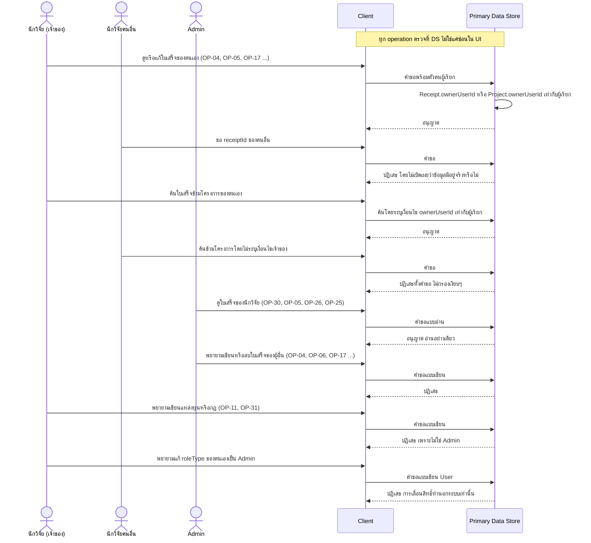
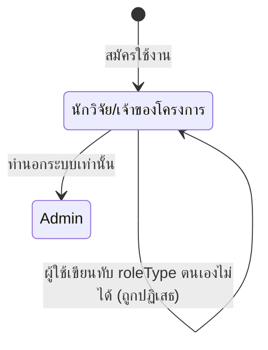

# Detailed Design — จำกัดสิทธิ์การเข้าถึงข้อมูลตามเจ้าของ (Access Control)

> การออกแบบระดับ component สำหรับ [[feature-list#9. จำกัดสิทธิ์การเข้าถึงข้อมูลตามเจ้าของ (Access Control)|ฟีเจอร์ที่ 9]]
> เป็นฟีเจอร์ cross-cutting ไม่มี operation ของตัวเอง — บังคับตาม [[api-spec]] หัวข้อ 2 กับทุก operation ที่มี `projectId`/`receiptId`
> test case: [[03-testing/01-test-plan/test-cases/access-control|access-control]]

## 0. สถานะเอกสารและสถานะการสร้าง

- **เขียนใหม่ทั้งไฟล์ 2026-11-17** — **กลับคำตัดสินใจเดิม (FR-33):** ของเดิมระบุว่า Admin เข้าถึงใบเสร็จไม่ได้เลย ตอนนี้ Admin **อ่านอย่างเดียว**ข้อมูลของทุกคน
  เขียน/แก้/ลบของผู้อื่นไม่ได้ ข้อมูลระดับองค์กร (แหล่งทุน/ระเบียบ/ชุดเอกสาร) ทุกคนที่ล็อกอินอ่านได้ เขียนได้เฉพาะ Admin
- **สถานะ: สร้างแล้ว** — บังคับที่ **Primary Data Store** (กฎสิทธิ์ของที่เก็บข้อมูลหลัก) การซ่อนเมนู Admin ที่ Client เป็นเพียงส่วนแสดงผล
- **ส่วนที่ยังไม่สร้าง:** (1) ไฟล์ในที่เก็บไฟล์ภายนอกปัจจุบัน "ใครมีลิงก์ดูได้" ปลายทางจำกัดเจ้าของ+Admin (FR-37/NFR-15 — ดู [[02-design/02-technical/detailed-design/google-drive-attachment|google-drive-attachment]])
  (2) การห้าม Client เขียน `Receipt.status`/`VerificationResult` เอง (ปลายทาง OP-34 — Backlog) (3) ไม่มีบันทึกการเข้าถึงของ Admin ต่อใบเสร็จเป็นรายการ ([[architecture]] 5.5 ข้อ 4)

## 1. ภาพรวม

ตารางสิทธิ์ (จาก [[architecture]] 2.2):

| ข้อมูล | เจ้าของ | นักวิจัยคนอื่น | Admin |
|---|---|---|---|
| โปรไฟล์ผู้ใช้ | อ่าน/เขียน (ห้ามเปลี่ยนสถานะ Admin ตนเอง) | ไม่มีสิทธิ์ | อ่านอย่างเดียว |
| โครงการ/ประมาณการ | อ่าน/เขียน | ไม่มีสิทธิ์ | อ่านอย่างเดียว |
| ใบเสร็จ/ไฟล์อ้างอิง/ผลตรวจ/agent log | อ่าน/เขียน/ลบ | ไม่มีสิทธิ์ | อ่านอย่างเดียว |
| แหล่งทุน/ระเบียบ/ชุดเอกสาร/ประเภทเอกสาร | อ่าน | อ่าน | อ่าน/เขียน |

Component: Client (ซ่อนเมนู), Primary Data Store (จุดบังคับ)

## 2. Sequence Diagram

## 3. Operation ↔ Entity ที่กระทบ (กฎต่อ entity)

| Entity | เจ้าของ | Admin | หมายเหตุ |
|---|---|---|---|
| User (E-01) | อ่าน/เขียน ยกเว้น `roleType` | อ่าน | OP-13, OP-14 เขียน `privacyConsentAcceptedAt` ไม่แตะ `roleType` |
| Project (E-03), EstimateVersion/EstimateLine (E-15/E-16) | อ่าน/เขียน (OP-18–OP-20, OP-22–OP-26) | อ่าน (OP-25, OP-26) | ตรวจ `Project.ownerUserId` |
| Receipt (E-04) | อ่าน/เขียน/ลบ (OP-04–OP-07, OP-17) | อ่าน (OP-05, OP-30) | **มี `ownerUserId` ซ้ำในระเบียน** ให้กฎสิทธิ์ตรวจได้โดยไม่ join และให้ค้นข้ามโครงการได้ |
| ReceiptFile (E-05), VerificationResult/Finding/Citation (E-08/E-23/E-09), AgentLog (E-24) | อ่าน/เขียนตามใบเสร็จ | อ่าน | ความเป็นเจ้าของอนุมานจาก Receipt |
| FundSource, RuleVersion, RuleItem, EvidenceChain, Step, StepDocument, DocumentType, Attestation (E-02, E-06, E-07, E-18–E-22) | อ่าน | อ่าน/เขียน | ไม่มีเจ้าของรายคน |
| ConsentRecord (E-11), AuditLogEntry (E-14) | ตามเจ้าของ | — | Backlog |

## 4. State Diagram

ไม่มี state diagram ของข้อมูล — ฟีเจอร์นี้เป็นกฎ ไม่ใช่วงจรชีวิตข้อมูล สถานะเดียวที่เกี่ยวข้องคือ `User.roleType` ซึ่งเปลี่ยนได้นอกระบบเท่านั้น:

## 5. Edge Case และวิธีจัดการ

| # | Edge Case | วิธีจัดการ | อ้างอิง |
|---|---|---|---|
| 1 | เรียกข้อมูลของผู้อื่นด้วยรหัสที่เดาได้ (ใบเสร็จรหัสลำดับต่อเนื่องภายในเจ้าของ) | ปฏิเสธโดยไม่เปิดเผยว่ามีอยู่ ไม่พึ่งการเดารหัสยาก | api-spec หัวข้อ 2 ข้อ 1 |
| 2 | ค้นข้ามโครงการโดยไม่ระบุเจ้าของ | ปฏิเสธทั้งคำขอ ไม่กรองเงียบ (เฉพาะ OP-30 ของ Admin ทำได้) | ข้อ 3, OP-30 |
| 3 | Admin เรียก operation ที่เขียนข้อมูลผู้อื่น | ปฏิเสธ | FR-33 |
| 4 | ผู้ใช้ทั่วไปเปิดหน้า Admin โดยตรง | ซ่อนเมนูที่ Client และปฏิเสธที่ชั้นสิทธิ์ | NFR-05 |
| 5 | ลบโครงการ/ใบเสร็จที่ Admin กำลังดูอยู่ | Admin เห็นข้อมูลล่าสุดเมื่ออ่านครั้งถัดไป ไม่มีการล็อกที่ระบุ | OP-30 |
| 6 | ผลตรวจถูกแก้จากเบราว์เซอร์ (ช่องโหว่ปัจจุบัน) | ยอมรับตามมติผสม ปิดด้วย OP-34 (Backlog) | architecture 5.4 |
| 7 | ผู้ใช้ที่ได้รับแจ้งว่า Admin อ่านข้อมูลได้ยังไม่ติ๊กยินยอม | บล็อก OP-04/อัปโหลด (OP-14) | FR-13/FR-14 |
| 8 | ผู้ที่ไม่ใช่เจ้าของเปิดลิงก์ไฟล์ใบเสร็จ | **ปัจจุบันเปิดได้ถ้ามีลิงก์** (ช่องโหว่ที่ทราบ) ปลายทางจำกัดเจ้าของ+Admin | FR-37, NFR-15 |
| 9 | Admin ดูข้อมูลแล้วไม่มีร่องรอย | ไม่มีบันทึกการเข้าถึงของ Admin รายการละเอียด (ไม่มี FR/NFR กำหนด) ถ้าต้องการต้องเสนอเป็น requirement | architecture 5.5 ข้อ 4 |

## เอกสารที่เกี่ยวข้อง

- [[feature-list#9. จำกัดสิทธิ์การเข้าถึงข้อมูลตามเจ้าของ (Access Control)|feature-list ฟีเจอร์ที่ 9]], [[architecture]] 2.2, [[api-spec]] หัวข้อ 1–2, [[db-spec]] กฎข้อ 22
- [[02-design/02-technical/detailed-design/admin-dashboard|admin-dashboard]], [[02-design/02-technical/detailed-design/consent-management|consent-management]], [[02-design/02-technical/detailed-design/google-drive-attachment|google-drive-attachment]]
