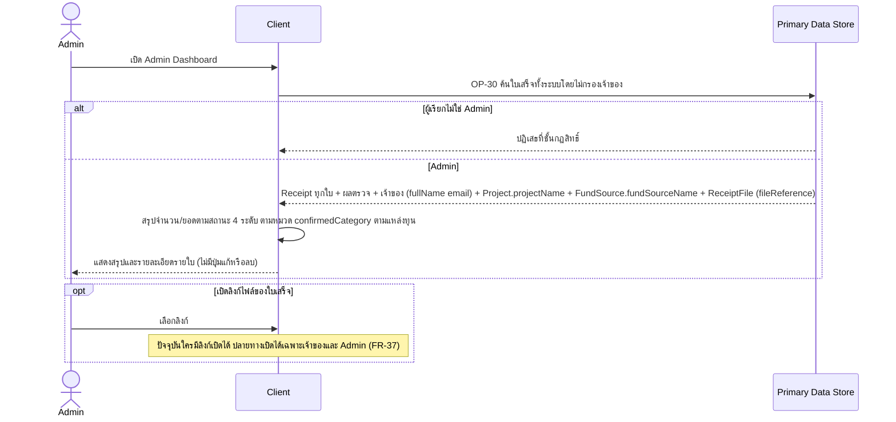
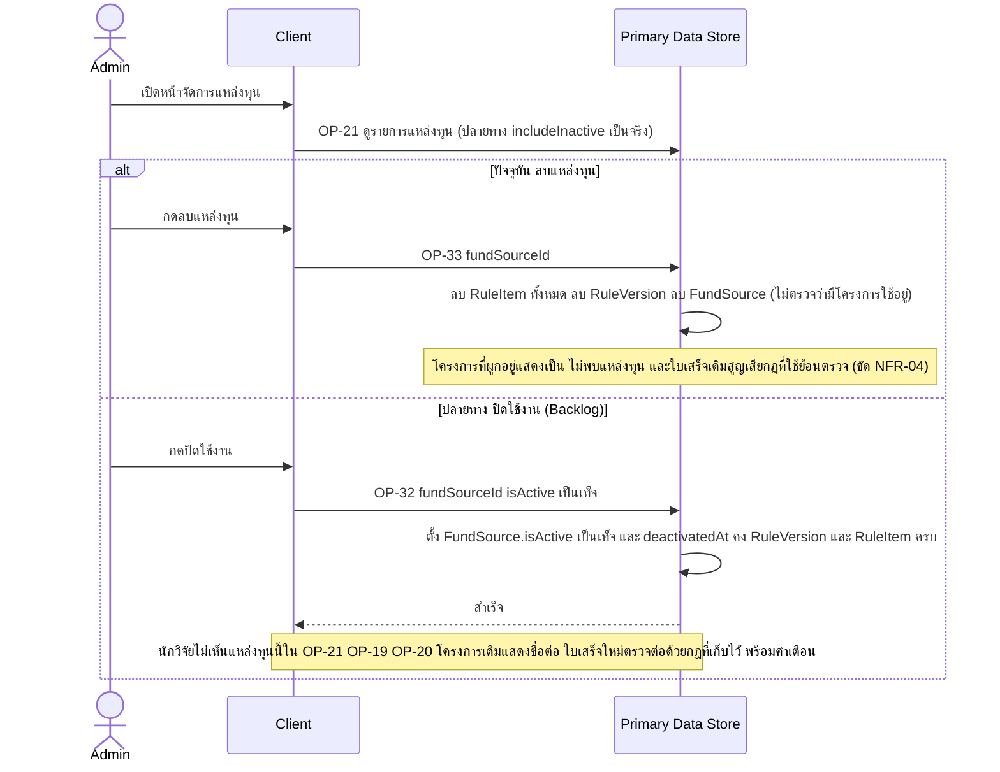
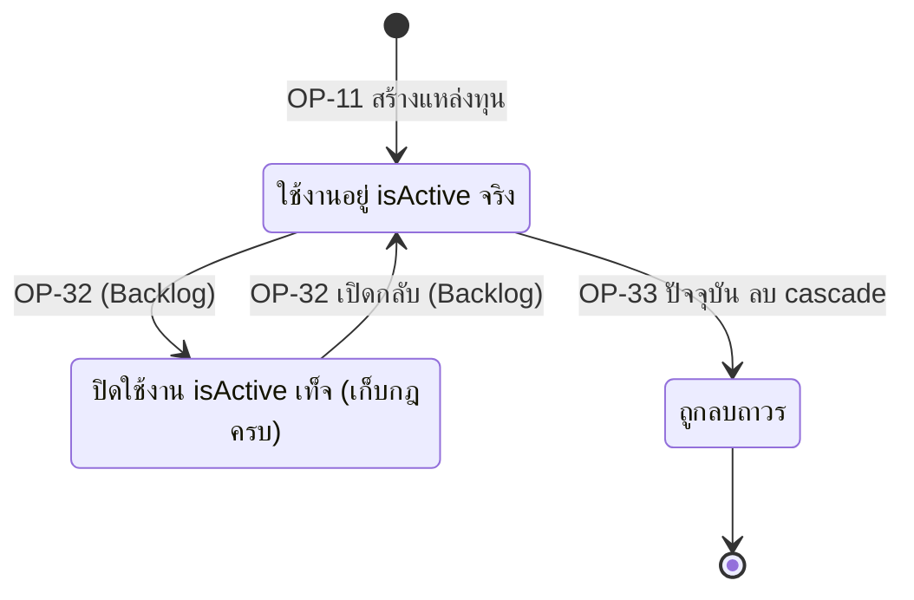

# Detailed Design — Admin Dashboard อ่านใบเสร็จทุกคนแบบอ่านอย่างเดียว และจัดการแหล่งทุน/กฎ

> การออกแบบระดับ component สำหรับ [[feature-list#22. Admin Dashboard อ่านใบเสร็จทุกคนแบบอ่านอย่างเดียว และจัดการแหล่งทุน/กฎ|ฟีเจอร์ที่ 22]]
> แปลงจาก [[user-journey#Journey 9: Admin ดูภาพรวมใบเสร็จของทุกคนผ่าน Admin Dashboard (อ่านอย่างเดียว)|Journey 9]] และ
> [[user-journey#Journey 4: Admin นำเข้า/อัปเดตระเบียบของแหล่งทุนเข้าสู่ Rule Engine|Journey 4]] (ส่วนปิดใช้งาน/ลบแหล่งทุน)
> อ้างอิง operation จริง: OP-30, OP-21, OP-33, OP-32, OP-11, OP-18 (ชื่อแหล่งทุนของโครงการ)
> test case: [[03-testing/01-test-plan/test-cases/admin-dashboard|admin-dashboard]]

## 0. สถานะเอกสารและสถานะการสร้าง

- **สร้างใหม่ 2026-11-17** ฟีเจอร์นี้เป็นผลของการ**กลับคำตัดสินใจเดิม (FR-33)** ที่ให้ Admin อ่านใบเสร็จของทุกคนได้ **แบบอ่านอย่างเดียว**

| ส่วน | Operation | สถานะ |
|---|---|---|
| ดูภาพรวมใบเสร็จของทุกคน (สรุปตามสถานะ 4 ระดับ/หมวด/แหล่งทุน + รายละเอียดรายใบพร้อมเจ้าของ) | OP-30 | **สร้างแล้ว** |
| ดูรายการแหล่งทุน | OP-21 | สร้างแล้ว |
| ลบแหล่งทุนถาวร (cascade ลบ RuleVersion/RuleItem ไม่ตรวจโครงการที่ใช้อยู่) | OP-33 | **สร้างแล้ว** (พฤติกรรมปัจจุบัน จะถูกแทนที่ด้วย OP-32) |
| ปิดใช้งาน/เปิดใช้งานแหล่งทุนแทนการลบ | OP-32 | **Backlog** (FR-35) |
| แหล่งทุนปิดใช้งาน: ใบเสร็จใหม่ **ตรวจต่อแต่เตือน** | OP-04/OP-05 | มติตัดสินแล้ว (architecture 5.5) สร้างพร้อม FR-35 |
| เพิ่ม/แก้/ลบกฎรายหมวด | OP-11 | สร้างบางส่วน (ดู [[02-design/02-technical/detailed-design/admin-rule-management\|admin-rule-management]]) |

## 1. ภาพรวม

Admin เห็นสรุปและรายละเอียดใบเสร็จของนักวิจัยทุกคน (ระบุเจ้าของ) เพื่อรายงานเชิงบริหาร **อ่านอย่างเดียว** เขียน/แก้/ลบของผู้อื่นไม่ได้ ผู้ใช้ทั่วไปไม่เห็นเมนู Admin และถูกปฏิเสธที่ชั้นกฎสิทธิ์
นักวิจัยต้องได้รับแจ้งก่อนอัปโหลดครั้งแรกว่า Admin อ่านข้อมูลได้ (OP-13/OP-14) การค้นข้ามผู้ใช้โดยไม่กรองเจ้าของทำได้เฉพาะ Admin
Component: Client (เมนู Admin ซ่อนจากผู้ใช้ทั่วไป), Primary Data Store (บังคับสิทธิ์อ่านอย่างเดียว)

## 2. Sequence Diagram

### 2.1 ดูภาพรวม (OP-30)

### 2.2 จัดการแหล่งทุน (ปัจจุบันลบถาวร / ปลายทางปิดใช้งาน)

## 3. Operation ↔ Entity ที่กระทบ

| Operation | Entity | การกระทำ | ลำดับ/เงื่อนไข |
|---|---|---|---|
| [[api-spec#OP-30 ดูภาพรวมใบเสร็จของทุกคน (Admin อ่านอย่างเดียว)\|OP-30]] | Receipt (E-04), VerificationResult (E-08), VerificationFinding (E-23), ReceiptFile (E-05), User (E-01), Project (E-03), FundSource (E-02) | **อ่านอย่างเดียว** | `Receipt.ownerUserId` ซ้ำในระเบียนให้ค้นข้ามโครงการได้โดยไม่ join |
| [[api-spec#OP-21 ดูรายการแหล่งทุน\|OP-21]] | FundSource (E-02) | อ่าน | Admin เห็นทั้งหมดเมื่อ `includeInactive` เป็นจริง (Backlog) |
| [[api-spec#OP-33 ลบแหล่งทุนถาวร (พฤติกรรมปัจจุบัน)\|OP-33]] | FundSource (E-02), RuleVersion (E-06), RuleItem (E-07) | ลบ (cascade) | ปัจจุบัน; ไม่ตรวจโครงการที่ใช้อยู่ |
| [[api-spec#OP-32 ปิดใช้งาน/เปิดใช้งานแหล่งทุน\|OP-32]] | FundSource (E-02) | แก้ `isActive`, `deactivatedAt` | Backlog; **ไม่ลบ** RuleVersion/RuleItem เปิดกลับได้เสมอ |
| [[api-spec#OP-18 ดูรายการโครงการวิจัยของตนเอง\|OP-18]] | Project, FundSource | อ่าน | โครงการที่ผูกแหล่งทุนปิดใช้งานแสดงชื่อต่อ |
| [[api-spec#OP-11 นำเข้า/แก้ไขระเบียบของแหล่งทุน (หมวด/อัตรา/ชุดเอกสาร)\|OP-11]] | FundSource, RuleVersion, RuleItem | เพิ่ม/แก้/ลบ | Admin เท่านั้น |

## 4. State Diagram — FundSource

เมื่อ OP-32 สร้างแล้ว OP-33 จะถูกแทนที่ (เส้น `active → deleted` ปัจจุบันเท่านั้น)

## 5. Edge Case และวิธีจัดการ

| # | Edge Case | วิธีจัดการ | อ้างอิง |
|---|---|---|---|
| 1 | ผู้ใช้ทั่วไปเข้าหน้า Admin | ซ่อนเมนูที่ Client และปฏิเสธที่ชั้นสิทธิ์ | NFR-05 |
| 2 | Admin พยายามเขียน/แก้/ลบใบเสร็จของผู้อื่น | ปฏิเสธ (อ่านอย่างเดียว) | FR-33 |
| 3 | นักวิจัยยังไม่ได้รับแจ้งว่า Admin อ่านข้อมูลได้ | บล็อกการส่งตรวจครั้งแรกจนกว่าจะติ๊ก (OP-14) | FR-13/14 |
| 4 | **ปัจจุบัน:** Admin ลบแหล่งทุนที่มีโครงการใช้อยู่ | ลบสำเร็จ ไม่เตือน โครงการแสดง "ไม่พบแหล่งทุน" ใบเสร็จใหม่ถูกบันทึก "ไม่เข้าเงื่อนไข" `NO_FUND_SOURCE` ใบเสร็จเดิมสูญเสียกฎที่ใช้ย้อนตรวจ (ช่องว่างที่ FR-35 ปิด) | OP-33 |
| 5 | ปลายทาง: ปิดใช้งานแหล่งทุนที่มีโครงการ | ไม่ลบอะไร โครงการแสดงชื่อต่อ นักวิจัยสร้างโครงการใหม่ผูกแหล่งทุนนี้ไม่ได้ | OP-32 |
| 6 | ปลายทาง: ใบเสร็จใหม่ในโครงการที่ผูกแหล่งทุนปิดใช้งาน | **ตรวจต่อด้วยกฎที่เก็บไว้ พร้อมคำเตือน** (ไม่บล็อก) คำเตือนคำนวณตอนแสดง ไม่เก็บ | architecture 5.5 ข้อ 1 |
| 7 | ปลายทาง: เปิดกลับ | `isActive` เป็นจริง ล้าง `deactivatedAt` ใช้ได้ทันที | OP-32 ข้อ 4 |
| 8 | ผู้ใช้ทั่วไปไม่ใช่ Admin เรียก OP-32/OP-33 | ปฏิเสธ | OP-32, OP-33 |
| 9 | ไม่มี Audit Trail การเข้าถึงของ Admin | ไม่มีบันทึกว่า Admin เปิดดูใบเสร็จใบใด (ไม่มี FR/NFR กำหนด) ถ้าต้องการต้องเสนอเป็น requirement | architecture 5.5 ข้อ 4 |
| 10 | ใบเสร็จจำนวนมาก | NFR-07 ยังไม่มีตัวเลขเป้าหมาย จึงไม่กำหนดการแบ่งหน้า/ประสิทธิภาพในเอกสารนี้ | NFR-07 |
| 11 | ใบเสร็จเก่าไม่มีข้อค้นพบ/ร่องรอย | แสดงเท่าที่มี | OP-05 |

## เอกสารที่เกี่ยวข้อง

- [[feature-list#22. Admin Dashboard อ่านใบเสร็จทุกคนแบบอ่านอย่างเดียว และจัดการแหล่งทุน/กฎ|feature-list ฟีเจอร์ที่ 22]], [[user-journey#Journey 9: Admin ดูภาพรวมใบเสร็จของทุกคนผ่าน Admin Dashboard (อ่านอย่างเดียว)|Journey 9]], [[architecture]] 3.4/5.5, [[api-spec]], [[db-spec]] กฎข้อ 21–22
- [[02-design/02-technical/detailed-design/access-control|access-control]], [[02-design/02-technical/detailed-design/admin-rule-management|admin-rule-management]], [[02-design/02-technical/detailed-design/project-setup|project-setup]],
  [[02-design/02-technical/detailed-design/google-drive-attachment|google-drive-attachment]]
