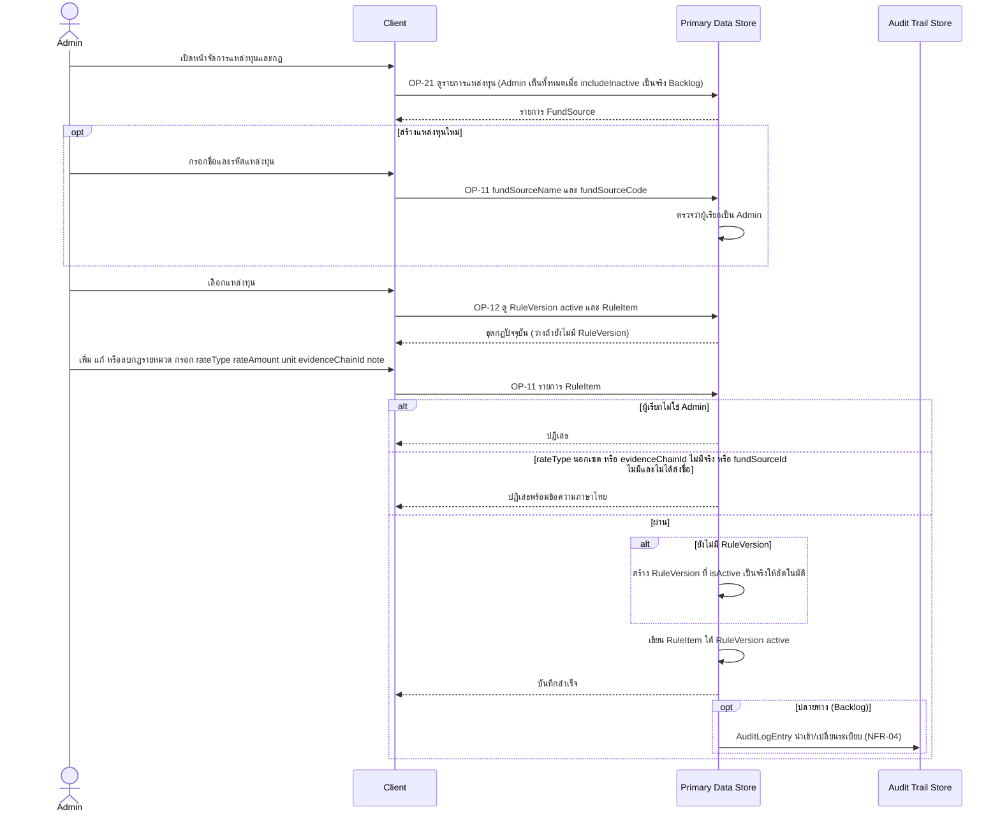
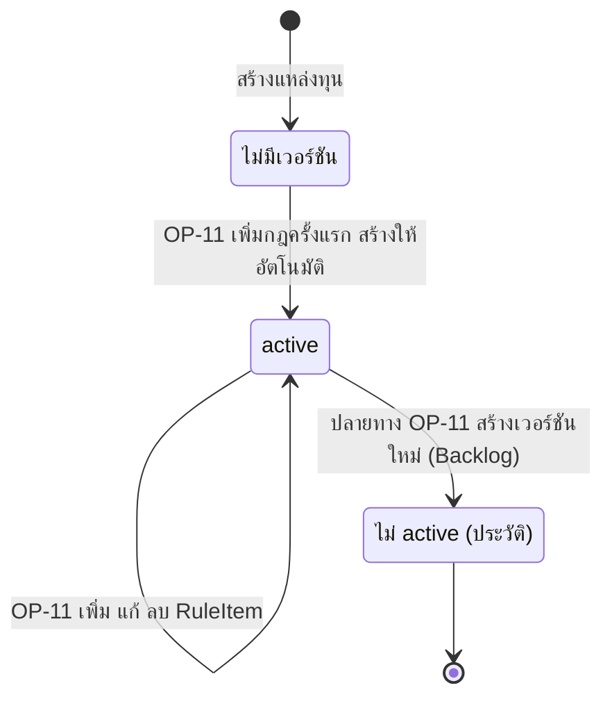

# Detailed Design — นำเข้า/อัปเดตระเบียบของแหล่งทุนเข้าสู่ Rule Engine (Admin)

> การออกแบบระดับ component สำหรับ [[feature-list#8. นำเข้า/อัปเดตระเบียบของแหล่งทุนเข้าสู่ Rule Engine (Admin)|ฟีเจอร์ที่ 8]]
> แปลงจาก [[user-journey#Journey 4: Admin นำเข้า/อัปเดตระเบียบของแหล่งทุนเข้าสู่ Rule Engine|Journey 4]]
> อ้างอิง operation จริง: OP-11, OP-12, OP-21 (ปุ่มผลักชุดกฎมาตรฐาน OP-31 อยู่ที่ [[02-design/02-technical/detailed-design/rule-set-2570|rule-set-2570]],
> ปิดใช้งาน/ลบแหล่งทุน OP-32/OP-33 อยู่ที่ [[02-design/02-technical/detailed-design/admin-dashboard|admin-dashboard]])
> test case: [[03-testing/01-test-plan/test-cases/admin-rule-management|admin-rule-management]]

## 0. สถานะเอกสารและสถานะการสร้าง

- **เขียนใหม่ทั้งไฟล์ 2026-11-17** โครงสร้างกฎเปลี่ยนจาก `maxAmount` เป็น `rateType`/`rateAmount`/`unit`/`evidenceChainId`/`note`

| Operation | สถานะ |
|---|---|
| OP-11 นำเข้า/แก้ไขระเบียบ (หมวด/อัตรา/ชุดเอกสาร) | **สร้างบางส่วน** — เพิ่ม/ลบแหล่งทุน และเพิ่ม/แก้/ลบกฎรายหมวดผ่านหน้าจอ ใต้ `RuleVersion` active ชุดเดียวที่สร้างให้อัตโนมัติ ยังไม่มี UI ประวัติเวอร์ชัน ไม่นำเข้าจากไฟล์ระเบียบโดยตรง ไม่เขียน AuditLogEntry |
| OP-12 ดูเวอร์ชันระเบียบ active | สร้างแล้ว |
| OP-21 ดูรายการแหล่งทุน | สร้างแล้ว (ตัวกรอง `includeInactive` เป็น Backlog FR-35) |

## 1. ภาพรวม

Admin จัดการระเบียบของแต่ละแหล่งทุน โดยไม่ต้อง retrain AI (กฎตัดสิน AI ไม่ตัดสิน) ผลของการเปลี่ยนกฎมีผลกับ**การตรวจครั้งถัดไป**เท่านั้น ผลตรวจเก่าเป็น snapshot
ไม่เปลี่ยน ผู้ที่ไม่ใช่ Admin ไม่เห็นเมนูและถูกปฏิเสธที่ชั้นกฎสิทธิ์ของที่เก็บข้อมูลหลัก (ไม่ใช่แค่ซ่อน UI)
Component: Client (เมนู Admin), Primary Data Store (จุดบังคับสิทธิ์), Audit Trail Store (ปลายทาง Backlog)

## 2. Sequence Diagram

## 3. Operation ↔ Entity ที่กระทบ

| Operation | Entity | การกระทำ | ลำดับ/เงื่อนไข |
|---|---|---|---|
| [[api-spec#OP-21 ดูรายการแหล่งทุน\|OP-21]] | FundSource (E-02) | อ่าน | ไม่กรองเจ้าของ นักวิจัยเห็นเฉพาะที่ใช้งานอยู่ (Backlog) |
| [[api-spec#OP-11 นำเข้า/แก้ไขระเบียบของแหล่งทุน (หมวด/อัตรา/ชุดเอกสาร)\|OP-11]] | FundSource (E-02) | สร้างใหม่ (ถ้าไม่ส่ง `fundSourceId`) | ก่อน RuleVersion |
| OP-11 | RuleVersion (E-06) | สร้างอัตโนมัติ `isActive` เป็นจริง หรือ (ปลายทาง) สร้างเวอร์ชันใหม่แล้วตั้งเวอร์ชันเดิมเป็นเท็จใน operation เดียวกัน | active ได้ 1 ต่อแหล่งทุน (db-spec กฎข้อ 7) |
| OP-11 | RuleItem (E-07) | เพิ่ม/แก้/ลบ | ตรวจ `rateType` ∈ 4 ค่า; `evidenceChainId` ต้องอ้าง EvidenceChain (E-18) ที่มีอยู่; ตัวเลขทุกตัวต้องมีที่มาใน `note` |
| OP-11 | AuditLogEntry (E-14) | สร้าง "นำเข้า/เปลี่ยนระเบียบ (NFR-04)" | **Backlog** ยังไม่มี Audit Trail Store |
| [[api-spec#OP-12 ดูเวอร์ชันระเบียบที่ active ของแหล่งทุน\|OP-12]] | RuleVersion, RuleItem, EvidenceChain/Step/StepDocument, DocumentType, Attestation | อ่าน | ทุกคนที่ล็อกอินอ่านได้ เขียนได้เฉพาะ Admin |

## 4. State Diagram — RuleVersion

ปัจจุบันไม่มีเส้น `active → old` ที่ใช้งานได้ (ไม่มี UI ประวัติเวอร์ชัน) กฎที่ Admin แก้จึงเปลี่ยนใน RuleVersion เดิม

## 5. Edge Case และวิธีจัดการ

| # | Edge Case | วิธีจัดการ | อ้างอิง |
|---|---|---|---|
| 1 | ผู้ใช้ที่ไม่ใช่ Admin เรียก OP-11 | ปฏิเสธที่ชั้นกฎสิทธิ์ เมนู Admin ไม่แสดงให้ผู้ใช้ทั่วไป | NFR-05 |
| 2 | ผู้ใช้พยายามเลื่อนตนเองเป็น Admin | ทำไม่ได้ผ่านการเขียนปกติ ทำนอกระบบเท่านั้น | api-spec หัวข้อ 2 ข้อ 5 |
| 3 | `rateType` ไม่อยู่ใน 4 ค่า | ปฏิเสธ | OP-11 |
| 4 | `ตามข้อเสนอโครงการ` ไม่มี `rateAmount` | ยอมให้ว่าง ห้ามแต่งตัวเลข ระบุที่มาใน `note` | OP-11 ข้อ 2 |
| 5 | ข้อมูลกฎเก่าที่มีแต่ `maxAmount` | ตีความเป็น "เพดานตามจริง" `rateAmount` = ค่านั้น `evidenceChainId` ว่าง | OP-11 ข้อ 4 |
| 6 | เปลี่ยนกฎขณะมีใบเสร็จรอส่งตรวจ | ใบเสร็จที่ยังไม่ส่งใช้กฎใหม่ทันที `VerificationResult` เดิมไม่เปลี่ยน | OP-11 ข้อ 5, db-spec กฎข้อ 2 |
| 7 | `fundSourceId` ไม่มีและไม่ส่งชื่อสร้างใหม่ | ปฏิเสธ | OP-11 |
| 8 | ลบ `RuleItem` ที่ผลตรวจเก่าอ้างอิงอยู่ | **ปลายทาง (Backlog):** `RuleItem` ที่ถูกอ้างอิงแล้วทำได้เฉพาะ "ปิดใช้งาน" ห้ามลบ **ปัจจุบัน:** ลบถาวรได้ ผลตรวจเก่าอาจชี้ไปกฎที่ไม่มีแล้ว (ช่องว่างที่ทราบ ขัด NFR-04) | NFR-04 |
| 9 | แหล่งทุนไม่มี RuleVersion active ตอนมีใบเสร็จส่งเข้ามา | ใบเสร็จถูกบันทึกเป็น "ไม่เข้าเงื่อนไข" `NO_ACTIVE_RULE_VERSION` ไม่บล็อก | OP-04 |

## 6. ช่องว่างที่ทราบ

- **G-5 ปิดใน spec แล้ว:** `RuleItem` ที่ถูกอ้างอิงเป็น "ปิดใช้งานเท่านั้น" (Backlog) การลบถาวรของระบบปัจจุบันเป็นช่องว่างที่ทราบ (ไม่ใช่ช่องว่างของ spec)

## เอกสารที่เกี่ยวข้อง

- [[feature-list#8. นำเข้า/อัปเดตระเบียบของแหล่งทุนเข้าสู่ Rule Engine (Admin)|feature-list ฟีเจอร์ที่ 8]], [[user-journey#Journey 4: Admin นำเข้า/อัปเดตระเบียบของแหล่งทุนเข้าสู่ Rule Engine|Journey 4]], [[architecture]] 3.4, [[api-spec]], [[db-spec]]
- [[02-design/02-technical/detailed-design/rule-set-2570|rule-set-2570]], [[02-design/02-technical/detailed-design/admin-dashboard|admin-dashboard]], [[02-design/02-technical/detailed-design/project-setup|project-setup]],
  [[02-design/02-technical/detailed-design/access-control|access-control]]
