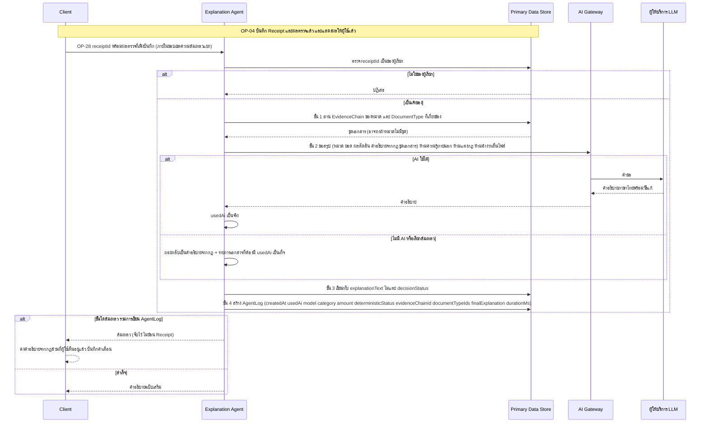
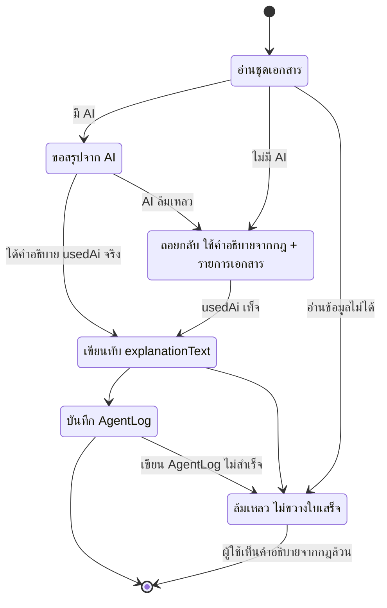

# Detailed Design — AI agent อธิบายผลจากกฎในระบบเท่านั้น พร้อมบันทึกประวัติ

> การออกแบบระดับ component สำหรับ [[feature-list#19. AI agent อธิบายผลจากกฎในระบบเท่านั้น พร้อมบันทึกประวัติ|ฟีเจอร์ที่ 19]]
> แปลงจาก [[user-journey#Journey 1: นักวิจัยอัปโหลดใบเสร็จและตรวจสอบผลจนผ่านเกณฑ์|Journey 1]] (ขั้นหลังกฎตัดสิน)
> อ้างอิง operation จริง: OP-28 (เรียกต่อจาก OP-04), OP-05 (ดูผล), OP-39 (ถ้าเลือกเส้นทางผ่านตัวกลาง)
> test case: [[03-testing/01-test-plan/test-cases/ai-agent-explanation|ai-agent-explanation]]

## 0. สถานะเอกสารและสถานะการสร้าง

- **สร้างใหม่ 2026-11-17**

| ส่วน | Operation | สถานะ |
|---|---|---|
| Explanation Agent อ่านชุดเอกสาร → AI สรุป → เขียนทับคำอธิบาย → บันทึก AgentLog | OP-28 | **สร้างแล้ว** |
| ถอยกลับเป็นคำอธิบายจากกฎ + รายการเอกสารที่ต้องมี เมื่อไม่มี AI | OP-28 | สร้างแล้ว |
| **ช่องว่างที่ทราบ (FR-18):** ปุ่มลบใบเสร็จไม่ลบ `AgentLog` | OP-17 | สร้างบางส่วน ดู [[02-design/02-technical/detailed-design/right-to-erasure\|right-to-erasure]] |
| เรียก agent หลังส่งตรวจซ้ำ | OP-06 | **Backlog** ตัดสินแล้ว: เรียก agent ซ้ำหลังส่งตรวจซ้ำ ([[02-design/02-technical/detailed-design/resubmit-failed-receipt\|resubmit-failed-receipt]]) |

## 1. ภาพรวม

ผลตัดสินเสร็จแล้วโดย Rule Engine (OP-04) agent **ไม่ตัดสิน และไม่เปลี่ยน `decisionStatus`/`Receipt.status`** มี 4 ขั้น: (1) อ่านชุดเอกสารของหมวดและประเภทเอกสารที่เกี่ยวข้องจากที่เก็บข้อมูล
(2) ให้ AI สรุปเป็นภาษาไทยพร้อมวิธีแก้ (3) เขียนทับ `VerificationResult.explanationText` (4) บันทึก `AgentLog` **ทุกครั้ง** (ใช้ AI หรือถอยกลับก็ตาม)
ข้อห้ามใน prompt: ห้ามใช้ความรู้ภายนอก ห้ามแต่งกฎ/เอกสาร ห้ามอ้างว่าเห็นหรือตรวจไฟล์ที่แนบ (agent ไม่ได้รับไฟล์) ข้อมูลที่ส่งให้ AI มีเฉพาะ หมวด/ยอด ผลตัดสินและคำอธิบายจากกฎ และชุดเอกสาร/ประเภทเอกสาร
**ความล้มเหลวทั้งหมดของ agent แยกขอบเขตจากการบันทึกใบเสร็จ** ไม่ย้อนและไม่ขวางใบเสร็จที่บันทึกสำเร็จแล้ว
Component: Client, Explanation Agent, AI Gateway, Primary Data Store (และ AI Key Proxy / LLM ตามเส้นทาง)

## 2. Sequence Diagram

## 3. Operation ↔ Entity ที่กระทบ

| Operation | Entity | การกระทำ | ลำดับ/เงื่อนไข |
|---|---|---|---|
| [[api-spec#OP-28 อธิบายผลด้วย AI agent และบันทึกประวัติการทำงาน\|OP-28]] | Receipt (E-04) | อ่านตรวจเจ้าของ | ก่อน |
| OP-28 | RuleItem (E-07), EvidenceChain (E-18), EvidenceChainStep (E-19), EvidenceChainStepDocument (E-20), DocumentType (E-21), Attestation (E-22) | อ่าน | ขั้น 1 เฉพาะที่ผูกกับหมวดของใบเสร็จ |
| OP-28 | VerificationResult (E-08) | แก้เฉพาะ `explanationText` | ขั้น 3 เป็นฟิลด์เดียวที่แก้ได้หลังบันทึก (db-spec กฎข้อ 3) |
| OP-28 | AgentLog (E-24) | สร้าง 1 record ต่อครั้ง append-only | ขั้น 4 ผูกกับ `receiptId` ไม่ผูกผลตรวจ |
| [[api-spec#OP-05 ดูรายละเอียดผลตรวจใบเสร็จ\|OP-05]] | VerificationResult | อ่าน `explanationText` ล่าสุด | Admin อ่านอย่างเดียว (รวม AgentLog ตามกฎ Admin) |
| [[api-spec#OP-39 ส่งต่อคำขอ AI ผ่านตัวกลางถือคีย์\|OP-39]] | ไม่มี | ส่งต่อคำขอ | เฉพาะเส้นทางผ่านตัวกลาง |

## 4. State Diagram — การทำงานของ agent หนึ่งรอบ

ไม่มีสถานะของข้อมูลที่เปลี่ยนนอกเหนือจาก `explanationText` แผนภาพคือวงจรของรอบการทำงาน

## 5. Edge Case และวิธีจัดการ

| # | Edge Case | วิธีจัดการ | อ้างอิง |
|---|---|---|---|
| 1 | ไม่มี AI / AI ล้มเหลว | ถอยกลับเป็นคำอธิบายจากกฎ + รายการเอกสารที่ต้องมี `usedAi` เท็จ ยังบันทึก AgentLog | OP-28 ข้อ 2 |
| 2 | หมวดไม่มีชุดเอกสาร | ชุดเอกสารว่าง agent อธิบายจากผลกฎอย่างเดียว | OP-28 |
| 3 | AI พยายามเปลี่ยนสถานะ/อ้างว่าตรวจไฟล์ | ห้ามโดยข้อมูลที่ส่งและ prompt agent ไม่ได้รับไฟล์ สถานะไม่ถูกแก้โดย operation นี้ (เขียนเฉพาะ `explanationText`) | OP-28 ข้อ 1, 3 |
| 4 | AI แต่งกฎ/เอกสารนอกระบบ | ป้องกันเชิงโครงสร้าง: ข้อมูลที่ให้มาจากที่เก็บข้อมูลเท่านั้น ห้ามความรู้ภายนอก — ไม่มีตัวตรวจผลลัพธ์ของ AI ซ้ำ (ผู้ใช้เห็นข้ออ้างอิงจากกฎควบคู่) | FR-31 |
| 5 | เขียน AgentLog ไม่สำเร็จ | ไม่ย้อนและไม่ขวางใบเสร็จ ผู้ใช้เห็นคำอธิบายจากกฎล้วน | OP-28 ข้อ 4 |
| 6 | `receiptId` ไม่ใช่ของผู้เรียก | ปฏิเสธ | OP-28 |
| 7 | AgentLog ตกค้างเมื่อลบใบเสร็จ | ช่องว่างที่ทราบ (ปุ่มลบปัจจุบันไม่ลบ AgentLog) | db-spec 5.6 |
| 8 | ถอนความยินยอม | OP-35 ลบ AgentLog ด้วย | OP-35 |
| 9 | Admin ดู AgentLog | อ่านอย่างเดียว | FR-33 |
| 10 | ส่งผลตรวจซ้ำ (Backlog) | **ตัดสินแล้ว (Q-4):** agent ทำงานอีกครั้ง AgentLog รอบใหม่แยกด้วย `createdAt` รอบล่าสุดคือปัจจุบัน | OP-28, OP-06 |
| 11 | agent รันเมื่อ `explanationText` ถูกเขียนทับไปแล้ว | เขียนทับได้ แต่ละรอบเพิ่ม AgentLog 1 record (append-only) | db-spec E-24 |

## เอกสารที่เกี่ยวข้อง

- [[feature-list#19. AI agent อธิบายผลจากกฎในระบบเท่านั้น พร้อมบันทึกประวัติ|feature-list ฟีเจอร์ที่ 19]], [[user-journey#Journey 1: นักวิจัยอัปโหลดใบเสร็จและตรวจสอบผลจนผ่านเกณฑ์|Journey 1]], [[architecture]] 2.1, [[api-spec]], [[db-spec]] กฎข้อ 3/18
- [[02-design/02-technical/detailed-design/rule-engine-verification|rule-engine-verification]], [[02-design/02-technical/detailed-design/ai-ocr-receipt-reading|ai-ocr-receipt-reading]], [[02-design/02-technical/detailed-design/evidence-chain-check|evidence-chain-check]]
