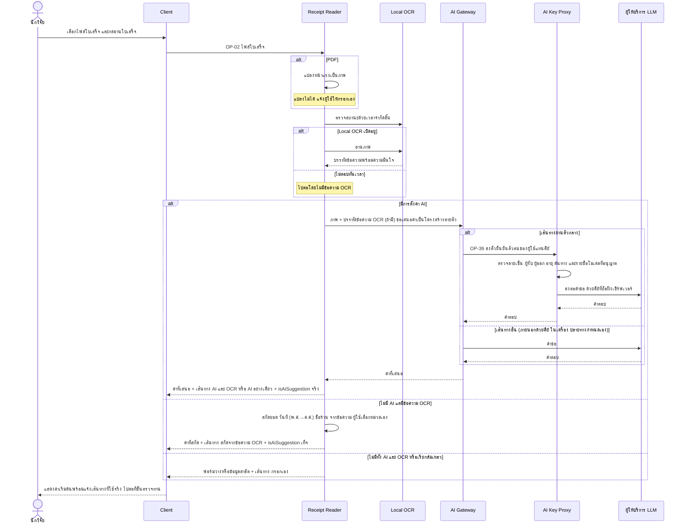
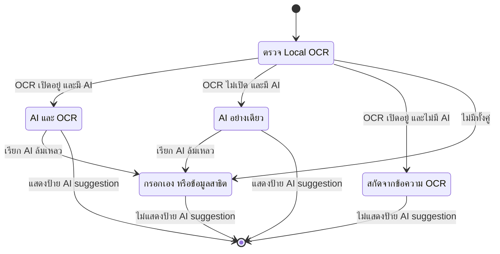

# Detailed Design — อ่านใบเสร็จด้วย AI และ OCR ภาษาไทยในเครื่อง

> การออกแบบระดับ component สำหรับ [[feature-list#17. อ่านใบเสร็จด้วย AI และ OCR ภาษาไทยในเครื่อง|ฟีเจอร์ที่ 17]]
> แปลงจาก [[user-journey#Journey 1: นักวิจัยอัปโหลดใบเสร็จและตรวจสอบผลจนผ่านเกณฑ์|Journey 1]] (ขั้นอ่านใบเสร็จ)
> อ้างอิง operation จริง: OP-02, OP-39
> test case: [[03-testing/01-test-plan/test-cases/ai-ocr-receipt-reading|ai-ocr-receipt-reading]]

## 0. สถานะเอกสารและสถานะการสร้าง

- **สร้างใหม่ 2026-11-17**

| ส่วน | Operation/Component | สถานะ |
|---|---|---|
| อ่านใบเสร็จเพื่อเสนอค่า ยอด วันที่ หมวด ชื่อร้าน | OP-02 (Receipt Reader) | สร้างแล้ว |
| OCR ภาษาไทยในเครื่อง | Local OCR | สร้างแล้ว (ทางเลือก ผู้ใช้ต้องเปิดเอง) |
| สลับผู้ให้บริการ AI 4 รูปแบบเชิงบทบาท | AI Gateway | สร้างแล้ว |
| ส่งต่อคำขอ AI ผ่านตัวกลางถือคีย์ | OP-39 (AI Key Proxy) | **สร้างบางส่วน** — เขียนและทดสอบแล้ว **ยังไม่ deploy** คีย์ที่ใช้อยู่ปัจจุบันเป็นของคลาสเท่านั้น |
| บันทึกค่าที่เสนอ | — | **ไม่บันทึก** (db-spec กฎข้อ 1: เก็บเฉพาะค่าที่ผู้ใช้ยืนยัน) |

## 1. ภาพรวม

Receipt Reader รับไฟล์ (ภาพ หรือ PDF หน้าแรกแปลงเป็นภาพ) แล้วเสนอ `confirmedAmount`, `confirmedDate` (แปลงพ.ศ.→ค.ศ.), `confirmedCategory`, `confirmedVendorName` เป็น**ค่าเริ่มต้นของฟอร์มตรวจทาน**เท่านั้น
AI **ไม่ตัดสินสถานะ** ผู้ใช้แก้ได้ทุกค่า (FR-03) ป้าย "AI suggestion" แสดงเฉพาะเมื่อ AI ทำงานจริง และต้องแจ้งเส้นทางที่ใช้จริงเสมอ
ผู้ให้บริการ AI สลับได้ 4 รูปแบบเชิงบทบาท: ภายนอกด้วยคีย์ / ในเครื่อง / ผ่านตัวกลางถือคีย์ (ส่งตั๋วยืนยันตัวตนผู้ใช้แทนคีย์) / ปลายทางกำหนดเอง
Component: Client, Receipt Reader, Local OCR, AI Gateway, AI Key Proxy, External LLM Provider / LLM ในเครื่อง

## 2. Sequence Diagram

## 3. Operation ↔ Entity ที่กระทบ

| Operation | Entity | การกระทำ | ลำดับ/เงื่อนไข |
|---|---|---|---|
| [[api-spec#OP-02 อ่านใบเสร็จด้วย AI/OCR เพื่อเสนอค่า\|OP-02]] | ไม่มี | ไม่อ่านไม่เขียนที่เก็บข้อมูลหลัก ผลเป็นค่าชั่วคราวบนหน้าจอ | ก่อนขั้นตรวจทาน; ไฟล์/ค่าที่ AI อ่านไม่ถูกบันทึกในใบเสร็จ |
| [[api-spec#OP-39 ส่งต่อคำขอ AI ผ่านตัวกลางถือคีย์\|OP-39]] | ไม่มี (ไม่เก็บข้อมูลใบเสร็จ) | ส่งต่อคำขอ ตรวจตั๋ว | เฉพาะเส้นทางผ่านตัวกลาง สถานะสร้างบางส่วน |
| (ถัดไป) [[api-spec#OP-04 ยืนยันข้อมูลใบเสร็จ ส่งตรวจ และบันทึกใบเสร็จ\|OP-04]] | Receipt (E-04) | สร้างด้วยค่าที่ผู้ใช้**ยืนยัน** | ไม่มี `ocr*` ในโมเดล |

## 4. State Diagram — เส้นทางการอ่านที่เลือกใช้ (สถานะชั่วคราวบนหน้าจอ ไม่บันทึก)

หมายเหตุ: ในกรณี `aiOcr` ล้มเหลว api-spec ระบุเพียง "ถอยกลับเป็นกรอกเอง/ข้อมูลสาธิต" แผนภาพจึงไม่ใส่ทางถอยไป `ocrOnly` เพื่อไม่เกินกว่าที่ spec กำหนด

## 5. Edge Case และวิธีจัดการ

| # | Edge Case | วิธีจัดการ | อ้างอิง |
|---|---|---|---|
| 1 | ไม่ได้ตั้งค่า AI หรือ AI/OCR เรียกล้มเหลว | ถอยกลับเป็นกรอกเอง/ข้อมูลสาธิตพร้อมแจ้งเส้นทางที่ใช้ ไม่ขวาง flow | OP-02 ข้อ 3 |
| 2 | PDF แปลงเป็นภาพไม่ได้ | แจ้งผู้ใช้ให้กรอกเอง | OP-02 |
| 3 | OCR ภาษาไทยตกวรรณยุกต์ | ผู้ใช้ตรวจแก้ทุกค่าเสมอ ข้อความ OCR ที่ความมั่นใจต่ำถูกทำเครื่องหมายก่อนส่ง AI | OP-02 ข้อ 5 |
| 4 | ค่าที่อ่านไม่ได้ | ปล่อยว่าง ไม่เดา | OP-02 |
| 5 | AI เสนอค่าที่ผิดหรือเสนอหมวดที่ไม่อยู่ในกฎ | ผู้ใช้แก้ได้ หมวดที่ไม่อยู่ในกฎได้ผล "ไม่เข้าเงื่อนไข" ตอนส่งตรวจ AI ไม่ตัดสินสถานะ | FR-03, OP-04 |
| 6 | ป้าย "AI suggestion" | แสดงเฉพาะเมื่อ AI ทำงานจริง ไม่ติดป้ายให้เส้นทางสกัดเอง/ข้อมูลสาธิต | OP-02 |
| 7 | ความเป็นส่วนตัว | เส้นทางที่ประมวลผลในเครื่องไม่ส่งใบเสร็จออกนอกเครื่อง ผู้ให้บริการภายนอกต้องผ่านมาตรการ NFR-08/NFR-09 | NFR-14 |
| 8 | ตั๋วยืนยันตัวตนไม่ถูกต้อง/หมดอายุ (เส้นทางตัวกลาง) | ตัวกลางปฏิเสธ AI Gateway ได้ความล้มเหลว Receipt Reader ถอยกลับตามข้อ 1 | OP-39 |
| 9 | ต้นทางหรือโมเดลไม่อยู่ในรายการอนุญาตของตัวกลาง | ปฏิเสธ ผลเหมือนข้อ 8 | OP-39 |
| 10 | คีย์ AI ฝั่ง Client | เส้นทางด้วยคีย์ตรง ปัจจุบันเป็นคีย์ของคลาสเท่านั้น และถูกเปิดเผยฝั่ง Client ได้ — ปิดช่องด้วยการ deploy ตัวกลาง (NFR-12 สร้างบางส่วน) | NFR-12 |
| 11 | ผู้ให้บริการ AI ล้มเหลวหลังใบเสร็จถูกบันทึกแล้ว | ไม่เกี่ยว OP-02 อยู่ก่อนบันทึก ความล้มเหลวของ agent อธิบายผลแยกที่ [[02-design/02-technical/detailed-design/ai-agent-explanation\|ai-agent-explanation]] | OP-28 |

## เอกสารที่เกี่ยวข้อง

- [[feature-list#17. อ่านใบเสร็จด้วย AI และ OCR ภาษาไทยในเครื่อง|feature-list ฟีเจอร์ที่ 17]], [[user-journey#Journey 1: นักวิจัยอัปโหลดใบเสร็จและตรวจสอบผลจนผ่านเกณฑ์|Journey 1]], [[architecture]] 2.1, [[api-spec]], [[db-spec]] กฎข้อ 1/18
- [[02-design/02-technical/detailed-design/receipt-upload-ocr|receipt-upload-ocr]], [[02-design/02-technical/detailed-design/review-edit-ocr-data|review-edit-ocr-data]], [[02-design/02-technical/detailed-design/thesis-evaluation-harness|thesis-evaluation-harness]] (ใช้ AI Gateway ตัวเดียวกัน)
