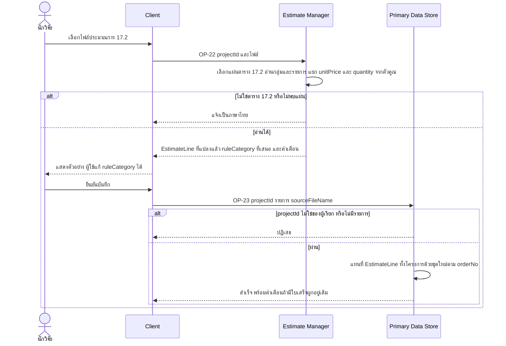
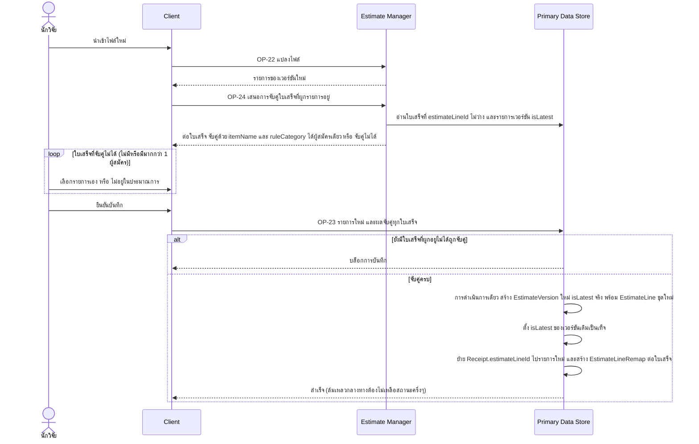
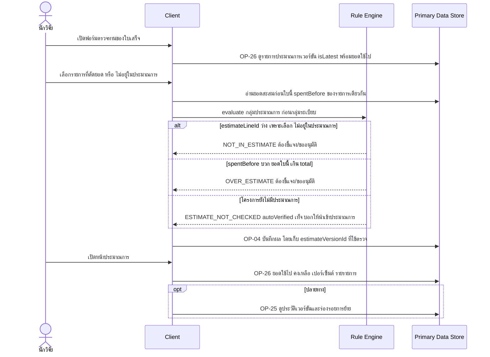
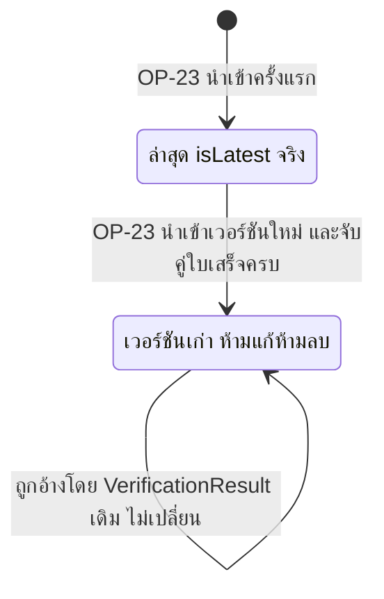
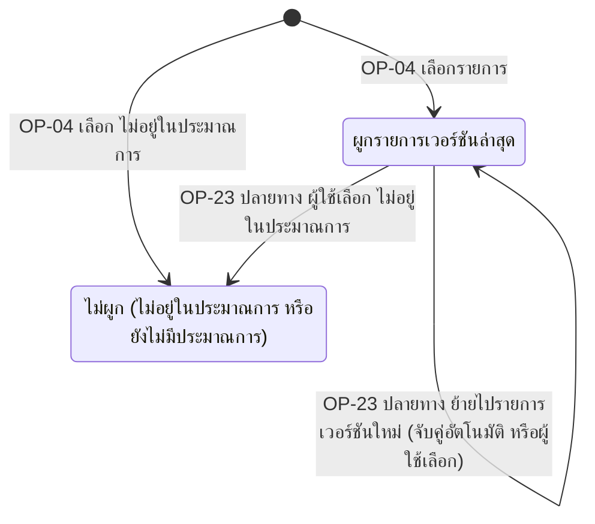

# Detailed Design — นำเข้าประมาณการโครงการ (ตาราง 17.2) และตรวจกับประมาณการ

> การออกแบบระดับ component สำหรับ [[feature-list#14. นำเข้าประมาณการโครงการ (ตาราง 17.2) และตรวจกับประมาณการ|ฟีเจอร์ที่ 14]]
> แปลงจาก [[user-journey#Journey 8: นักวิจัยติดตามยอดใช้ไป/คงเหลือตามประมาณการของโครงการ|Journey 8]] และขั้นนำเข้าประมาณการใน
> [[user-journey#Journey 1: นักวิจัยอัปโหลดใบเสร็จและตรวจสอบผลจนผ่านเกณฑ์|Journey 1]]
> อ้างอิง operation จริง: OP-22, OP-23, OP-24, OP-25, OP-26 และกลุ่ม "ประมาณการ" ของ OP-04
> test case: [[03-testing/01-test-plan/test-cases/budget-estimate-check|budget-estimate-check]]

## 0. สถานะเอกสารและสถานะการสร้าง

- **สร้างใหม่ 2026-11-17** (ฟีเจอร์ที่ 14 เพิ่งเพิ่มเข้า feature-list)

| ส่วน | Operation | สถานะ |
|---|---|---|
| แปลงไฟล์ประมาณการ 17.2 ดูตัวอย่าง (ไม่บันทึก) | OP-22 | สร้างแล้ว |
| บันทึกประมาณการ | OP-23 | สร้างแล้ว แบบ**แทนที่ทั้งชุด** (ใบเสร็จที่ผูกอยู่อาจผูกผิดรายการ ระบบเตือนเท่านั้น) |
| ดูยอดใช้ไป/คงเหลือ/% รายรายการ | OP-26 | สร้างแล้ว |
| ตรวจ "ไม่อยู่ในประมาณการ"/เกิน 100%/อัตรา×จำนวน ตอนส่งตรวจ | OP-04 (Rule Engine) | สร้างแล้ว |
| เก็บเวอร์ชันประมาณการ (สำเนาทั้งชุดต่อเวอร์ชัน) + `EstimateVersion` | OP-23 ปลายทาง | **Backlog** (FR-36) |
| เสนอจับคู่ใบเสร็จเดิมกับรายการเวอร์ชันใหม่ | OP-24 | **Backlog** (FR-36) |
| ดูประวัติเวอร์ชัน | OP-25 | **Backlog** (FR-36) |
| EstimateLineRemap (E-17) | — | **Backlog** |

## 1. ภาพรวม

การเงินตรวจใบเสร็จกับประมาณการที่อนุมัติก่อน แล้วจึงตรวจกับระเบียบ ขั้นตอน: (1) นำเข้า (2) ตัดยอดตอนส่งตรวจ (3) ติดตามยอด
- **ฐานตรวจ:** `EstimateLine.total` ทั้งโครงการ (ไม่ใช่รายงวด) เกินเมื่อ `spentBefore + confirmedAmount` มากกว่า 100% → "ต้องชี้แจง/ขออนุมัติ"
- **อัตรา×จำนวน:** ถ้ารายการมี `quantity` เพดานระเบียบ = `RuleItem.rateAmount` × `quantity`
- **ปลายทาง (FR-36):** นำเข้าซ้ำสร้างเวอร์ชันใหม่ ใบเสร็จอ้างรายการของเวอร์ชัน `isLatest` ผลตรวจเก็บ `estimateVersionId` ที่ใช้ตอนตรวจ

Component: Client, Estimate Manager, Rule Engine, Primary Data Store

## 2. Sequence Diagram

### 2.1 นำเข้าและบันทึก (พฤติกรรมปัจจุบัน — แทนที่ทั้งชุด)

### 2.2 นำเข้าซ้ำแบบเก็บเวอร์ชัน (ปลายทาง Backlog FR-36)

### 2.3 ตัดยอดตอนส่งตรวจและติดตามยอด

## 3. Operation ↔ Entity ที่กระทบ

| Operation | Entity | การกระทำ | ลำดับ/เงื่อนไข |
|---|---|---|---|
| [[api-spec#OP-22 นำเข้าและแปลงไฟล์ประมาณการ 17.2 (ดูตัวอย่างก่อนบันทึก)\|OP-22]] | Project (E-03) | อ่านตรวจเจ้าของ | ไม่บันทึกข้อมูล ผลเป็นรายการ `EstimateLine` ชั่วคราวบนหน้าจอ |
| [[api-spec#OP-23 บันทึกประมาณการของโครงการ\|OP-23]] | EstimateLine (E-16) | แทนที่ทั้งชุด (ปัจจุบัน) | ตาม `orderNo` |
| OP-23 (ปลายทาง) | EstimateVersion (E-15) | สร้างเวอร์ชันใหม่ `isLatest` จริง ตั้งเวอร์ชันเดิมเป็นเท็จ | active ได้ 1 ต่อโครงการ (db-spec กฎข้อ 13) |
| OP-23 (ปลายทาง) | Receipt (E-04), EstimateLineRemap (E-17) | แก้ `estimateLineId` + สร้างร่องรอย | บล็อกจนจับคู่ครบ ทำเป็นการดำเนินการเดียว |
| [[api-spec#OP-24 เสนอการจับคู่ใบเสร็จเดิมกับรายการของเวอร์ชันใหม่\|OP-24]] | Receipt, EstimateLine | อ่านอย่างเดียว | Backlog จับคู่ด้วย `itemName` + `ruleCategory` ไม่ใช้ลำดับแถว |
| [[api-spec#OP-25 ดูประวัติเวอร์ชันประมาณการ\|OP-25]] | EstimateVersion, EstimateLine, VerificationResult (นับตาม `estimateVersionId`), EstimateLineRemap | อ่าน | Backlog; Admin อ่านอย่างเดียว |
| [[api-spec#OP-26 ดูสรุปยอดใช้ไป/คงเหลือ/% รายรายการ\|OP-26]] | EstimateLine (เวอร์ชัน `isLatest`), Receipt (`confirmedAmount`, `estimateLineId`) | อ่าน | ยอดใช้ไป = ผลรวม `confirmedAmount` ของใบเสร็จที่ตัดรายการนั้น |
| [[api-spec#OP-04 ยืนยันข้อมูลใบเสร็จ ส่งตรวจ และบันทึกใบเสร็จ\|OP-04]] | Receipt, VerificationResult (`estimateVersionId`), VerificationFinding (กลุ่ม "ประมาณการ") | อ่าน/สร้าง | กลุ่มประมาณการตรวจก่อนกลุ่มอื่น |

## 4. State Diagram

### 4.1 EstimateVersion (ปลายทาง FR-36 — ปัจจุบันมีเวอร์ชันล่าสุดเวอร์ชันเดียวไม่มีประวัติ)

### 4.2 การผูกใบเสร็จกับประมาณการ (Receipt.estimateLineId)

## 5. Edge Case และวิธีจัดการ

| # | Edge Case | วิธีจัดการ | อ้างอิง |
|---|---|---|---|
| 1 | ไฟล์ไม่ใช่ตาราง 17.2 / ไม่พบแผ่น | แจ้งภาษาไทย ไม่บันทึก | OP-22 |
| 2 | ผลรวมงวด ≠ `total` หรือ `unitPrice × quantity` ≠ `total` | เตือนตอนนำเข้า บันทึกได้ ผู้ใช้ตรวจเอง | OP-22 ข้อ 3 |
| 3 | ช่องตัวคูณว่าง/ไม่มีรูปแบบคูณ | `unitPrice`/`quantity` ว่าง บันทึกได้ แต่ตรวจอัตรา×จำนวนไม่ได้จนกว่านำเข้าใหม่ ผลตรวจบอกให้อัปโหลดใหม่พร้อมจำนวนหน่วย | OP-23 ข้อ 5 |
| 4 | ไม่มีรายการเลยในชุดที่บันทึก | ปฏิเสธ | OP-23 |
| 5 | `projectId` ไม่ใช่ของผู้เรียก / Admin พยายามบันทึก | ปฏิเสธ (Admin อ่านอย่างเดียว) | หัวข้อ 2 ของ api-spec |
| 6 | **นำเข้าซ้ำขณะมีใบเสร็จผูกอยู่ (ปัจจุบัน)** | แทนที่ทั้งชุด ใบเสร็จเก่าอาจผูกผิดรายการ ระบบเตือนเท่านั้น (ช่องว่างที่ FR-36 มีไว้ปิด) | OP-23, OP-26 |
| 7 | **นำเข้าซ้ำ (ปลายทาง)** จับคู่ไม่ได้ (ไม่มีหรือมากกว่า 1 ผู้สมัคร) | ผู้ใช้เลือกรายการเองหรือ "ไม่อยู่ในประมาณการ" บล็อกการบันทึกจนครบ | OP-24, OP-23 |
| 8 | ปลายทาง: การย้ายล้มเหลวกลางทาง | ต้องไม่เหลือสถานะครึ่งๆ (สร้างเวอร์ชัน+ย้าย+Remap เป็นการดำเนินการเดียว) | OP-23 ข้อ 4 |
| 9 | ผลตรวจเก่าหลังนำเข้าเวอร์ชันใหม่ | ไม่เปลี่ยน ยังชี้ `estimateVersionId` เดิม (snapshot) | db-spec กฎข้อ 2, 14 |
| 10 | ยอดสะสมเกิน 100% ของ `total` | "ต้องชี้แจง/ขออนุมัติ" `OVER_ESTIMATE` การชี้แจงเกิดนอกระบบ | OP-04 |
| 11 | ผู้ใช้เลือก "ไม่อยู่ในประมาณการ" | บันทึก `estimateLineId` ว่าง ผล `NOT_IN_ESTIMATE` | OP-04 |
| 12 | โครงการมีประมาณการแต่ไม่เลือกรายการเลย | OP-04 ปฏิเสธพร้อมให้เลือก | OP-04 |
| 13 | ลบใบเสร็จที่ตัดยอด | ยอดใช้ไป/คงเหลือคำนวณใหม่จากใบเสร็จที่เหลือ | OP-17 |
| 14 | ถอนความยินยอม | ประมาณการไม่ถูกลบ (เป็นข้อมูลโครงการ) | db-spec 5.6 ข้อ 5 |

## เอกสารที่เกี่ยวข้อง

- [[feature-list#14. นำเข้าประมาณการโครงการ (ตาราง 17.2) และตรวจกับประมาณการ|feature-list ฟีเจอร์ที่ 14]], [[user-journey#Journey 8: นักวิจัยติดตามยอดใช้ไป/คงเหลือตามประมาณการของโครงการ|Journey 8]], [[architecture]] 3.6, [[api-spec]], [[db-spec]] กฎข้อ 13–14, 17
- [[02-design/02-technical/detailed-design/rule-engine-pure-module|rule-engine-pure-module]], [[02-design/02-technical/detailed-design/rule-engine-verification|rule-engine-verification]], [[02-design/02-technical/detailed-design/review-edit-ocr-data|review-edit-ocr-data]]
