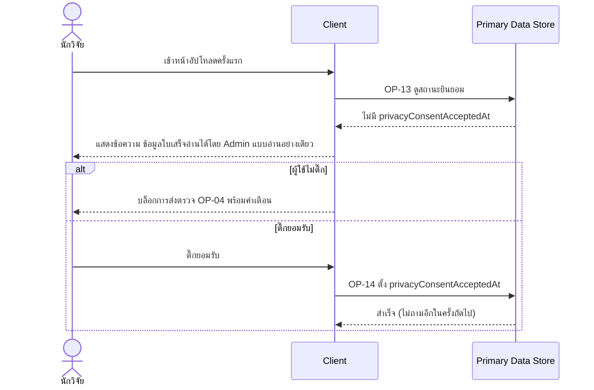
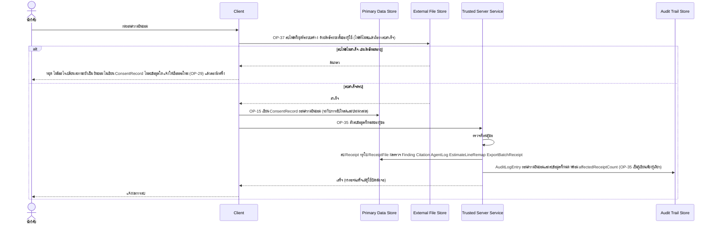
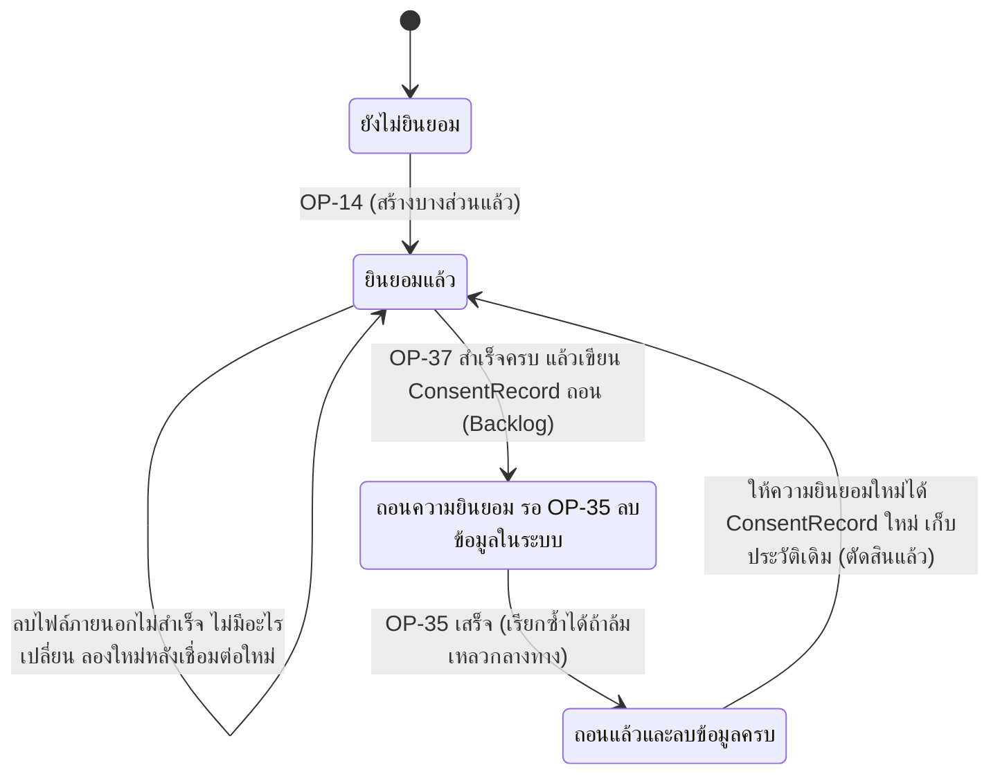

# Detailed Design — แจ้ง Privacy Notice และจัดการความยินยอม (Consent Management)

> การออกแบบระดับ component สำหรับ [[feature-list#10. แจ้ง Privacy Notice และจัดการความยินยอม (Consent Management)|ฟีเจอร์ที่ 10]]
> แปลงจาก [[user-journey#Journey 1: นักวิจัยอัปโหลดใบเสร็จและตรวจสอบผลจนผ่านเกณฑ์|Journey 1 (ยินยอม)]] และ
> [[user-journey#Journey 5: นักวิจัยถอนความยินยอม (Withdraw Consent) และผลกระทบต่อการใช้งานระบบ|Journey 5 (ถอนความยินยอม)]]
> อ้างอิง operation จริง: OP-13, OP-14, OP-15, OP-35, OP-37 (และ OP-29 สำหรับเชื่อมต่อใหม่)
> test case: [[03-testing/01-test-plan/test-cases/consent-management|consent-management]]

## 0. สถานะเอกสารและสถานะการสร้าง

- **เขียนใหม่ทั้งไฟล์ 2026-11-17** ตามมติสถาปัตยกรรมผสม และ FR-37 (ลบไฟล์ภายนอกก่อนลบข้อมูล)

| ส่วน | Operation | สถานะ |
|---|---|---|
| ดูสถานะยินยอม + แจ้งว่า Admin อ่านข้อมูลได้ | OP-13 | **สร้างบางส่วน** (ยินยอมแบบเบา: ไม่มีหน้า Privacy Notice แยก ไม่มีเวอร์ชันประกาศ) |
| ให้ความยินยอม | OP-14 | **สร้างบางส่วน** (ตั้ง `User.privacyConsentAcceptedAt` ครั้งเดียว ไม่มี ConsentRecord) |
| ถอนความยินยอม (ฝั่ง Client) | OP-15 | **Backlog** (FR-16/FR-20/FR-37) |
| ลบข้อมูลทั้งหมดของผู้ใช้ โดย Trusted Server Service | OP-35 | **Backlog** |
| ลบไฟล์แนบในที่เก็บไฟล์ภายนอกด้วยสิทธิ์ผู้ใช้ | OP-37 | **Backlog** (FR-37) |
| PrivacyNoticeVersion (E-10), ConsentRecord (E-11), AuditLogEntry (E-14) | — | **Backlog** (FR-15) |

## 1. ภาพรวม

- **ที่สร้างแล้ว:** ก่อนอัปโหลดครั้งแรก นักวิจัยติ๊กยอมรับครั้งเดียว ระบบแจ้งว่า Admin อ่านข้อมูลใบเสร็จได้แบบอ่านอย่างเดียว (FR-33) และบล็อก OP-04 จนกว่าจะติ๊ก
- **ปลายทาง:** แสดง Privacy Notice เวอร์ชันที่ใช้ บันทึก ConsentRecord คู่เวอร์ชัน (append-only) และถอนความยินยอมได้ทุกเมื่อ ซึ่ง**ลบข้อมูลใบเสร็จ/ผลตรวจทั้งหมด
  โดยไม่แยกตามสถานะ export** ([[db-spec]] กฎข้อ 6) แต่**ไม่ลบ** `Project`, `FundSource`, `EstimateVersion`/`EstimateLine`, `ExportBatch`
- **ลำดับบังคับของการถอน:** Client ลบไฟล์ในที่เก็บไฟล์ภายนอกก่อนด้วยสิทธิ์ระยะสั้นของผู้ใช้เอง เมื่อสำเร็จครบจึงสั่ง Trusted Server Service ลบข้อมูลในระบบ
  **ถ้าลบไฟล์ไม่สำเร็จ ไม่ลบข้อมูลใดในระบบเลย** (ไม่มีไฟล์กำพร้า ไม่ล้มเหลวเงียบ)
Component: Client, Primary Data Store, User-owned External File Store, Trusted Server Service, Audit Trail Store

## 2. Sequence Diagram

### 2.1 ให้ความยินยอม (สร้างบางส่วน)

### 2.2 ถอนความยินยอม (ปลายทาง Backlog — ลำดับตาม OP-15)

**ตัดสินแล้ว (Q-1):** เขียน ConsentRecord "ถอน" **หลัง**ลบไฟล์ภายนอกสำเร็จครบเท่านั้น ถ้าลบไม่สำเร็จ สถานะคงเป็น "ยินยอม" และไม่มีอะไรเปลี่ยน (ตรง FR-37 ข้อ 4)
(ลำดับนี้แทนลำดับตัวอักษรของ OP-15 ที่ระบุให้ระงับสิทธิ์ก่อน)

## 3. Operation ↔ Entity ที่กระทบ

| Operation | Entity | การกระทำ | ลำดับ/เงื่อนไข |
|---|---|---|---|
| [[api-spec#OP-13 ดูสถานะยินยอมและ Privacy Notice\|OP-13]] | User (E-01); ปลายทาง PrivacyNoticeVersion (E-10), ConsentRecord (E-11) | อ่าน | แสดงก่อนอัปโหลดครั้งแรก |
| [[api-spec#OP-14 ให้ความยินยอมชัดแจ้ง\|OP-14]] | User (`privacyConsentAcceptedAt`); ปลายทาง ConsentRecord "ให้ความยินยอม" | แก้/สร้าง | ไม่แตะ `roleType` |
| [[api-spec#OP-15 ถอนความยินยอม (ฝั่ง Client — ลำดับบังคับ)\|OP-15]] | ConsentRecord (E-11) | สร้าง "ถอนความยินยอม" (append-only) | **หลัง** OP-37 สำเร็จครบ และก่อน OP-35 |
| [[api-spec#OP-37 ลบไฟล์แนบในที่เก็บไฟล์ภายนอกของผู้ใช้\|OP-37]] | ReceiptFile (E-05) อ่านเพื่อรู้ไฟล์ | อ่าน + ลบไฟล์จริงภายนอก | ต้องสำเร็จครบก่อน OP-35 |
| [[api-spec#OP-35 ลบข้อมูลทั้งหมดของผู้ใช้โดย Trusted Server Service\|OP-35]] | Receipt (E-04), ReceiptFile (E-05), VerificationResult (E-08), VerificationFinding (E-23), VerificationRuleCitation (E-09), AgentLog (E-24), EstimateLineRemap (E-17), ExportBatchReceipt (E-13) | ลบ | ไม่ตรวจ `isExported` เรียกซ้ำได้ ผลเหมือนเดิม |
| OP-35 | Project (E-03), FundSource (E-02), EstimateVersion/EstimateLine (E-15/E-16), ExportBatch (E-12) | **ไม่ลบ** | เป็นข้อมูลโครงการ/องค์กร ไม่ใช่ข้อมูลส่วนบุคคล (db-spec 5.6 ข้อ 5) |
| OP-35 | AuditLogEntry (E-14) | สร้าง (`eventType` ถอนความยินยอม+ลบข้อมูลทั้งหมด, `affectedReceiptCount`, ไม่เก็บเนื้อหาใบเสร็จ) | หลังลบ |

## 4. State Diagram — ความยินยอมของผู้ใช้

## 5. Edge Case และวิธีจัดการ

| # | Edge Case | วิธีจัดการ | อ้างอิง |
|---|---|---|---|
| 1 | ยังไม่ยินยอมแล้วพยายามส่งตรวจ | บล็อกพร้อมคำเตือนจนกว่าจะติ๊ก | OP-14 |
| 2 | ลบไฟล์ภายนอกไม่สำเร็จตอนถอน | ไม่ลบข้อมูลใดในระบบ แจ้งเหตุผล ให้เชื่อมต่อใหม่แล้วลองอีก | FR-37 ข้อ 4, OP-15 |
| 3 | ผู้ใช้ปิดหน้าจอระหว่างลบข้อมูลในระบบ | Trusted Server Service ทำต่อจนเสร็จ (เหตุผลที่ลบข้อมูลอยู่เซิร์ฟเวอร์) | OP-35 ข้อ 1 |
| 4 | OP-35 ล้มเหลวกลางทาง | แจ้งสถานะ ให้เรียกซ้ำเพื่อลบส่วนที่เหลือ ไม่ปล่อยข้อมูลครึ่งๆ โดยไม่แจ้ง | OP-35 ข้อ 4 |
| 5 | ใบเสร็จที่ export แล้ว | **ลบด้วย** ไม่ตรวจ `isExported` (ต่างจาก OP-17 โดยเจตนา) | FR-20 |
| 6 | เซิร์ฟเวอร์ลบไฟล์ภายนอกแทนผู้ใช้ | ทำไม่ได้ เซิร์ฟเวอร์ไม่ถือข้อมูลรับรองผู้ใช้ จึงเป็นข้อบังคับของลำดับที่ Client | OP-35 ข้อ 3 |
| 7 | ไฟล์เก่าก่อนมี `externalFileId` | ต้องหาจาก `fileReference`/โฟลเดอร์รหัสใบเสร็จ | db-spec E-05 |
| 8 | Trusted Server Service ใช้งานไม่ได้ | ไม่ถอยกลับให้ Client ลบข้อมูลเอง (ขัดวัตถุประสงค์) แจ้งให้ลองใหม่ | OP-34 แนวเดียวกัน |
| 9 | ถอนความยินยอมแล้ว Admin ยังเห็น `Project`/ประมาณการ | ใช่ เพราะไม่ลบ แต่ไม่เห็นใบเสร็จ/ผลตรวจ/ไฟล์อ้างอิงอีก | db-spec กฎข้อ 6 |

## 6. ประเด็นที่ตัดสินแล้ว

ไม่มีประเด็นเปิด
- **Q-1:** เขียน ConsentRecord "ถอน" หลังลบไฟล์ภายนอกสำเร็จเท่านั้น ล้มเหลว = คงสถานะ "ยินยอม" ไม่เปลี่ยนอะไร
- **Q-3:** ให้ความยินยอมใหม่หลังถอนได้ สร้าง ConsentRecord "ให้ความยินยอม" ใหม่ เก็บประวัติเดิมไว้
- **G-6:** OP-35 เป็นผู้เขียน AuditLogEntry การถอนความยินยอมเพียงผู้เดียว

## เอกสารที่เกี่ยวข้อง

- [[feature-list#10. แจ้ง Privacy Notice และจัดการความยินยอม (Consent Management)|feature-list ฟีเจอร์ที่ 10]], [[architecture]] 3.5/5.4, [[api-spec]], [[db-spec]] กฎข้อ 6/8
- [[02-design/02-technical/detailed-design/right-to-erasure|right-to-erasure]], [[02-design/02-technical/detailed-design/google-drive-attachment|google-drive-attachment]], [[02-design/02-technical/detailed-design/access-control|access-control]],
  [[02-design/02-technical/detailed-design/receipt-upload-ocr|receipt-upload-ocr]]
