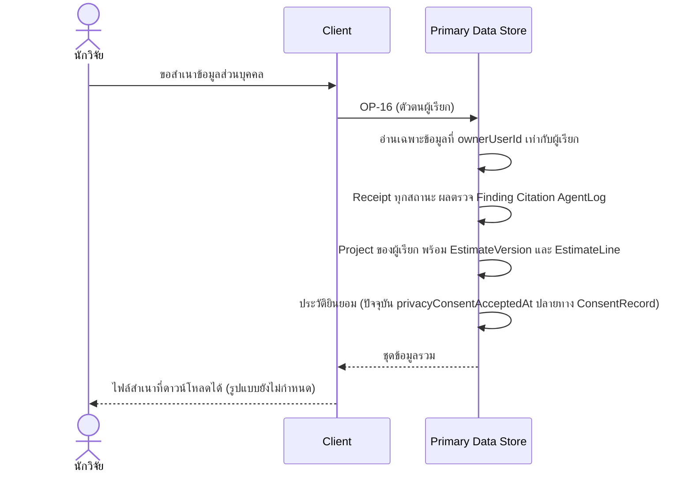

# Detailed Design — ขอเข้าถึง/ขอสำเนาข้อมูลส่วนบุคคลของตนเอง (Data Access & Portability)

> การออกแบบระดับ component สำหรับ [[feature-list#11. ขอเข้าถึง/ขอสำเนาข้อมูลส่วนบุคคลของตนเอง (Data Access & Portability)|ฟีเจอร์ที่ 11]]
> แปลงจาก [[user-journey#Journey 6: นักวิจัยขอเข้าถึง/ขอสำเนาข้อมูลส่วนบุคคลของตนเอง (Data Access & Portability)|Journey 6]]
> อ้างอิง operation จริง: OP-16 เท่านั้น
> test case: [[03-testing/01-test-plan/test-cases/data-access-portability|data-access-portability]]

## 0. สถานะเอกสารและสถานะการสร้าง

- **สถานะฟีเจอร์: Backlog ทั้งหมด** (FR-17 ยังไม่ได้สร้าง) **ปรับ 2026-11-17:** ขอบเขตข้อมูลขยายตามโมเดลใหม่ (ผลตรวจ 4 ระดับ ข้อค้นพบ agent log ประมาณการ)
  และทำที่ **Client** ภายใต้กฎสิทธิ์ของที่เก็บข้อมูลหลัก (ไม่ใช่ Trusted Server Service ตามมติผสม)

| Operation | สถานะ |
|---|---|
| OP-16 ขอสำเนาข้อมูลส่วนบุคคลของตนเอง | Backlog |

## 1. ภาพรวม

แยกจาก Export (ฟีเจอร์ที่ 7) โดยเจตนา: OP-16 ส่งสำเนาข้อมูลส่วนบุคคล**ครบถ้วน** ไม่ใช่รายงานสรุปสำหรับยื่นภายนอก ครอบคลุม `Receipt` **ทุกสถานะ (4 ระดับ)** ของทุกโครงการที่ผู้ขอเป็นเจ้าของ
ผลตรวจ+ข้อค้นพบ `AgentLog` ประมาณการ (`EstimateVersion`/`EstimateLine`) ของโครงการที่เป็นเจ้าของ และประวัติยินยอม รูปแบบไฟล์ยังเป็น open point ([[db-spec]] 5.2)
Component: Client, Primary Data Store

## 2. Sequence Diagram

## 3. Operation ↔ Entity ที่กระทบ

| Operation | Entity | การกระทำ | เงื่อนไข |
|---|---|---|---|
| [[api-spec#OP-16 ขอสำเนาข้อมูลส่วนบุคคลของตนเอง\|OP-16]] | Receipt (E-04) | อ่านทุกสถานะ ทุกโครงการของผู้เรียก | ไม่จำกัดเฉพาะ "ผ่าน" (FR-17 AC-2) |
| OP-16 | VerificationResult (E-08), VerificationFinding (E-23), VerificationRuleCitation (E-09) | อ่าน | รวมผลตรวจทุกรอบของใบเสร็จ |
| OP-16 | AgentLog (E-24), ReceiptFile (E-05), User (E-01) profile | อ่าน | รวมลิงก์ไฟล์และโปรไฟล์ |
| OP-16 | Project (E-03), EstimateVersion (E-15), EstimateLine (E-16) | อ่าน | เฉพาะโครงการที่ผู้เรียกเป็นเจ้าของ |
| OP-16 | User (E-01) `privacyConsentAcceptedAt`; ปลายทาง ConsentRecord (E-11) | อ่าน | ประวัติยินยอม |

## 4. State Diagram

ไม่มี — OP-16 อ่านอย่างเดียว ไม่เปลี่ยนสถานะข้อมูลใดและไม่มี entity เก็บคำขอสำเนา

## 5. Edge Case และวิธีจัดการ

| # | Edge Case | วิธีจัดการ | อ้างอิง |
|---|---|---|---|
| 1 | ไม่มีใบเสร็จเลย | คืนสำเนาประวัติยินยอมได้ ไม่ใช่ error | OP-16 |
| 2 | ใบเสร็จสถานะไม่ผ่าน | ต้องรวมด้วย ต่างจาก Export ซึ่งรวมเฉพาะ "ผ่าน" | FR-17 AC-2 |
| 3 | ผู้อื่นขอสำเนาของคนอื่น | ไม่รองรับ operation นี้ใช้ตัวตนผู้เรียกเท่านั้น ไม่มี input ผู้ใช้เป้าหมาย Admin ใช้ไม่ได้ | หัวข้อ 2 ของ api-spec |
| 4 | หลังถอนความยินยอม | ใบเสร็จ/ผลตรวจถูกลบแล้ว สำเนามีเฉพาะที่ยังเหลือ (โครงการ ประมาณการ ประวัติยินยอม) | OP-35 |
| 5 | รูปแบบไฟล์ | ยังไม่กำหนด ไม่ระบุในเอกสารนี้ | db-spec 5.2 |
| 6 | ข้อมูลอ้างอิงไฟล์ (`ReceiptFile`) อยู่ในสำเนาหรือไม่ | รวมลิงก์ไฟล์ (`ReceiptFile`) และโปรไฟล์ `User` ในสำเนา | OP-16 |
| 7 | ใบเสร็จเก่าก่อน 2026-11-14 ไม่มีข้อค้นพบ | รวมเท่าที่มี | db-spec E-04 |

## 6. ช่องว่าง api-spec/db-spec ที่พบ

- **G-7 ปิดแล้ว:** สำเนาของ OP-16 รวมโปรไฟล์ `User` และลิงก์ `ReceiptFile`

## เอกสารที่เกี่ยวข้อง

- [[feature-list#11. ขอเข้าถึง/ขอสำเนาข้อมูลส่วนบุคคลของตนเอง (Data Access & Portability)|feature-list ฟีเจอร์ที่ 11]], [[user-journey#Journey 6: นักวิจัยขอเข้าถึง/ขอสำเนาข้อมูลส่วนบุคคลของตนเอง (Data Access & Portability)|Journey 6]], [[api-spec]], [[db-spec]]
- [[02-design/02-technical/detailed-design/export-verified-report|export-verified-report]], [[02-design/02-technical/detailed-design/consent-management|consent-management]]
