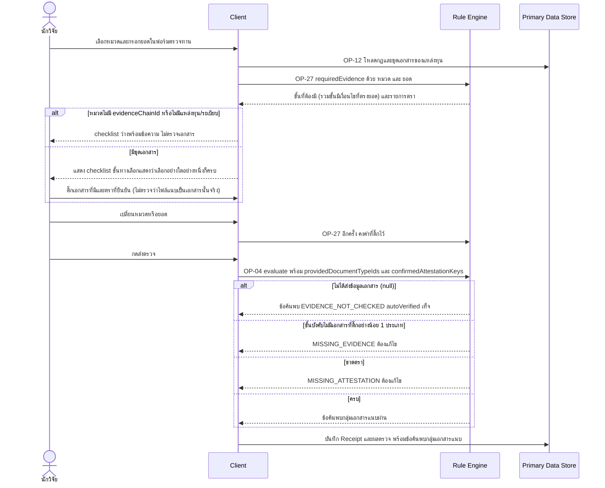
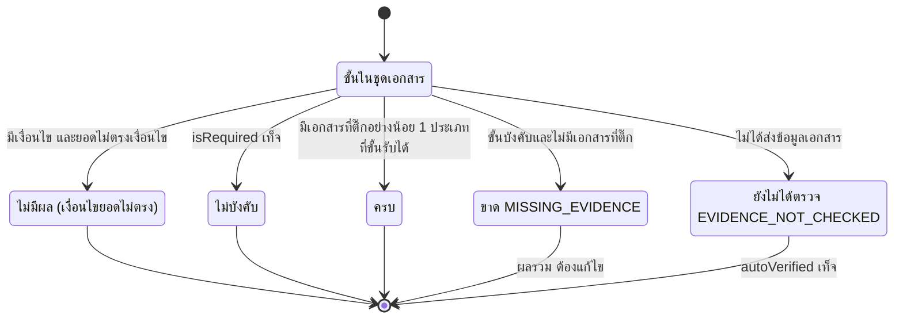

# Detailed Design — ตรวจความครบของเอกสารแนบตามชุดเอกสาร (Evidence Chain)

> การออกแบบระดับ component สำหรับ [[feature-list#15. ตรวจความครบของเอกสารแนบตามชุดเอกสาร (Evidence Chain)|ฟีเจอร์ที่ 15]]
> แปลงจาก [[user-journey#Journey 1: นักวิจัยอัปโหลดใบเสร็จและตรวจสอบผลจนผ่านเกณฑ์|Journey 1]] (ขั้นติ๊กเอกสาร/ตรา)
> อ้างอิง operation จริง: OP-27, OP-04 (กลุ่ม "เอกสารแนบ"), OP-12, OP-31
> test case: [[03-testing/01-test-plan/test-cases/evidence-chain-check|evidence-chain-check]]

## 0. สถานะเอกสารและสถานะการสร้าง

- **สร้างใหม่ 2026-11-17**

| ส่วน | Operation | สถานะ |
|---|---|---|
| แสดง checklist เอกสาร/ตราตามหมวดและยอด | OP-27 | สร้างแล้ว |
| ตรวจความครบตอนส่งตรวจ (กลุ่มเอกสารแนบ ลำดับที่ 4) | OP-04 | สร้างแล้ว |
| โหลดชุดเอกสาร/ประเภทเอกสาร/ตรา | OP-12 | สร้างแล้ว |
| ผลักชุดเอกสารมาตรฐานเข้าระบบจริง | OP-31 | สร้างแล้ว (Admin กดปุ่ม ดู [[02-design/02-technical/detailed-design/rule-set-2570\|rule-set-2570]]) |
| จำแนกเอกสารจากไฟล์ที่แนบด้วย OCR | — | **ไม่มีในระบบ** (ปัจจุบันนักวิจัยติ๊กยืนยันเอง ไม่ตรวจจากไฟล์จริง) |

## 1. ภาพรวม

หมวดค่าใช้จ่าย (`RuleItem`) ชี้ชุดเอกสาร (`EvidenceChain`) ได้ 1 ชุด ชุดประกอบด้วย **ขั้น** (ก่อน/หลัง/พร้อมกัน, บังคับหรือไม่, อาจมีเงื่อนไขตามยอด เช่น ยอดเกิน 100,000 บาทต้องมีใบรับรองคณะกรรมการ)
แต่ละขั้นรับประเภทเอกสารได้หลายแบบ (ทางเลือก) และชุดอาจกำหนด**ตรา**ที่ต้องอยู่บนเอกสาร (เช่น "จ่ายแล้ว", ตรวจรับพัสดุ) ขั้นถือว่าครบเมื่อมีเอกสารที่ติ๊กอย่างน้อย 1 ประเภท
ขั้น `isRequired` เป็นเท็จไม่ทำให้ไม่ผ่าน เอกสาร/ตราที่ขาด → "ต้องแก้ไข" (`MISSING_EVIDENCE`/`MISSING_ATTESTATION`)
Component: Client, Rule Engine (โมดูลเดียวกับ OP-04 เพื่อให้ checklist ตรงกับที่ตรวจจริง), Primary Data Store

## 2. Sequence Diagram

## 3. Operation ↔ Entity ที่กระทบ

| Operation | Entity | การกระทำ | ลำดับ/เงื่อนไข |
|---|---|---|---|
| [[api-spec#OP-27 ดูรายการเอกสาร/ตราที่ต้องมีของหมวดและยอด\|OP-27]] | RuleItem (E-07), EvidenceChain (E-18), EvidenceChainStep (E-19), EvidenceChainStepDocument (E-20), DocumentType (E-21), Attestation (E-22) | อ่านอย่างเดียว | ขั้นที่มี `conditionField` มีผลเมื่อยอดตรงเงื่อนไข |
| [[api-spec#OP-12 ดูเวอร์ชันระเบียบที่ active ของแหล่งทุน\|OP-12]] | ข้างต้นทั้งหมดผ่านกฎของแหล่งทุน | อ่าน | ใช้ได้แม้แหล่งทุนปิดใช้งาน |
| [[api-spec#OP-04 ยืนยันข้อมูลใบเสร็จ ส่งตรวจ และบันทึกใบเสร็จ\|OP-04]] | Receipt (E-04) | สร้างพร้อม `providedDocumentTypeIds`, `confirmedAttestationKeys` | null เมื่อหมวดไม่มีชุดเอกสาร ต่างจากรายการที่สั้นกว่าที่ต้องมี |
| OP-04 | VerificationFinding (E-23) | สร้างข้อค้นพบกลุ่ม "เอกสารแนบ" | ลำดับกลุ่มสุดท้าย |
| [[api-spec#OP-31 อัปเดตชุดกฎ ชุดเอกสาร และประเภทเอกสารตามรหัสคงที่\|OP-31]] | DocumentType, EvidenceChain, EvidenceChainStep, EvidenceChainStepDocument, Attestation | เพิ่ม/ทับตามรหัสคงที่ | Admin เท่านั้น ไม่ลบ |

## 4. State Diagram — การประเมินหนึ่งขั้นของชุดเอกสาร

## 5. Edge Case และวิธีจัดการ

| # | Edge Case | วิธีจัดการ | อ้างอิง |
|---|---|---|---|
| 1 | หมวดไม่มี `evidenceChainId` | checklist ว่าง ไม่ตรวจเอกสาร `providedDocumentTypeIds` เป็น null | OP-27 |
| 2 | ไม่ได้ส่งข้อมูลเอกสาร | `EVIDENCE_NOT_CHECKED` `autoVerified` เท็จ ไม่ผ่านเงียบ | db-spec กฎข้อ 16 |
| 3 | ขั้นรับเอกสารทางเลือก (เช่น วจ.1 หรือ วจ.2) | มีอย่างใดอย่างหนึ่งครบ | db-spec E-20 |
| 4 | ขั้นไม่บังคับ | ขาดก็ไม่ทำให้ไม่ผ่าน | db-spec กฎข้อ 19 |
| 5 | ขั้นแบบมีเงื่อนไขตามยอด (เช่น ยอดเกิน 100,000) | มีผลเมื่อยอดใบเสร็จตรงเงื่อนไข เปลี่ยนยอด → checklist เปลี่ยน | OP-27, E-19 |
| 6 | ยอดไม่ผ่านอยู่แล้วและเอกสารขาด | สถานะตามระดับที่รุนแรงกว่า ข้อค้นพบเอกสารขาดยังเก็บเป็นข้อค้นพบเพิ่ม | db-spec กฎข้อ 15 |
| 7 | ผู้ใช้ติ๊กเอกสารที่ไม่ได้แนบจริง | ระบบไม่ตรวจจากไฟล์ (ข้อจำกัดที่ยอมรับ) เป็นการยืนยันด้วยตนเอง ปลายทางจำแนกด้วย OCR เติมค่าเดียวกันได้โดยไม่เปลี่ยนโครงสร้าง | db-spec กฎข้อ 19 |
| 8 | ชุดเอกสารในระบบจริงยังไม่อัปเดต (Admin ยังไม่กดผลักชุดมาตรฐาน) | กฎที่ engine ต้องการแต่ไม่มีในข้อมูลถูกข้ามอย่างปลอดภัย | OP-31 |
| 9 | ตราต้องอ้างผ่านชุดเดียวกัน | `attestationKey` ไม่ซ้ำภายในชุด ตีความภายใต้ชุดของหมวดนั้น | db-spec E-22 |
| 10 | ชุดเอกสารจากแหล่งทุนที่ปิดใช้งาน | ยังใช้ได้ (เก็บกฎครบ) | OP-12 |

## เอกสารที่เกี่ยวข้อง

- [[feature-list#15. ตรวจความครบของเอกสารแนบตามชุดเอกสาร (Evidence Chain)|feature-list ฟีเจอร์ที่ 15]], [[user-journey#Journey 1: นักวิจัยอัปโหลดใบเสร็จและตรวจสอบผลจนผ่านเกณฑ์|Journey 1]], [[api-spec]], [[db-spec]] E-18–E-22
- [[02-design/02-technical/detailed-design/review-edit-ocr-data|review-edit-ocr-data]], [[02-design/02-technical/detailed-design/rule-engine-pure-module|rule-engine-pure-module]], [[02-design/02-technical/detailed-design/rule-set-2570|rule-set-2570]],
  [[02-design/02-technical/detailed-design/ai-agent-explanation|ai-agent-explanation]]
