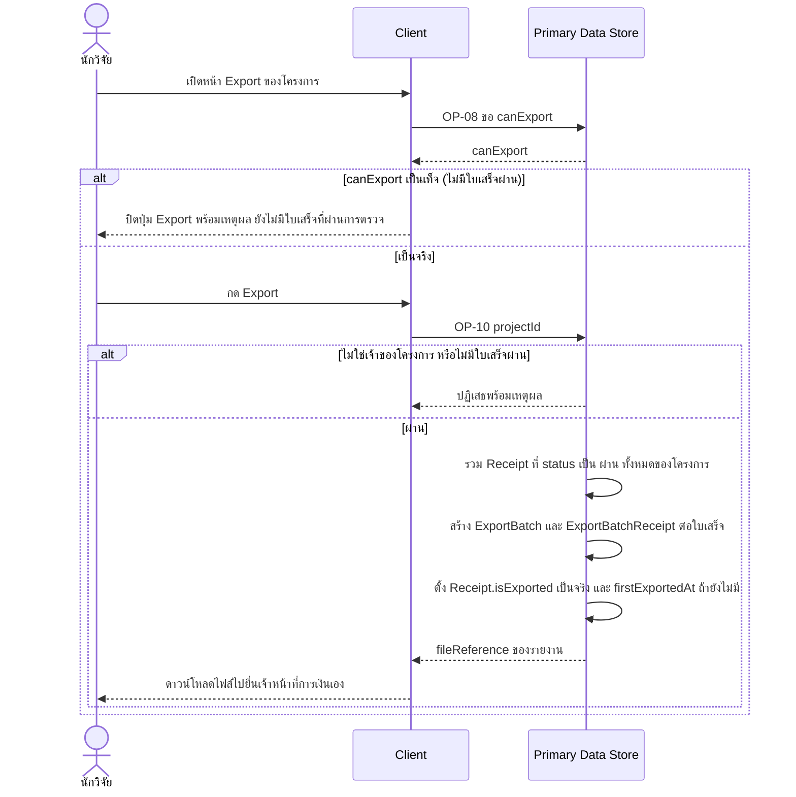
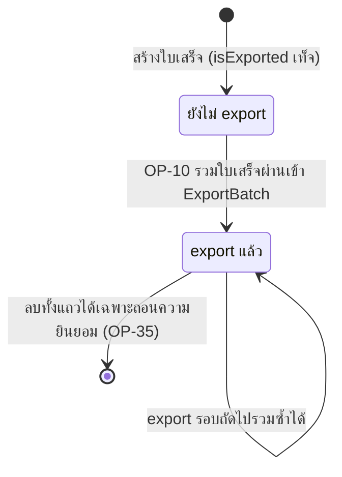

# Detailed Design — Export รายงานสรุปใบเสร็จที่ผ่านตรวจแล้ว

> การออกแบบระดับ component สำหรับ [[feature-list#7. Export รายงานสรุปใบเสร็จที่ผ่านตรวจแล้ว|ฟีเจอร์ที่ 7]]
> แปลงจาก [[user-journey#Journey 3: นักวิจัย Export รายงานสรุปใบเสร็จที่ผ่านตรวจแล้วเพื่อยื่นเจ้าหน้าที่การเงิน|Journey 3]]
> อ้างอิง operation จริง: OP-08 (`canExport`), OP-10, OP-17 (ผลของ `isExported`)
> test case: [[03-testing/01-test-plan/test-cases/export-verified-report|export-verified-report]]

## 0. สถานะเอกสารและสถานะการสร้าง

- **สถานะฟีเจอร์: Backlog ทั้งหมด** (FR-10, FR-21 ยังไม่ได้สร้าง) **ปรับ 2026-11-17** ให้ตรงมติสถาปัตยกรรมผสม: Export ทำที่ **Client** ภายใต้กฎสิทธิ์ของที่เก็บข้อมูลหลัก
  (ไม่ใช่ Trusted Server Service) ปรับเฉพาะถ้อยคำสถานะ 4 ระดับและ component

| Operation | สถานะ |
|---|---|
| OP-08 ดูภาพรวม (ใช้ `canExport`) | Backlog |
| OP-10 Export รายงานสรุปใบเสร็จที่ผ่านตรวจแล้ว | Backlog |

## 1. ภาพรวม

เจ้าหน้าที่การเงินไม่ใช่ user ของระบบ เป็นเพียงผู้รับไฟล์ที่ดาวน์โหลดออกไปนอกระบบ ปุ่ม Export ปิดไว้จนกว่าจะมีใบเสร็จ "ผ่าน" ≥ 1 ใบ (FR-21)
หลัง Export ใบเสร็จที่ถูกรวม `isExported` เป็นจริงถาวรและเป็นเงื่อนไขล็อกการลบเองรายใบ (ฟีเจอร์ที่ 12)
Component: Client, Primary Data Store (รูปแบบไฟล์รายงานยังเป็น open point — [[db-spec]] 5.2)

## 2. Sequence Diagram

## 3. Operation ↔ Entity ที่กระทบ

| Operation | Entity | การกระทำ | ลำดับ/เงื่อนไข |
|---|---|---|---|
| [[api-spec#OP-08 ดูภาพรวมสถานะใบเสร็จของโครงการ (Dashboard ของนักวิจัย)\|OP-08]] | Receipt (E-04) | อ่านนับ "ผ่าน" | ได้ `canExport` |
| [[api-spec#OP-10 Export รายงานสรุปใบเสร็จที่ผ่านตรวจแล้ว\|OP-10]] | Project (E-03) | อ่านตรวจเจ้าของ | ก่อนสุด |
| OP-10 | Receipt (E-04) | อ่านที่ `status` = "ผ่าน" แล้วแก้ `isExported`, `firstExportedAt` | `isExported` เปลี่ยนเป็นจริงได้ทางเดียว (db-spec กฎข้อ 4) |
| OP-10 | ExportBatch (E-12) | สร้าง (`projectId`, `exportedByUserId`, `exportedAt`, `fileReference`) | หนึ่ง record ต่อการกด Export |
| OP-10 | ExportBatchReceipt (E-13) | สร้างต่อใบเสร็จที่รวม | ลำดับ: ExportBatch ก่อน แล้ว ExportBatchReceipt |

## 4. State Diagram — Receipt.isExported

`isExported` ห้ามกลับเป็นเท็จ การลบรายใบ (OP-17) ถูกล็อกเมื่อเป็นจริง

## 5. Edge Case และวิธีจัดการ

| # | Edge Case | วิธีจัดการ | อ้างอิง |
|---|---|---|---|
| 1 | ไม่มีใบเสร็จ "ผ่าน" เลย | ปิดปุ่มพร้อมเหตุผล และ OP-10 ปฏิเสธถ้าถูกเรียกตรง | FR-21, OP-10 |
| 2 | โครงการไม่ใช่ของผู้เรียก | ปฏิเสธ (Admin Export แทนไม่ได้) | หัวข้อ 2 ของ api-spec |
| 3 | Export ซ้ำ | รวมใบ "ผ่านทั้งหมด" ใหม่เสมอ สร้าง ExportBatch ใหม่ ใบที่เคยรวมถูกรวมซ้ำได้ | OP-10 |
| 4 | ใบเสร็จไม่ผ่าน (3 ระดับ) | ไม่รวมใน Export (เฉพาะ "ผ่าน") | OP-10 |
| 5 | ใบเสร็จ "ผ่าน" แต่ `autoVerified` เป็นเท็จ (ผ่านเพราะตรงหมวดหรือตรวจบางด้านไม่ได้) | api-spec กำหนดรวมทุกใบที่ `status` = "ผ่าน" ไม่แยกตาม `autoVerified` — ไม่เพิ่มกติกาเอง | OP-10 |
| 6 | รูปแบบไฟล์รายงาน | ยังไม่กำหนด (open point db-spec 5.2) ไม่ระบุในเอกสารนี้ | db-spec 5.2 |
| 7 | ผู้ใช้ถอนความยินยอมหลัง Export | `ExportBatchReceipt` และใบเสร็จถูกลบ `ExportBatch` ตัวมันเองไม่ถูกลบ | db-spec กฎข้อ 6 |

## เอกสารที่เกี่ยวข้อง

- [[feature-list#7. Export รายงานสรุปใบเสร็จที่ผ่านตรวจแล้ว|feature-list ฟีเจอร์ที่ 7]], [[user-journey#Journey 3: นักวิจัย Export รายงานสรุปใบเสร็จที่ผ่านตรวจแล้วเพื่อยื่นเจ้าหน้าที่การเงิน|Journey 3]], [[architecture]] 3.3, [[api-spec]], [[db-spec]]
- [[02-design/02-technical/detailed-design/fund-dashboard|fund-dashboard]], [[02-design/02-technical/detailed-design/right-to-erasure|right-to-erasure]]
