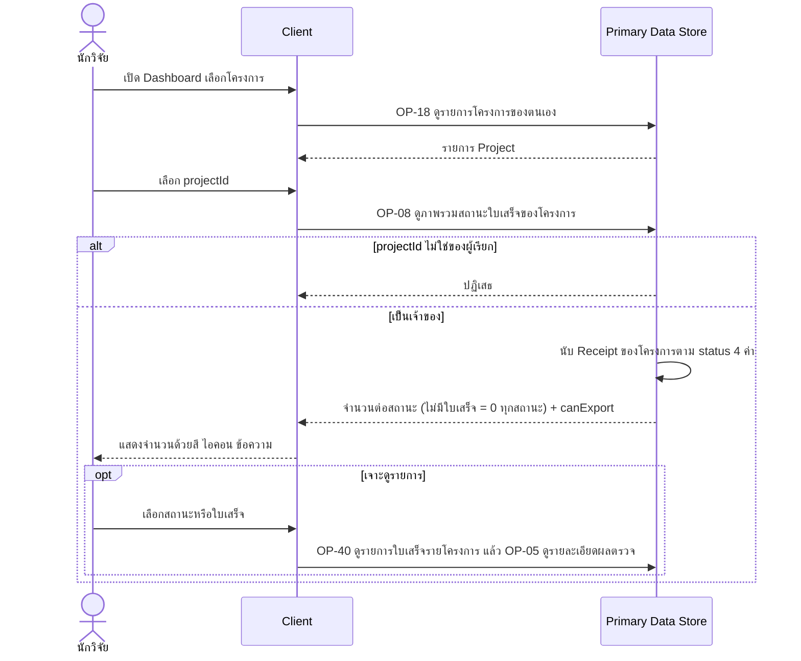
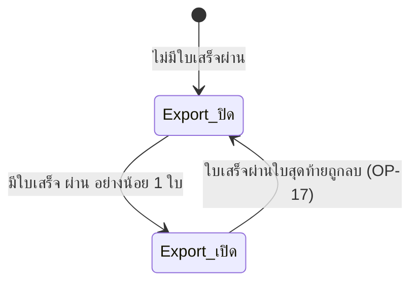

# Detailed Design — Dashboard สรุปภาพรวมใบเสร็จของโครงการ

> การออกแบบระดับ component สำหรับ [[feature-list#5. Dashboard สรุปภาพรวมใบเสร็จของโครงการ|ฟีเจอร์ที่ 5]]
> แปลงจาก [[user-journey#Journey 2: นักวิจัยติดตามภาพรวมโครงการและจัดการใบเสร็จที่มีปัญหาผ่าน Dashboard และการแจ้งเตือน|Journey 2]]
> อ้างอิง operation จริง: OP-08 (เป้าหมาย), OP-26 (ใช้แทนบางส่วนปัจจุบัน), OP-18, OP-05
> test case: [[03-testing/01-test-plan/test-cases/fund-dashboard|fund-dashboard]]

## 0. สถานะเอกสารและสถานะการสร้าง

- **เขียนใหม่ 2026-11-17** (ของเดิมนับสถานะ 3 ระดับและมี "รอผลตรวจ") ชื่อไฟล์ `fund-dashboard` คงเดิมเพราะตรงกับ test case ทั้งที่ฟีเจอร์เป็น Dashboard ระดับ**โครงการ**

| ส่วน | Operation | สถานะ |
|---|---|---|
| Dashboard จำนวนใบเสร็จตามสถานะ 4 ระดับ + `canExport` | OP-08 | **Backlog** (FR-08 ยังไม่ได้สร้าง) |
| ยอดใช้ไป/คงเหลือ/% รายรายการประมาณการ (ใช้แทนบางส่วนปัจจุบัน) | OP-26 | สร้างแล้ว |
| หน้ารายการใบเสร็จรายโครงการของนักวิจัย | OP-40 ดูรายการใบเสร็จของตนเอง (ทั้งหมด/รายโครงการ) | สร้างแล้ว |
| Dashboard ข้ามผู้ใช้ของ Admin | OP-30 | สร้างแล้ว (ดู [[02-design/02-technical/detailed-design/admin-dashboard\|admin-dashboard]]) |

## 1. ภาพรวม

นักวิจัยเลือกโครงการของตน แล้วเห็นจำนวนใบเสร็จตามสถานะ ผ่าน / ต้องแก้ไข / ต้องชี้แจง-ขออนุมัติ / ไม่เข้าเงื่อนไข และสถานะปุ่ม Export (ฟีเจอร์ที่ 7)
ไม่มีสถานะ "รอ OCR/รอตรวจทาน/รอผลตรวจ" เพราะไม่บันทึกถาวร ข้อมูลทั้งหมดคำนวณจาก `Receipt.status` ไม่มี entity เก็บสรุป
Component: Client, Primary Data Store

## 2. Sequence Diagram (เป้าหมาย OP-08)

## 3. Operation ↔ Entity ที่กระทบ

| Operation | Entity | การกระทำ | เงื่อนไข |
|---|---|---|---|
| [[api-spec#OP-08 ดูภาพรวมสถานะใบเสร็จของโครงการ (Dashboard ของนักวิจัย)\|OP-08]] | Project (E-03) | อ่านตรวจเจ้าของ | `ownerUserId` = ผู้เรียก |
| OP-08 | Receipt (E-04) | อ่านนับตาม `status` | `canExport` = จริงเมื่อมี "ผ่าน" ≥ 1 (เชื่อม FR-21) |
| [[api-spec#OP-26 ดูสรุปยอดใช้ไป/คงเหลือ/% รายรายการ\|OP-26]] | EstimateLine (E-16), Receipt (E-04) | อ่าน | ใช้ติดตามยอดประมาณการ ดู [[02-design/02-technical/detailed-design/budget-estimate-check\|budget-estimate-check]] |
| [[api-spec#OP-18 ดูรายการโครงการวิจัยของตนเอง\|OP-18]] | Project, FundSource | อ่าน | เลือกโครงการ |

## 4. State Diagram — ปุ่ม Export (ค่าที่คำนวณจากสถานะ)

ฟีเจอร์นี้ไม่มีสถานะของ entity เอง สถานะที่เปลี่ยนคือค่า `canExport` ที่คำนวณทุกครั้งที่เรียก OP-08

## 5. Edge Case และวิธีจัดการ

| # | Edge Case | วิธีจัดการ | อ้างอิง |
|---|---|---|---|
| 1 | โครงการยังไม่มีใบเสร็จ | แสดง 0 ทุกสถานะ ไม่ใช่ error `canExport` = เท็จ | OP-08 |
| 2 | `projectId` ไม่ใช่ของผู้เรียก | ปฏิเสธ | OP-08 |
| 3 | Admin ต้องการภาพรวมข้ามคน | ไม่ใช้ OP-08 ใช้ OP-30 (อ่านอย่างเดียว) | FR-33 |
| 4 | โครงการผูกแหล่งทุนที่ปิดใช้งาน (FR-35) | ยังแสดงชื่อแหล่งทุนปกติ ตัวเลขไม่เปลี่ยน | OP-18 |
| 5 | ใบเสร็จเก่าไม่มีข้อมูลย้อนรอย | นับจาก `Receipt.status` ได้ตามปกติ | db-spec E-04 |
| 6 | ใบเสร็จถูกลบระหว่างเปิดหน้า | คำนวณใหม่เมื่อเรียกครั้งถัดไป ไม่มี cache ที่ระบุใน spec | OP-17 |

## 6. ช่องว่าง api-spec/db-spec ที่พบ

- ไม่มีช่องว่างค้าง: G-1 ปิดแล้วด้วย **OP-40 ดูรายการใบเสร็จของตนเอง (ทั้งหมด/รายโครงการ)** (สร้างแล้ว) เป็นจุดเริ่มของ OP-05, OP-17, OP-06, OP-07
  ขั้น "เปิดรายการใบเสร็จ" ในเอกสาร detailed-design ทั้งหมดคือ OP-40 (นักวิจัยเจาะดูรายใบจาก OP-40 แล้วเรียก OP-05)

## เอกสารที่เกี่ยวข้อง

- [[feature-list#5. Dashboard สรุปภาพรวมใบเสร็จของโครงการ|feature-list ฟีเจอร์ที่ 5]], [[user-journey#Journey 2: นักวิจัยติดตามภาพรวมโครงการและจัดการใบเสร็จที่มีปัญหาผ่าน Dashboard และการแจ้งเตือน|Journey 2]], [[api-spec]], [[db-spec]]
- [[02-design/02-technical/detailed-design/export-verified-report|export-verified-report]], [[02-design/02-technical/detailed-design/pending-issue-notification|pending-issue-notification]], [[02-design/02-technical/detailed-design/admin-dashboard|admin-dashboard]]
