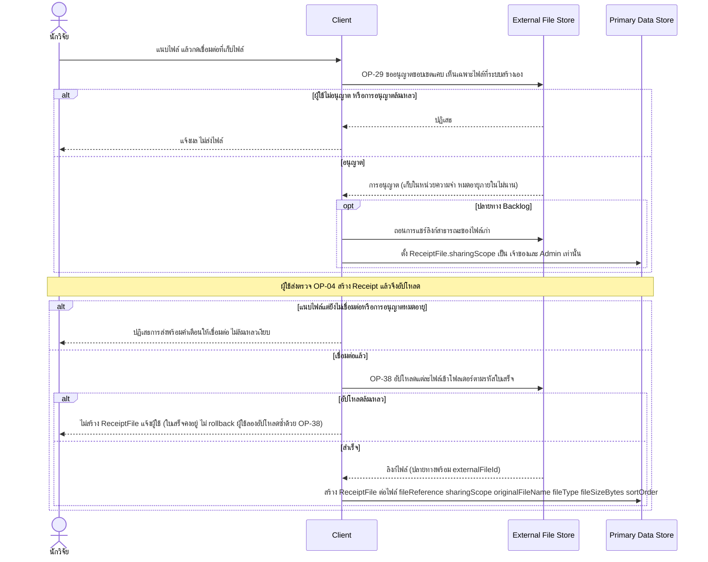
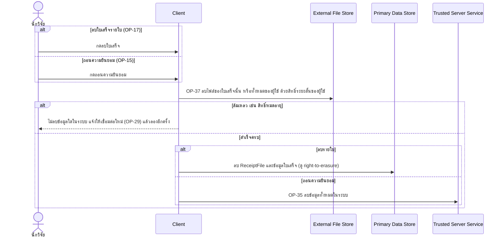
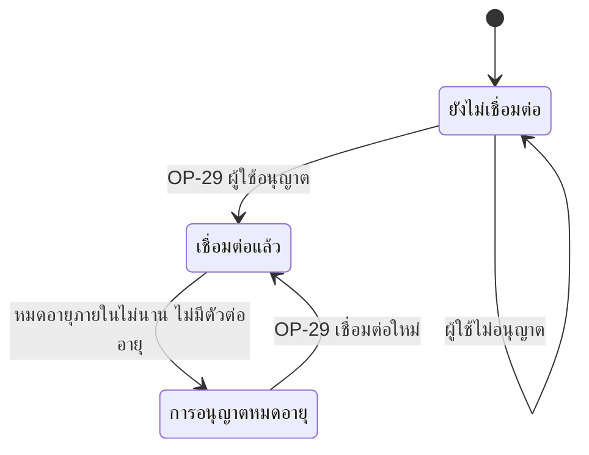
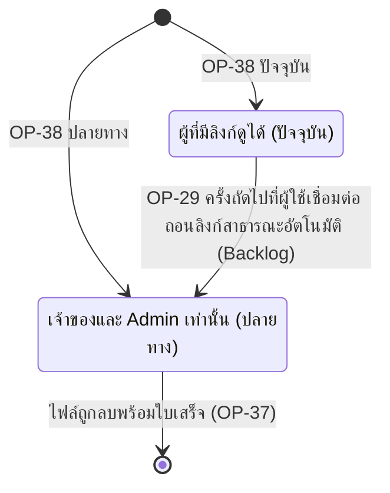

# Detailed Design — แนบไฟล์จริงผ่านที่เก็บไฟล์ภายนอกของผู้ใช้

> การออกแบบระดับ component สำหรับ [[feature-list#21. แนบไฟล์จริงผ่าน Google Drive ของผู้ใช้|ฟีเจอร์ที่ 21]]
> (ชื่อไฟล์ `google-drive-attachment` ใช้ตามชุด test case เนื้อหาในเอกสารนี้ใช้คำเชิงบทบาทว่า "ที่เก็บไฟล์ภายนอกของผู้ใช้เอง")
> แปลงจาก [[user-journey#Journey 1: นักวิจัยอัปโหลดใบเสร็จและตรวจสอบผลจนผ่านเกณฑ์|Journey 1]] และส่วนลบไฟล์ใน
> [[user-journey#Journey 5: นักวิจัยถอนความยินยอม (Withdraw Consent) และผลกระทบต่อการใช้งานระบบ|Journey 5]] / [[user-journey#Journey 7: นักวิจัยลบข้อมูลใบเสร็จของตนเองด้วยตนเอง (Right to Erasure)|Journey 7]]
> อ้างอิง operation จริง: OP-29, OP-38, OP-37 (และ OP-17/OP-15/OP-07 ที่เรียก OP-37)
> test case: [[03-testing/01-test-plan/test-cases/google-drive-attachment|google-drive-attachment]]

## 0. สถานะเอกสารและสถานะการสร้าง

- **สร้างใหม่ 2026-11-17**

| ส่วน | Operation | สถานะ |
|---|---|---|
| เชื่อมต่อที่เก็บไฟล์ของผู้ใช้ (ขอบเขตแคบ การอนุญาตอยู่ในหน่วยความจำ ไม่มีตัวต่ออายุ) | OP-29 | **สร้างแล้ว** |
| อัปโหลดไฟล์เข้าโฟลเดอร์ตามรหัสใบเสร็จ + บันทึก `ReceiptFile` | OP-38 | **สร้างแล้ว** — ปัจจุบันตั้ง `sharingScope` = "ผู้ที่มีลิงก์ดูได้" (**ใครมีลิงก์ก็เปิดดูได้** ขัดเจตนาความเป็นส่วนตัว) |
| ถอนการแชร์ลิงก์สาธารณะของไฟล์เก่าอัตโนมัติเมื่อเชื่อมต่อครั้งถัดไป | OP-29 ส่วนเพิ่ม | **Backlog** (FR-37 ข้อ 5) |
| จำกัดผู้ดูเป็น "เจ้าของและ Admin เท่านั้น" (แชร์ตรงให้บัญชี Admin) + บันทึก `externalFileId` | OP-38 ปลายทาง | **Backlog** (FR-37/NFR-15) |
| ลบไฟล์ภายนอกด้วยสิทธิ์ระยะสั้นของผู้ใช้เองก่อนลบข้อมูล | OP-37 | **Backlog** (FR-37) |

## 1. ภาพรวม

ไฟล์จริงของใบเสร็จอยู่ในพื้นที่ของผู้ใช้เอง ไม่ใช่ที่เก็บข้อมูลหลัก ที่เก็บข้อมูลหลักเก็บเฉพาะข้อมูลอ้างอิง (`ReceiptFile`) เพื่อแสดงเป็นลิงก์ใน Client และ Admin Dashboard
เซิร์ฟเวอร์ไม่เก็บข้อมูลรับรองของผู้ใช้ต่อที่เก็บไฟล์ภายนอก จึง**ลบไฟล์แทนผู้ใช้ไม่ได้** — ผู้ลบคือ Client ด้วยสิทธิ์ระยะสั้นของนักวิจัย (มติ architecture 5.5 ข้อ 3)
หลักที่ใช้กับการลบ: **ลบไฟล์ภายนอกให้สำเร็จครบก่อน แล้วจึงลบข้อมูลในระบบ ถ้าลบไฟล์ไม่สำเร็จ ไม่ลบอะไรเลย** (ไม่มีไฟล์กำพร้า ไม่ล้มเหลวเงียบ)
Component: Client, User-owned External File Store, Primary Data Store, Trusted Server Service (เฉพาะส่วนลบข้อมูลในระบบเมื่อถอนความยินยอม)

## 2. Sequence Diagram

### 2.1 เชื่อมต่อและอัปโหลด (สร้างแล้ว)

### 2.2 ลบไฟล์ตามใบเสร็จหรือเมื่อถอนความยินยอม (ปลายทาง Backlog)

## 3. Operation ↔ Entity ที่กระทบ

| Operation | Entity | การกระทำ | ลำดับ/เงื่อนไข |
|---|---|---|---|
| [[api-spec#OP-29 เชื่อมต่อที่เก็บไฟล์ภายนอกของผู้ใช้\|OP-29]] | ไม่มี (การอนุญาตอยู่ในหน่วยความจำ); ปลายทาง ReceiptFile (E-05) `sharingScope` | ปลายทางแก้ขอบเขตการแชร์ของไฟล์เก่า | ก่อน OP-38/OP-37 ทุกครั้ง |
| [[api-spec#OP-38 อัปโหลดไฟล์ใบเสร็จไปยังที่เก็บไฟล์ภายนอกและบันทึกข้อมูลอ้างอิง\|OP-38]] | ReceiptFile (E-05) | สร้าง 1 record ต่อไฟล์ (1–5 ไฟล์ต่อใบเสร็จ) | ต้องมี Receipt (E-04) อยู่แล้ว |
| [[api-spec#OP-37 ลบไฟล์แนบในที่เก็บไฟล์ภายนอกของผู้ใช้\|OP-37]] | ReceiptFile (`externalFileId`, `fileReference`) | อ่านเพื่อรู้ไฟล์ที่ต้องลบ | ต้องสำเร็จครบก่อนลบข้อมูล |
| [[api-spec#OP-17 ลบใบเสร็จของตนเอง\|OP-17]] / [[api-spec#OP-15 ถอนความยินยอม (ฝั่ง Client — ลำดับบังคับ)\|OP-15]] | Receipt, ReceiptFile ฯลฯ | ลบหลัง OP-37 สำเร็จ | ดู right-to-erasure และ consent-management |
| [[api-spec#OP-30 ดูภาพรวมใบเสร็จของทุกคน (Admin อ่านอย่างเดียว)\|OP-30]] | ReceiptFile (`fileReference`) | Admin อ่านลิงก์ | ปลายทางลิงก์เปิดได้เฉพาะเจ้าของ+Admin |

## 4. State Diagram

### 4.1 การเชื่อมต่อที่เก็บไฟล์ (ในหน่วยความจำ ต่อหนึ่งหน้า)

### 4.2 ReceiptFile.sharingScope

## 5. Edge Case และวิธีจัดการ

| # | Edge Case | วิธีจัดการ | อ้างอิง |
|---|---|---|---|
| 1 | แนบไฟล์แต่ยังไม่เชื่อมต่อ / การอนุญาตหมดอายุ | ปฏิเสธการส่งพร้อมคำเตือน ผู้ใช้เชื่อมต่อใหม่ | OP-29, OP-38 |
| 2 | ผู้ใช้ไม่อนุญาตหรือการอนุญาตล้มเหลว | แจ้งผล ไม่ส่งไฟล์ | OP-29 |
| 3 | อัปโหลดล้มเหลว | ไม่สร้าง `ReceiptFile` แจ้งผู้ใช้ ใบเสร็จที่บันทึกไปแล้วคงอยู่ (ตัดสินแล้ว ไม่ rollback) ผู้ใช้ลองอัปโหลดซ้ำด้วย OP-38 | OP-38 |
| 4 | **ปัจจุบัน:** ผู้ที่ไม่ใช่เจ้าของเปิดลิงก์ไฟล์ได้ | ช่องโหว่ที่ทราบ ปิดด้วย FR-37/NFR-15 (Backlog) | db-spec กฎข้อ 23 |
| 5 | **ปัจจุบัน:** ลบใบเสร็จแล้วไฟล์ภายนอกยังอยู่ | พฤติกรรมที่ทราบ ลบเฉพาะข้อมูลอ้างอิง ปลายทางลบไฟล์ก่อนด้วย OP-37 | OP-17 |
| 6 | ลบไฟล์ภายนอกไม่สำเร็จ (สิทธิ์หมดอายุ) | ไม่ลบข้อมูลในระบบเลย ให้เชื่อมต่อใหม่แล้วลองอีก ไม่มีไฟล์กำพร้า | OP-37, FR-37 ข้อ 4 |
| 7 | ลบไฟล์สำเร็จบางไฟล์ไม่ครบ | OP-37 คืนผลต่อไฟล์ ถือว่ายังไม่สำเร็จครบ จึงไม่ลบข้อมูลในระบบ **ตัดสินแล้ว (Q-8):** ไฟล์ที่ไม่พบแล้วถือว่าลบสำเร็จ (idempotent) จึงลองซ้ำจากต้นได้ | OP-37 |
| 8 | ไฟล์เก่าที่สร้างก่อนมี `externalFileId` | ต้องหาจาก `fileReference`/โฟลเดอร์รหัสใบเสร็จ | db-spec E-05 |
| 9 | ไฟล์เก่าที่ยังเป็นลิงก์สาธารณะ | ถอนการแชร์และตั้ง `sharingScope` ใหม่อัตโนมัติเมื่อเชื่อมต่อครั้งถัดไป (Backlog) | FR-37 ข้อ 5 |
| 10 | Admin ดูไฟล์เมื่อไม่ใช่ลิงก์สาธารณะแล้ว | แชร์ตรงให้บัญชี Admin (ค่าเริ่มต้นที่ตัดสินแล้ว ทบทวนได้) ไม่เก็บรายชื่อผู้ถูกแชร์ใน `ReceiptFile` | db-spec 5.6 ข้อ 3 |
| 11 | เซิร์ฟเวอร์ลบไฟล์แทนผู้ใช้ | ทำไม่ได้ (ไม่ถือข้อมูลรับรอง) | OP-35 ข้อ 3 |
| 12 | ไม่แนบไฟล์จริง (โหมดสาธิต) | ไม่มี `ReceiptFile` ไม่มีสิ่งต้องเชื่อมต่อ/ลบ | db-spec กฎข้อ 9 |

## 6. ประเด็นเปิด

ไม่มี — Q-2 และ Q-8 ตัดสินแล้ว (Edge Case ข้อ 3 และ 7)

## เอกสารที่เกี่ยวข้อง

- [[feature-list#21. แนบไฟล์จริงผ่าน Google Drive ของผู้ใช้|feature-list ฟีเจอร์ที่ 21]], [[architecture]] 2.1/3.5/5.5, [[api-spec]], [[db-spec]] E-05, กฎข้อ 23
- [[02-design/02-technical/detailed-design/receipt-upload-ocr|receipt-upload-ocr]], [[02-design/02-technical/detailed-design/right-to-erasure|right-to-erasure]], [[02-design/02-technical/detailed-design/consent-management|consent-management]],
  [[02-design/02-technical/detailed-design/admin-dashboard|admin-dashboard]]
