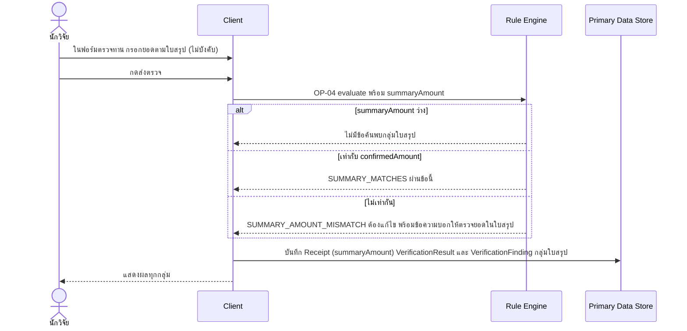
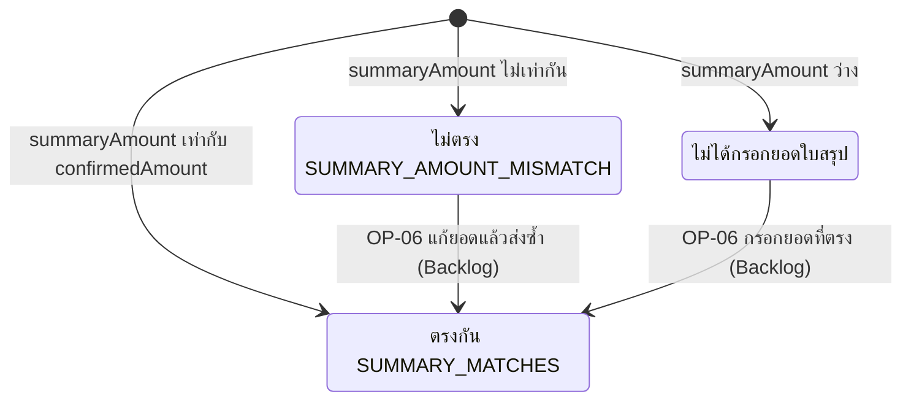

# Detailed Design — เทียบยอดกับใบสรุปรายรับ-จ่าย

> การออกแบบระดับ component สำหรับ [[feature-list#16. เทียบยอดกับใบสรุปรายรับ-จ่าย|ฟีเจอร์ที่ 16]]
> แปลงจาก [[user-journey#Journey 1: นักวิจัยอัปโหลดใบเสร็จและตรวจสอบผลจนผ่านเกณฑ์|Journey 1]] (ขั้นกรอกยอดตามใบสรุป)
> อ้างอิง operation จริง: OP-04 (กลุ่ม "ใบสรุป") เท่านั้น — ฟีเจอร์นี้ไม่มี operation ของตัวเอง และ OP-06 (Backlog) สำหรับแก้ภายหลัง
> test case: [[03-testing/01-test-plan/test-cases/ledger-amount-check|ledger-amount-check]] (ใช้ slug `ledger-amount-check` แทน summary-sheet-check ตามที่ตกลงไว้ในชุด test case)

## 0. สถานะเอกสารและสถานะการสร้าง

- **สร้างใหม่ 2026-11-17**

| ส่วน | สถานะ |
|---|---|
| กรอกยอดตามใบสรุป (ไม่บังคับ) และเทียบกับยอดใบเสร็จตอนส่งตรวจ (OP-04) | **สร้างแล้ว** |
| แก้ยอดตามใบสรุปแล้วส่งตรวจซ้ำ (OP-06) | Backlog |
| ตรวจยอดรวมรายหมวดของใบสรุปทั้งชุด (ไม่ใช่รายใบ) | **ไม่มี** (ข้อจำกัดที่ยอมรับ ใบสรุปไม่ได้นำเข้าระบบ) |

## 1. ภาพรวม

นักวิจัยกรอก `summaryAmount` = ยอดที่ลงไว้ในใบสรุปรายรับ-จ่ายโครงการ (ไม่บังคับ) Rule Engine เทียบกับ `confirmedAmount` เป็นกลุ่มที่ 3 ของการตรวจ (หลังประมาณการและระเบียบ ก่อนเอกสารแนบ)
ไม่เท่ากัน → ข้อค้นพบ `SUMMARY_AMOUNT_MISMATCH` ระดับ "ต้องแก้ไข"; เท่ากัน → `SUMMARY_MATCHES`; ว่าง → ไม่มีข้อค้นพบ
Component: Client, Rule Engine, Primary Data Store

## 2. Sequence Diagram

## 3. Operation ↔ Entity ที่กระทบ

| Operation | Entity | การกระทำ | ลำดับ/เงื่อนไข |
|---|---|---|---|
| [[api-spec#OP-04 ยืนยันข้อมูลใบเสร็จ ส่งตรวจ และบันทึกใบเสร็จ\|OP-04]] | Receipt (E-04) | สร้างพร้อม `summaryAmount` (ว่างได้) | เทียบกับ `confirmedAmount` ในใบเดียวกัน |
| OP-04 | VerificationFinding (E-23) | สร้างข้อค้นพบกลุ่ม "ใบสรุป" เฉพาะเมื่อ `summaryAmount` มีค่า | ลำดับกลุ่ม ที่ 3 |
| OP-04 | VerificationResult (E-08) | สร้าง; `reasonCode` หลักตามลำดับกลุ่มและระดับที่รุนแรงสุด | |
| [[api-spec#OP-06 แก้ไขข้อมูลใบเสร็จแล้วส่งตรวจซ้ำ\|OP-06]] | Receipt, VerificationResult | แก้ `summaryAmount` แล้วสร้างผลใหม่ | Backlog |

## 4. State Diagram — ผลของการเทียบยอด

## 5. Edge Case และวิธีจัดการ

| # | Edge Case | วิธีจัดการ | อ้างอิง |
|---|---|---|---|
| 1 | ไม่กรองยอดตามใบสรุป | ไม่มีข้อค้นพบกลุ่มนี้ ไม่ใช่ error (spec ไม่ระบุว่ากระทบ `autoVerified`) | db-spec กฎข้อ 20 |
| 2 | ยอดไม่ตรง | "ต้องแก้ไข" ตามที่ OP-04 กำหนด | OP-04 |
| 3 | ยอดไม่ตรงพร้อมกับเกินประมาณการ | สถานะ "ต้องชี้แจง/ขออนุมัติ" (รุนแรงกว่า) `reasonCode` หลักเป็นของประมาณการ ข้อค้นพบใบสรุปยังแสดง | db-spec กฎข้อ 15 |
| 4 | ความต่างเล็กน้อย (ทศนิยม/ปัดเศษ) | **ตัดสินแล้ว (Q-7, ตรวจกับโค้ด):** ต้องเท่ากันทุกสตางค์ ผลต่าง ≥ 0.01 → "ต้องแก้ไข" ไม่มีเกณฑ์ปัดเศษ | OP-04 |
| 5 | ยอดรวมรายหมวดในใบสรุปทั้งชุด | ไม่ตรวจ ตรวจรายใบเท่านั้น | db-spec กฎข้อ 20 |
| 6 | แก้ใบสรุปภายหลัง | ต้องรอ OP-06 (Backlog) | OP-06 |
| 7 | ค่าติดลบ/ไม่ใช่ตัวเลข | api-spec ไม่ระบุการตรวจรูปแบบของ `summaryAmount` ไม่เพิ่มกติกาเอง | OP-04 |

## 6. ประเด็นเปิด

ไม่มี — Q-7 ตัดสินแล้ว (เท่ากันทุกสตางค์ ไม่มีความคลาดเคลื่อน) การตรวจรูปแบบค่า `summaryAmount` spec ไม่ระบุ จึงไม่เพิ่มกติกา

## เอกสารที่เกี่ยวข้อง

- [[feature-list#16. เทียบยอดกับใบสรุปรายรับ-จ่าย|feature-list ฟีเจอร์ที่ 16]], [[user-journey#Journey 1: นักวิจัยอัปโหลดใบเสร็จและตรวจสอบผลจนผ่านเกณฑ์|Journey 1]], [[api-spec]], [[db-spec]] กฎข้อ 20
- [[02-design/02-technical/detailed-design/rule-engine-pure-module|rule-engine-pure-module]], [[02-design/02-technical/detailed-design/review-edit-ocr-data|review-edit-ocr-data]]
