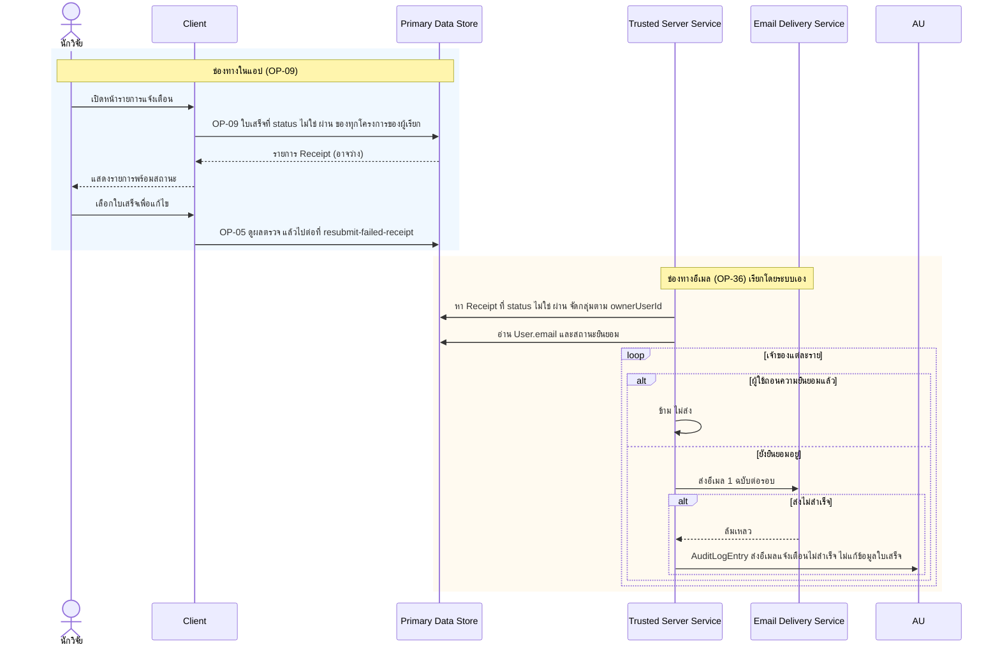
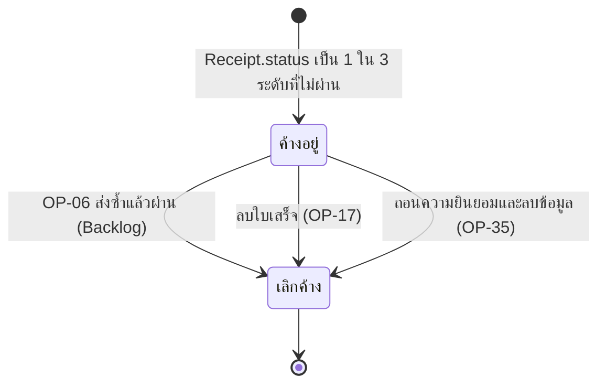

# Detailed Design — แจ้งเตือนใบเสร็จที่มีปัญหาค้างอยู่

> การออกแบบระดับ component สำหรับ [[feature-list#6. แจ้งเตือนใบเสร็จที่มีปัญหาค้างอยู่|ฟีเจอร์ที่ 6]]
> แปลงจาก [[user-journey#Journey 2: นักวิจัยติดตามภาพรวมโครงการและจัดการใบเสร็จที่มีปัญหาผ่าน Dashboard และการแจ้งเตือน|Journey 2]]
> อ้างอิง operation จริง: OP-09, OP-36 เท่านั้น (ใช้ OP-05 เป็นปลายทางเมื่อเจาะดูใบเสร็จ)
> test case: [[03-testing/01-test-plan/test-cases/pending-issue-notification|pending-issue-notification]]

## 0. สถานะเอกสารและสถานะการสร้าง

- **สถานะฟีเจอร์: Backlog ทั้งหมด** (FR-09 ยังไม่ได้สร้าง) **เขียนใหม่ 2026-11-17** ให้ตรงกับมติสถาปัตยกรรมผสม: การส่งอีเมลเป็น 1 ใน 3 หน้าที่ของ
  **Trusted Server Service** (ก็ยัง Backlog) การแจ้งเตือนในแอปอยู่ที่ Client

| Operation | ผู้เรียก | สถานะ |
|---|---|---|
| OP-09 ดูรายการแจ้งเตือนใบเสร็จที่มีปัญหาค้างอยู่ (ในแอป) | นักวิจัย (Client) | Backlog |
| OP-36 ส่งอีเมลแจ้งเตือนใบเสร็จที่ค้างอยู่ | ระบบเรียกเอง (Trusted Server Service) | Backlog |

## 1. ภาพรวม

"ใบเสร็จที่มีปัญหาค้าง" = `Receipt.status` ∈ {ต้องแก้ไข, ต้องชี้แจง/ขออนุมัติ, ไม่เข้าเงื่อนไข} **ไม่มี entity แจ้งเตือน** ทุกอย่างคำนวณจากสถานะ
ไม่รวมการแจ้งเตือนตามกำหนดเวลาส่งหลักฐานรายทุน (ตัดออกจาก MVP) มี 2 ช่องทาง: ในแอป (OP-09) และอีเมล (OP-36)
Component: Client, Primary Data Store, Trusted Server Service, Email Delivery Service (ภายนอก)

## 2. Sequence Diagram

## 3. Operation ↔ Entity ที่กระทบ

| Operation | Entity | การกระทำ | เงื่อนไข |
|---|---|---|---|
| [[api-spec#OP-09 ดูรายการแจ้งเตือนใบเสร็จที่มีปัญหาค้างอยู่\|OP-09]] | Receipt (E-04) | อ่านตาม `ownerUserId` = ผู้เรียก และ `status` ไม่ใช่ "ผ่าน" | คืนรายการว่างได้ ไม่ใช่ error |
| [[api-spec#OP-36 ส่งอีเมลแจ้งเตือนใบเสร็จที่ค้างอยู่\|OP-36]] | Receipt (E-04) | อ่านข้ามเจ้าของ จัดกลุ่มตาม `ownerUserId` | ไม่ส่งรายการ `status` = "ผ่าน" |
| OP-36 | User (E-01) | อ่าน `email`, `privacyConsentAcceptedAt` (ปลายทาง: ConsentRecord E-11 ล่าสุด) | ไม่ส่งให้ผู้ที่ถอนความยินยอมแล้ว |
| OP-36 | AuditLogEntry (E-14) | สร้างเมื่อส่งไม่สำเร็จ (`eventType` "ส่งอีเมลแจ้งเตือนไม่สำเร็จ") | ไม่มี entity ประวัติการส่งที่สำเร็จ (FR-09 ไม่กำหนด) |
| [[api-spec#OP-40 ดูรายการใบเสร็จของตนเอง (ทั้งหมด/รายโครงการ)\|OP-40]] | Receipt (E-04) | อ่าน | จุดเปิดใบเสร็จที่ค้างเพื่อไปแก้ไข (ก่อน OP-05) |

## 4. State Diagram — "มีปัญหาค้าง" (สถานะที่คำนวณ ไม่ใช่ entity)

## 5. Edge Case และวิธีจัดการ

| # | Edge Case | วิธีจัดการ | อ้างอิง |
|---|---|---|---|
| 1 | ไม่มีใบเสร็จค้าง | OP-09 คืนรายการว่าง OP-36 ไม่ส่งอะไร | OP-09, OP-36 |
| 2 | ผู้ใช้ถอนความยินยอมแล้ว | ไม่ส่งอีเมล (และข้อมูลใบเสร็จถูกลบตาม FR-20 อยู่แล้ว) | OP-36 |
| 3 | ส่งอีเมลล้มเหลว | บันทึกความล้มเหลว ไม่กระทบข้อมูลใบเสร็จ | OP-36 |
| 4 | ผู้ให้บริการอีเมลเป็นบริการภายนอก | ต้องพิจารณา NFR-08/NFR-09 (ที่ตั้ง/สัญญาประมวลผลข้อมูล) | OP-36 |
| 5 | ความถี่/กำหนดเวลาส่ง การไม่ส่งซ้ำใบเดิม เนื้อหาอีเมลที่ไม่เปิดเผยรายละเอียดใบเสร็จเกินจำเป็น | **ยังไม่กำหนด** (FR-09 ไม่ระบุ) ไม่เพิ่ม entity เก็บประวัติการส่ง — **ประเด็นเปิด Q-5** | db-spec 5.6 |
| 6 | แหล่งทุนของโครงการปิดใช้งาน | ไม่เกี่ยวกับการแจ้งเตือน ใช้สถานะใบเสร็จเท่านั้น | FR-35 |
| 7 | ไม่แจ้งตามกำหนดส่งหลักฐานรายทุน | อยู่นอกขอบเขต MVP | FR-09 |

## 6. ประเด็นเปิดและช่องว่าง

- **Q-5:** ความถี่ การไม่ส่งซ้ำ และเนื้อหาอีเมล (FR-09 ไม่ระบุ — ส่งกลับผู้ประสานงานเพื่อรอการออกแบบ ไม่เดา)
- **G-4 ปิดแล้ว:** ความล้มเหลวของ OP-36 บันทึกเป็น AuditLogEntry "ส่งอีเมลแจ้งเตือนไม่สำเร็จ"
- **Q-5 ยังเปิดอยู่** จนกว่าจะออกแบบ FR-09 (ไม่ตัดสินแทน)

## เอกสารที่เกี่ยวข้อง

- [[feature-list#6. แจ้งเตือนใบเสร็จที่มีปัญหาค้างอยู่|feature-list ฟีเจอร์ที่ 6]], [[user-journey#Journey 2: นักวิจัยติดตามภาพรวมโครงการและจัดการใบเสร็จที่มีปัญหาผ่าน Dashboard และการแจ้งเตือน|Journey 2]], [[architecture]] 3.2, [[api-spec]], [[db-spec]]
- [[02-design/02-technical/detailed-design/resubmit-failed-receipt|resubmit-failed-receipt]], [[02-design/02-technical/detailed-design/consent-management|consent-management]]
