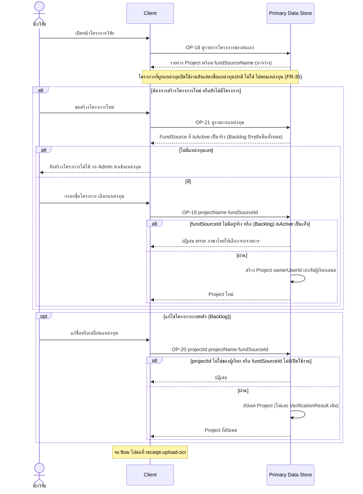

# Detailed Design — จัดการข้อมูลโครงการวิจัยและผูกกับแหล่งทุน (Project Setup)

> การออกแบบระดับ component สำหรับ [[feature-list#13. จัดการข้อมูลโครงการวิจัยและผูกกับแหล่งทุน (Project Setup)|ฟีเจอร์ที่ 13]]
> แปลงจาก [[user-journey#Journey 1: นักวิจัยอัปโหลดใบเสร็จและตรวจสอบผลจนผ่านเกณฑ์|Journey 1]] (ขั้นเลือก/สร้างโครงการ — ไม่มี journey แยก)
> อ้างอิง operation จริง: OP-18, OP-21, OP-19, OP-20
> test case: [[03-testing/01-test-plan/test-cases/project-setup|project-setup]]

## 0. สถานะเอกสารและสถานะการสร้าง

- **ปรับปรุง 2026-11-17** (สร้างครั้งแรก 2026-09-03) แก้ให้ตรงกับ [[api-spec]]/[[db-spec]] รอบนี้: ตัด Backend Service ใช้ Client + Primary Data Store,
  เพิ่มเงื่อนไข `isActive` ของแหล่งทุน (FR-35), ระบุว่า OP-20 ยังไม่ได้สร้าง

| Operation | สถานะ |
|---|---|
| OP-18 ดูรายการโครงการของตนเอง | สร้างแล้ว |
| OP-21 ดูรายการแหล่งทุน | สร้างแล้ว (ตัวกรอง `isActive`/`includeInactive` เป็น Backlog FR-35) |
| OP-19 สร้างโครงการใหม่ผูกแหล่งทุน | สร้างแล้ว (การปฏิเสธแหล่งทุนปิดใช้งานเป็น Backlog FR-35) |
| OP-20 แก้ไขโครงการ | **Backlog** (ยังไม่มีหน้าจอแก้ไข มีเฉพาะแสดงรายการและสร้าง) |

## 1. ภาพรวม

เงื่อนไขก่อนหน้า (gate) ของการอัปโหลดใบเสร็จ เพราะ `Receipt.projectId` ต้องชี้ `Project` ที่มีอยู่ 1 โครงการมีเจ้าของ 1 คน ผูกแหล่งทุน 1 แหล่ง นักวิจัย 1 คนมีได้หลายโครงการ
สร้างโครงการได้โดยไม่ต้องมีประมาณการก่อน (นำเข้าภายหลัง — [[02-design/02-technical/detailed-design/budget-estimate-check|budget-estimate-check]])
Component: Client, Primary Data Store

## 2. Sequence Diagram

## 3. Operation ↔ Entity ที่กระทบ

| Operation | Entity | การกระทำ | ลำดับ/เงื่อนไข |
|---|---|---|---|
| [[api-spec#OP-18 ดูรายการโครงการวิจัยของตนเอง\|OP-18]] | Project (E-03), FundSource (E-02) | อ่าน | `ownerUserId` = ผู้เรียก; คืนว่างได้; ชื่อแหล่งทุนต้องอ่านได้แม้ปิดใช้งาน |
| [[api-spec#OP-21 ดูรายการแหล่งทุน\|OP-21]] | FundSource (E-02) | อ่าน | ไม่กรองเจ้าของ ไม่รวมกฎ นักวิจัยเห็นเฉพาะ `isActive` เป็นจริง (Backlog) |
| [[api-spec#OP-19 สร้างโครงการวิจัยใหม่ผูกกับแหล่งทุน\|OP-19]] | FundSource (E-02) | อ่านตรวจว่ามีอยู่และ `isActive` เป็นจริง (ส่วน `isActive` Backlog) | ก่อนสร้าง |
| OP-19 | Project (E-03) | สร้าง (`ownerUserId` = ผู้เรียกเสมอ ไม่รับจากภายนอก) | |
| [[api-spec#OP-20 แก้ไขข้อมูลโครงการวิจัย (ชื่อ/แหล่งทุนที่ผูก)\|OP-20]] | Project (E-03), FundSource (E-02) | อ่านตรวจเจ้าของ/แหล่งทุนใหม่ แล้วแก้ | Backlog; ไม่แตะ VerificationResult (E-08) — `ruleVersionId` เป็น snapshot |

## 4. State Diagram

ไม่มี — `Project` ไม่มีฟิลด์สถานะ ([[db-spec]] E-03 มีเพียง `projectName`, `ownerUserId`, `fundSourceId`, `createdAt`) ความสัมพันธ์ที่เปลี่ยนได้เพียง `fundSourceId` ผ่าน OP-20 (Backlog)
ส่วนสถานะ `FundSource.isActive` อยู่ที่ [[02-design/02-technical/detailed-design/admin-dashboard|admin-dashboard]]

## 5. Edge Case และวิธีจัดการ

| # | Edge Case | วิธีจัดการ | อ้างอิง |
|---|---|---|---|
| 1 | ยังไม่เคยสร้างโครงการ | OP-18 คืนรายการว่าง Client พาไปสร้างผ่าน OP-19 | FR-23 |
| 2 | Admin ยังไม่นำเข้าแหล่งทุน | OP-21 ว่าง สร้างโครงการไม่ได้ จนกว่า Admin นำเข้า ([[02-design/02-technical/detailed-design/admin-rule-management\|admin-rule-management]]) | FR-23, FR-11 |
| 3 | `fundSourceId` ไม่มีอยู่จริง | ปฏิเสธพร้อม error ภาษาไทยให้เลือกจากรายการ | NFR-02 |
| 4 | แหล่งทุนถูกปิดใช้งาน | โครงการใหม่เลือกไม่ได้ (Backlog) โครงการเดิมแสดงชื่อต่อและยังส่งตรวจต่อได้พร้อมคำเตือน | FR-35, architecture 5.5 |
| 5 | แหล่งทุนถูกลบถาวร (OP-33 ปัจจุบัน) | โครงการที่ผูกอยู่แสดง "ไม่พบแหล่งทุน" และใบเสร็จตรวจได้เป็น "ไม่เข้าเงื่อนไข" `NO_FUND_SOURCE` — ช่องว่างที่ FR-35 มีไว้ปิด | OP-33 |
| 6 | `projectId` ไม่ใช่ของผู้เรียก (OP-20) | ปฏิเสธ | [[02-design/02-technical/detailed-design/access-control\|access-control]] |
| 7 | จำนวนโครงการต่อนักวิจัย | ไม่จำกัด | db-spec กฎข้อ 12 |
| 8 | เปลี่ยนแหล่งทุนของโครงการที่มีใบเสร็จแล้ว (Backlog) | ผลตรวจเดิมไม่เปลี่ยน ใบเสร็จที่ยังไม่ส่งตรวจใช้ระเบียบของแหล่งทุนใหม่ในครั้งถัดไป | OP-20 ข้อ 2 |
| 9 | อัปโหลดใบเสร็จโดยไม่มีโครงการ | ถูกพากลับมาที่ OP-19 | [[02-design/02-technical/detailed-design/receipt-upload-ocr\|receipt-upload-ocr]] |
| 10 | ถอนความยินยอม | `Project` ไม่ถูกลบ นักวิจัยกลับมาใช้ได้ | db-spec E-03 |

## เอกสารที่เกี่ยวข้อง

- [[feature-list#13. จัดการข้อมูลโครงการวิจัยและผูกกับแหล่งทุน (Project Setup)|feature-list ฟีเจอร์ที่ 13]], [[user-journey#Journey 1: นักวิจัยอัปโหลดใบเสร็จและตรวจสอบผลจนผ่านเกณฑ์|Journey 1]], [[architecture]] 3.1, [[api-spec]], [[db-spec]]
- [[02-design/02-technical/detailed-design/admin-dashboard|admin-dashboard]], [[02-design/02-technical/detailed-design/rule-engine-verification|rule-engine-verification]]
