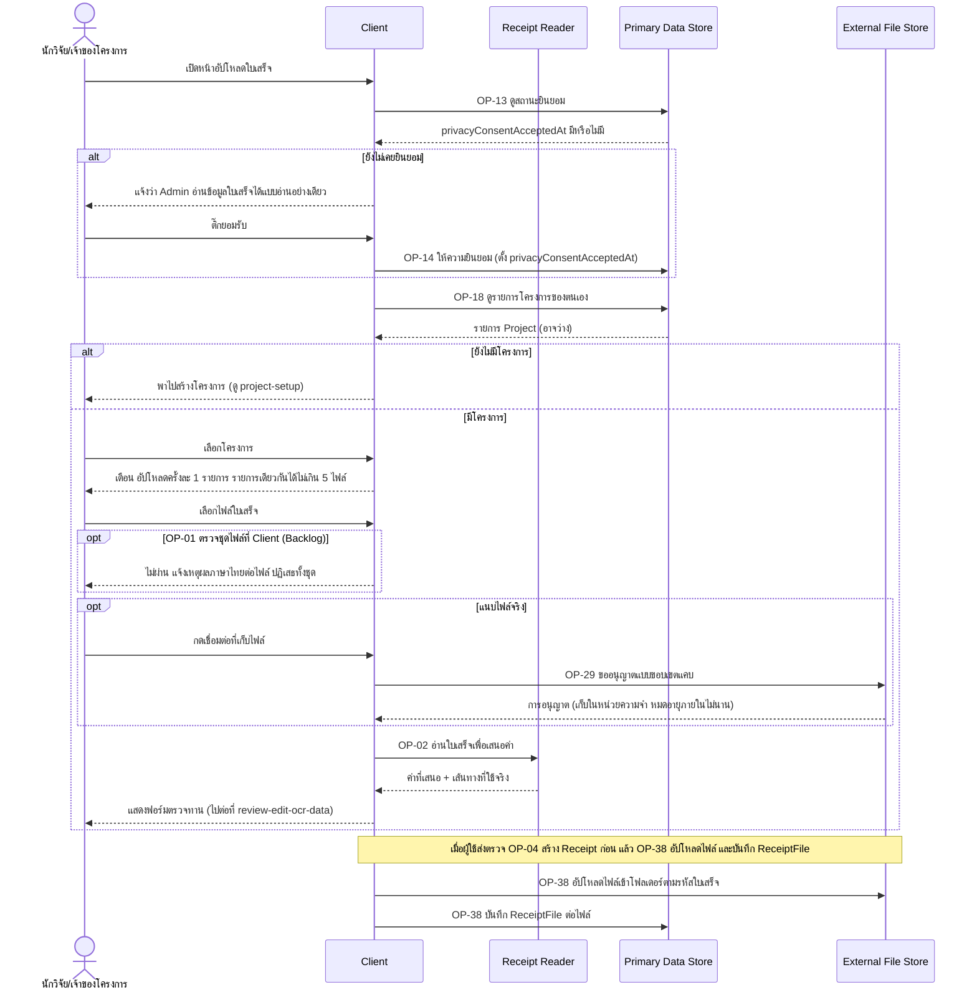
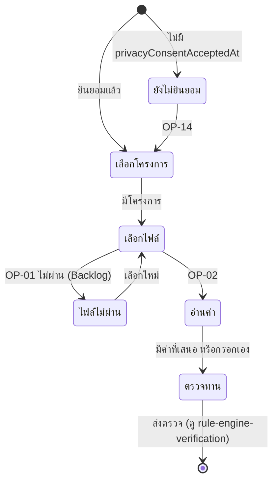

# Detailed Design — อัปโหลดใบเสร็จและอ่านข้อมูลอัตโนมัติด้วย OCR

> การออกแบบระดับ component สำหรับ [[feature-list#1. อัปโหลดใบเสร็จและอ่านข้อมูลอัตโนมัติด้วย OCR|ฟีเจอร์ที่ 1]]
> แปลงจาก [[user-journey#Journey 1: นักวิจัยอัปโหลดใบเสร็จและตรวจสอบผลจนผ่านเกณฑ์|Journey 1]]
> อ้างอิง operation จริงจาก [[api-spec]] เท่านั้น: OP-13, OP-14, OP-18, OP-01, OP-29, OP-02, OP-38
> test case: [[03-testing/01-test-plan/test-cases/receipt-upload-ocr|receipt-upload-ocr]]

## 0. สถานะเอกสารและสถานะการสร้าง

- **เขียนใหม่ทั้งไฟล์ 2026-11-17** ให้ตรงกับ [[api-spec]] (OP-01–OP-39) / [[db-spec]] (E-01–E-24) ที่ sync วันนี้ ของเดิมอ้าง Backend Service,
  ใบเสร็จสถานะ "รอ OCR" ที่บันทึกถาวร และ OP-03 ซึ่งไม่มีแล้ว
- **สาระสำคัญที่เปลี่ยน:** ใบเสร็จ (`Receipt`) และไฟล์อ้างอิง (`ReceiptFile`) **ถูกสร้างตอนส่งตรวจ** ไม่ใช่ตอนเลือกไฟล์ การอ่านด้วย AI/OCR (OP-02)
  เสนอค่าบนหน้าจอเท่านั้น ไม่บันทึกข้อมูล

| ส่วนของฟีเจอร์ | Operation | สถานะ |
|---|---|---|
| ตรวจ/ให้ความยินยอมก่อนอัปโหลดครั้งแรก | OP-13, OP-14 | สร้างบางส่วน (ยินยอมแบบเบา) |
| เลือกโครงการที่จะผูกใบเสร็จ | OP-18 | สร้างแล้ว |
| เชื่อมต่อที่เก็บไฟล์ภายนอกของผู้ใช้ | OP-29 | สร้างแล้ว |
| อ่านใบเสร็จด้วย AI/OCR เพื่อเสนอค่า | OP-02 | สร้างแล้ว (รายละเอียดที่ [[02-design/02-technical/detailed-design/ai-ocr-receipt-reading\|ai-ocr-receipt-reading]]) |
| อัปโหลดไฟล์ไปที่เก็บไฟล์ภายนอกและบันทึกข้อมูลอ้างอิง | OP-38 | สร้างแล้ว |
| ตรวจชุดไฟล์ (ชนิด/ขนาด 5 MB/จำนวน 1–5 ไฟล์/ไฟล์เสียหาย) | OP-01 | **Backlog** (FR-19/FR-22 ยังไม่ได้บังคับในระบบที่สร้าง) |

## 1. ภาพรวม

ลำดับ: ผ่านเงื่อนไขความยินยอม → เลือกโครงการ → แนบไฟล์ (เตือน "ครั้งละ 1 รายการ") → (ถ้าแนบไฟล์) เชื่อมต่อที่เก็บไฟล์ภายนอก → อ่านด้วย AI/OCR
เพื่อเสนอค่า → ไปขั้นตรวจทาน ([[02-design/02-technical/detailed-design/review-edit-ocr-data|review-edit-ocr-data]]) → ส่งตรวจ
([[02-design/02-technical/detailed-design/rule-engine-verification|rule-engine-verification]]) แล้วจึงอัปโหลดไฟล์ (OP-38)
Component: Client, Receipt Reader, Primary Data Store, User-owned External File Store

## 2. Sequence Diagram

## 3. Operation ↔ Entity ที่กระทบ

| Operation | Entity | การกระทำ | ลำดับ/เงื่อนไข |
|---|---|---|---|
| [[api-spec#OP-13 ดูสถานะยินยอมและ Privacy Notice\|OP-13]] | User (E-01) | อ่าน `privacyConsentAcceptedAt` | ก่อนอัปโหลดครั้งแรกเสมอ |
| [[api-spec#OP-14 ให้ความยินยอมชัดแจ้ง\|OP-14]] | User (E-01) | แก้ `privacyConsentAcceptedAt` | ทำครั้งเดียว ไม่แตะ `roleType` ปลายทาง FR-15: เขียน ConsentRecord (E-11) |
| [[api-spec#OP-18 ดูรายการโครงการวิจัยของตนเอง\|OP-18]] | Project (E-03), FundSource (E-02) | อ่าน | เฉพาะ `ownerUserId` = ผู้เรียก |
| [[api-spec#OP-01 ตรวจสอบชุดไฟล์ใบเสร็จก่อนใช้งาน\|OP-01]] | ไม่มี | ตรวจล้วน ไม่บันทึก | Backlog |
| [[api-spec#OP-29 เชื่อมต่อที่เก็บไฟล์ภายนอกของผู้ใช้\|OP-29]] | ไม่มี (การอนุญาตอยู่ในหน่วยความจำ) | — | ต้องทำก่อน OP-38 |
| [[api-spec#OP-02 อ่านใบเสร็จด้วย AI/OCR เพื่อเสนอค่า\|OP-02]] | ไม่มี | ไม่บันทึกค่าที่เสนอ | db-spec กฎข้อ 1 |
| [[api-spec#OP-38 อัปโหลดไฟล์ใบเสร็จไปยังที่เก็บไฟล์ภายนอกและบันทึกข้อมูลอ้างอิง\|OP-38]] | ReceiptFile (E-05) | สร้าง 1 record ต่อไฟล์ | ต้องมี Receipt (E-04) อยู่แล้ว (สร้างโดย OP-04) |

## 4. State Diagram

ไม่มีสถานะของ `Receipt` ในฟีเจอร์นี้ (ใบเสร็จยังไม่ถูกสร้าง) แผนภาพด้านล่างคือ **สถานะชั่วคราวของหน้าจอ ไม่บันทึกถาวร** ([[db-spec]] หัวข้อ 5.4)

## 5. Edge Case และวิธีจัดการ

| # | Edge Case | วิธีจัดการ | อ้างอิง |
|---|---|---|---|
| 1 | ยังไม่ยินยอม | บล็อกพร้อมคำเตือนจนกว่าจะติ๊ก (ไม่ใช่ error) | OP-14, FR-14 |
| 2 | ยังไม่มีโครงการ | OP-18 คืนรายการว่าง Client พาไปสร้างโครงการก่อน | OP-18, [[02-design/02-technical/detailed-design/project-setup\|project-setup]] |
| 3 | ไฟล์ผิดชนิด เสียหาย เกิน 5 MB หรือเกิน 5 ไฟล์ | ปฏิเสธทั้งชุดพร้อมเหตุผลภาษาไทย — **ยังเป็น Backlog** ระบบที่สร้างแล้วไม่บังคับครบ และการตรวจอยู่ที่ Client จึงไม่ authoritative (ข้อจำกัดที่ยอมรับตามมติผสม) | OP-01, FR-19, FR-22 |
| 4 | ผู้ใช้เลือกใบเสร็จหลายรายการปนในชุดเดียว | แสดงคำเตือน "ครั้งละ 1 รายการ" ก่อนเลือกไฟล์ ไม่มีกลไกตรวจอัตโนมัติ | FR-22 |
| 5 | แนบไฟล์แต่ยังไม่เชื่อมต่อที่เก็บไฟล์ หรือสิทธิ์หมดอายุ | ที่ขั้นส่งตรวจ ปฏิเสธการส่งพร้อมคำเตือนให้เชื่อมต่อ ไม่ล้มเหลวเงียบ | OP-29, OP-04 |
| 6 | AI/OCR ไม่พร้อมหรือล้มเหลว | ถอยกลับเป็นกรอกเอง/ข้อมูลสาธิตพร้อมแจ้งเส้นทางที่ใช้ ไม่ขวาง flow | OP-02 |
| 7 | PDF แปลงหน้าแรกเป็นภาพไม่ได้ | แจ้งผู้ใช้และให้กรอกเอง | OP-02 |
| 8 | ไม่แนบไฟล์จริง (โหมดสาธิต) | บันทึกใบเสร็จได้ ไม่มี `ReceiptFile` (ข้อยกเว้นของ db-spec กฎข้อ 9) | db-spec กฎข้อ 9 |
| 9 | OP-38 ล้มเหลวหลัง OP-04 บันทึกใบเสร็จแล้ว | **ตัดสินแล้ว (Q-2, ตรงกับระบบที่สร้างแล้ว):** ใบเสร็จถูกบันทึกก่อน (OP-04) แล้วจึงอัปโหลดไฟล์ ถ้าอัปโหลดล้มเหลวใบเสร็จคงอยู่โดยไม่มีไฟล์ (บางไฟล์) ผู้ใช้เห็น error ออกแบบให้ **ไม่ rollback** และให้ผู้ใช้ลองอัปโหลดซ้ำ (OP-38) | OP-38 |

## 6. ประเด็นเปิด

ไม่มี — Q-2 ตัดสินแล้ว (Edge Case ข้อ 9): คงใบเสร็จ ไม่ rollback ให้ลองอัปโหลดซ้ำด้วย OP-38 กับ `Receipt` เดิม

## เอกสารที่เกี่ยวข้อง

- [[feature-list#1. อัปโหลดใบเสร็จและอ่านข้อมูลอัตโนมัติด้วย OCR|feature-list ฟีเจอร์ที่ 1]], [[user-journey#Journey 1: นักวิจัยอัปโหลดใบเสร็จและตรวจสอบผลจนผ่านเกณฑ์|Journey 1]]
- [[architecture]] หัวข้อ 3.1, [[api-spec]], [[db-spec]]
- ฟีเจอร์ที่ต่อเนื่อง: [[02-design/02-technical/detailed-design/ai-ocr-receipt-reading|ai-ocr-receipt-reading]], [[02-design/02-technical/detailed-design/google-drive-attachment|google-drive-attachment]], [[02-design/02-technical/detailed-design/consent-management|consent-management]]
