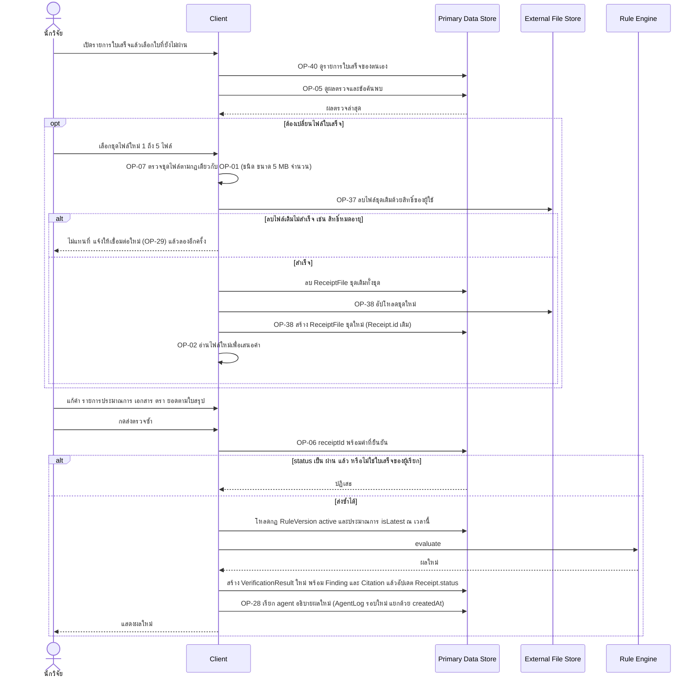
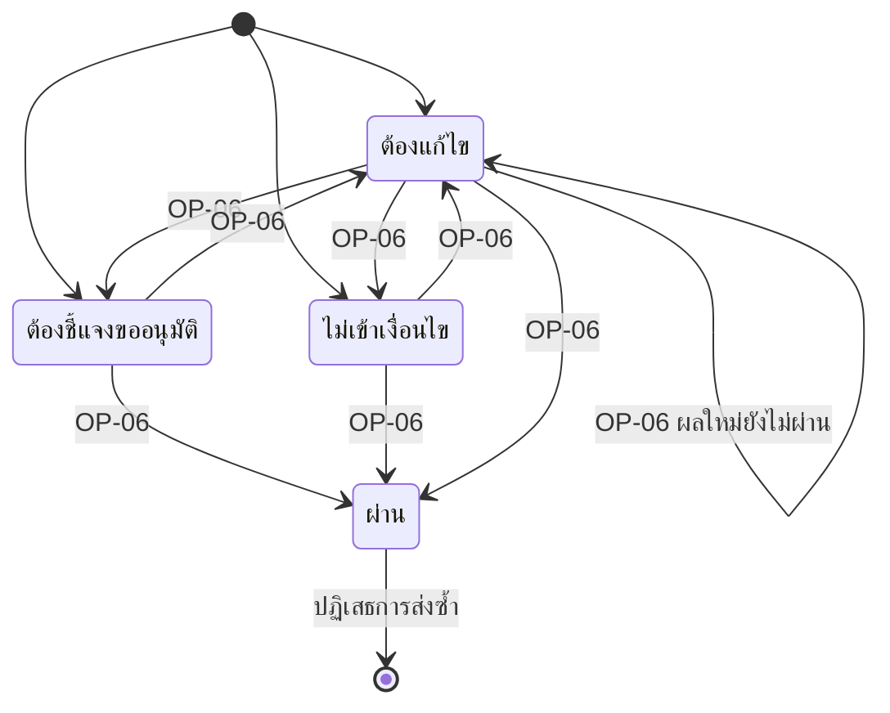

# Detailed Design — แก้ไขและส่งใบเสร็จที่ไม่ผ่านตรวจซ้ำ

> การออกแบบระดับ component สำหรับ [[feature-list#4. แก้ไขและส่งใบเสร็จที่ไม่ผ่านตรวจซ้ำ|ฟีเจอร์ที่ 4]]
> แปลงจาก [[user-journey#Journey 2: นักวิจัยติดตามภาพรวมโครงการและจัดการใบเสร็จที่มีปัญหาผ่าน Dashboard และการแจ้งเตือน|Journey 2]] (ส่วนแก้ไขแล้วส่งซ้ำ)
> อ้างอิง operation จริง: OP-06, OP-07, OP-37, OP-38, OP-29, OP-02, OP-27, OP-05
> test case: [[03-testing/01-test-plan/test-cases/resubmit-failed-receipt|resubmit-failed-receipt]]

## 0. สถานะเอกสารและสถานะการสร้าง

- **สถานะฟีเจอร์: Backlog ทั้งหมด** (FR-07 ยังไม่ได้สร้าง ระบบที่สร้างแล้วไม่มีหน้าจอแก้ไขใบเสร็จหรือส่งตรวจซ้ำ) เอกสารนี้เป็นการออกแบบเป้าหมาย
- **เขียนใหม่ 2026-11-17** ให้ใช้ผลตรวจ 4 ระดับ ตัด "รอผลตรวจ"/"รอ OCR" เพิ่มลำดับลบไฟล์ภายนอกก่อนแทนที่ไฟล์ (FR-37)

| Operation | สถานะ |
|---|---|
| OP-06 แก้ข้อมูลแล้วส่งตรวจซ้ำ | Backlog |
| OP-07 อัปโหลดไฟล์ใหม่แทนชุดเดิม | Backlog |
| OP-37 ลบไฟล์เดิมในที่เก็บไฟล์ภายนอก | Backlog |
| OP-38, OP-29, OP-02, OP-27, OP-05 | สร้างแล้ว (ใช้ซ้ำ) |

## 1. ภาพรวม

ผู้ใช้เปิดใบเสร็จที่ `status` เป็น "ต้องแก้ไข" / "ต้องชี้แจง/ขออนุมัติ" / "ไม่เข้าเงื่อนไข" ดูเหตุผล (OP-05) แล้วเลือก (ก) แก้ข้อมูลอย่างเดียว (OP-06) หรือ
(ข) เปลี่ยนไฟล์ทั้งชุด (OP-07) แล้วตรวจทานและส่งซ้ำ (OP-06) **วนจนกว่าจะ "ผ่าน"** การส่งซ้ำสร้าง `VerificationResult` ใหม่ ไม่แก้ของเดิม (append-only)
Component: Client, Rule Engine, Primary Data Store, User-owned External File Store (และปลายทาง Trusted Server Service ตามมติ OP-34)

## 2. Sequence Diagram

## 3. Operation ↔ Entity ที่กระทบ

| Operation | Entity | การกระทำ | ลำดับ/เงื่อนไข |
|---|---|---|---|
| [[api-spec#OP-06 แก้ไขข้อมูลใบเสร็จแล้วส่งตรวจซ้ำ\|OP-06]] | Receipt (E-04) | อ่านตรวจเจ้าของ/สถานะ แล้วแก้ `confirmed*`, `estimateLineId`, `summaryAmount`, `providedDocumentTypeIds`, `confirmedAttestationKeys`, `status` | **ครั้งแรกที่ `status` เปลี่ยนหลังสร้าง** เฉพาะ `status` ∈ 3 ระดับที่ไม่ผ่าน |
| OP-06 | VerificationResult (E-08), VerificationFinding (E-23), VerificationRuleCitation (E-09) | สร้างชุดใหม่ ไม่แก้ชุดเดิม | หลัง evaluate; snapshot กฎ/ประมาณการเวอร์ชัน ณ เวลาส่งซ้ำ |
| [[api-spec#OP-07 อัปโหลดไฟล์ใบเสร็จใหม่แทนชุดเดิม\|OP-07]] | ReceiptFile (E-05) | ลบชุดเดิมทั้งชุด แล้วสร้างชุดใหม่ผ่าน OP-38 | แทนที่ทั้งชุดเท่านั้น ไม่แทนทีละไฟล์ (db-spec กฎข้อ 9) |
| [[api-spec#OP-37 ลบไฟล์แนบในที่เก็บไฟล์ภายนอกของผู้ใช้\|OP-37]] | ReceiptFile (`externalFileId`/`fileReference`) | อ่านเพื่อลบไฟล์จริง | ต้องสำเร็จก่อนลบ `ReceiptFile` |
| [[api-spec#OP-38 อัปโหลดไฟล์ใบเสร็จไปยังที่เก็บไฟล์ภายนอกและบันทึกข้อมูลอ้างอิง\|OP-38]] | ReceiptFile (E-05) | สร้าง | ต้องเชื่อมต่อแล้ว (OP-29) |
| [[api-spec#OP-02 อ่านใบเสร็จด้วย AI/OCR เพื่อเสนอค่า\|OP-02]], [[api-spec#OP-27 ดูรายการเอกสาร/ตราที่ต้องมีของหมวดและยอด\|OP-27]] | — | ใช้ซ้ำเช่นเดิม | ไม่บันทึก |

## 4. State Diagram — Receipt.status เมื่อส่งซ้ำ

ทุกลูกศรเกิดจาก OP-06 เท่านั้น และแต่ละครั้งเพิ่ม `VerificationResult` ใหม่ ผลเดิมคงอยู่ใช้ย้อนตรวจได้

## 5. Edge Case และวิธีจัดการ

| # | Edge Case | วิธีจัดการ | อ้างอิง |
|---|---|---|---|
| 1 | ใบเสร็จ "ผ่าน" แล้ว | ปฏิเสธการส่งซ้ำ | OP-06, OP-07 |
| 2 | ใบเสร็จไม่ใช่ของผู้เรียก (รวม Admin) | ปฏิเสธ ไม่เปิดเผยว่ามีอยู่ | หัวข้อ 2 ของ api-spec |
| 3 | ลบไฟล์เดิมในที่เก็บภายนอกไม่สำเร็จ | **ไม่แทนที่** คง `ReceiptFile` เดิมครบ แจ้งให้เชื่อมต่อใหม่แล้วลองอีก (ไม่มีไฟล์กำพร้า) | OP-07, OP-37 |
| 4 | ชุดไฟล์ใหม่ผิดกฎ (ชนิด/ขนาด/จำนวน) | ปฏิเสธทั้งชุดพร้อมเหตุผลภาษาไทย ไม่ลบชุดเดิม | OP-01 |
| 5 | ระเบียบ/ประมาณการเปลี่ยนระหว่างรอ | ใช้ `RuleVersion` active และประมาณการ `isLatest` ณ เวลาส่งซ้ำ ผลเก่าไม่เปลี่ยน | db-spec กฎข้อ 2, 11 |
| 6 | แหล่งทุนปิดใช้งานระหว่างรอ | ตรวจต่อด้วยกฎที่เก็บไว้พร้อมคำเตือน | architecture 5.5 ข้อ 1 |
| 7 | ผู้ใช้แก้ค่าแล้วยังเกินประมาณการ | ได้ "ต้องชี้แจง/ขออนุมัติ" ต่อไป การชี้แจงเกิดนอกระบบ ระบบไม่มีบทบาทผู้อนุมัติ | architecture 1 |
| 8 | ส่งซ้ำพร้อมกัน 2 หน้าต่าง | api-spec ไม่ระบุ — แต่ละครั้งสร้าง `VerificationResult` ใหม่ สถานะสุดท้ายตามครั้งหลังสุด (ไม่ได้ตัดสินกลไกป้องกัน) | OP-06 |

## 6. ประเด็นเปิด

ไม่มี — **Q-4 ตัดสินแล้ว:** หลัง OP-06 สำเร็จ เรียก agent (OP-28) อีกครั้ง `AgentLog` แต่ละรอบแยกด้วย `createdAt` (ไม่มีฟิลด์เพิ่ม) รอบล่าสุดคือปัจจุบัน และ `explanationText` ของผลตรวจใหม่ถูกเขียนทับตามปกติ

## เอกสารที่เกี่ยวข้อง

- [[feature-list#4. แก้ไขและส่งใบเสร็จที่ไม่ผ่านตรวจซ้ำ|feature-list ฟีเจอร์ที่ 4]], [[user-journey#Journey 2: นักวิจัยติดตามภาพรวมโครงการและจัดการใบเสร็จที่มีปัญหาผ่าน Dashboard และการแจ้งเตือน|Journey 2]], [[api-spec]], [[db-spec]]
- [[02-design/02-technical/detailed-design/rule-engine-verification|rule-engine-verification]], [[02-design/02-technical/detailed-design/google-drive-attachment|google-drive-attachment]], [[02-design/02-technical/detailed-design/pending-issue-notification|pending-issue-notification]]
