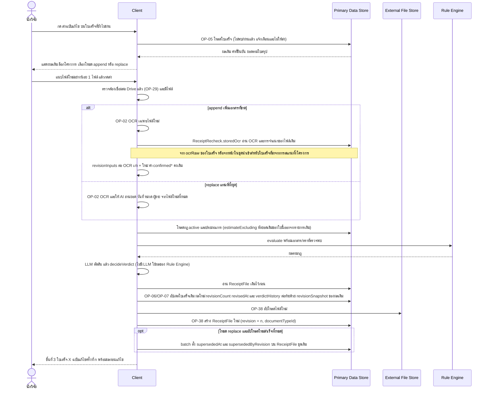
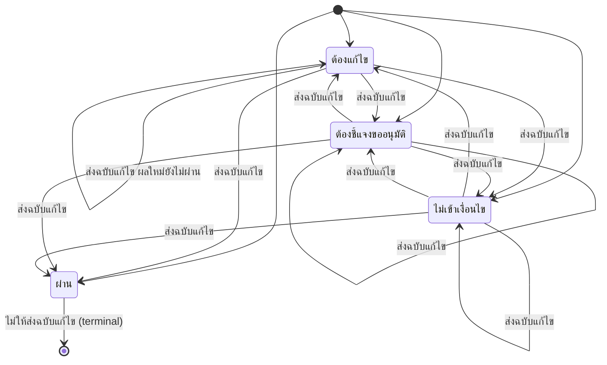

# Detailed Design — แก้ไขและส่งใบเสร็จที่ไม่ผ่านตรวจซ้ำ

> การออกแบบระดับ component สำหรับ [[feature-list#4. แก้ไขและส่งใบเสร็จที่ไม่ผ่านตรวจซ้ำ|ฟีเจอร์ที่ 4]]
> แปลงจาก [[user-journey#Journey 2: นักวิจัยติดตามภาพรวมโครงการและจัดการใบเสร็จที่มีปัญหาผ่าน Dashboard และการแจ้งเตือน|Journey 2]] (ส่วนแก้ไขแล้วส่งซ้ำ)
> อ้างอิง operation จริง: OP-06, OP-07, OP-37, OP-38, OP-29, OP-02, OP-05
> test case: [[03-testing/01-test-plan/test-cases/resubmit-failed-receipt|resubmit-failed-receipt]]

## 0. สถานะเอกสารและสถานะการสร้าง

- **สถานะฟีเจอร์: สร้างและ deploy แล้ว 2026-11-26** (commit 43fd4a9) เอกสารนี้อธิบายสิ่งที่สร้างจริง แทนการออกแบบเป้าหมายเดิม (เขียนใหม่ 2026-11-27)
- **การทดสอบ:** unit test ของฟังก์ชันล้วน (`isRevisable`, `revisionInputs`, `revisionSnapshot`) อยู่ใน `tests/receipt-pipeline.test.js` ส่วนการส่งจริงตั้งแต่อัปโหลด Drive ถึงเขียน Firestore เจ้าของโปรเจกต์ทดสอบเองในเครื่อง ยังไม่มีการทดสอบอัตโนมัติ end-to-end
- **ต่างจากการออกแบบเป้าหมายเดิม:**
  - ไม่มีขั้น "แก้ค่าเอง" แล้ว (หน้าตรวจทานแก้ไขข้อมูลถูกถอดตั้งแต่การปรับทิศทาง 2026-11-24) ระบบอ่านและตัดสินจากไฟล์เท่านั้น
  - **ไม่ลบไฟล์เดิมใน Drive** ตอนแทนที่ชุดไฟล์ แต่ทำเครื่องหมายว่าถูกแทนที่ เพื่อเก็บประวัติการแก้ไข (แทนลำดับ "ลบไฟล์ภายนอกก่อน" ที่ออกแบบไว้เดิม)
  - ใบเสร็จเดียวกัน รหัสเดิม อัปเดตในที่ (in place) และเก็บผลเดิมไว้ใน `verdictHistory` แทนการสร้าง `VerificationResult` ชุดใหม่ใน entity แยก

| Operation | สถานะ | บทบาทตามที่สร้างจริง |
|---|---|---|
| OP-06 ส่งตรวจซ้ำ | สร้างแล้ว | โหมด "เพิ่มเอกสารที่ขาด" (append) เก็บค่าที่อ่านไว้แล้วเดิม อ่านเฉพาะไฟล์ใหม่ |
| OP-07 อัปโหลดไฟล์ใหม่แทนชุดเดิม | สร้างแล้ว | โหมด "แทนที่ทั้งชุด" (replace) อ่านทุกอย่างจากไฟล์ใหม่ ไฟล์เดิมถูกซ่อน ไม่ถูกลบ |
| OP-37 ลบไฟล์ใน Drive | สร้างแล้ว (ไม่ถูกเรียกตอนส่งฉบับแก้ไข) | ใช้เฉพาะตอนลบใบเสร็จทั้งใบ ซึ่งลบไฟล์ Drive ทุกไฟล์รวมชุดที่ถูกแทนที่ |
| OP-38, OP-29, OP-02, OP-05 | สร้างแล้ว (ใช้ซ้ำ) | อัปโหลด/เชื่อมต่อ Drive, อ่านไฟล์ด้วย OCR/AI, ดูผลตรวจ |

## 1. ภาพรวม

ผู้ใช้เห็นปุ่ม "ส่งฉบับแก้ไข" บนใบเสร็จทุกใบที่ `status` ไม่ใช่ "ผ่าน" (`ReceiptPipeline.isRevisable`) ทั้งในหน้ารายการใบเสร็จและหน้า "ประมาณการและใบเสร็จ"
ปุ่มพาไปหน้าอัปโหลด `new-receipt.html?projectId=…&revise=receiptNNN` หน้านั้นโหลดใบเสร็จเดิม แสดงผลเดิม ล็อกโครงการ และเติมยอดตามใบสรุปเดิม
ผู้ใช้เลือกโหมด **เพิ่มเอกสารที่ขาด** (ค่าเริ่มต้น) หรือ **แทนที่ทั้งชุด** แนบไฟล์อย่างน้อย 1 ไฟล์ แล้วระบบทำขั้นตอนเดียวกับการอัปโหลดใหม่: จำแนกเอกสาร/ตรวจหลักฐาน, Rule Engine, LLM (โหมดตัดสินเริ่มต้นคือ llm) และ `decideVerdict`
ใบเสร็จ **รหัสเดิมและเอกสารเดิม** ถูกอัปเดตในที่ ทำให้ยอดสะสมของรายการประมาณการไม่นับซ้ำ ส่งซ้ำได้หลายรอบจนกว่าจะ "ผ่าน"
Component: Client, Rule Engine, Primary Data Store, User-owned External File Store, ผู้ให้บริการ OCR/LLM (ปลายทาง Trusted Server Service ตามมติ OP-34 ยังไม่สร้าง)

## 2. Sequence Diagram

หลังส่งฉบับแก้ไข ปุ่ม "อัปโหลดใบเสร็จใหม่" พาไปหน้าอัปโหลดแบบปกติ (ไม่ค้างโหมดแก้ไข)

## 3. Operation ↔ Entity ที่กระทบ

| Operation | Entity | การกระทำ | ลำดับ/เงื่อนไข |
|---|---|---|---|
| [[api-spec#OP-06 ส่งฉบับแก้ไขและตรวจใบเสร็จซ้ำ\|OP-06]] (append) | Receipt (E-04) | อ่านตรวจสถานะ แล้วอัปเดต `status`, `aiExplanation`, `ruleCheck`, `llmVerdict`, `verdictMode`, `ocrRaw` (ทุกไฟล์ที่ใช้ตรวจ), `providedDocumentTypeIds`, `confirmedAttestations`, `revisionCount`, `revisedAt`; `verdictHistory` เพิ่มด้วย `arrayUnion(revisionSnapshot)` | เฉพาะ `status` ที่ไม่ใช่ "ผ่าน"; ยอด วันที่ หมวด ผู้ขายคงเดิม |
| [[api-spec#OP-07 แทนที่ชุดไฟล์ของใบเสร็จ (OP-06 โหมด "แทนที่ทั้งชุด")\|OP-07]] (replace) | Receipt (E-04), ReceiptFile (E-05) | อัปเดตใบเสร็จเหมือน OP-06 พร้อมค่าที่อ่านใหม่; ตั้ง `supersededAt` + `supersededByRevision` บน ReceiptFile ชุดเดิม | ตั้งหลังอัปโหลดไฟล์ใหม่สำเร็จเท่านั้น; ไฟล์เดิมไม่ถูกลบ ทั้งเรคคอร์ดและไฟล์ใน Drive |
| [[api-spec#OP-38 อัปโหลดไฟล์ใบเสร็จไปยังที่เก็บไฟล์ภายนอกและบันทึกข้อมูลอ้างอิง\|OP-38]] | ReceiptFile (E-05) | สร้างเรคคอร์ดใหม่ มี `revision` = n และ `documentTypeId` | ต้องเชื่อมต่อ Drive แล้ว (OP-29); รหัสใบเสร็จเดิม |
| OP-29 | — | ตรวจว่าเชื่อมต่ออยู่ก่อนส่ง | token หมดอายุ ให้เชื่อมต่อใหม่ |
| [[api-spec#OP-02 อ่านใบเสร็จด้วย AI/OCR เพื่อเสนอค่า\|OP-02]] | — | OCR ไฟล์ใหม่ (append) หรืออ่านค่าจากไฟล์ใหม่ทั้งหมด (replace) | OCR ล่ม หรือ AI ไม่พร้อม ใช้ทางสำรองเหมือนอัปโหลดปกติ |
| [[api-spec#OP-05 ดูรายละเอียดผลตรวจใบเสร็จ\|OP-05]] | Receipt (E-04), ReceiptFile (E-05) | อ่านผลเดิมมาแสดง; อ่านไฟล์เดิมก่อนเขียน | หน้ารายการ/ประมาณการ/แดชบอร์ดไม่แสดงไฟล์ที่มี `supersededAt` |
| [[api-spec#OP-37 ลบไฟล์แนบในที่เก็บไฟล์ภายนอกของผู้ใช้\|OP-37]] | ReceiptFile | **ไม่ถูกเรียกตอนส่งฉบับแก้ไข** | ลบใบเสร็จทั้งใบยังลบไฟล์ Drive ทุกไฟล์ รวมชุดที่ถูกแทนที่ |

**ยอดสะสมประมาณการ:** `ReceiptStore.estimateExcluding` หักยอดเดิมของใบเสร็จนี้ออกจากรายการประมาณการเดิม ก่อนตรวจด้วยยอดใหม่ ใบเสร็จเดียวกันจึงไม่ถูกนับซ้ำ

**ขนาดข้อมูล:** `revisionSnapshot` เก็บ `kind: "revision"`, เลขครั้ง, โหมด, ผลเดิม (status, explanation, ruleCheck, llmVerdict, ค่าที่อ่าน) และข้อความ OCR เดิมเท่านั้น ไม่เก็บ confidence ของแต่ละบรรทัด เพื่อไม่ให้เอกสารเกิน 1 MB

## 4. State Diagram — Receipt.status เมื่อส่งฉบับแก้ไข

ทุกครั้งผลใหม่ทับ `status` ปัจจุบัน และผลเดิมถูกต่อท้ายใน `verdictHistory` พร้อมเลขครั้ง (`revisionCount` เพิ่มทีละ 1) จึงย้อนตรวจได้ "ผ่าน" เป็นสถานะสิ้นสุดของการแก้ไข

## 5. Edge Case และวิธีจัดการ

| # | Edge Case | วิธีจัดการ | อ้างอิง |
|---|---|---|---|
| 1 | ใบเสร็จ "ผ่าน" แล้ว | ไม่แสดงปุ่ม; ถ้าเปิด URL ตรง หน้าแจ้งเตือนและไม่ให้ส่ง | OP-06, OP-07 |
| 2 | ไม่พบใบเสร็จตามรหัส `revise` ในโครงการนี้ | แจ้งเตือนแล้วทำงานเป็นการอัปโหลดใบเสร็จใหม่ | OP-05 |
| 3 | ไม่ใช่ใบเสร็จของผู้เรียก (รวม Admin) | Security Rules ปฏิเสธการเขียน (Admin อ่านอย่างเดียว) และหน้าอ่านใบเสร็จของผู้อื่นผ่านเส้นทางของตนไม่ได้ | หัวข้อ 2 ของ api-spec |
| 4 | ไม่แนบไฟล์ | ปฏิเสธการส่ง ต้องมีอย่างน้อย 1 ไฟล์ | OP-06, OP-07 |
| 5 | ยังไม่เชื่อมต่อ Drive หรือ token หมดอายุ | บล็อกก่อนเริ่มพร้อมคำเตือน ให้เชื่อมต่อใหม่ (OP-29) แล้วลองอีกครั้ง | OP-38, OP-29 |
| 6 | OCR server ปิดอยู่ | ทำงานทางสำรองแบบเดียวกับอัปโหลดปกติ (ไม่มีข้อความ OCR จากไฟล์ใหม่) | OP-02 |
| 7 | ไม่ได้ตั้งค่า LLM หรือเรียกล้ม | ใช้ผลของ Rule Engine ตัดสิน และระบุในคำอธิบาย | `decideVerdict` |
| 8 | เอกสารเกินขนาด 1 MB | snapshot เก็บเฉพาะข้อความ OCR ไม่เก็บ confidence รายบรรทัด | `revisionSnapshot` |
| 9 | ล้มเหลวกลางทาง | **ใบเสร็จถูกอัปเดตก่อนอัปโหลดไฟล์** ถ้าอัปโหลดไฟล์ใหม่ล้ม ผลใหม่บันทึกแล้วแต่ไฟล์ใหม่ไม่ครบ; การทำเครื่องหมาย `supersededAt` ทำหลังอัปโหลดใหม่สำเร็จเท่านั้น ไฟล์เดิมจึงยังแสดงอยู่ ไม่มีช่วงที่ใบเสร็จไม่มีไฟล์ใดแสดงเลย | OP-38 |
| 10 | ระเบียบ/ประมาณการเปลี่ยนระหว่างรอ | ใช้กฎ active และประมาณการ ณ เวลาส่ง ผลเดิมคงใน `verdictHistory` ไม่เปลี่ยน | db-spec กฎข้อ 2, 11 |
| 11 | แหล่งทุนปิดใช้งานระหว่างรอ | ตรวจต่อพร้อมคำเตือน | architecture 5.5 ข้อ 1 |
| 12 | แก้แล้วยังเกินประมาณการ | ได้ "ต้องชี้แจง/ขออนุมัติ" ต่อไป การชี้แจงเกิดนอกระบบ | architecture 1 |
| 13 | ส่งซ้ำพร้อมกัน 2 หน้าต่าง | api-spec ไม่ระบุ ผลสุดท้ายตามครั้งหลังสุด ทั้งสองครั้งถูกเก็บใน `verdictHistory` ไม่มีกลไกป้องกัน | OP-06 |

## 6. ข้อจำกัดที่ทราบและประเด็นเปิด

- **ข้อจำกัด:** รูปถ่ายการตรวจรับพัสดุตรวจจับไม่ได้ เพราะระบบอ่านจากข้อความ OCR เท่านั้น ใบเสร็จที่แนบรูปถ่ายเพิ่มในฉบับแก้ไขจึงยังรายงานว่า "ขาดรูปตรวจรับ" เจ้าของโปรเจกต์ยังไม่ตัดสินว่าจะแก้อย่างไร
- **ยังไม่ได้ทำ:** ตรวจ end-to-end อัตโนมัติของการส่งจริง (อัปโหลด Drive + เขียน Firestore) และกลไกป้องกันการส่งซ้ำพร้อมกัน

## เอกสารที่เกี่ยวข้อง

- [[feature-list#4. แก้ไขและส่งใบเสร็จที่ไม่ผ่านตรวจซ้ำ|feature-list ฟีเจอร์ที่ 4]], [[user-journey#Journey 2: นักวิจัยติดตามภาพรวมโครงการและจัดการใบเสร็จที่มีปัญหาผ่าน Dashboard และการแจ้งเตือน|Journey 2]], [[api-spec]], [[db-spec]]
- [[02-design/02-technical/detailed-design/rule-engine-verification|rule-engine-verification]], [[02-design/02-technical/detailed-design/google-drive-attachment|google-drive-attachment]], [[02-design/02-technical/detailed-design/pending-issue-notification|pending-issue-notification]]
