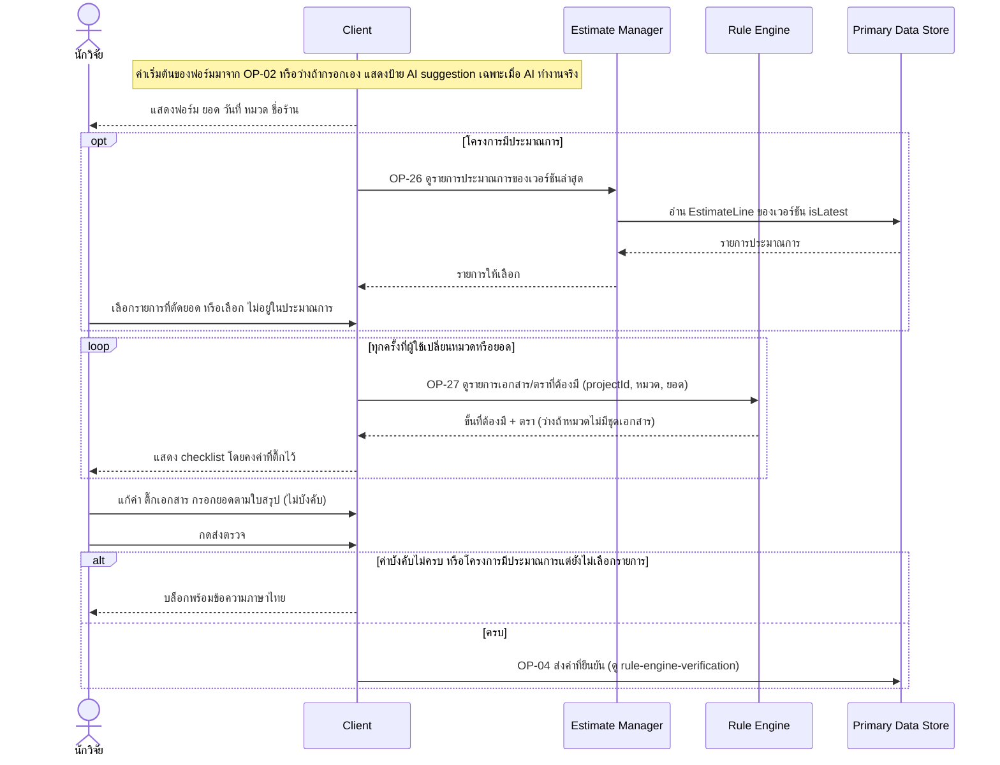
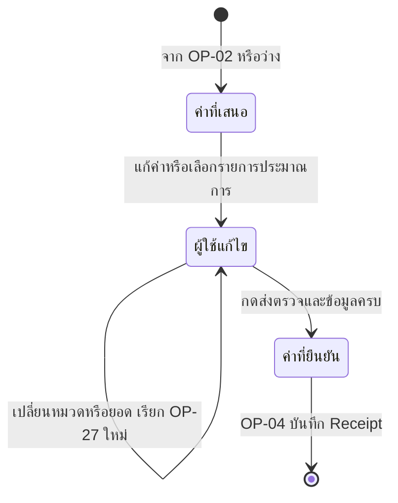

# Detailed Design — ตรวจสอบและแก้ไขข้อมูลก่อนส่งตรวจ

> การออกแบบระดับ component สำหรับ [[feature-list#2. ตรวจสอบและแก้ไขข้อมูลก่อนส่งตรวจ|ฟีเจอร์ที่ 2]]
> แปลงจาก [[user-journey#Journey 1: นักวิจัยอัปโหลดใบเสร็จและตรวจสอบผลจนผ่านเกณฑ์|Journey 1]] (ขั้นตรวจทาน)
> อ้างอิง operation จริง: OP-02 (ที่มาของค่าเริ่มต้น), OP-26, OP-27, OP-04 — OP-03 ถูกยกเลิกเลขแล้ว (รวมเข้า OP-02/OP-04)
> test case: [[03-testing/01-test-plan/test-cases/review-edit-ocr-data|review-edit-ocr-data]]

## 0. สถานะเอกสารและสถานะการสร้าง

- **เขียนใหม่ทั้งไฟล์ 2026-11-17** ของเดิมอ้างใบเสร็จสถานะ "รอตรวจทาน" และค่า `ocr*` ที่บันทึกในใบเสร็จ ซึ่งไม่มีในระบบที่สร้างแล้ว
  ([[db-spec]] 5.4 และกฎข้อ 1: ไม่เก็บค่าที่เสนอ เก็บเฉพาะค่าที่ผู้ใช้ยืนยัน)
- **สถานะ: สร้างแล้ว** (ขั้นตรวจทานเป็นฟอร์มที่ Client; ไม่มี operation ของตัวเองที่บันทึกข้อมูล — การบันทึกเกิดที่ OP-04)

## 1. ภาพรวม

ขั้นตรวจทานเกิดบน**ฟอร์มที่ Client** ก่อนส่งตรวจ: ผู้ใช้เห็นค่าที่เสนอ (ยอด วันที่ หมวด ชื่อร้าน) แก้ได้ทุกค่า เลือกรายการประมาณการที่ตัดยอด
ติ๊กเอกสาร/ตราตาม checklist และกรอกยอดตามใบสรุป (ไม่บังคับ) จากนั้นส่งเข้า OP-04 เฉพาะ**ค่าที่ยืนยันแล้ว**เท่านั้นที่เข้า Rule Engine (FR-03)
Component: Client, Receipt Reader (ที่มาของค่าเสนอ), Estimate Manager, Rule Engine (ผ่าน OP-27), Primary Data Store

## 2. Sequence Diagram

## 3. Operation ↔ Entity ที่กระทบ

| Operation | Entity | การกระทำ | ลำดับ/เงื่อนไข |
|---|---|---|---|
| [[api-spec#OP-02 อ่านใบเสร็จด้วย AI/OCR เพื่อเสนอค่า\|OP-02]] | ไม่มี | ให้ค่าเริ่มต้นแก่ฟอร์ม ไม่บันทึก | ก่อนขั้นตรวจทาน |
| [[api-spec#OP-26 ดูสรุปยอดใช้ไป/คงเหลือ/% รายรายการ\|OP-26]] | EstimateVersion (E-15), EstimateLine (E-16), Receipt (E-04) | อ่าน | ใช้แสดงรายการประมาณการให้เลือก ว่างถ้าโครงการยังไม่มีประมาณการ |
| [[api-spec#OP-27 ดูรายการเอกสาร/ตราที่ต้องมีของหมวดและยอด\|OP-27]] | RuleItem (E-07), EvidenceChain (E-18), EvidenceChainStep (E-19), EvidenceChainStepDocument (E-20), DocumentType (E-21), Attestation (E-22) | อ่านอย่างเดียว | เรียกซ้ำเมื่อเปลี่ยนหมวด/ยอด |
| [[api-spec#OP-04 ยืนยันข้อมูลใบเสร็จ ส่งตรวจ และบันทึกใบเสร็จ\|OP-04]] | Receipt (E-04) | สร้างด้วยค่า `confirmed*`, `estimateLineId`, `summaryAmount`, `providedDocumentTypeIds`, `confirmedAttestationKeys` | เฉพาะค่าที่ยืนยัน ไม่มี `ocr*` |

## 4. State Diagram

สถานะของฟอร์มเป็นสถานะชั่วคราวบนหน้าจอ **ไม่บันทึกถาวร** ไม่ใช่ `Receipt.status` ([[db-spec]] 5.4)

## 5. Edge Case และวิธีจัดการ

| # | Edge Case | วิธีจัดการ | อ้างอิง |
|---|---|---|---|
| 1 | AI/OCR อ่านค่าผิด (เช่น OCR ตกวรรณยุกต์) | ผู้ใช้ตรวจแก้ได้ทุกค่า ค่าที่อ่านไม่ได้ปล่อยว่าง ไม่เดา | FR-03, OP-02 |
| 2 | ค่าบังคับว่าง (ยอด/วันที่/หมวด) | ไม่ส่ง OP-04 บล็อกที่ฟอร์ม | db-spec E-04 |
| 3 | ยอดไม่เป็นบวก | ไม่บล็อกที่ฟอร์ม Rule Engine ให้ผล "ต้องแก้ไข" เหตุผล `INVALID_AMOUNT` | OP-04 |
| 4 | โครงการมีประมาณการแต่ไม่เลือกรายการ/ "ไม่อยู่ในประมาณการ" | OP-04 ปฏิเสธพร้อมให้เลือก "ไม่อยู่ในประมาณการ" บันทึกเป็นค่าว่าง | OP-04, FR-26 |
| 5 | โครงการยังไม่มีประมาณการ | ไม่แสดงช่องเลือกรายการ `estimateLineId` ว่าง ผลตรวจมีข้อค้นพบ `ESTIMATE_NOT_CHECKED` และบอกให้นำเข้าประมาณการ | OP-04, OP-26 |
| 6 | เปลี่ยนหมวด/ยอดหลังติ๊ก checklist | OP-27 เรียกใหม่ รายการที่ติ๊กไว้และยังอยู่ในชุดใหม่ถูกคงไว้ | OP-27 |
| 7 | หมวดไม่มีชุดเอกสาร (`evidenceChainId` ว่าง) | checklist ว่าง `providedDocumentTypeIds`/`confirmedAttestationKeys` เป็น null ไม่ตรวจเอกสาร | OP-27, db-spec E-04 |
| 8 | ผู้ใช้ไม่ติ๊กเอกสารใดเลยทั้งที่หมวดมีชุดเอกสาร | ส่งเป็นรายการสั้นกว่าที่ต้องมี ได้ข้อค้นพบ `MISSING_EVIDENCE` (ไม่เท่ากับ null ซึ่งคือ `EVIDENCE_NOT_CHECKED`) | db-spec E-04 |
| 9 | แก้ค่าหลังบันทึกแล้ว | ทำไม่ได้ในระบบที่สร้างแล้ว (ต้องรอ OP-06 — Backlog, ดู [[02-design/02-technical/detailed-design/resubmit-failed-receipt\|resubmit-failed-receipt]]) | OP-06 |

## 6. ช่องว่าง api-spec/db-spec ที่พบ

- **G-3 ปิดแล้ว:** OP-26 คืน `ruleCategory` ของรายการ หน้าจอใช้ตั้งหมวดเริ่มต้นเมื่อผู้ใช้เลือกรายการประมาณการ

## เอกสารที่เกี่ยวข้อง

- [[feature-list#2. ตรวจสอบและแก้ไขข้อมูลก่อนส่งตรวจ|feature-list ฟีเจอร์ที่ 2]], [[user-journey#Journey 1: นักวิจัยอัปโหลดใบเสร็จและตรวจสอบผลจนผ่านเกณฑ์|Journey 1]], [[api-spec]], [[db-spec]]
- [[02-design/02-technical/detailed-design/receipt-upload-ocr|receipt-upload-ocr]] (ขั้นก่อนหน้า), [[02-design/02-technical/detailed-design/rule-engine-verification|rule-engine-verification]] (ขั้นถัดไป),
  [[02-design/02-technical/detailed-design/evidence-chain-check|evidence-chain-check]], [[02-design/02-technical/detailed-design/ledger-amount-check|ledger-amount-check]], [[02-design/02-technical/detailed-design/budget-estimate-check|budget-estimate-check]]
