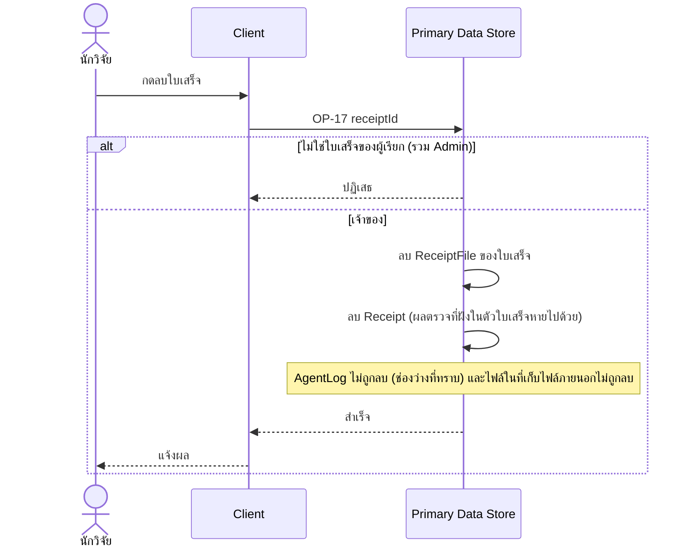
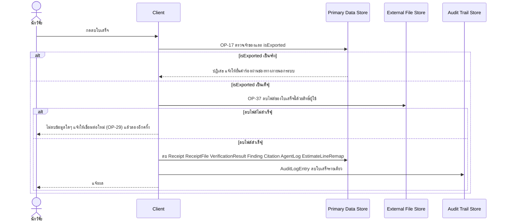
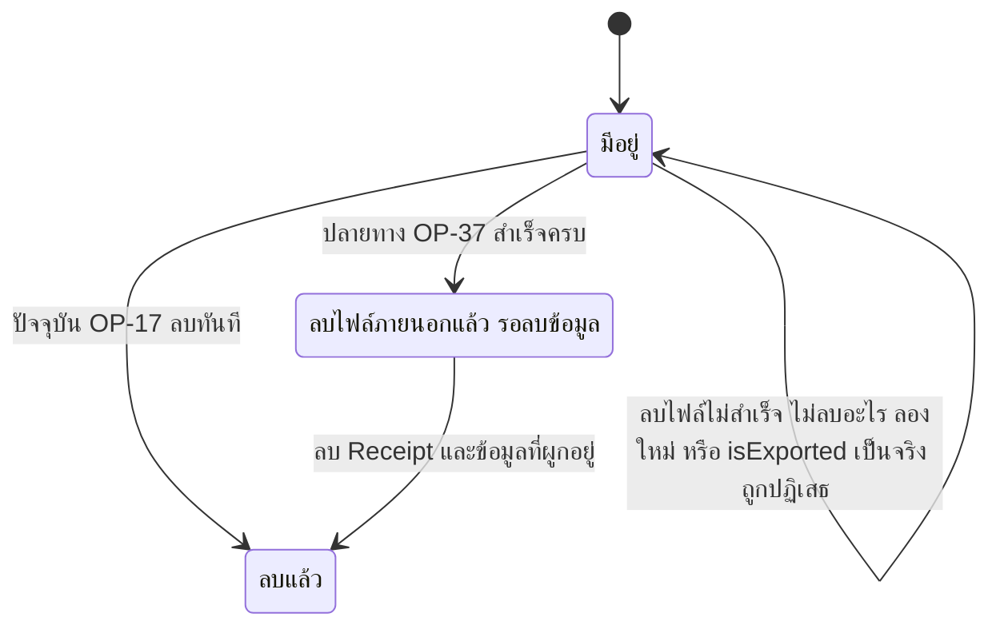

# Detailed Design — ลบข้อมูลใบเสร็จของตนเองด้วยตนเอง (Right to Erasure)

> การออกแบบระดับ component สำหรับ [[feature-list#12. ลบข้อมูลใบเสร็จของตนเองด้วยตนเอง (Right to Erasure)|ฟีเจอร์ที่ 12]]
> แปลงจาก [[user-journey#Journey 7: นักวิจัยลบข้อมูลใบเสร็จของตนเองด้วยตนเอง (Right to Erasure)|Journey 7]]
> อ้างอิง operation จริง: OP-17, OP-37, OP-29
> test case: [[03-testing/01-test-plan/test-cases/right-to-erasure|right-to-erasure]]

## 0. สถานะเอกสารและสถานะการสร้าง

- **เขียนใหม่ทั้งไฟล์ 2026-11-17** แยก "พฤติกรรมปัจจุบัน" กับ "ปลายทาง" ชัดเจน

| ส่วน | สถานะ |
|---|---|
| ปุ่มลบใบเสร็จรายใบ (OP-17) | **สร้างบางส่วน** — ลบระเบียนไฟล์อ้างอิง (`ReceiptFile`) แล้วลบตัวใบเสร็จ (ผลตรวจอยู่ในตัวใบเสร็จจึงหายไปด้วย) ทันที ไม่มีเงื่อนไข export-lock ไม่มี Audit Trail ไม่ลบไฟล์ในที่เก็บไฟล์ภายนอก |
| **ช่องว่างที่ทราบ (FR-18):** ปุ่มลบปัจจุบัน **ไม่ลบ `AgentLog`** | เจตนาคือลบพร้อมใบเสร็จ ปัจจุบันตกค้าง ต้องแก้ระบบให้ตรงเจตนา (db-spec 5.6) |
| ลบไฟล์ในที่เก็บไฟล์ภายนอกก่อนลบข้อมูล (OP-37) | **Backlog** (FR-37) |
| เงื่อนไข "ห้ามลบถ้า export แล้ว" | **Backlog** (รอ Export FR-10) |
| AuditLogEntry "ลบใบเสร็จรายเดียว (FR-18)" | **Backlog** (Audit Trail Store) |

## 1. ภาพรวม

นักวิจัยลบใบเสร็จของตนเองได้เองจากหน้ารายการใบเสร็จ (ขั้นเปิดรายการคือ OP-40 ดูรายการใบเสร็จของตนเอง — [[02-design/02-technical/detailed-design/fund-dashboard|fund-dashboard]]) การลบทำที่ **Client**
ภายใต้กฎสิทธิ์ของที่เก็บข้อมูลหลัก (ไม่ใช่ Trusted Server Service) ต่างจากการถอนความยินยอม (ฟีเจอร์ที่ 10) ซึ่งลบทั้งหมดและไม่ตรวจ export
หลังลบ ยอดใช้ไป/คงเหลือของประมาณการคำนวณใหม่จากใบเสร็จที่เหลือ (ไม่มีค่าที่เก็บไว้ให้แก้)
Component: Client, Primary Data Store, User-owned External File Store, Audit Trail Store (ปลายทาง)

## 2. Sequence Diagram

### 2.1 พฤติกรรมปัจจุบัน (สร้างบางส่วน)

### 2.2 ปลายทาง (FR-18 + FR-37 — Backlog)

## 3. Operation ↔ Entity ที่กระทบ

| Operation | Entity | การกระทำ | ลำดับ/เงื่อนไข |
|---|---|---|---|
| [[api-spec#OP-17 ลบใบเสร็จของตนเอง\|OP-17]] | Receipt (E-04) | อ่านตรวจเจ้าของ/`isExported` แล้วลบ | ปลายทาง: ลบหลังไฟล์ภายนอกถูกลบสำเร็จ |
| OP-17 | ReceiptFile (E-05) | ลบ | ก่อนลบ Receipt |
| OP-17 | VerificationResult (E-08), VerificationFinding (E-23), VerificationRuleCitation (E-09) | ลบ (ปัจจุบันหายไปกับตัวใบเสร็จ) | |
| OP-17 | AgentLog (E-24) | ลบ — **ปัจจุบันไม่ลบ** | ช่องว่างที่ทราบ |
| OP-17 | EstimateLineRemap (E-17) | ลบ | Backlog (FR-36) |
| OP-17 | AuditLogEntry (E-14) | สร้าง "ลบใบเสร็จรายเดียว (FR-18)" | Backlog |
| [[api-spec#OP-37 ลบไฟล์แนบในที่เก็บไฟล์ภายนอกของผู้ใช้\|OP-37]] | ReceiptFile (`externalFileId`/`fileReference`) | อ่านเพื่อลบไฟล์จริง | Backlog; ต้องสำเร็จครบก่อนลบข้อมูล |

## 4. State Diagram — วงจรชีวิตของใบเสร็จตอนลบ

## 5. Edge Case และวิธีจัดการ

| # | Edge Case | วิธีจัดการ | อ้างอิง |
|---|---|---|---|
| 1 | ใบเสร็จถูก export แล้ว (`isExported` เป็นจริง) | ปฏิเสธ แจ้งให้ยื่นคำร้องผ่าน Admin/DPO นอกระบบ — **Backlog** เพราะ Export ยังไม่มี ปัจจุบันไม่มีเงื่อนไขนี้ | OP-17, FR-18 AC-2 |
| 2 | ลบไฟล์ภายนอกไม่สำเร็จ (สิทธิ์หมดอายุ) | **ไม่ลบอะไรเลย** แจ้งให้เชื่อมต่อใหม่แล้วลองอีก ไม่มีไฟล์กำพร้า ไม่ล้มเหลวเงียบ — Backlog | OP-37, FR-37 ข้อ 4 |
| 3 | ลบใบเสร็จแล้ว `AgentLog` ยังอยู่ | ช่องว่างที่ทราบของระบบปัจจุบัน ต้องแก้ให้ลบพร้อมกัน | db-spec 5.6 |
| 4 | ลบใบเสร็จที่ผูกรายการประมาณการ | ยอดใช้ไป/คงเหลือ (OP-26) คำนวณใหม่จากใบเสร็จที่เหลือ | OP-17 |
| 5 | Admin พยายามลบของผู้อื่น | ปฏิเสธ | หัวข้อ 2 ของ api-spec |
| 6 | ลบเกิดขึ้นกลางทาง (ลบไฟล์อ้างอิงแล้วแต่ตัวใบเสร็จยัง) | **ตัดสินแล้ว (Q-6):** ลบระเบียนลูกก่อน (ไฟล์อ้างอิง ผลตรวจ/ข้อค้นพบ/citation AgentLog EstimateLineRemap) ลบตัวใบเสร็จเป็นขั้นสุดท้าย ล้มเหลวกลางทางลองซ้ำตั้งแต่ต้นได้อย่างปลอดภัย (idempotent: ระเบียนที่ไม่พบถือว่าลบแล้ว) เมื่อมี Trusted Server Service การลบนี้ย้ายไปอยู่ที่นั่น | OP-17 |
| 7 | ผู้ใช้ต้องการลบทั้งหมด | ใช้การถอนความยินยอม ([[02-design/02-technical/detailed-design/consent-management\|consent-management]]) ไม่ใช่ OP-17 ทีละใบ | OP-15 |
| 8 | ใบเสร็จไม่มีไฟล์จริง (โหมดสาธิต) | ลบข้อมูลได้เลย ไม่มีไฟล์ภายนอกให้ลบ | db-spec กฎข้อ 9 |

## 6. ประเด็นเปิด

ไม่มี — Q-6 ตัดสินแล้ว (ดู Edge Case ข้อ 6): ลบลูกก่อน ใบเสร็จท้ายสุด ลองซ้ำได้ (idempotent) และลำดับลบในแผนภาพ 2.2 ถือตามนี้

## เอกสารที่เกี่ยวข้อง

- [[feature-list#12. ลบข้อมูลใบเสร็จของตนเองด้วยตนเอง (Right to Erasure)|feature-list ฟีเจอร์ที่ 12]], [[user-journey#Journey 7: นักวิจัยลบข้อมูลใบเสร็จของตนเองด้วยตนเอง (Right to Erasure)|Journey 7]], [[architecture]] 3.5, [[api-spec]], [[db-spec]] กฎข้อ 5
- [[02-design/02-technical/detailed-design/google-drive-attachment|google-drive-attachment]], [[02-design/02-technical/detailed-design/export-verified-report|export-verified-report]], [[02-design/02-technical/detailed-design/consent-management|consent-management]]
