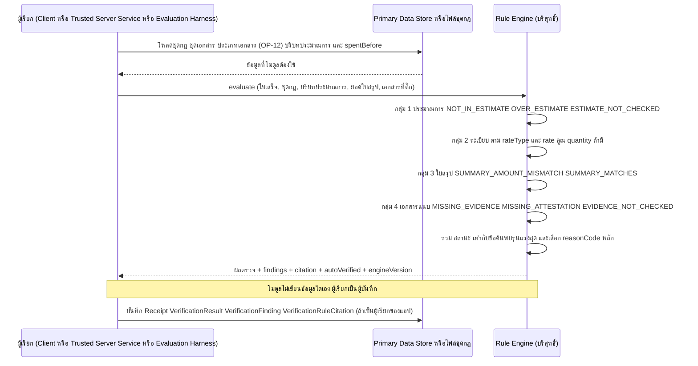
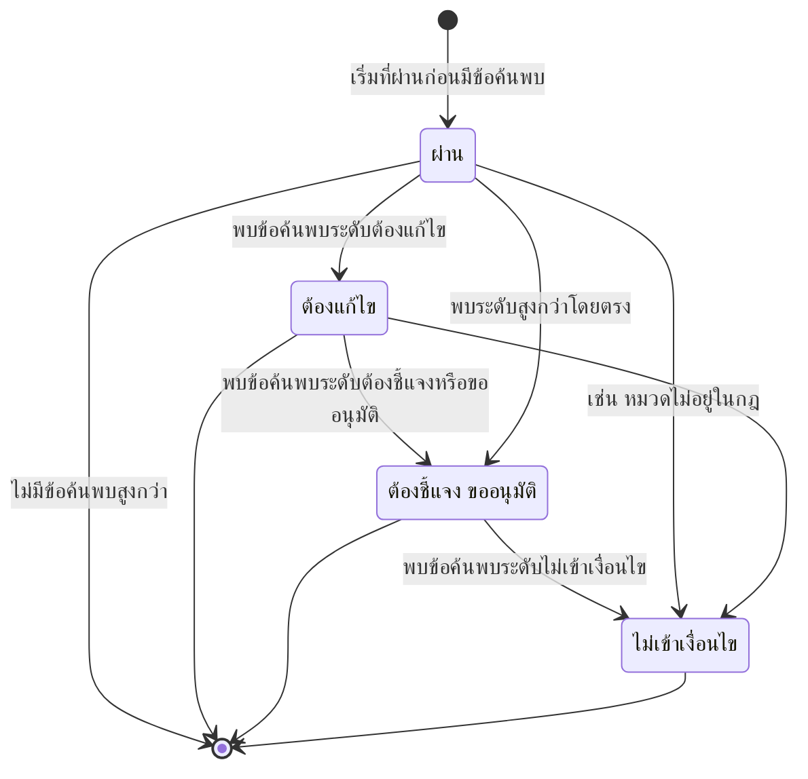

# Detailed Design — Rule Engine แบบโมดูลบริสุทธิ์ ผลตรวจ 4 ระดับ ตรวจย้อนได้

> การออกแบบระดับ component สำหรับ [[feature-list#18. Rule Engine แบบโมดูลบริสุทธิ์ ผลตรวจ 4 ระดับ ตรวจย้อนได้|ฟีเจอร์ที่ 18]]
> แปลงจาก [[user-journey#Journey 1: นักวิจัยอัปโหลดใบเสร็จและตรวจสอบผลจนผ่านเกณฑ์|Journey 1]] (ขั้น Rule Engine ตัดสิน) และ
> [[user-journey#Journey 10: ผู้วิจัยรันชุดประเมินผลเพื่อเทียบ Rule Engine กับผลของเจ้าหน้าที่การเงิน (เครื่องมือนอกแอป)|Journey 10]] (ใช้ซ้ำ)
> อ้างอิง operation จริง: OP-04, OP-27, OP-05, OP-34 (ปลายทาง) — โมดูลเองไม่มี operation ของตัวเอง ถูกเรียกโดย operation เหล่านี้
> test case: [[03-testing/01-test-plan/test-cases/rule-engine-pure-module|rule-engine-pure-module]]

## 0. สถานะเอกสารและสถานะการสร้าง

- **สร้างใหม่ 2026-11-17**

| ส่วน | สถานะ |
|---|---|
| โมดูล Rule Engine บริสุทธิ์ + เวอร์ชัน engine + 4 ระดับ + ข้อค้นพบรายกลุ่ม | **สร้างแล้ว** (รันที่ Client) |
| ใช้โมดูลเดียวกันใน Evaluation Harness นอกแอป | สร้างบางส่วน (ดู [[02-design/02-technical/detailed-design/thesis-evaluation-harness\|thesis-evaluation-harness]]) |
| รันที่ Trusted Server Service เพื่อให้เบราว์เซอร์แก้ผลไม่ได้ (OP-34) | **Backlog** |

## 1. ภาพรวม

โมดูลเป็นฟังก์ชันที่ไม่มีผลข้างเคียง: **ไม่อ่านที่เก็บข้อมูล หน้าจอ หรือเครือข่ายเอง** ผู้เรียกโหลดชุดกฎมาให้ ทำให้ทดสอบได้ ย้ายที่รันได้ และเปรียบเทียบข้ามเวอร์ชัน engine ได้
- **Input:** ใบเสร็จ (หมวด ยอด วันที่ เอกสารที่ติ๊ก ตราที่ยืนยัน ยอดใบสรุป) + ชุดกฎ (`RuleVersion`, `RuleItem`, ชุดเอกสาร, ประเภทเอกสาร) + บริบทประมาณการ (รายการที่ตัดยอด, `spentBefore`)
- **Output:** สถานะ 4 ระดับ, `reasonCode`, `autoVerified`, ข้อค้นพบรายกลุ่ม, ข้อระเบียบที่อ้างอิง (citation), รหัสกฎ/เวอร์ชันกฎ/แหล่งทุน, `engineVersion`, คำอธิบายภาษาไทย
- **กฎ:** กฎตัดสิน AI ไม่ตัดสิน; **ต้องเพิ่ม `engineVersion` ทุกครั้งที่ตรรกะตัดสินเปลี่ยน** (FR-24); ตัดสินเฉพาะจากกฎที่ Admin ป้อนไว้ ไม่แต่งกฎ
- **ลำดับกลุ่ม (FR-25):** ประมาณการ → ระเบียบ → ใบสรุป → เอกสารแนบ สถานะ = ข้อค้นพบที่รุนแรงที่สุด (ผ่าน < ต้องแก้ไข < ต้องชี้แจง/ขออนุมัติ < ไม่เข้าเงื่อนไข) `reasonCode` = ข้อค้นพบแรกที่ไม่ใช่ประเภท "ยังไม่ได้ตรวจ" ของระดับที่รุนแรงสุดตามลำดับกลุ่ม

## 2. Sequence Diagram

### reasonCode ที่ engine ใช้ (ตาม [[db-spec]] E-08)

NO_FUND_SOURCE, NO_ACTIVE_RULE_VERSION, CATEGORY_NOT_IN_RULES, INVALID_AMOUNT, AMOUNT_EXCEEDS_CAP, WITHIN_CAP, NO_FIXED_CAP, NOT_IN_ESTIMATE, OVER_ESTIMATE,
ESTIMATE_NOT_CHECKED, PER_UNIT_CAP_VIA_ESTIMATE, PER_PROPOSAL_VIA_ESTIMATE, OVER_RATE_ALLOWANCE, WITHIN_RATE_ALLOWANCE, SUMMARY_AMOUNT_MISMATCH, SUMMARY_MATCHES,
MISSING_EVIDENCE, MISSING_ATTESTATION, EVIDENCE_NOT_CHECKED

## 3. Operation ↔ Entity ที่กระทบ

| Operation | Entity | การกระทำ | ลำดับ/เงื่อนไข |
|---|---|---|---|
| ผู้เรียกโหลดข้อมูล ([[api-spec#OP-12 ดูเวอร์ชันระเบียบที่ active ของแหล่งทุน\|OP-12]]) | FundSource, RuleVersion, RuleItem, EvidenceChain/Step/StepDocument, DocumentType, Attestation | อ่านโดยผู้เรียก | ก่อนเรียกโมดูล |
| [[api-spec#OP-04 ยืนยันข้อมูลใบเสร็จ ส่งตรวจ และบันทึกใบเสร็จ\|OP-04]] ผู้เรียกบันทึกผล | Receipt (`status` = `decisionStatus`), VerificationResult (`decisionStatus`, `reasonCode`, `autoVerified`, `engineVersion`, `ruleVersionId`, `ruleItemId`, `estimateVersionId`, `fundSourceId`), VerificationFinding, VerificationRuleCitation | สร้าง | หลังโมดูลคืนผล ไม่มีผลที่ไม่มี `engineVersion` |
| [[api-spec#OP-27 ดูรายการเอกสาร/ตราที่ต้องมีของหมวดและยอด\|OP-27]] | RuleItem, EvidenceChain และอื่น ๆ | อ่านอย่างเดียว | ใช้ฟังก์ชันเดียวกับโมดูล (requiredEvidence) ให้ checklist ตรงกับที่ตรวจจริง |
| [[api-spec#OP-05 ดูรายละเอียดผลตรวจใบเสร็จ\|OP-05]] | VerificationResult, VerificationFinding, VerificationRuleCitation | อ่าน | ย้อนไปยังกฎ/เวอร์ชัน engine ได้ (NFR-04) |
| [[api-spec#OP-34 คำนวณและบันทึกผลตรวจใบเสร็จโดย Trusted Server Service\|OP-34]] | เหมือน OP-04 | สร้าง | Backlog เรียกโมดูลและเวอร์ชันเดียวกัน |

## 4. State Diagram — การรวมระดับผลตรวจ

ผลตรวจไม่ใช่สถานะที่เปลี่ยนตามเวลา เป็นการรวมข้อค้นพบตามลำดับกลุ่ม ระดับสูงสุดที่พบเท่านั้นที่ปรากฏเป็นสถานะ:

ระดับเพิ่มได้ทางเดียวระหว่างรวมข้อค้นพบ (ไม่ลดลง) ผลที่ได้บันทึกครั้งเดียวต่อการส่งตรวจ

## 5. Edge Case และวิธีจัดการ

| # | Edge Case | วิธีจัดการ | อ้างอิง |
|---|---|---|---|
| 1 | ไม่มีแหล่งทุน / ไม่มี RuleVersion active | ไม่ผ่านเงียบ: "ไม่เข้าเงื่อนไข" `NO_FUND_SOURCE` / `NO_ACTIVE_RULE_VERSION` พร้อมคำอธิบาย ไม่มี citation | OP-04 |
| 2 | หมวดไม่อยู่ในกฎ | "ไม่เข้าเงื่อนไข" `CATEGORY_NOT_IN_RULES` | OP-04 |
| 3 | ยอดไม่เป็นบวก | "ต้องแก้ไข" `INVALID_AMOUNT` | OP-04 |
| 4 | `rateType` ต่อหน่วย / ตามข้อเสนอโครงการ ไม่มีเพดานรวมตายตัว | ผ่านตามหมวด แต่ `autoVerified` เท็จ ยกเว้นเมื่อมีประมาณการ/quantity ช่วยตรวจ (`WITHIN_RATE_ALLOWANCE`, `PER_PROPOSAL_VIA_ESTIMATE`) | db-spec กฎข้อ 17 |
| 5 | เพดานที่มี `unit` ผูกรายการที่ไม่มี `quantity` | ไม่ถือว่าตรวจตัวเลขได้ ข้อความบอกให้นำเข้าประมาณการใหม่ที่ระบุจำนวน | OP-04 |
| 6 | เพดานทั้งใบ (`unit` ว่าง) | เทียบทั้งใบเสมอ | db-spec กฎข้อ 17 |
| 7 | ตรวจบางด้านไม่ได้ | `autoVerified` เท็จ มีข้อค้นพบ "ยังไม่ได้ตรวจ" และข้อความให้ผู้ใช้ทำต่อ | db-spec กฎข้อ 16 |
| 8 | ยอดไม่ผ่านพร้อมเอกสารขาด | สถานะตามระดับสูงสุด ข้อค้นพบเอกสารยังเก็บเพิ่ม | db-spec กฎข้อ 15 |
| 9 | ตรรกะเปลี่ยนแต่ลืมเพิ่ม `engineVersion` | ผลย้อนตรวจแยกเวอร์ชันไม่ได้ — เป็นข้อบังคับของกระบวนการพัฒนา ไม่ใช่กลไกที่ระบบบังคับ | FR-24 |
| 10 | ผลตรวจเก่าและเวอร์ชันกฎ/ประมาณการ | เป็น snapshot ไม่เปลี่ยนเมื่อกฎ/ประมาณการเปลี่ยน | db-spec กฎข้อ 2 |
| 11 | โมดูลถูกเรียกจาก Client | ผลแก้ได้ในทางเทคนิคจากเบราว์เซอร์ ปิดด้วย OP-34 (Backlog) | architecture 5.4 |

## เอกสารที่เกี่ยวข้อง

- [[feature-list#18. Rule Engine แบบโมดูลบริสุทธิ์ ผลตรวจ 4 ระดับ ตรวจย้อนได้|feature-list ฟีเจอร์ที่ 18]], [[architecture]] 2.1, [[api-spec]], [[db-spec]] กฎข้อ 2/15–17
- [[02-design/02-technical/detailed-design/rule-engine-verification|rule-engine-verification]], [[02-design/02-technical/detailed-design/budget-estimate-check|budget-estimate-check]], [[02-design/02-technical/detailed-design/evidence-chain-check|evidence-chain-check]],
  [[02-design/02-technical/detailed-design/ledger-amount-check|ledger-amount-check]], [[02-design/02-technical/detailed-design/rule-set-2570|rule-set-2570]]
