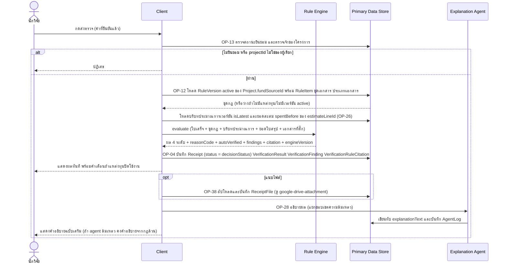
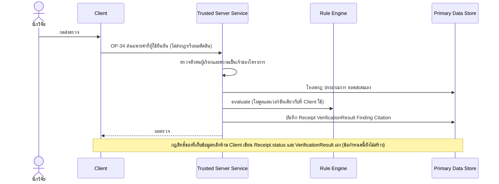
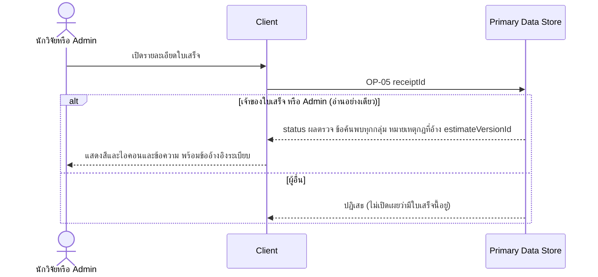
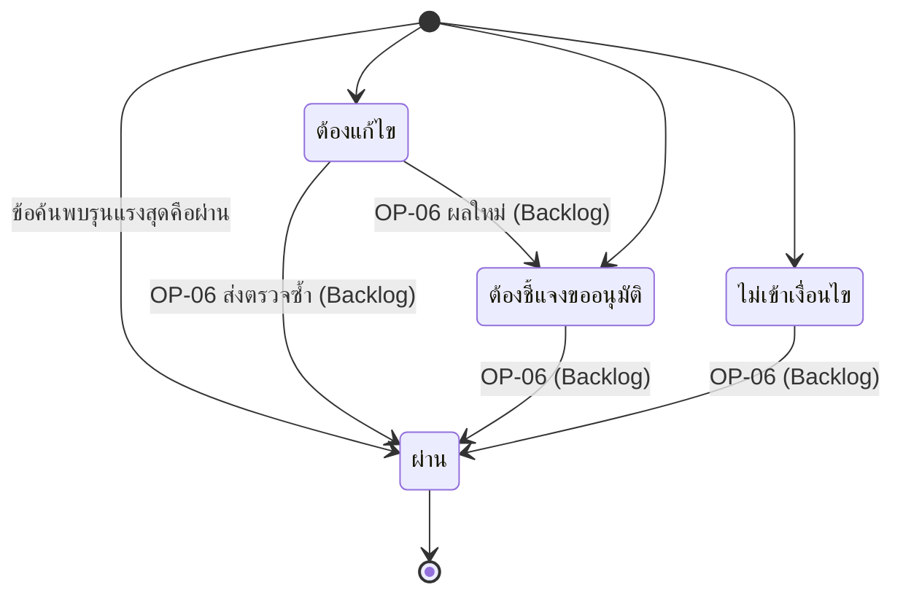

# Detailed Design — ตรวจสอบใบเสร็จด้วย Rule Engine พร้อมคำอธิบายจาก AI

> การออกแบบระดับ component สำหรับ [[feature-list#3. ตรวจสอบใบเสร็จด้วย Rule Engine พร้อมคำอธิบายจาก LLM|ฟีเจอร์ที่ 3]]
> แปลงจาก [[user-journey#Journey 1: นักวิจัยอัปโหลดใบเสร็จและตรวจสอบผลจนผ่านเกณฑ์|Journey 1]] (ขั้นส่งตรวจและดูผล)
> อ้างอิง operation จริง: OP-04, OP-12, OP-05, OP-28, OP-38 และปลายทาง OP-34
> test case: [[03-testing/01-test-plan/test-cases/rule-engine-verification|rule-engine-verification]]

## 0. สถานะเอกสารและสถานะการสร้าง

- **เขียนใหม่ทั้งไฟล์ 2026-11-17** ของเดิมใช้ผลตรวจ 3 ระดับ มี Backend Service และใบเสร็จสถานะ "รอผลตรวจ"/"รอ OCR" ตรรกะตัดสินเชิงลึกอยู่ที่
  [[02-design/02-technical/detailed-design/rule-engine-pure-module|rule-engine-pure-module]] ไฟล์นี้เน้นลำดับการเรียกและการบันทึก

| ส่วน | Operation | สถานะ |
|---|---|---|
| ส่งตรวจ คำนวณและบันทึกผลที่ **Client** | OP-04 | สร้างแล้ว (คำนวณที่ Client) |
| โหลดกฎ/ชุดเอกสารของแหล่งทุน | OP-12 | สร้างแล้ว |
| ดูผลตรวจรายใบ (Admin อ่านอย่างเดียว) | OP-05 | สร้างแล้ว |
| AI agent อธิบายผลต่อท้าย | OP-28 | สร้างแล้ว |
| คำนวณและบันทึกผลโดย **Trusted Server Service** | OP-34 | **Backlog** |

## 1. ภาพรวม

หลักการ: **กฎตัดสิน AI ไม่ตัดสิน** ผลตรวจ 4 ระดับ ผ่าน < ต้องแก้ไข < ต้องชี้แจง/ขออนุมัติ < ไม่เข้าเงื่อนไข เท่ากับข้อค้นพบที่รุนแรงที่สุด ตามลำดับกลุ่ม
ประมาณการ → ระเบียบ → ใบสรุป → เอกสารแนบ ใบเสร็จถูกบันทึกครั้งเดียวพร้อมผล (ไม่มีสถานะ "รอผลตรวจ" เพราะ synchronous)
Component: Client, Rule Engine, Primary Data Store, Explanation Agent (ต่อท้าย), User-owned External File Store (ผ่าน OP-38) และ Trusted Server Service (ปลายทาง)

## 2. Sequence Diagram

### 2.1 พฤติกรรมปัจจุบัน (สร้างแล้ว — คำนวณที่ Client)

### 2.2 ปลายทาง (Backlog — Trusted Server Service บันทึกผล)

### 2.3 ดูผลตรวจรายใบ

## 3. Operation ↔ Entity ที่กระทบ

| Operation | Entity | การกระทำ | ลำดับ/เงื่อนไข |
|---|---|---|---|
| [[api-spec#OP-12 ดูเวอร์ชันระเบียบที่ active ของแหล่งทุน\|OP-12]] | FundSource (E-02), RuleVersion (E-06), RuleItem (E-07), EvidenceChain/Step/StepDocument (E-18–E-20), DocumentType (E-21), Attestation (E-22) | อ่าน | ก่อน evaluate ใช้ได้แม้แหล่งทุนปิดใช้งาน |
| [[api-spec#OP-04 ยืนยันข้อมูลใบเสร็จ ส่งตรวจ และบันทึกใบเสร็จ\|OP-04]] | Project (E-03) | อ่าน ตรวจเจ้าของ | ก่อนสุด |
| OP-04 | EstimateLine (E-16), Receipt (E-04) | อ่าน | หา `spentBefore` จาก `confirmedAmount` ของใบเสร็จอื่นที่ `estimateLineId` เดียวกัน |
| OP-04 | Receipt (E-04) | สร้าง (`status` ตั้งครั้งเดียว) | หลัง evaluate |
| OP-04 | VerificationResult (E-08) | สร้าง (snapshot `ruleVersionId`/`ruleItemId`/`estimateVersionId`/`engineVersion`) | หลัง Receipt |
| OP-04 | VerificationFinding (E-23), VerificationRuleCitation (E-09) | สร้าง | ผูกกับ VerificationResult; citation ≥ 1 เมื่อมีกฎเกี่ยวข้อง |
| [[api-spec#OP-05 ดูรายละเอียดผลตรวจใบเสร็จ\|OP-05]] | Receipt, VerificationResult, VerificationFinding, VerificationRuleCitation, RuleItem, FundSource | อ่าน | `fundSourceInactiveWarning` คำนวณตอนแสดงจาก `FundSource.isActive` ไม่บันทึก |
| [[api-spec#OP-28 อธิบายผลด้วย AI agent และบันทึกประวัติการทำงาน\|OP-28]] | VerificationResult (`explanationText` เท่านั้น), AgentLog (E-24) | แก้ 1 ฟิลด์ + สร้าง | ไม่แตะ `decisionStatus`/`Receipt.status` |
| [[api-spec#OP-34 คำนวณและบันทึกผลตรวจใบเสร็จโดย Trusted Server Service\|OP-34]] | เหมือน OP-04 | สร้าง | Backlog |

## 4. State Diagram — Receipt.status

สถานะตั้งครั้งเดียวตอนสร้างและคงอยู่ (ไม่มีหน้าจอแก้สถานะ) การเปลี่ยนหลังสร้างเกิดได้เฉพาะ OP-06 (Backlog)

ค่า `ต้องชี้แจงขออนุมัติ` ในแผนภาพคือ "ต้องชี้แจง/ขออนุมัติ" (ตัดเครื่องหมาย `/` เพื่อให้ Mermaid อ่านได้) การเปลี่ยนจาก/ไปทุกระดับตามผลใหม่เป็นไปได้เมื่อ OP-06 สร้างแล้ว แสดงเฉพาะตัวอย่าง
`ผ่าน` ถูกปฏิเสธไม่ให้ส่งซ้ำ

## 5. Edge Case และวิธีจัดการ

| # | Edge Case | วิธีจัดการ | อ้างอิง |
|---|---|---|---|
| 1 | โครงการไม่มีแหล่งทุน หรือแหล่งทุนไม่มี RuleVersion active | **ไม่บล็อกการส่ง** บันทึกใบเสร็จ "ไม่เข้าเงื่อนไข" reasonCode `NO_FUND_SOURCE`/`NO_ACTIVE_RULE_VERSION` พร้อมคำอธิบาย ไม่มี citation | OP-04, db-spec E-09 |
| 2 | หมวดไม่อยู่ในกฎ (เช่น หมวดที่คู่มือไม่สนับสนุน) | "ไม่เข้าเงื่อนไข" `CATEGORY_NOT_IN_RULES` | OP-04 |
| 3 | แหล่งทุนปิดใช้งาน (FR-35) | **ตรวจต่อด้วยกฎที่เก็บไว้ พร้อมคำเตือน** (มติ architecture 5.5 ข้อ 1) คำเตือนเป็นค่าที่คำนวณตอนแสดง ไม่เก็บ — การปิดใช้งานเองเป็น Backlog | OP-05, OP-32 |
| 4 | ผลตรวจหลายกลุ่มพร้อมกัน | สถานะ = รุนแรงสุด `reasonCode` = ข้อค้นพบหลักตามลำดับกลุ่ม แสดงข้อค้นพบทุกกลุ่ม ยอดเกินเพดานแล้วเอกสารที่ขาดยังเก็บเป็นข้อค้นพบเพิ่ม | db-spec กฎข้อ 15 |
| 5 | ตรวจบางด้านไม่ได้ (ไม่มีประมาณการ/ไม่มี quantity/ไม่ส่งข้อมูลเอกสาร) | ไม่ผ่านเงียบ `autoVerified` = เท็จ มีข้อค้นพบ "ยังไม่ได้ตรวจ" บอกว่าผู้ใช้ต้องทำอะไร | db-spec กฎข้อ 16 |
| 6 | แนบไฟล์แต่ยังไม่เชื่อมต่อที่เก็บไฟล์ | ปฏิเสธการส่งพร้อมคำเตือน | OP-29 |
| 7 | AI/agent ล้มเหลว (OP-28) | ไม่ย้อนและไม่ขวางใบเสร็จที่บันทึกแล้ว คงคำอธิบายจากกฎล้วน | OP-28 |
| 8 | OP-38 ล้มเหลวหลังบันทึกใบเสร็จ | **ตัดสินแล้ว:** คงใบเสร็จไว้ (ไม่ rollback) ผู้ใช้เห็น error และลองอัปโหลดซ้ำ (OP-38) ดู [[02-design/02-technical/detailed-design/receipt-upload-ocr\|receipt-upload-ocr]] | OP-38 |
| 9 | Admin พยายามเรียก OP-04 แทนผู้ใช้ | ปฏิเสธ (Admin เขียนข้อมูลผู้อื่นไม่ได้) | api-spec หัวข้อ 2 |
| 10 | แก้ผลตรวจจากเบราว์เซอร์ | ปัจจุบันทำได้ในทางเทคนิคเพราะคำนวณที่ Client — ปิดช่องด้วย OP-34 (Backlog) | architecture 5.4 |
| 11 | ใบเสร็จก่อน 2026-11-14 ไม่มีฟิลด์ย้อนรอย | OP-05 แสดงเท่าที่มี | OP-05 |

## เอกสารที่เกี่ยวข้อง

- [[feature-list#3. ตรวจสอบใบเสร็จด้วย Rule Engine พร้อมคำอธิบายจาก LLM|feature-list ฟีเจอร์ที่ 3]], [[user-journey#Journey 1: นักวิจัยอัปโหลดใบเสร็จและตรวจสอบผลจนผ่านเกณฑ์|Journey 1]], [[architecture]] 3.1/5.4, [[api-spec]], [[db-spec]]
- [[02-design/02-technical/detailed-design/rule-engine-pure-module|rule-engine-pure-module]], [[02-design/02-technical/detailed-design/budget-estimate-check|budget-estimate-check]], [[02-design/02-technical/detailed-design/evidence-chain-check|evidence-chain-check]],
  [[02-design/02-technical/detailed-design/ledger-amount-check|ledger-amount-check]], [[02-design/02-technical/detailed-design/ai-agent-explanation|ai-agent-explanation]], [[02-design/02-technical/detailed-design/resubmit-failed-receipt|resubmit-failed-receipt]]
