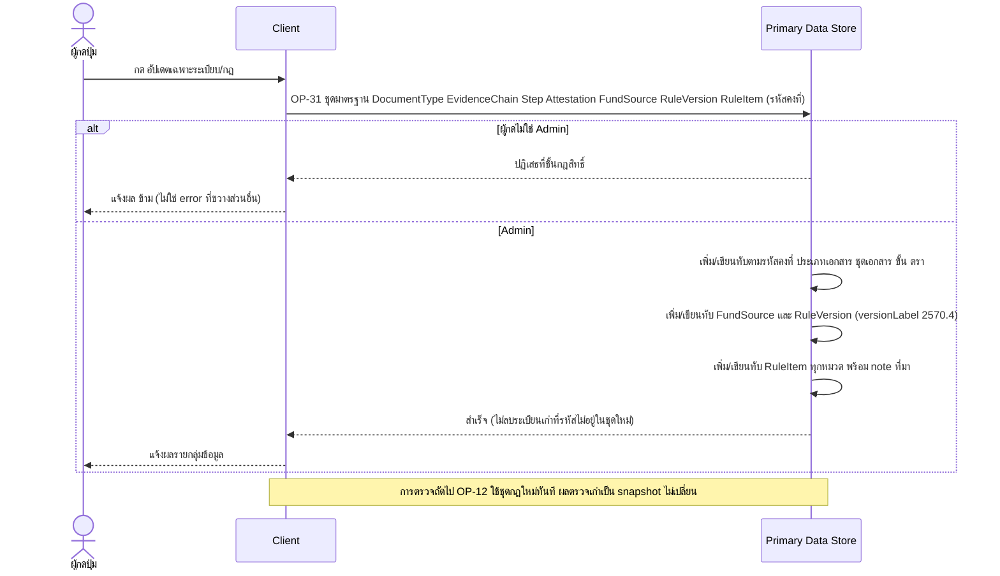
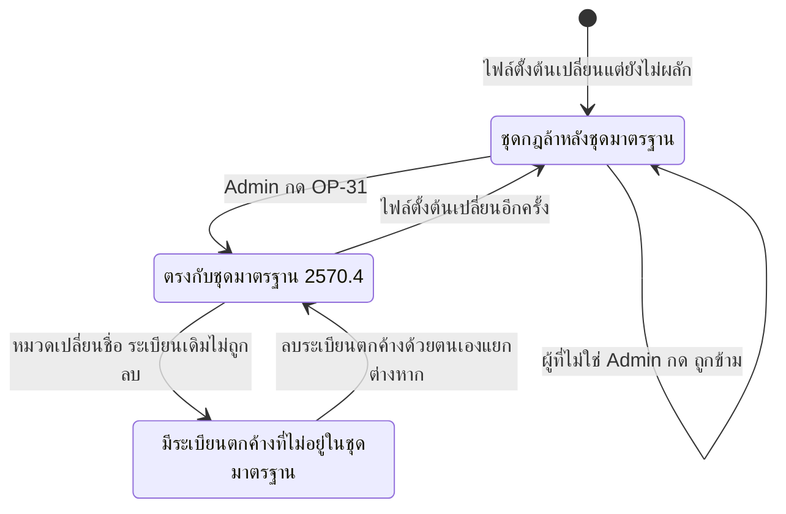

# Detailed Design — ชุดกฎตามคู่มือจริง (rule set 2570.4) และการอัปเดตกฎ

> การออกแบบระดับ component สำหรับ [[feature-list#20. ชุดกฎตามคู่มือจริง (rule set 2570.4) และการอัปเดตกฎ|ฟีเจอร์ที่ 20]]
> แปลงจาก [[user-journey#Journey 4: Admin นำเข้า/อัปเดตระเบียบของแหล่งทุนเข้าสู่ Rule Engine|Journey 4]] (ส่วนผลักชุดกฎมาตรฐาน)
> อ้างอิง operation จริง: OP-31, OP-11, OP-12
> test case: [[03-testing/01-test-plan/test-cases/rule-set-2570|rule-set-2570]]

## 0. สถานะเอกสารและสถานะการสร้าง

- **สร้างใหม่ 2026-11-17**

| ส่วน | Operation | สถานะ |
|---|---|---|
| ปุ่ม "อัปเดตเฉพาะระเบียบ/กฎ" ผลักชุดกฎมาตรฐานเข้าระบบจริง (แยกจากการใส่ข้อมูลตัวอย่าง ไม่แตะข้อมูลผู้ใช้/โครงการ/ใบเสร็จ) | OP-31 | **สร้างแล้ว** |
| ชุดกฎ 2570.4 (28 หมวดรายการ) ในไฟล์ตั้งต้น | — | สร้างแล้ว |
| แก้กฎรายหมวดผ่านหน้าจอ | OP-11 | สร้างบางส่วน (ดู [[02-design/02-technical/detailed-design/admin-rule-management\|admin-rule-management]]) |
| โหลดกฎตอนตรวจ | OP-12 | สร้างแล้ว |
| ข้อมูลในระบบจริง | — | **ยังไม่อัปเดตจนกว่า Admin กดปุ่ม** (กฎที่ engine ต้องการแต่ไม่มีในข้อมูลถูกข้ามอย่างปลอดภัย) |

## 1. ภาพรวม

ชุดกฎอ้างอิงตัวเลข/เงื่อนไขจาก "คู่มือฯ ปีงบประมาณ 2570" และ "คู่มือการกรอกแบบฟอร์มและตัวอย่างใบเสร็จ ฉบับปรับปรุง" ครอบคลุม 28 หมวดรายการ ป้ายเวอร์ชัน `versionLabel` = "2570.4"
- ทุกกฎอ้างอิงที่มา (ข้อ/หน้า) ใน `RuleItem.note` ตัวเลขที่ไม่มีในคู่มือ**ห้ามแต่งขึ้นเอง** ต้องบอกใน `note`
- `rateType` ∈ เพดานตามจริง / เหมาจ่าย / ต่อหน่วย / ตามข้อเสนอโครงการ รายการที่ไม่มีตัวเลขตายตัวใช้ "ตามข้อเสนอโครงการ" ไม่ยัด `rateAmount`
- หมวดที่คู่มือไม่สนับสนุน (เช่น ค่าตอบแทนคณะผู้วิจัย) **มีในรายการหมวดแต่ไม่มี `RuleItem`** ผลตรวจจึงเป็น "ไม่เข้าเงื่อนไข" (`CATEGORY_NOT_IN_RULES`)
- OP-31 ทำงานแบบ **เพิ่ม/ทับตามรหัสคงที่ ไม่ลบ** ทำซ้ำได้ผลเหมือนเดิม

Component: Client (หน้าอัปเดตระเบียบ), Primary Data Store (จุดบังคับสิทธิ์ Admin)

## 2. Sequence Diagram

## 3. Operation ↔ Entity ที่กระทบ

| Operation | Entity | การกระทำ | ลำดับ/เงื่อนไข |
|---|---|---|---|
| [[api-spec#OP-31 อัปเดตชุดกฎ ชุดเอกสาร และประเภทเอกสารตามรหัสคงที่\|OP-31]] | DocumentType (E-21) | เพิ่ม/ทับตามรหัสคงที่ | ก่อนชุดเอกสาร (ถูกอ้างโดยขั้น) |
| OP-31 | EvidenceChain (E-18), EvidenceChainStep (E-19), EvidenceChainStepDocument (E-20), Attestation (E-22) | เพิ่ม/ทับ | ก่อน RuleItem (ถูกอ้างด้วย `evidenceChainId`) |
| OP-31 | FundSource (E-02), RuleVersion (E-06) | เพิ่ม/ทับ | `versionLabel` "2570.4" `isActive` เป็นจริงได้ 1 ต่อแหล่งทุน |
| OP-31 | RuleItem (E-07) | เพิ่ม/ทับ 28 หมวด | `note` ต้องมีที่มา ห้ามแต่งตัวเลข |
| [[api-spec#OP-11 นำเข้า/แก้ไขระเบียบของแหล่งทุน (หมวด/อัตรา/ชุดเอกสาร)\|OP-11]] | RuleItem ฯลฯ | แก้ทีละหมวดผ่านหน้าจอ | เสริมกับ OP-31 |
| [[api-spec#OP-12 ดูเวอร์ชันระเบียบที่ active ของแหล่งทุน\|OP-12]] | RuleVersion, RuleItem ฯลฯ | อ่าน | ตอนส่งตรวจ |

## 4. State Diagram — ชุดกฎในระบบจริงเทียบกับชุดมาตรฐาน

## 5. Edge Case และวิธีจัดการ

| # | Edge Case | วิธีจัดการ | อ้างอิง |
|---|---|---|---|
| 1 | ผู้ที่ไม่ใช่ Admin กดปุ่ม | ถูกข้ามและแจ้งผล "ข้าม" ที่ชั้นกฎสิทธิ์ ไม่เปลี่ยนข้อมูล | OP-31 |
| 2 | กดซ้ำ | ผลเหมือนเดิม (รหัสคงที่) | OP-31 |
| 3 | หมวดเปลี่ยนชื่อในชุดมาตรฐาน | ระเบียนเก่าที่รหัสไม่อยู่ในชุดใหม่ **ไม่ถูกลบ** ต้องลบแยกด้วยตนเอง — `RuleItem` ที่ผลตรวจเก่าอ้างอยู่ปลายทางเป็น "ปิดใช้งานเท่านั้น ห้ามลบ" (ดู [[02-design/02-technical/detailed-design/admin-rule-management\|admin-rule-management]]) | OP-31 |
| 4 | ตัวเลขที่คู่มือไม่ระบุ | ไม่แต่ง ใช้ "ตามข้อเสนอโครงการ" หรือระบุใน `note` | OP-11 ข้อ 2 |
| 5 | หมวดที่คู่มือไม่สนับสนุน | ไม่มี `RuleItem` ผลตรวจ "ไม่เข้าเงื่อนไข" | rule-engine-pure-module |
| 6 | ระบบจริงยังไม่ได้ผลักชุดล่าสุด | กฎที่ engine ต้องการแต่ไม่มีถูกข้ามอย่างปลอดภัย การตรวจอาจหลวมกว่าชุดมาตรฐานจนกว่าจะกดปุ่ม | api-spec OP-31 |
| 7 | คำถามเปิดจากการเงิน (เช่น เกณฑ์กรรมการตรวจรับ 3 คน) | ชุด 2570.4 บันทึกข้อยืนยันของการเงินแล้ว (เงื่อนไขยอดเกิน 100,000 บาท) ไม่เปลี่ยนในเอกสารนี้ | feature-list ฟีเจอร์ที่ 15, 20 |
| 8 | ปุ่มนี้ไม่แตะข้อมูลผู้ใช้ | ไม่สร้าง/แก้ User Project Receipt ReceiptFile | OP-31 |
| 9 | ไม่มี Audit Trail | ไม่มี AuditLogEntry ของการผลักชุดกฎ (Backlog) | OP-11 ข้อ 7 |

## เอกสารที่เกี่ยวข้อง

- [[feature-list#20. ชุดกฎตามคู่มือจริง (rule set 2570.4) และการอัปเดตกฎ|feature-list ฟีเจอร์ที่ 20]], [[user-journey#Journey 4: Admin นำเข้า/อัปเดตระเบียบของแหล่งทุนเข้าสู่ Rule Engine|Journey 4]], [[api-spec]], [[db-spec]] E-06/E-07/E-18–E-22
- [[02-design/02-technical/detailed-design/admin-rule-management|admin-rule-management]], [[02-design/02-technical/detailed-design/evidence-chain-check|evidence-chain-check]], [[02-design/02-technical/detailed-design/rule-engine-pure-module|rule-engine-pure-module]]
