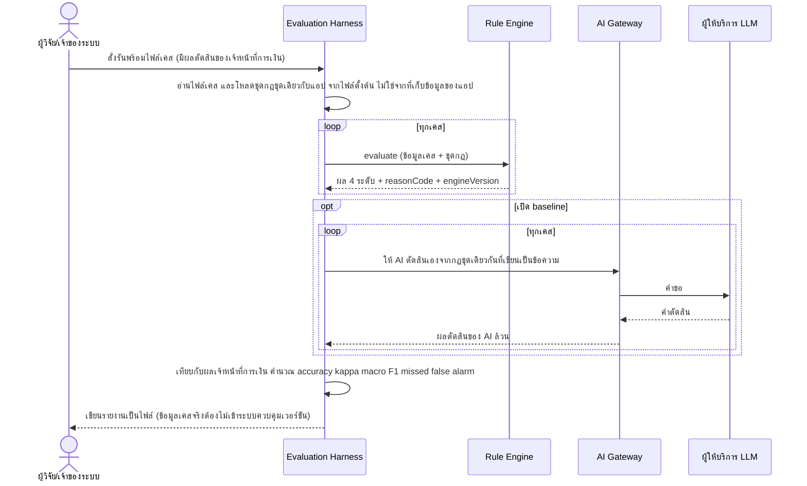
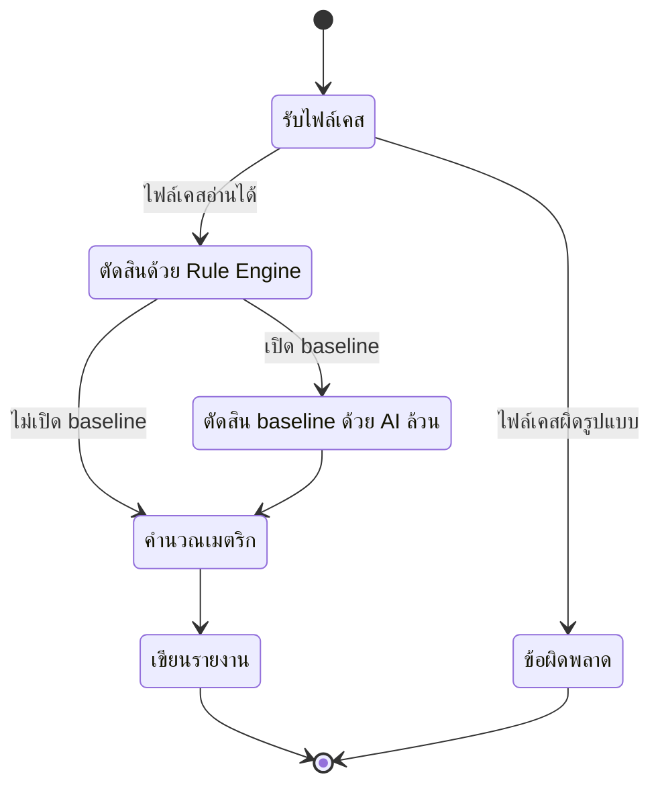

# Detailed Design — ชุดประเมินผลสำหรับวิทยานิพนธ์ (รันนอกแอป)

> การออกแบบระดับ component สำหรับ [[feature-list#23. ชุดประเมินผลสำหรับวิทยานิพนธ์ (รันนอกแอป)|ฟีเจอร์ที่ 23]]
> แปลงจาก [[user-journey#Journey 10: ผู้วิจัยรันชุดประเมินผลเพื่อเทียบ Rule Engine กับผลของเจ้าหน้าที่การเงิน (เครื่องมือนอกแอป)|Journey 10]]
> **ไม่มี operation ใน [[api-spec]] และไม่มี entity ใน [[db-spec]] โดยเจตนา** (api-spec หัวข้อ 1: เป็นเครื่องมือนอกแอป ใช้โมดูล Rule Engine ตัวเดียวกับ OP-04 กับไฟล์เคสที่ไม่อยู่ในที่เก็บข้อมูลของแอป)
> test case: [[03-testing/01-test-plan/test-cases/thesis-evaluation-harness|thesis-evaluation-harness]]

## 0. สถานะเอกสารและสถานะการสร้าง

- **สร้างใหม่ 2026-11-17** — **สถานะ: สร้างบางส่วน** (Component Evaluation Harness ตาม [[architecture]] 2.1)

| ส่วน | สถานะ |
|---|---|
| อ่านไฟล์เคส รัน Rule Engine เทียบผลเจ้าหน้าที่การเงิน คำนวณ accuracy / Cohen's kappa / macro F1 / missed / false alarm เขียนรายงานเป็นไฟล์ | สร้างแล้ว |
| baseline "AI ตัดสินเองล้วน" จากกฎชุดเดียวกันเป็นข้อความ ผ่าน AI Gateway | สร้างแล้ว **แต่ยังไม่ได้รันกับผู้ให้บริการที่เสียเงิน** |
| ข้อมูลเคสจริงจากเจ้าหน้าที่การเงิน | **ยังไม่มี** (รอ EC) มีเฉพาะเคสสมมติ |
| ผู้ใช้เครื่องมือ | ผู้วิจัย/เจ้าของระบบเท่านั้น **ไม่ใช่บทบาทที่ 3 ในแอป** |

## 1. ภาพรวม

เครื่องมือบรรทัดคำสั่งของผู้วิจัยสำหรับขั้นประเมินเชิงเทคนิคของวิทยานิพนธ์ หลักการสำคัญ: **รันโมดูล Rule Engine ตัวเดียวกับที่แอปใช้** ([[02-design/02-technical/detailed-design/rule-engine-pure-module|rule-engine-pure-module]])
กับชุดกฎเดียวกัน เพื่อให้ผลประเมินสะท้อนระบบจริงและเปรียบเทียบข้ามเวอร์ชัน engine ได้ ไม่เชื่อมกับที่เก็บข้อมูลของแอป ข้อมูลเคสจริงอยู่นอกระบบควบคุมเวอร์ชัน (มีข้อมูลส่วนบุคคล)
Component: Evaluation Harness, Rule Engine (โมดูลเดียวกัน), AI Gateway (เฉพาะ baseline)

## 2. Sequence Diagram

## 3. Operation ↔ Entity ที่กระทบ

ไม่มี operation และไม่มี entity ของแอปที่ถูกอ่านหรือเขียน — ตารางนี้ระบุเฉพาะสิ่งที่ฟีเจอร์ใช้เพื่อให้ไม่คลุมเครือ

| ส่วนที่ใช้ | ชนิด | การกระทำ | หมายเหตุ |
|---|---|---|---|
| โมดูล Rule Engine | component (ตัวเดียวกับ OP-04 เรียก) | เรียกตรง | ไม่มีผลข้างเคียง ไม่แตะที่เก็บข้อมูล |
| ชุดกฎ (ข้อมูลเชิงโครงสร้างเดียวกับ RuleVersion/RuleItem/EvidenceChain) | ไฟล์ตั้งต้นของระบบ | อ่าน | ไม่ใช่การอ่านจาก Primary Data Store |
| ไฟล์เคส | ข้อมูลภายนอกแอป | อ่าน | ไม่ใช่ entity ใน db-spec |
| รายงานผล | ไฟล์ | เขียน | ไม่ใช่ entity ใน db-spec |
| AI Gateway | component | เรียก (baseline เท่านั้น) | เลือกผู้ให้บริการได้ 4 รูปแบบ ผู้ให้บริการในเครื่องไม่ส่งข้อมูลออกนอกเครื่อง |

## 4. State Diagram — การรันหนึ่งรอบ

ไม่มีสถานะของข้อมูลที่บันทึกถาวรในระบบ แผนภาพคือขั้นของการรัน:

## 5. Edge Case และวิธีจัดการ

| # | Edge Case | วิธีจัดการ | อ้างอิง |
|---|---|---|---|
| 1 | เคสที่ระบบมองไม่เห็น (เจ้าหน้าที่การเงินตัดสินจากข้อมูลที่กฎไม่ครอบคลุม) | ผลไม่ตรงกันนับเป็นข้อพลาด/แจ้งเตือนเกินตามนิยาม ใช้วิเคราะห์ข้อผิดพลาดของวิทยานิพนธ์ ไม่ใช่ error ของเครื่องมือ | FR-34 |
| 2 | ข้อมูลเคสไม่มีบางด้าน (ประมาณการ เอกสาร ใบสรุป) | engine ให้ข้อค้นพบ "ยังไม่ได้ตรวจ" และ `autoVerified` เท็จ ไม่เดาแทน | db-spec กฎข้อ 16 |
| 3 | ข้อมูลเคสจริง | ห้ามเข้าระบบควบคุมเวอร์ชัน เก็บในที่ที่ไม่ถูก commit | FR-34 |
| 4 | baseline ต้องเรียกผู้ให้บริการ AI | ผู้ให้บริการภายนอกที่เสียเงิน**ยังไม่ได้รัน**; ถ้าใช้ผู้ให้บริการภายนอกกับข้อมูลจริงต้องผ่าน NFR-08/NFR-09 ผู้ให้บริการในเครื่องไม่ส่งข้อมูลออก | NFR-08, NFR-14 |
| 5 | ผลระดับของเจ้าหน้าที่การเงินไม่ตรง 4 ระดับ | api-spec/feature-list ไม่ระบุการแปลงค่า — ถือว่าไฟล์เคสต้องใช้ 4 ระดับเดียวกัน ถ้าไม่ตรงถือเป็นข้อผิดพลาดของไฟล์เคส ไม่แปลงเอง | FR-34 |
| 6 | เปรียบเทียบข้ามเวอร์ชัน engine | บันทึก `engineVersion` ในผลเพื่อแยกเวอร์ชัน ข้อบังคับให้เพิ่มเวอร์ชันเมื่อตรรกะเปลี่ยนอยู่ที่ FR-24 | FR-24 |
| 7 | ผู้ใช้ทั่วไป/Admin ของแอปใช้เครื่องมือนี้ | ไม่ใช่บทบาทในแอป เครื่องมือนี้ไม่ผ่านกฎสิทธิ์ของที่เก็บข้อมูลเพราะไม่ได้เข้าถึง | api-spec หัวข้อ 1 |

## 6. หมายเหตุช่องว่าง api-spec/db-spec

ไม่ถือเป็นช่องว่าง — ฟีเจอร์นี้อยู่นอกแอป จึงไม่มี operation/entity โดยออกแบบ (ไม่ต้องรัน `sync-api-db`) หากภายหลังต้องการให้แอปเก็บเคส/ผลประเมิน ต้องเสนอเป็น requirement ใหม่ก่อน

## เอกสารที่เกี่ยวข้อง

- [[feature-list#23. ชุดประเมินผลสำหรับวิทยานิพนธ์ (รันนอกแอป)|feature-list ฟีเจอร์ที่ 23]], [[user-journey#Journey 10: ผู้วิจัยรันชุดประเมินผลเพื่อเทียบ Rule Engine กับผลของเจ้าหน้าที่การเงิน (เครื่องมือนอกแอป)|Journey 10]], [[architecture]] 2.1/3.7, [[api-spec]], [[db-spec]]
- [[02-design/02-technical/detailed-design/rule-engine-pure-module|rule-engine-pure-module]], [[02-design/02-technical/detailed-design/ai-ocr-receipt-reading|ai-ocr-receipt-reading]] (AI Gateway ตัวเดียวกัน)
