# User Journey — Grant Receipt Assistant

แมปฟีเจอร์จาก [[feature-list]] เป็น flow การใช้งานจริงตามบทบาทผู้ใช้ (step-by-step) ระบบมี 2
บทบาทเท่านั้น: **นักวิจัย/เจ้าของโครงการ** และ **Admin (ผู้ดูแลระบบ/ผู้อัปเดตระเบียบ)** (ดู
[[20260816-01-grant-receipt-verification#3. บทบาทผู้ใช้ (User Roles)]]) — Journey 5-7 (ด้าน
PDPA/การคุ้มครองข้อมูลส่วนบุคคล อ้างอิง [[20260816-02-pdpa-compliance]]) ไม่มีบทบาทใหม่เพิ่มเติม
เป็นสิทธิ์/หน้าที่ของบทบาทนักวิจัย/เจ้าของโครงการเดิมทั้งหมด แต่ละ journey ด้านล่างมี
แผนภาพ Mermaid flowchart กำกับก่อนรายการขั้นตอนแบบข้อความเสมอ เพื่อให้เห็นภาพรวมได้เร็ว

> **อัปเดต 2026-09-03:** ปรับคำศัพท์จาก "ทุนวิจัย/เจ้าของทุน" เป็น "โครงการวิจัย (Project)/เจ้าของ
> โครงการ" ให้ตรงกับโมเดลข้อมูลที่แก้ไขแล้วใน [[feature-list]]/backlog (แยก FundSource ออกจาก
> Project ชัดเจน, ใบเสร็จผูกกับ Project ไม่ใช่ FundSource) แทรก step ใหม่ **"ตั้งค่าโครงการวิจัยและ
> ผูกกับแหล่งทุน" (FR-23, ฟีเจอร์ที่ 13)** เข้าไปใน Journey 1 ก่อนขั้นตอนอัปโหลดใบเสร็จ เพราะเป็น
> ขั้นตอนต่อยอด/ก่อนหน้าของ flow เดิม ไม่ใช่สถานการณ์ใหม่ที่ต้องแยก journey ต่างหาก และปรับคำใน
> Journey 2/4 ให้ตรงกับ FR-08/FR-11 ที่แก้ไขแล้ว
>
> **อัปเดต 2026-11-17:** sync ตาม backlog ที่เพิ่ม FR-24–FR-34/NFR-12–NFR-14 (สร้างเสร็จแล้วในแอปจริง —
> [[20261117-01-implemented-rule-engine-ai-and-admin]]) **Journey 1 เรียบเรียงใหม่ตามลำดับการใช้งานจริง:**
> นำเข้าประมาณการ 17.2 ที่หน้าโครงการ (FR-26) → เชื่อมต่อ Google Drive (FR-32) → อัปโหลดใบเสร็จ → AI/OCR อ่าน
> (FR-30) → เลือกรายการในประมาณการ (FR-26) + ติ๊กเอกสารแนบ (FR-27) + กรอกยอดในใบสรุป (FR-28 ไม่บังคับ) →
> Rule Engine ตัดสิน 4 ระดับ (FR-24, FR-25) → AI agent อธิบาย (FR-31) เลขขั้นตอนใน Journey 1 เปลี่ยน
> (เดิม 11 ขั้น ตอนนี้ 17 ขั้น) จึงปรับการอ้างอิงข้ามใน Journey 2-4 ให้ตรงแล้ว และเพิ่ม **Journey 8-10**
> (ติดตามประมาณการ / Admin Dashboard / ชุดประเมินผลวิทยานิพนธ์) ปรับ Journey 4 ตามการกลับคำตัดสินใจเรื่องสิทธิ์
> Admin (FR-33: อ่านใบเสร็จทุกคนได้แบบอ่านอย่างเดียว)
>
> **อัปเดต 2026-11-17 (รอบ 2):** sync ตาม backlog ที่เพิ่ม FR-35–FR-37/NFR-15
> ([[20261117-02-fund-source-deactivation-estimate-versioning-drive-privacy]] — **ยังไม่ได้สร้างทั้งหมด**) แทรกเข้า journey เดิม ไม่สร้าง journey ใหม่:
> Journey 4 (ปิดใช้งานแหล่งทุน FR-35, แทรกเป็นขั้นตอนที่ 3 เลขขั้นเดิม 3-5 เลื่อนเป็น 4-6), Journey 8 (นำเข้าประมาณการซ้ำแบบเก็บเวอร์ชัน FR-36,
> ขั้นตอนที่ 5-8), Journey 7/5 (ลบไฟล์ใน Google Drive ตามเมื่อลบใบเสร็จ/ถอนความยินยอม FR-37, NFR-15), Journey 9 และ Journey 1 (หมายเหตุอ้างอิง)
>
> **อัปเดต 2026-11-27:** Journey 1 เขียนตามแผนปัจจุบัน (ปรับทิศทาง 2026-11-24 — LLM ตัดสิน ไม่มีขั้นแก้ค่า/ติ๊กเอกสาร FR-38/FR-39
> [[20261127-02-llm-verdict-research-direction]]) **Journey 1 แผนแรกไม่ได้ลบ** ย้ายไปเก็บที่ภาคผนวกท้ายเอกสารในฐานะแผนแรกที่ออกแบบไว้
> เลขขั้นตอน 1-17 ของ Journey 1 คงเดิม Journey 10 เพิ่มตัวรันชุดเคส (FR-41)

## Journey 1: นักวิจัยอัปโหลดใบเสร็จและตรวจสอบผลจนผ่านเกณฑ์

บทบาท: นักวิจัย/เจ้าของโครงการ

> **แผนปัจจุบัน (ตั้งแต่ 2026-11-24):** กดอัปโหลดครั้งเดียว ระบบทำต่อเองทั้งหมด (OCR → อ่านค่า → จำแนกเอกสาร/หาตรา → ตรวจ → บันทึก)
> **ไม่มีขั้นให้นักวิจัยแก้ค่าหรือติ๊กเอกสาร** และค่าตั้งต้นให้ **LLM ตัดสินผล** โดย Rule Engine ยังรันทุกใบเก็บผลไว้เทียบ
> เหตุผล: งานวิจัยต้องวัดความถูกต้องของ LLM ที่ตัดสินเอง เทียบกับเจ้าหน้าที่การเงินและกับแบบที่ใช้เทคนิคอื่น
> ([[20261127-02-llm-verdict-research-direction]]) — **แผนแรก** (นักวิจัยตรวจแก้ค่า เลือกรายการประมาณการ ติ๊กเอกสาร แล้ว Rule Engine ตัดสิน)
> เก็บไว้ครบที่ [[#ภาคผนวก Journey 1 แผนแรก (ก่อน 2026-11-24)]] ไม่ได้ลบ

```mermaid
flowchart TD
    A["เข้าสู่ระบบ เห็นเฉพาะข้อมูลของตนเอง (FR-12, NFR-05)"]
    B{"เคยให้ความยินยอม (Consent) แล้วหรือยัง? (FR-14)"}
    C["แสดง Privacy Notice (FR-13)"]
    D["ขอความยินยอมชัดแจ้งก่อนเก็บ/ประมวลผลข้อมูล (FR-14)"]
    E{"ให้ความยินยอมหรือไม่?"}
    F["บันทึกหลักฐานการให้ความยินยอม (FR-15)"]
    G["ไม่สามารถอัปโหลดใบเสร็จได้ (FR-14)"]
    P{"มีโครงการวิจัยที่ผูกกับแหล่งทุนไว้แล้วหรือยัง? (FR-23)"}
    Q["สร้าง/จัดการข้อมูลโครงการวิจัย และเลือกผูกกับแหล่งทุนที่ได้รับ (FR-23)"]
    R{"โครงการมีประมาณการ 17.2 แล้วหรือยัง? ต้องมีก่อนอัปโหลด (FR-26)"}
    S["นำเข้าไฟล์ประมาณการ 17.2 ที่หน้าโครงการ ตรวจ/แก้การจับคู่หมวดระเบียบแล้วบันทึก (FR-26)"]
    T{"ต้องการแนบไฟล์จริงลง Google Drive ของตนเองหรือไม่? (FR-32)"}
    U["เชื่อมต่อ Google Drive ของตนเอง สิทธิ์ drive.file (FR-32, FR-37)"]
    H["อัปโหลดไฟล์ของค่าใช้จ่าย 1 เรื่อง สูงสุด 5 ไฟล์ กรอกยอดในใบสรุปถ้าต้องการ แล้วกดครั้งเดียว (FR-01, FR-22, FR-28)"]
    H2{"ไฟล์/จำนวนไฟล์ถูกต้องหรือไม่ (FR-19)"}
    H3["ระบบปฏิเสธไฟล์ พร้อมข้อความ error ภาษาไทย (FR-19)"]
    I["OCR อ่านทุกหน้าทุกไฟล์ + AI อ่านยอด/วันที่/หมวด/ร้าน เก็บ OCR ดิบ (FR-02, FR-30, FR-39)"]
    X["ระบบจำแนกเอกสารและหาตราจากข้อความ OCR เอง และจับรายการประมาณการจากหมวด (FR-39, FR-26, FR-27)"]
    K["Rule Engine ตรวจทุกใบ เก็บผลไว้เทียบ (FR-24, FR-25)"]
    K2["LLM ตัดสินด้วย checklist 4 ข้อ จาก OCR + ระเบียบ + ประมาณการ ถ้าล้มเหลวใช้ผล Rule Engine (FR-38)"]
    L2["บันทึกและแสดงสถานะด้วยสี+ไอคอน+ข้อความ พร้อมคำแนะนำภาษาไทย (FR-06, FR-38, NFR-02, NFR-03, NFR-13)"]
    M{"ผ่านการตรวจหรือไม่?"}
    N["ส่งฉบับแก้ไข เพิ่มเอกสารที่ขาด/แทนที่ทั้งชุด ดู Journey 2 หรือชี้แจง/ขออนุมัติ (FR-07)"]
    O["ใบเสร็จผ่านตรวจ พร้อมสำหรับ Export"]

    A --> B
    B -->|เคยแล้ว| P
    B -->|ยัง ครั้งแรก| C --> D --> E
    E -->|ให้ความยินยอม| F --> P
    E -->|ไม่ให้ความยินยอม| G
    P -->|มีแล้ว| R
    P -->|ยังไม่มี/ต้องการเพิ่มโครงการใหม่| Q --> R
    R -->|มีแล้ว| T
    R -->|ยังไม่มี| S --> T
    T -->|ต้องการแนบ| U --> H
    T -->|ไม่ต้องการ| H
    H --> H2
    H2 -->|ไม่ถูกต้อง| H3 --> H
    H2 -->|ถูกต้อง| I
    I --> X --> K --> K2 --> L2 --> M
    M -->|ผ่าน| O
    M -->|ไม่ผ่าน| N
    N --> I
```

ขั้นตอน:
1. เข้าสู่ระบบ — เห็นเฉพาะข้อมูลใบเสร็จ/โครงการของตนเองเท่านั้น
   ([[20260816-01-grant-receipt-verification#4. Functional Requirements|FR-12]],
   [[20260816-01-grant-receipt-verification#5. Non-Functional Requirements|NFR-05]])
2. ตามสถานการณ์: ถ้า**ยังไม่เคย**ให้ความยินยอมมาก่อน (ใช้งานครั้งแรก/ก่อนอัปโหลดใบเสร็จครั้งแรก) →
   ระบบแสดงประกาศความเป็นส่วนตัว (Privacy Notice) แจ้งวัตถุประสงค์การเก็บ/ใช้ข้อมูล ตัวตนผู้ควบคุม
   ข้อมูล ระยะเวลาเก็บข้อมูล และสิทธิ์ของเจ้าของข้อมูล (รวมถึงว่า Admin อ่านข้อมูลใบเสร็จได้แบบอ่านอย่างเดียว)
   แล้วขอความยินยอมชัดแจ้ง (Explicit Consent) ก่อนเริ่มเก็บ/ประมวลผลข้อมูลใบเสร็จ — ปัจจุบันในแอปเป็นการ
   ยินยอมแบบเบา (ติ๊กครั้งเดียวก่อนอัปโหลดครั้งแรก) ถ้า**เคยให้**ความยินยอมแล้ว → ข้ามไปขั้นตอนตรวจสอบ
   โครงการวิจัยได้เลย
   ([[20260816-02-pdpa-compliance#4. Functional Requirements|FR-13]],
   [[20260816-02-pdpa-compliance#4. Functional Requirements|FR-14]])
3. ตามสถานการณ์ (เฉพาะกรณีเป็นครั้งแรก): ถ้า**ให้ความยินยอม** → ระบบบันทึกหลักฐานการให้ความยินยอม
   (วันที่ให้, เวอร์ชัน Privacy Notice) แล้วไปขั้นตอนตรวจสอบโครงการวิจัย ถ้า**ไม่ให้ความยินยอม** → ไม่
   สามารถอัปโหลดใบเสร็จเข้าสู่ระบบได้ จบ flow นี้ (ดูวิธีถอนความยินยอมภายหลังที่ Journey 5)
   ([[20260816-02-pdpa-compliance#4. Functional Requirements|FR-14]],
   [[20260816-02-pdpa-compliance#4. Functional Requirements|FR-15]])
4. ตามสถานการณ์: ถ้า**ยังไม่มี**โครงการวิจัยที่ผูกกับแหล่งทุนไว้เลย (หรือต้องการเพิ่มโครงการใหม่) →
   สร้าง/จัดการข้อมูลโครงการวิจัยของตนเอง (อย่างน้อยชื่อโครงการ) แล้วเลือกผูกโครงการเข้ากับแหล่งทุน
   (fund source) ที่โครงการได้รับจากรายการที่ Admin นำเข้าไว้ (ดู Journey 4) เพื่อให้ระบบทราบว่า
   ใบเสร็จของโครงการนี้ต้องตรวจตามระเบียบของแหล่งทุนใด ถ้า**มีแล้ว** → ข้ามไปขั้นตอนถัดไปได้
   เลยโดยเลือกโครงการที่มีอยู่แล้วเป็นตัวที่จะผูกใบเสร็จ
   ([[20260816-01-grant-receipt-verification#4. Functional Requirements|FR-23]])
5. ตามสถานการณ์: ถ้าโครงการ**ยังไม่มี**ประมาณการ → นำเข้าไฟล์ตารางประมาณการ 17.2 ของมหาวิทยาลัย
   (.xlsx/.csv) ที่หน้าโครงการ (ปุ่ม "ประมาณการ" บนการ์ดโครงการ) ระบบแปลงเป็นรายการประมาณการ อ่านจำนวนหน่วยจากช่อง
   ตัวคูณ จับคู่หมวดระเบียบให้ นักวิจัยตรวจ/แก้การจับคู่ก่อนบันทึก (พฤติกรรมปัจจุบัน: การนำเข้าซ้ำจะแทนที่รายการทั้งหมด ส่วนการนำเข้าซ้ำแบบเก็บ
   เวอร์ชันเก่าและย้ายใบเสร็จไปรายการล่าสุด **ยังไม่ได้สร้าง** ดู Journey 8 ขั้นตอนที่ 5-8) ถ้า
   **มีแล้ว** → ข้ามไปขั้นตอนถัดไป (ติดตามยอดใช้ไป/คงเหลือ ดู Journey 8) — **ตั้งแต่ 2026-11-24 ต้องมีประมาณการก่อนจึงอัปโหลดใบเสร็จได้**
   (หน้าอัปโหลดแจ้งพร้อมลิงก์ไปหน้าประมาณการ และปุ่มอัปโหลดไม่ทำงานจนกว่าจะนำเข้า)
   ([[20261117-01-implemented-rule-engine-ai-and-admin#2. Functional Requirements|FR-26]],
   [[20261117-02-fund-source-deactivation-estimate-versioning-drive-privacy#2. Functional Requirements|FR-36]])
6. ตามสถานการณ์: ถ้า**ต้องการแนบไฟล์จริง** → กด "เชื่อมต่อ Google Drive" เพื่ออนุญาตบัญชี Google ของตนเอง
   (สิทธิ์ `drive.file` เท่านั้น) ไฟล์จะเก็บในโฟลเดอร์แยกตามรหัสใบเสร็จ ถ้า**ไม่ต้องการ** → ข้ามไป (โทเค็นหมดอายุ
   ประมาณ 1 ชั่วโมง ต้องกดเชื่อมต่อใหม่ ระบบจะเตือนถ้าแนบไฟล์แต่ยังไม่ได้เชื่อมต่อ) — **ยังไม่ได้สร้าง (FR-37):** ไฟล์จะดูได้เฉพาะเจ้าของและ Admin
   (ปัจจุบันใครมีลิงก์เปิดดูได้) และถูกลบตามเมื่อลบใบเสร็จ/ถอนความยินยอม ดู Journey 7 และ 5
   ([[20261117-01-implemented-rule-engine-ai-and-admin#2. Functional Requirements|FR-32]],
   [[20261117-02-fund-source-deactivation-estimate-versioning-drive-privacy#2. Functional Requirements|FR-37]])
7. อัปโหลดไฟล์ใบเสร็จของค่าใช้จ่าย 1 เรื่อง (jpg/png หรือ PDF สแกน) ผูกกับ**โครงการวิจัย**ของตนเอง
   (ไม่ใช่ผูกตรงกับแหล่งทุนโดยตรง) — 1 รายการใบเสร็จ (ชุดเอกสารหลักฐานของค่าใช้จ่าย 1 เรื่อง) อาจ
   ประกอบด้วยมากกว่า 1 ไฟล์/แผ่น (เช่น ค่ารถตู้ตามระเบียบมหาวิทยาลัยต้องมี "ใบสำคัญรับเงิน" +
   "สำเนาบัตรผู้รับเงิน" รวมกัน) สูงสุด **5 ไฟล์ต่อรายการ** ต้องอัปโหลดไฟล์ทั้งหมดของค่าใช้จ่ายเรื่อง
   เดียวกันพร้อมกันในครั้งเดียวและผูกกับ record เดียวกัน ไม่ใช่แยกเป็นใบเสร็จคนละรายการ (ใบเสร็จ 1
   แผ่นที่มีสินค้าหลายชิ้นจากร้านเดียวกันยังนับเป็นรายการเดียว ไม่ต้องแยก) ระหว่างขั้นตอนนี้ระบบต้อง
   แสดงข้อความเตือน/คำแนะนำให้อัปโหลดครั้งละ 1 รายการเท่านั้น เพื่อป้องกันความสับสนอัปโหลดใบเสร็จ
   หลายรายการปนกันในครั้งเดียว
   ([[20260816-01-grant-receipt-verification#4. Functional Requirements|FR-01]],
   [[20260816-01-grant-receipt-verification#4. Functional Requirements|FR-22]])
8. ระบบตรวจสอบความถูกต้องของไฟล์ที่อัปโหลดก่อนส่งเข้า OCR เสมอ (ชนิดไฟล์ที่รองรับ, ไฟล์ไม่เสียหาย/
   เปิดได้, ไม่เกินขนาดสูงสุด 5 MB ต่อไฟล์, จำนวนไฟล์ไม่เกิน 5 ไฟล์ต่อรายการ) — ตามสถานการณ์: ถ้า
   **ไฟล์ไม่ถูกต้องหรือมีจำนวนไฟล์เกินที่กำหนด** → ระบบปฏิเสธการอัปโหลด (หรือไฟล์ส่วนเกิน) ทันทีพร้อม
   ข้อความ error ภาษาไทยที่ชัดเจนระบุสาเหตุ แนะนำให้ลดจำนวนไฟล์หรือแยกเป็นรายการใหม่ตามความเหมาะสม
   แล้ววนกลับไปขั้นตอนที่ 7 ให้อัปโหลดใหม่ ถ้า**ไฟล์ถูกต้องครบตามเงื่อนไข** → ไปขั้นตอนถัดไป
   ([[20260816-01-grant-receipt-verification#4. Functional Requirements|FR-19]],
   [[20260816-01-grant-receipt-verification#4. Functional Requirements|FR-22]])
9. ระบบอ่านข้อมูลจากใบเสร็จอัตโนมัติ (ยอดเงิน วันที่ หมวดค่าใช้จ่าย ชื่อร้าน/ผู้ขาย) — AI อ่านภาพ/PDF หน้าแรก
   พร้อมป้าย "AI suggestion" เฉพาะเมื่อ AI ทำงานจริง ผู้ให้บริการสลับได้ (OpenRouter / Ollama ในเครื่อง / proxy /
   custom) และถ้ามี OCR ภาษาไทยในเครื่องเปิดอยู่ ระบบส่งข้อความที่ OCR อ่านได้เข้า AI ประกอบภาพ (ใบเสร็จไม่ออกจากเครื่อง
   ถ้าใช้ AI ในเครื่อง) หรือสกัดยอด/วันที่ (พ.ศ.→ค.ศ.)/ชื่อร้านเองเมื่อไม่มี AI ถ้าไม่มี AI/OCR หรือเรียกล้มเหลว → ถอยกลับเป็น
   กรอกเองหรือข้อมูลสาธิตพร้อมแจ้งว่าใช้เส้นทางใด — หากผู้ให้บริการ OCR/AI ประมวลผลข้อมูลนอกราชอาณาจักรไทย ต้องมี
   มาตรการคุ้มครอง cross-border transfer และข้อตกลงประมวลผลข้อมูล (DPA) ตามเงื่อนไขที่กำหนด
   ([[20260816-01-grant-receipt-verification#4. Functional Requirements|FR-02]],
   [[20261117-01-implemented-rule-engine-ai-and-admin#2. Functional Requirements|FR-30]],
   [[20260816-01-grant-receipt-verification#5. Non-Functional Requirements|NFR-01]],
   [[20260816-01-grant-receipt-verification#5. Non-Functional Requirements|NFR-06]],
   [[20260816-02-pdpa-compliance#5. Non-Functional Requirements|NFR-08]],
   [[20260816-02-pdpa-compliance#5. Non-Functional Requirements|NFR-09]],
   [[20261117-01-implemented-rule-engine-ai-and-admin#3. Non-Functional Requirements|NFR-12]],
   [[20261117-01-implemented-rule-engine-ai-and-admin#3. Non-Functional Requirements|NFR-14]])
10. **ไม่มีขั้นตรวจ/แก้ค่าที่อ่านได้** — ค่าที่ OCR/AI อ่านถูกใช้ตรวจทันที หน้าจอขั้นที่ 2 แสดงเพียง "กำลังตรวจสอบ"
    (แผนแรกให้นักวิจัยตรวจแก้ได้ทุกค่าตาม FR-03 ดูภาคผนวก) ถ้าอ่านยอดไม่ได้จะบันทึกเป็นค่าว่าง ไม่ใช่ตัวเลขผิด
    ([[20261127-02-llm-verdict-research-direction#2. Functional Requirements|FR-39]])
11. ระบบจับรายการในประมาณการจากหมวดค่าใช้จ่ายที่อ่านได้เอง (แผนแรกให้นักวิจัยเลือกรายการหรือ "ไม่อยู่ในประมาณการ" เอง)
    ([[20261117-01-implemented-rule-engine-ai-and-admin#2. Functional Requirements|FR-26]])
12. ระบบจำแนกประเภทเอกสารของแต่ละไฟล์ และหาตรา ("จ่ายแล้ว", "ตรวจรับพัสดุ"/"ได้รับพัสดุ") จากข้อความ OCR เอง
    แล้วใช้เป็นเอกสาร/ตราที่มีสำหรับตรวจกับชุดเอกสารของหมวดนั้น (แผนแรกให้นักวิจัยติ๊กเอง) — เป็นการจับคำสำคัญ ไม่ใช่โมเดลจำแนกจริง
    และ**ตรวจรูปถ่ายพัสดุไม่ได้**
    ([[20261117-01-implemented-rule-engine-ai-and-admin#2. Functional Requirements|FR-27]],
    [[20261127-02-llm-verdict-research-direction#2. Functional Requirements|FR-39]])
13. ยอดในใบสรุปรายรับ-จ่าย (ไม่บังคับ) กรอกพร้อมอัปโหลดในขั้นตอนที่ 7 — เป็นข้อมูลเดียวที่นักวิจัยกรอกเอง
    ([[20261117-01-implemented-rule-engine-ai-and-admin#2. Functional Requirements|FR-28]])
14. ตรวจ: Rule Engine ตรวจทุกใบตามลำดับ ประมาณการ → ระเบียบ → ใบสรุป → เอกสารแนบ และบันทึกใน `receipt.ruleCheck` เสมอ
    จากนั้น (โหมดตั้งต้น `llm`) LLM ตัดสิน pass/fail จากข้อความ OCR ระเบียบเป็นข้อความ และประมาณการพร้อมตัวเลขที่คำนวณไว้
    โดยกรอก checklist 4 ข้อ (ประมาณการ / เพดานระเบียบ / เอกสาร / ตรา) พร้อมข้อความ OCR ที่ใช้เป็นหลักฐาน — ถ้า LLM ล้มเหลว
    ใช้ผล Rule Engine แทน; โหมด `rule` ให้ Rule Engine ตัดสินเหมือนแผนแรก
    ([[20261117-01-implemented-rule-engine-ai-and-admin#2. Functional Requirements|FR-24]],
    [[20261117-01-implemented-rule-engine-ai-and-admin#2. Functional Requirements|FR-25]],
    [[20261127-02-llm-verdict-research-direction#2. Functional Requirements|FR-38]])
15. คำอธิบาย: โหมด `llm` ใช้คำแนะนำและข้อสังเกตของ LLM แสดงเป็นภาษาไทย; AI agent ที่อธิบายผลของกฎ (FR-31) ทำงานเฉพาะโหมด `rule`
    ([[20260816-01-grant-receipt-verification#4. Functional Requirements|FR-05]],
    [[20261117-01-implemented-rule-engine-ai-and-admin#2. Functional Requirements|FR-31]],
    [[20261127-02-llm-verdict-research-direction#2. Functional Requirements|FR-38]])
16. ระบบแสดงสถานะใบเสร็จด้วยสี+ไอคอน+ข้อความ (โหมด `llm`: ผ่าน / ต้องแก้ไข; โหมด `rule`: 4 ระดับ) พร้อมคำแนะนำ
    ([[20260816-01-grant-receipt-verification#4. Functional Requirements|FR-06]],
    [[20261117-01-implemented-rule-engine-ai-and-admin#2. Functional Requirements|FR-25]],
    [[20260816-01-grant-receipt-verification#5. Non-Functional Requirements|NFR-02]],
    [[20260816-01-grant-receipt-verification#5. Non-Functional Requirements|NFR-03]],
    [[20261117-01-implemented-rule-engine-ai-and-admin#3. Non-Functional Requirements|NFR-13]])
17. ตามสถานการณ์: ถ้า**ผ่าน** → ใบเสร็จพร้อมสำหรับนำไป export (ดู Journey 3) จบ flow นี้
    ถ้า**ไม่ผ่าน** → กด "ส่งฉบับแก้ไข" เลือกเพิ่มเอกสารที่ขาดหรือแทนที่ทั้งชุด
    (รายละเอียดดู Journey 2 ขั้นตอนที่ 4-7; กรณีต้องชี้แจง/ขออนุมัติ ให้ดำเนินการกับการเงินนอกระบบ) แล้วระบบตรวจซ้ำเหมือนขั้นตอนที่ 14 จนกว่าจะผ่าน
    ([[20260816-01-grant-receipt-verification#4. Functional Requirements|FR-07]])

## Journey 2: นักวิจัยติดตามภาพรวมโครงการและจัดการใบเสร็จที่มีปัญหาผ่าน Dashboard และการแจ้งเตือน

บทบาท: นักวิจัย/เจ้าของโครงการ

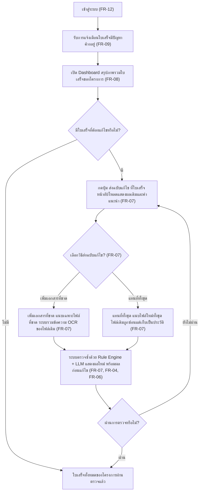

ขั้นตอน:
1. เข้าสู่ระบบ — เห็นเฉพาะโครงการของตนเอง
   ([[20260816-01-grant-receipt-verification#4. Functional Requirements|FR-12]])
2. รับการแจ้งเตือนเมื่อมีใบเสร็จสถานะ "ต้องแก้ไข"/"ต้องชี้แจง/ขออนุมัติ"/"ไม่เข้าเงื่อนไข" ค้างอยู่ยังไม่ได้รับการแก้ไข
   (ไม่รวมการแจ้งเตือนตามกำหนดเวลาส่งหลักฐาน ซึ่งตัดออกจากขอบเขต MVP นี้) — ยังเป็น Backlog
   ([[20260816-01-grant-receipt-verification#4. Functional Requirements|FR-09]])
3. เปิดดู Dashboard สรุปภาพรวมสถานะใบเสร็จของแต่ละ**โครงการวิจัย**ที่เป็นเจ้าของ (จำนวนที่ผ่าน/
   ต้องแก้ไข/ต้องชี้แจง-ขออนุมัติ/ไม่เข้าเงื่อนไข) — ปัจจุบันนักวิจัยดูได้ผ่านหน้ารายการใบเสร็จรายโครงการ (ตัวกรองตามโครงการ)
   ส่วน Dashboard สรุปข้ามผู้ใช้มีเฉพาะฝั่ง Admin (ดู Journey 9) ([[20260816-01-grant-receipt-verification#4. Functional Requirements|FR-08]])
4. ตามสถานการณ์: ถ้า**มี**ใบเสร็จที่ยังไม่ผ่าน (ต้องแก้ไข/ต้องชี้แจง-ขออนุมัติ/ไม่เข้าเงื่อนไข) → กดปุ่ม
   "ส่งฉบับแก้ไข" ที่ใบเสร็จนั้น (มีในหน้า "ใบเสร็จของฉัน" และ "ประมาณการและใบเสร็จ"; ใบเสร็จที่ผ่านแล้วไม่มีปุ่มนี้) ระบบเปิดหน้าอัปโหลดใน
   โหมดฉบับแก้ไข แสดงสถานะ ยอด วันที่ หมวด ร้านค้า และคำแนะนำเดิม โดยใช้ใบเสร็จรหัสเดิม และล็อกโครงการไว้
   (ต่อยอดจาก Journey 1 ขั้นตอนที่ 17) ถ้า**ไม่มี** → ใบเสร็จทั้งหมดของโครงการผ่านตรวจแล้ว พร้อมสำหรับ export
   ([[20260816-01-grant-receipt-verification#4. Functional Requirements|FR-07]])
5. เลือกวิธีส่งฉบับแก้ไข 1 ใน 2 แบบต่อการส่งแต่ละครั้ง (ไม่มีขั้นตอนแก้ไขช่องข้อมูลด้วยมือ ผู้ใช้กรอกเองได้เพียงยอดในใบสรุปรายรับ-จ่ายแบบไม่บังคับ):
   - **เพิ่มเอกสารที่ขาด** — แนบเฉพาะเอกสารที่ขาด ระบบ OCR เฉพาะไฟล์ใหม่ แล้วรวมกับข้อความ OCR ที่เก็บไว้ของไฟล์เดิมเพื่อตรวจ
     ส่วนยอด/วันที่/หมวด/ร้านค้ายังคงตามใบเดิม
   - **แทนที่ทั้งชุด** — แนบไฟล์ใหม่ทั้งชุด ระบบอ่านและตรวจเหมือนอัปโหลดใหม่ ไฟล์เดิมถูกซ่อนแต่ไม่ลบ (ทำเครื่องหมายว่าถูกแทนที่
     และเก็บไฟล์ใน Drive ไว้เป็นประวัติ)

   ต้องแนบไฟล์อย่างน้อย 1 ไฟล์ทุกครั้ง
   ([[20260816-01-grant-receipt-verification#4. Functional Requirements|FR-07]])
6. ระบบตรวจซ้ำด้วยวิธีเดียวกับการอัปโหลดใหม่ (Rule Engine + LLM) โดยประมาณการไม่นับยอดเดิมของใบเสร็จใบนี้ซ้ำ แล้วแสดงผลใหม่
   พร้อมข้อความ "ฉบับแก้ไขครั้งที่ n · ผลก่อนแก้ไข: ..." ผลก่อนหน้าถูกเก็บเป็นประวัติ และใบเสร็จแสดง "แก้ไขแล้ว n ครั้ง"
   ([[20260816-01-grant-receipt-verification#4. Functional Requirements|FR-07]])
7. ตามสถานการณ์: ถ้า**ผ่าน** → ปุ่มหายไป ใบเสร็จพร้อม export ถ้า**ยังไม่ผ่าน** → กด "ส่งฉบับแก้ไข" ซ้ำได้ไม่จำกัดครั้งจนกว่าจะผ่าน
   — ข้อจำกัดปัจจุบัน: ระบบตรวจรูปถ่ายตรวจรับพัสดุจากไฟล์ไม่ได้ (ตรวจจากข้อความ OCR เท่านั้น) จึงอาจยังแสดงว่ารูปถ่ายขาด
   แม้แนบมาในฉบับแก้ไขแล้ว (เจ้าของโครงการยังไม่ตัดสินใจแนวทางแก้)
   ([[20260816-01-grant-receipt-verification#4. Functional Requirements|FR-07]])

## Journey 3: นักวิจัย Export รายงานสรุปใบเสร็จที่ผ่านตรวจแล้วเพื่อยื่นเจ้าหน้าที่การเงิน

บทบาท: นักวิจัย/เจ้าของโครงการ

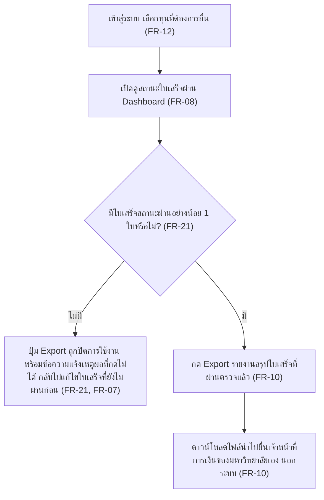

ขั้นตอน:
1. เข้าสู่ระบบและเลือกทุนที่ต้องการยื่นเบิก
   ([[20260816-01-grant-receipt-verification#4. Functional Requirements|FR-12]])
2. เปิดดูสถานะใบเสร็จของทุนผ่าน Dashboard
   ([[20260816-01-grant-receipt-verification#4. Functional Requirements|FR-08]])
3. ตามสถานการณ์: ถ้า**ไม่มี**ใบเสร็จสถานะผ่านแม้แต่ใบเดียว → ระบบปิดการใช้งาน (disable) ปุ่ม Export
   ของทุนนั้นไว้ก่อน พร้อมข้อความแจ้งเหตุผลที่กดไม่ได้ (เช่น "ยังไม่มีใบเสร็จที่ผ่านการตรวจสำหรับทุนนี้")
   แทนการปล่อยให้กดแล้วได้รายงานเปล่า แล้วกลับไปแก้ไขใบเสร็จที่ยังไม่ผ่านก่อน (ต่อยอดจาก Journey 1
   ขั้นตอนที่ 17) ถ้า**มี**ใบเสร็จสถานะผ่านอย่างน้อย 1 ใบ → ปุ่ม Export ใช้งานได้ตามปกติ ไปขั้นตอนถัดไป
   ([[20260816-01-grant-receipt-verification#4. Functional Requirements|FR-21]],
   [[20260816-01-grant-receipt-verification#4. Functional Requirements|FR-07]])
4. กด Export รายงานสรุปใบเสร็จที่ผ่านการตรวจแล้วของทุน — ยังเป็น Backlog (ยังไม่ได้สร้างในแอป)
   ([[20260816-01-grant-receipt-verification#4. Functional Requirements|FR-10]])
5. ดาวน์โหลดไฟล์รายงานและนำไปยื่นต่อเจ้าหน้าที่การเงินของมหาวิทยาลัยเอง (เจ้าหน้าที่การเงินรับไฟล์
   ภายนอกระบบเท่านั้น ไม่ใช่ user ของระบบนี้) — หมายเหตุ: ใบเสร็จที่ถูก export ไปแล้วในขั้นตอนนี้จะ
   ถูกล็อกไม่ให้ลบด้วยตนเองผ่าน UI อีกต่อไป (ดู Journey 7: ลบข้อมูลใบเสร็จของตนเองด้วยตนเอง, FR-18)
   ([[20260816-01-grant-receipt-verification#4. Functional Requirements|FR-10]])

## Journey 4: Admin นำเข้า/อัปเดตระเบียบของแหล่งทุนเข้าสู่ Rule Engine

บทบาท: Admin (ผู้ดูแลระบบ/ผู้อัปเดตระเบียบ)

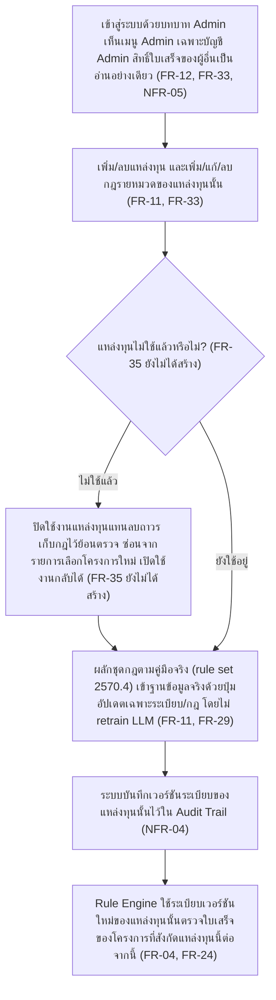

ขั้นตอน:
1. เข้าสู่ระบบด้วยบทบาท Admin — เห็นเมนู Admin (ผู้ใช้ทั่วไปไม่เห็น) จัดการแหล่งทุน/ระเบียบ/กฎใน Rule Engine ได้
   และอ่านใบเสร็จของทุกคนได้**แบบอ่านอย่างเดียว** (ดู Journey 9) เขียน/แก้ใบเสร็จของผู้อื่นไม่ได้ — การเลื่อนสิทธิ์
   เป็น Admin ทำผ่านคอนโซลเท่านั้น (สิทธิ์ส่วนนี้กลับคำตัดสินใจเดิมของสเปคแรก ตาม FR-33)
   ([[20260816-01-grant-receipt-verification#4. Functional Requirements|FR-12]],
   [[20261117-01-implemented-rule-engine-ai-and-admin#2. Functional Requirements|FR-33]],
   [[20260816-01-grant-receipt-verification#5. Non-Functional Requirements|NFR-05]])
2. รับทราบว่าระเบียบของ**แหล่งทุน (fund source)** แหล่งใดแหล่งหนึ่งมีการเปลี่ยนแปลง (แต่ละแหล่งทุนมี
   รหัส/ระเบียบใบเสร็จเป็นของตัวเอง) แล้วเพิ่ม/ลบแหล่งทุน และเพิ่ม/แก้/ลบกฎรายหมวด (ประเภทอัตรา เพดานตามจริง/
   เหมาจ่าย/ต่อหน่วย/ตามข้อเสนอโครงการ) โดยไม่ต้อง retrain LLM
   ([[20260816-01-grant-receipt-verification#4. Functional Requirements|FR-11]],
   [[20261117-01-implemented-rule-engine-ai-and-admin#2. Functional Requirements|FR-33]])
3. ตามสถานการณ์ (**ยังไม่ได้สร้าง** — FR-35 สถานะ Backlog): ถ้า**แหล่งทุนไม่ใช้แล้ว** → "ปิดใช้งาน" แทนการลบถาวร แหล่งทุนที่ปิดใช้งาน
   เก็บกฎ (`ruleVersions`/`ruleItems`) ไว้ครบเพื่อย้อนตรวจใบเสร็จเก่า ไม่แสดงในรายการเลือกแหล่งทุนตอนสร้างโครงการใหม่ (Journey 1 ขั้นตอนที่ 4)
   โครงการเดิมยังแสดงชื่อแหล่งทุนตามปกติ และ Admin เปิดใช้งานกลับได้ (พฤติกรรมของใบเสร็จใหม่ในโครงการเดิมที่ผูกกับแหล่งทุนที่ปิดใช้งานยังไม่ได้กำหนด)
   ถ้า**ยังใช้อยู่** → ข้ามไป (พฤติกรรมปัจจุบัน: ลบแหล่งทุนแบบ cascade ถาวร ไม่ตรวจโครงการที่ใช้อยู่)
   ([[20261117-02-fund-source-deactivation-estimate-versioning-drive-privacy#2. Functional Requirements|FR-35]])
4. ผลักชุดกฎตามคู่มือจริง (ปัจจุบัน rule set 2570.4 ครอบคลุม 28 หมวด แต่ละกฎอ้างอิงข้อ/หน้าของคู่มือ) เข้าฐานข้อมูลจริง
   ผ่านปุ่ม "อัปเดตเฉพาะระเบียบ/กฎ" — กฎที่แก้ในไฟล์ตั้งต้นยังไม่มีผลกับข้อมูลจริงจนกว่า Admin จะกดปุ่มนี้
   ([[20260816-01-grant-receipt-verification#4. Functional Requirements|FR-11]],
   [[20261117-01-implemented-rule-engine-ai-and-admin#2. Functional Requirements|FR-29]])
5. ระบบบันทึกเวอร์ชันระเบียบของแหล่งทุนนั้นที่นำเข้าไว้ใน Audit Trail เพื่อรองรับการตรวจสอบย้อนหลัง
   เมื่อระเบียบมีการเปลี่ยนแปลงตามเวลา
   ([[20260816-01-grant-receipt-verification#5. Non-Functional Requirements|NFR-04]])
6. Rule Engine ใช้ระเบียบเวอร์ชันใหม่ของแหล่งทุนนี้ตรวจใบเสร็จของทุกโครงการที่ผูกกับแหล่งทุนนี้
   (ดู Journey 1 ขั้นตอนที่ 4 เรื่องการผูกโครงการกับแหล่งทุน) ต่อจากนี้ (เชื่อมต่อกับ Journey 1
   ขั้นตอนที่ 14)
   ([[20260816-01-grant-receipt-verification#4. Functional Requirements|FR-04]],
   [[20261117-01-implemented-rule-engine-ai-and-admin#2. Functional Requirements|FR-24]])

## Journey 5: นักวิจัยถอนความยินยอม (Withdraw Consent) และผลกระทบต่อการใช้งานระบบ

บทบาท: นักวิจัย/เจ้าของโครงการ

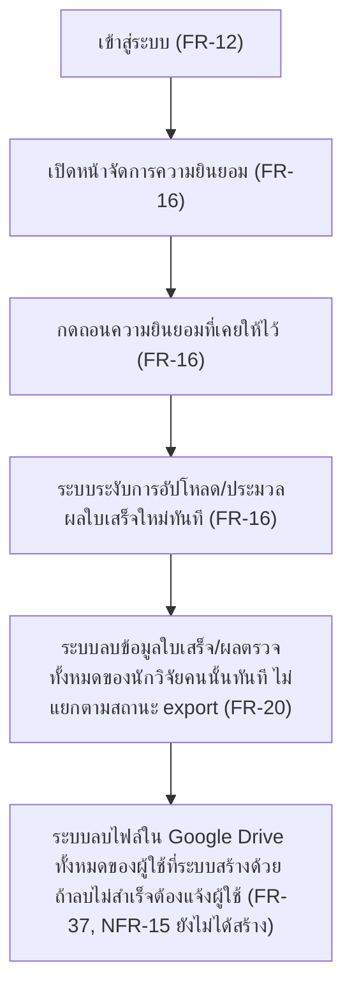

ขั้นตอน (ยังเป็น Backlog — ยังไม่ได้สร้างการถอนความยินยอมในแอป):
1. เข้าสู่ระบบ
   ([[20260816-01-grant-receipt-verification#4. Functional Requirements|FR-12]])
2. เปิดหน้าจัดการความยินยอม (ต่อยอดจากการให้ความยินยอมครั้งแรกใน Journey 1 ขั้นตอนที่ 2-3)
   ([[20260816-02-pdpa-compliance#4. Functional Requirements|FR-16]])
3. กดถอนความยินยอมที่เคยให้ไว้ — ทำได้ทุกเมื่อผ่าน UI ของระบบ
   ([[20260816-02-pdpa-compliance#4. Functional Requirements|FR-16]])
4. ระบบระงับการอัปโหลด/ประมวลผลใบเสร็จใหม่ของนักวิจัยคนนั้นทันที
   ([[20260816-02-pdpa-compliance#4. Functional Requirements|FR-16]])
5. ระบบลบข้อมูลใบเสร็จ/ผลตรวจทั้งหมดของนักวิจัยคนนั้นที่ระบบเก็บไว้ทันที โดยไม่แยกตามสถานะ export
   (เดิมเป็น open point ในรอบก่อน ยืนยันคำตอบแล้วโดยผู้ใช้เมื่อ 2026-08-16 รอบ 3) — เหตุผล: ระบบ
   Grant Receipt Assistant เป็นเพียง "ด่านตรวจก่อนสอบ" (pre-check gate) ไม่ใช่ archival/official
   retention system ของหลักฐานทางการเงิน เมื่อถอนความยินยอม (ฐานทางกฎหมายเดียวที่ใช้เก็บข้อมูลนี้)
   ระบบจึงไม่มีฐานทางกฎหมายเหลืออยู่ที่จะเก็บข้อมูลต่อได้อีก — ต่างจากการลบเฉพาะรายการใบเสร็จผ่าน UI
   ใน Journey 7 (Right to Erasure, FR-18) ซึ่งยังคงเงื่อนไขจำกัดไม่ให้ลบใบเสร็จที่ export ไปแล้ว
   เพราะนักวิจัยยังไม่ได้ถอนความยินยอมทั้งหมดในกรณีนั้น
   ([[20260816-02-pdpa-compliance#4. Functional Requirements|FR-20]])
6. **ยังไม่ได้สร้าง (FR-37/NFR-15 สถานะ Backlog):** ระบบลบไฟล์ใน Google Drive ทั้งหมดของผู้ใช้ที่ระบบสร้างด้วย (ต่อจากข้อมูลใน
   ระบบ) ถ้าลบไม่สำเร็จ (เช่น โทเค็นหมดอายุ) ต้องแจ้งผู้ใช้ ไม่ล้มเหลวเงียบ
   ([[20261117-02-fund-source-deactivation-estimate-versioning-drive-privacy#2. Functional Requirements|FR-37]],
   [[20261117-02-fund-source-deactivation-estimate-versioning-drive-privacy#3. Non-Functional Requirements|NFR-15]])

## Journey 6: นักวิจัยขอเข้าถึง/ขอสำเนาข้อมูลส่วนบุคคลของตนเอง (Data Access & Portability)

บทบาท: นักวิจัย/เจ้าของโครงการ

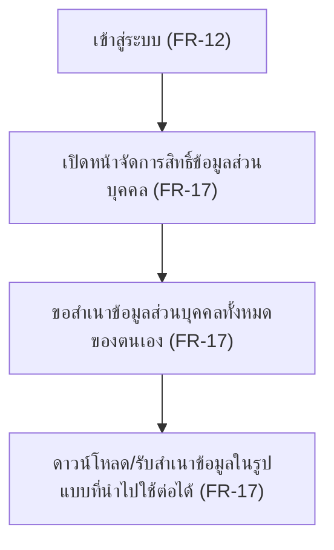

ขั้นตอน:
1. เข้าสู่ระบบ
   ([[20260816-01-grant-receipt-verification#4. Functional Requirements|FR-12]])
2. เปิดหน้าจัดการสิทธิ์ข้อมูลส่วนบุคคลของตนเอง
   ([[20260816-02-pdpa-compliance#4. Functional Requirements|FR-17]])
3. ขอสำเนาข้อมูลส่วนบุคคลทั้งหมดที่ระบบเก็บไว้เกี่ยวกับตนเอง (ข้อมูลใบเสร็จ, ผลตรวจ, ประวัติ consent)
   ([[20260816-02-pdpa-compliance#4. Functional Requirements|FR-17]])
4. ดาวน์โหลด/รับสำเนาข้อมูลในรูปแบบที่อ่าน/นำไปใช้ต่อได้ — แยกจาก Journey 3 (Export รายงานสรุปใบเสร็จ
   สำหรับยื่นเจ้าหน้าที่การเงิน) เพราะเป็นสำเนาข้อมูลส่วนบุคคลครบถ้วนตามสิทธิ์ PDPA ไม่ใช่รายงานสรุป
   ([[20260816-02-pdpa-compliance#4. Functional Requirements|FR-17]])

## Journey 7: นักวิจัยลบข้อมูลใบเสร็จของตนเองด้วยตนเอง (Right to Erasure)

บทบาท: นักวิจัย/เจ้าของโครงการ

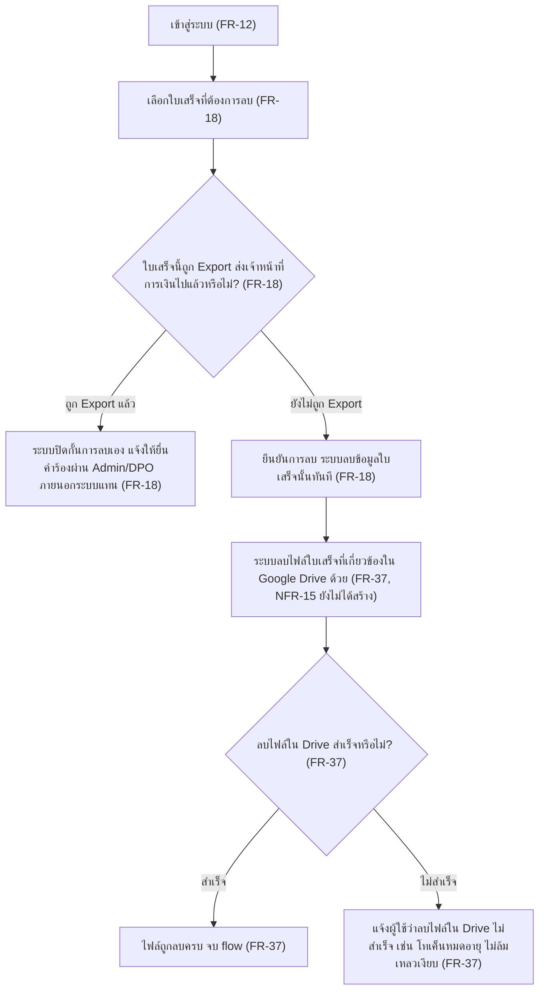

ขั้นตอน (สร้างแล้วบางส่วน: ปุ่มลบใบเสร็จลบถาวรทันทีทั้งใบเสร็จและเอกสารไฟล์ใน Firestore ยังไม่มีเงื่อนไขบล็อกกรณี export
เพราะ Export ยังไม่ได้สร้าง ไม่ลบไฟล์จริงใน Google Drive และไม่มี Audit Trail):
1. เข้าสู่ระบบ
   ([[20260816-01-grant-receipt-verification#4. Functional Requirements|FR-12]])
2. เลือกใบเสร็จของตนเองที่ต้องการลบ
   ([[20260816-02-pdpa-compliance#4. Functional Requirements|FR-18]])
3. ตามสถานการณ์: ถ้าใบเสร็จนั้น**ถูก export ไปแล้ว** (รวมอยู่ใน export รายงานที่ส่งเจ้าหน้าที่การเงิน
   ไปแล้ว — ดู Journey 3 ขั้นตอนที่ 5) → ระบบปิดกั้นการลบเองผ่าน UI และแจ้งให้ยื่นคำร้องผ่านช่องทาง
   Admin/DPO ภายนอกระบบแทน เพื่อรักษา Audit Trail/ป้องกันการลบหลักฐานหนีความรับผิดหลังยื่นเบิกไปแล้ว
   (เหตุผลปรับปรุงเมื่อ 2026-08-16 รอบ 3 — ไม่ใช่เพราะข้อกำหนดเก็บหลักฐานทางการเงินอย่างเป็นทางการ
   อีกต่อไป เทียบกับ Journey 5 ซึ่งเป็นการถอนความยินยอมทั้งหมด จึงลบได้ทันทีไม่มีเงื่อนไขนี้)
   ถ้า**ยังไม่ถูก export** → ไปขั้นตอนถัดไป
   ([[20260816-02-pdpa-compliance#4. Functional Requirements|FR-18]])
4. ยืนยันการลบ — ระบบลบข้อมูลใบเสร็จนั้นออกจากระบบทันที
   ([[20260816-02-pdpa-compliance#4. Functional Requirements|FR-18]])
5. **ยังไม่ได้สร้าง (FR-37/NFR-15 สถานะ Backlog):** ระบบลบไฟล์ใบเสร็จที่เกี่ยวข้องใน Google Drive ด้วย (พฤติกรรมปัจจุบัน: ลบเฉพาะข้อมูลใน Firestore
   ไฟล์ใน Drive ยังอยู่)
   ([[20261117-02-fund-source-deactivation-estimate-versioning-drive-privacy#2. Functional Requirements|FR-37]],
   [[20261117-02-fund-source-deactivation-estimate-versioning-drive-privacy#3. Non-Functional Requirements|NFR-15]])
6. ตามสถานการณ์ (ยังไม่ได้สร้าง): ถ้า**ลบไฟล์ใน Drive สำเร็จ** → ไฟล์ถูกลบครบ จบ flow
   ([[20261117-02-fund-source-deactivation-estimate-versioning-drive-privacy#2. Functional Requirements|FR-37]])
7. ตามสถานการณ์ (ยังไม่ได้สร้าง): ถ้า**ลบไฟล์ใน Drive ไม่สำเร็จ** (เช่น โทเค็นหมดอายุ) → แจ้งผู้ใช้ ไม่ล้มเหลวเงียบ
   ([[20261117-02-fund-source-deactivation-estimate-versioning-drive-privacy#2. Functional Requirements|FR-37]])

## Journey 8: นักวิจัยติดตามยอดใช้ไป/คงเหลือตามประมาณการของโครงการ

บทบาท: นักวิจัย/เจ้าของโครงการ

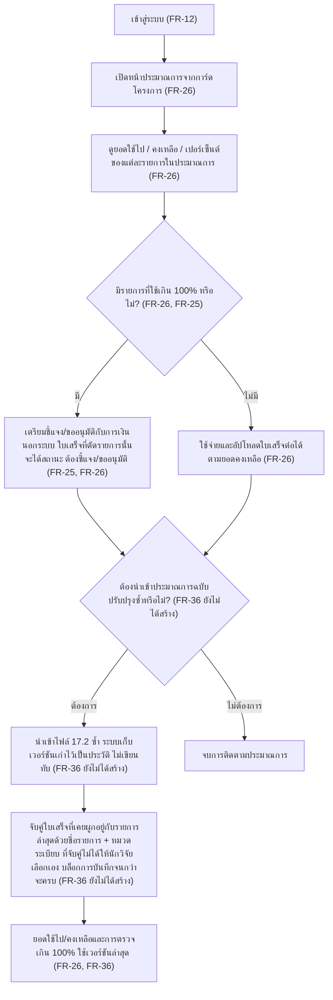

ขั้นตอน:
1. เข้าสู่ระบบ — เห็นเฉพาะโครงการของตนเอง
   ([[20260816-01-grant-receipt-verification#4. Functional Requirements|FR-12]])
2. เปิดหน้าประมาณการจากการ์ดโครงการ (ต้องนำเข้าไฟล์ประมาณการ 17.2 ก่อน ดู Journey 1 ขั้นตอนที่ 5)
   ([[20261117-01-implemented-rule-engine-ai-and-admin#2. Functional Requirements|FR-26]])
3. ดูยอดใช้ไป / คงเหลือ / เปอร์เซ็นต์ของแต่ละรายการ (คำนวณจากใบเสร็จที่ตัดรายการนั้นของโครงการ — เทียบกับยอดรวมทั้งโครงการ
   ของรายการ ไม่ได้บังคับตามงวด)
   ([[20261117-01-implemented-rule-engine-ai-and-admin#2. Functional Requirements|FR-26]])
4. ตามสถานการณ์: ถ้า**มี**รายการที่ใช้เกิน 100% → เตรียมชี้แจง/ขออนุมัติกับการเงินนอกระบบ (ใบเสร็จที่ตัดรายการนั้น
   หรือที่ไม่อยู่ในประมาณการจะได้สถานะ "ต้องชี้แจง/ขออนุมัติ" ตาม Journey 1 ขั้นตอนที่ 14) ถ้า**ไม่มี** → ใช้จ่ายและ
   อัปโหลดใบเสร็จต่อได้ตามยอดคงเหลือ
   ([[20261117-01-implemented-rule-engine-ai-and-admin#2. Functional Requirements|FR-25]],
   [[20261117-01-implemented-rule-engine-ai-and-admin#2. Functional Requirements|FR-26]])
5. ตามสถานการณ์ (**ยังไม่ได้สร้าง** — FR-36 สถานะ Backlog): ถ้า**ต้องนำเข้าประมาณการฉบับปรับปรุงซ้ำ** → ไปขั้นตอนที่ 6 ถ้า**ไม่ต้อง** → จบการติดตามประมาณการ
   (พฤติกรรมปัจจุบัน: การนำเข้าซ้ำแทนที่ทุกรายการตามลำดับ ใบเสร็จเก่าอาจเชื่อมผิดรายการ ระบบแค่เตือน)
   ([[20261117-02-fund-source-deactivation-estimate-versioning-drive-privacy#2. Functional Requirements|FR-36]])
6. นำเข้าไฟล์ 17.2 ซ้ำ — ระบบเก็บเวอร์ชันเก่าไว้เป็นประวัติ ไม่เขียนทับ (ยังไม่ได้สร้าง)
   ([[20261117-02-fund-source-deactivation-estimate-versioning-drive-privacy#2. Functional Requirements|FR-36]])
7. ระบบย้ายใบเสร็จที่เคยผูกอยู่ไปจับคู่กับรายการของเวอร์ชันล่าสุดด้วยชื่อรายการ + หมวดระเบียบ ถ้าจับคู่ไม่ได้ให้นักวิจัยเลือกรายการเอง
   และบล็อกการบันทึกจนกว่าใบเสร็จที่ผูกอยู่ทุกใบจะถูกจับคู่ครบ เพื่อไม่ให้มีใบเสร็จผูกผิดรายการโดยไม่มีใครรู้ (ยังไม่ได้สร้าง)
   ([[20261117-02-fund-source-deactivation-estimate-versioning-drive-privacy#2. Functional Requirements|FR-36]])
8. ยอดใช้ไป/คงเหลือและการตรวจ "เกิน 100%" (ขั้นตอนที่ 3-4 และ Journey 1 ขั้นตอนที่ 14) ใช้เวอร์ชันล่าสุดเสมอ (ยังไม่ได้สร้าง)
   ([[20261117-01-implemented-rule-engine-ai-and-admin#2. Functional Requirements|FR-26]],
   [[20261117-02-fund-source-deactivation-estimate-versioning-drive-privacy#2. Functional Requirements|FR-36]])

## Journey 9: Admin ดูภาพรวมใบเสร็จของทุกคนผ่าน Admin Dashboard (อ่านอย่างเดียว)

บทบาท: Admin (ผู้ดูแลระบบ/ผู้อัปเดตระเบียบ)

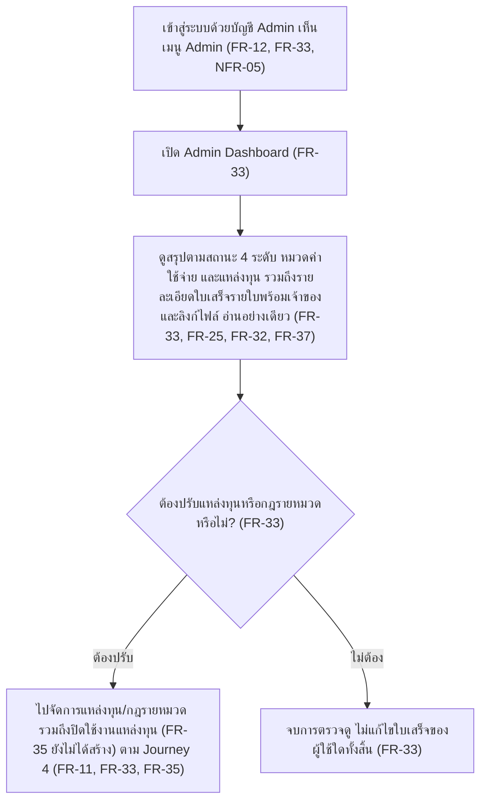

ขั้นตอน:
1. เข้าสู่ระบบด้วยบัญชี Admin — เมนู Admin ปรากฏเฉพาะบัญชีที่มีสิทธิ์ Admin (การเลื่อนสิทธิ์ทำผ่านคอนโซลเท่านั้น)
   ([[20260816-01-grant-receipt-verification#4. Functional Requirements|FR-12]],
   [[20261117-01-implemented-rule-engine-ai-and-admin#2. Functional Requirements|FR-33]],
   [[20260816-01-grant-receipt-verification#5. Non-Functional Requirements|NFR-05]])
2. เปิด Admin Dashboard
   ([[20261117-01-implemented-rule-engine-ai-and-admin#2. Functional Requirements|FR-33]])
3. ดูสรุปจำนวนใบเสร็จตามสถานะ 4 ระดับ หมวดค่าใช้จ่าย และแหล่งทุน พร้อมรายละเอียดใบเสร็จรายใบ (ระบุเจ้าของ คำอธิบายผลตรวจ
   และลิงก์ไฟล์ใน Google Drive) — อ่านได้อย่างเดียว เขียน/แก้ใบเสร็จของผู้อื่นไม่ได้ (นักวิจัยได้รับแจ้งเรื่องนี้ตอนยินยอมครั้งแรก
   ดู Journey 1 ขั้นตอนที่ 2) — **ยังไม่ได้สร้าง (FR-37):** ไฟล์ใน Drive จะดูได้เฉพาะเจ้าของและ Admin เท่านั้น (ปัจจุบันใครมีลิงก์เปิดดูได้)
   ([[20261117-01-implemented-rule-engine-ai-and-admin#2. Functional Requirements|FR-33]],
   [[20261117-01-implemented-rule-engine-ai-and-admin#2. Functional Requirements|FR-25]],
   [[20261117-01-implemented-rule-engine-ai-and-admin#2. Functional Requirements|FR-32]],
   [[20261117-02-fund-source-deactivation-estimate-versioning-drive-privacy#2. Functional Requirements|FR-37]])
4. ตามสถานการณ์: ถ้า**ต้องปรับ**แหล่งทุนหรือกฎรายหมวด (เช่น พบหมวดที่ถูกตัดสินผิดพลาดบ่อย หรือแหล่งทุนที่ไม่ใช้แล้วควรปิดใช้งาน — ส่วนปิดใช้งาน
   ยังไม่ได้สร้าง) → ไปจัดการตาม Journey 4 ถ้า**ไม่ต้อง** → จบการตรวจดู
   ([[20260816-01-grant-receipt-verification#4. Functional Requirements|FR-11]],
   [[20261117-01-implemented-rule-engine-ai-and-admin#2. Functional Requirements|FR-33]],
   [[20261117-02-fund-source-deactivation-estimate-versioning-drive-privacy#2. Functional Requirements|FR-35]])

## Journey 10: ผู้วิจัยรันชุดประเมินผลเพื่อเทียบ Rule Engine กับผลของเจ้าหน้าที่การเงิน (เครื่องมือนอกแอป)

บทบาท: ผู้วิจัย/เจ้าของระบบ (รันนอกแอปผ่านบรรทัดคำสั่ง ไม่ใช่บทบาทที่ 3 ในระบบ)

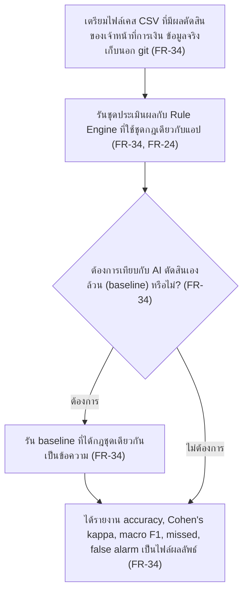

ขั้นตอน (เสร็จบางส่วน: ยังไม่มีข้อมูลจริงรอ EC มีแค่เคสสมมติ และยังไม่ได้รัน baseline กับ API ที่เสียเงิน):
1. เตรียมไฟล์เคส (CSV) ที่มีผลตัดสินของเจ้าหน้าที่การเงินต่อเคส ข้อมูลจริงเก็บในโฟลเดอร์ที่ไม่เข้า git
   ([[20261117-01-implemented-rule-engine-ai-and-admin#2. Functional Requirements|FR-34]])
2. รันชุดประเมินผลกับ Rule Engine ซึ่งเป็นโมดูลบริสุทธิ์เดียวกับที่แอปใช้และใช้ชุดกฎเดียวกัน
   ([[20261117-01-implemented-rule-engine-ai-and-admin#2. Functional Requirements|FR-34]],
   [[20261117-01-implemented-rule-engine-ai-and-admin#2. Functional Requirements|FR-24]])
3. ตามสถานการณ์: ถ้า**ต้องการ**เทียบกับ AI ตัดสินเองล้วน (baseline) → รัน baseline ที่ได้กฎชุดเดียวกันเป็นข้อความ
   ถ้า**ไม่ต้องการ** → ข้าม
   ([[20261117-01-implemented-rule-engine-ai-and-admin#2. Functional Requirements|FR-34]])
4. ได้รายงาน accuracy, Cohen's kappa, macro F1, จำนวนปัญหาที่ระบบพลาด (missed) และจำนวนแจ้งเตือนเกิน (false alarm)
   เป็นไฟล์ผลลัพธ์
   ([[20261117-01-implemented-rule-engine-ai-and-admin#2. Functional Requirements|FR-34]])
5. (ตั้งแต่ 2026-11-24) ตัวรันชุดเคส: รันโฟลเดอร์เคสใบเสร็จจริง (Stage B) หรือไฟล์สแกนทั้งโครงการ (Stage C) ผ่านโมดูลเดียวกับแอป
   (OCR → จำแนกเอกสาร → Rule Engine + LLM ตัดสิน) เลือกโหมด `llm` หรือ `rule` ได้ ได้ผลดิบทุกขั้นพร้อมรุ่นโมเดล/prompt/ชุดกฎ
   เป็น JSON+CSV และเมตริก pass/fail เทียบเจ้าหน้าที่การเงิน — ใช้เทียบความถูกต้องของ LLM กับเทคนิคอื่น
   ([[20261127-02-llm-verdict-research-direction#2. Functional Requirements|FR-41]])

## ภาคผนวก Journey 1 แผนแรก (ก่อน 2026-11-24)

> **เก็บไว้เป็นประวัติ — ไม่ใช่ flow ของแอปแล้ว** นี่คือ Journey 1 ตามแผนแรก (ฉบับก่อนแก้ 2026-11-27) ที่นักวิจัยตรวจแก้ค่า
> เลือกรายการประมาณการ ติ๊กเอกสาร แล้ว Rule Engine ตัดสินและ AI แค่อธิบาย เปลี่ยนเมื่อ 2026-11-24 เพื่องานวิจัยที่ต้องวัดความถูกต้องของ LLM
> ที่ตัดสินเองเทียบกับแบบที่ใช้เทคนิคอื่น ดู [[20261127-02-llm-verdict-research-direction]] — journey อื่นที่อ้าง "Journey 1 ขั้นตอนที่ n" หมายถึงฉบับปัจจุบันด้านบน

บทบาท: นักวิจัย/เจ้าของโครงการ

```mermaid
flowchart TD
    A["เข้าสู่ระบบ เห็นเฉพาะข้อมูลของตนเอง (FR-12, NFR-05)"]
    B{"เคยให้ความยินยอม (Consent) แล้วหรือยัง? (FR-14)"}
    C["แสดง Privacy Notice (FR-13)"]
    D["ขอความยินยอมชัดแจ้งก่อนเก็บ/ประมวลผลข้อมูล (FR-14)"]
    E{"ให้ความยินยอมหรือไม่?"}
    F["บันทึกหลักฐานการให้ความยินยอม (FR-15)"]
    G["ไม่สามารถอัปโหลดใบเสร็จได้ (FR-14)"]
    P{"มีโครงการวิจัยที่ผูกกับแหล่งทุนไว้แล้วหรือยัง? (FR-23)"}
    Q["สร้าง/จัดการข้อมูลโครงการวิจัย และเลือกผูกกับแหล่งทุนที่ได้รับ (FR-23)"]
    R{"โครงการมีประมาณการ 17.2 แล้วหรือยัง? (FR-26)"}
    S["นำเข้าไฟล์ประมาณการ 17.2 (.xlsx/.csv) ที่หน้าโครงการ ตรวจ/แก้การจับคู่หมวดระเบียบแล้วบันทึก (FR-26) นำเข้าซ้ำดู Journey 8 (FR-36 ยังไม่ได้สร้าง)"]
    T{"ต้องการแนบไฟล์จริงลง Google Drive ของตนเองหรือไม่? (FR-32)"}
    U["เชื่อมต่อ Google Drive ของตนเอง (สิทธิ์ drive.file) (FR-32, FR-37 จำกัดผู้ดูเป็นเจ้าของ+Admin ยังไม่ได้สร้าง)"]
    H["อัปโหลดไฟล์ใบเสร็จของค่าใช้จ่าย 1 เรื่อง ผูกกับโครงการวิจัยของตนเอง อาจมีหลายไฟล์สูงสุด 5 ไฟล์ต่อรายการ พร้อมคำเตือนให้อัปโหลดครั้งละ 1 รายการ (FR-01, FR-22)"]
    H2{"ไฟล์/จำนวนไฟล์ที่อัปโหลดถูกต้องหรือไม่ ชนิดไฟล์รองรับ/ไม่เสียหาย/ไม่เกิน 5 MB ต่อไฟล์/ไม่เกิน 5 ไฟล์ต่อรายการ (FR-19)"}
    H3["ระบบปฏิเสธไฟล์หรือไฟล์ส่วนเกิน พร้อมข้อความ error ภาษาไทยที่ชัดเจน ให้อัปโหลดใหม่หรือแยกเป็นรายการใหม่ (FR-19)"]
    I["AI/OCR อ่านข้อมูลใบเสร็จ เสนอยอด วันที่ หมวด ชื่อร้าน พร้อมป้าย AI suggestion หรือถอยกลับเป็นกรอกเอง (FR-02, FR-30, NFR-01, NFR-06, NFR-08, NFR-09, NFR-12, NFR-14)"]
    J["ตรวจสอบ/แก้ไขข้อมูลก่อนส่งตรวจ (FR-03)"]
    V{"โครงการมีประมาณการหรือไม่? (FR-26)"}
    W["เลือกรายการในประมาณการที่จะตัดยอด หรือเลือก ไม่อยู่ในประมาณการ (FR-26)"]
    X["ติ๊กเอกสารแนบที่มีครบตามรายการตรวจสอบของหมวดค่าใช้จ่าย (FR-27)"]
    Y{"ต้องการกรอกยอดในใบสรุปรายรับ-จ่ายหรือไม่? (FR-28 ไม่บังคับ)"}
    Z["กรอกยอดที่ลงไว้ในใบสรุปรายรับ-จ่ายโครงการ (FR-28)"]
    K["ส่งเข้าตรวจกับ Rule Engine ตรวจตามลำดับ ประมาณการ → ระเบียบ → ใบสรุป → เอกสารแนบ อ้างอิงระเบียบแหล่งทุนเวอร์ชัน active ณ วันที่ตรวจ (FR-04, FR-24, FR-25, FR-29, NFR-06)"]
    L["AI agent อธิบายผลจากกฎในระบบเท่านั้น พร้อมวิธีแก้ และบันทึก agentLogs (FR-05, FR-31)"]
    L2["ระบบแสดงสถานะ 4 ระดับด้วยสี+ไอคอน+ข้อความ พร้อมข้อค้นพบรายกลุ่มและอ้างอิงระเบียบ (FR-06, FR-25, NFR-02, NFR-03, NFR-04, NFR-13)"]
    M{"ผ่านการตรวจหรือไม่?"}
    N["ส่งฉบับแก้ไข (เพิ่มเอกสารที่ขาด/แทนที่ทั้งชุด ดู Journey 2) หรือชี้แจง/ขออนุมัติ (FR-07)"]
    O["ใบเสร็จผ่านตรวจ พร้อมสำหรับ Export"]

    A --> B
    B -->|เคยแล้ว| P
    B -->|ยัง ครั้งแรก| C --> D --> E
    E -->|ให้ความยินยอม| F --> P
    E -->|ไม่ให้ความยินยอม| G
    P -->|มีแล้ว| R
    P -->|ยังไม่มี/ต้องการเพิ่มโครงการใหม่| Q --> R
    R -->|มีแล้ว| T
    R -->|ยังไม่มี| S --> T
    T -->|ต้องการแนบ| U --> H
    T -->|ไม่ต้องการ| H
    H --> H2
    H2 -->|ไม่ถูกต้อง| H3 --> H
    H2 -->|ถูกต้อง| I
    I --> J --> V
    V -->|มี| W --> X
    V -->|ไม่มี| X
    X --> Y
    Y -->|กรอก| Z --> K
    Y -->|ไม่กรอก| K
    K --> L --> L2 --> M
    M -->|ผ่าน| O
    M -->|ต้องแก้ไข/ต้องชี้แจง/ไม่เข้าเงื่อนไข| N
    N --> K
```

ขั้นตอน:
1. เข้าสู่ระบบ — เห็นเฉพาะข้อมูลใบเสร็จ/โครงการของตนเองเท่านั้น
   ([[20260816-01-grant-receipt-verification#4. Functional Requirements|FR-12]],
   [[20260816-01-grant-receipt-verification#5. Non-Functional Requirements|NFR-05]])
2. ตามสถานการณ์: ถ้า**ยังไม่เคย**ให้ความยินยอมมาก่อน (ใช้งานครั้งแรก/ก่อนอัปโหลดใบเสร็จครั้งแรก) →
   ระบบแสดงประกาศความเป็นส่วนตัว (Privacy Notice) แจ้งวัตถุประสงค์การเก็บ/ใช้ข้อมูล ตัวตนผู้ควบคุม
   ข้อมูล ระยะเวลาเก็บข้อมูล และสิทธิ์ของเจ้าของข้อมูล (รวมถึงว่า Admin อ่านข้อมูลใบเสร็จได้แบบอ่านอย่างเดียว)
   แล้วขอความยินยอมชัดแจ้ง (Explicit Consent) ก่อนเริ่มเก็บ/ประมวลผลข้อมูลใบเสร็จ — ปัจจุบันในแอปเป็นการ
   ยินยอมแบบเบา (ติ๊กครั้งเดียวก่อนอัปโหลดครั้งแรก) ถ้า**เคยให้**ความยินยอมแล้ว → ข้ามไปขั้นตอนตรวจสอบ
   โครงการวิจัยได้เลย
   ([[20260816-02-pdpa-compliance#4. Functional Requirements|FR-13]],
   [[20260816-02-pdpa-compliance#4. Functional Requirements|FR-14]])
3. ตามสถานการณ์ (เฉพาะกรณีเป็นครั้งแรก): ถ้า**ให้ความยินยอม** → ระบบบันทึกหลักฐานการให้ความยินยอม
   (วันที่ให้, เวอร์ชัน Privacy Notice) แล้วไปขั้นตอนตรวจสอบโครงการวิจัย ถ้า**ไม่ให้ความยินยอม** → ไม่
   สามารถอัปโหลดใบเสร็จเข้าสู่ระบบได้ จบ flow นี้ (ดูวิธีถอนความยินยอมภายหลังที่ Journey 5)
   ([[20260816-02-pdpa-compliance#4. Functional Requirements|FR-14]],
   [[20260816-02-pdpa-compliance#4. Functional Requirements|FR-15]])
4. ตามสถานการณ์: ถ้า**ยังไม่มี**โครงการวิจัยที่ผูกกับแหล่งทุนไว้เลย (หรือต้องการเพิ่มโครงการใหม่) →
   สร้าง/จัดการข้อมูลโครงการวิจัยของตนเอง (อย่างน้อยชื่อโครงการ) แล้วเลือกผูกโครงการเข้ากับแหล่งทุน
   (fund source) ที่โครงการได้รับจากรายการที่ Admin นำเข้าไว้ (ดู Journey 4) เพื่อให้ระบบทราบว่า
   ใบเสร็จของโครงการนี้ต้องตรวจตามระเบียบของแหล่งทุนใด ถ้า**มีแล้ว** → ข้ามไปขั้นตอนถัดไปได้
   เลยโดยเลือกโครงการที่มีอยู่แล้วเป็นตัวที่จะผูกใบเสร็จ
   ([[20260816-01-grant-receipt-verification#4. Functional Requirements|FR-23]])
5. ตามสถานการณ์: ถ้าโครงการ**ยังไม่มี**ประมาณการ → นำเข้าไฟล์ตารางประมาณการ 17.2 ของมหาวิทยาลัย
   (.xlsx/.csv) ที่หน้าโครงการ (ปุ่ม "ประมาณการ" บนการ์ดโครงการ) ระบบแปลงเป็นรายการประมาณการ อ่านจำนวนหน่วยจากช่อง
   ตัวคูณ จับคู่หมวดระเบียบให้ นักวิจัยตรวจ/แก้การจับคู่ก่อนบันทึก (พฤติกรรมปัจจุบัน: การนำเข้าซ้ำจะแทนที่รายการทั้งหมด ส่วนการนำเข้าซ้ำแบบเก็บ
   เวอร์ชันเก่าและย้ายใบเสร็จไปรายการล่าสุด **ยังไม่ได้สร้าง** ดู Journey 8 ขั้นตอนที่ 5-8) ถ้า
   **มีแล้ว** → ข้ามไปขั้นตอนถัดไป (ติดตามยอดใช้ไป/คงเหลือ ดู Journey 8)
   ([[20261117-01-implemented-rule-engine-ai-and-admin#2. Functional Requirements|FR-26]],
   [[20261117-02-fund-source-deactivation-estimate-versioning-drive-privacy#2. Functional Requirements|FR-36]])
6. ตามสถานการณ์: ถ้า**ต้องการแนบไฟล์จริง** → กด "เชื่อมต่อ Google Drive" เพื่ออนุญาตบัญชี Google ของตนเอง
   (สิทธิ์ `drive.file` เท่านั้น) ไฟล์จะเก็บในโฟลเดอร์แยกตามรหัสใบเสร็จ ถ้า**ไม่ต้องการ** → ข้ามไป (โทเค็นหมดอายุ
   ประมาณ 1 ชั่วโมง ต้องกดเชื่อมต่อใหม่ ระบบจะเตือนถ้าแนบไฟล์แต่ยังไม่ได้เชื่อมต่อ) — **ยังไม่ได้สร้าง (FR-37):** ไฟล์จะดูได้เฉพาะเจ้าของและ Admin
   (ปัจจุบันใครมีลิงก์เปิดดูได้) และถูกลบตามเมื่อลบใบเสร็จ/ถอนความยินยอม ดู Journey 7 และ 5
   ([[20261117-01-implemented-rule-engine-ai-and-admin#2. Functional Requirements|FR-32]],
   [[20261117-02-fund-source-deactivation-estimate-versioning-drive-privacy#2. Functional Requirements|FR-37]])
7. อัปโหลดไฟล์ใบเสร็จของค่าใช้จ่าย 1 เรื่อง (jpg/png หรือ PDF สแกน) ผูกกับ**โครงการวิจัย**ของตนเอง
   (ไม่ใช่ผูกตรงกับแหล่งทุนโดยตรง) — 1 รายการใบเสร็จ (ชุดเอกสารหลักฐานของค่าใช้จ่าย 1 เรื่อง) อาจ
   ประกอบด้วยมากกว่า 1 ไฟล์/แผ่น (เช่น ค่ารถตู้ตามระเบียบมหาวิทยาลัยต้องมี "ใบสำคัญรับเงิน" +
   "สำเนาบัตรผู้รับเงิน" รวมกัน) สูงสุด **5 ไฟล์ต่อรายการ** ต้องอัปโหลดไฟล์ทั้งหมดของค่าใช้จ่ายเรื่อง
   เดียวกันพร้อมกันในครั้งเดียวและผูกกับ record เดียวกัน ไม่ใช่แยกเป็นใบเสร็จคนละรายการ (ใบเสร็จ 1
   แผ่นที่มีสินค้าหลายชิ้นจากร้านเดียวกันยังนับเป็นรายการเดียว ไม่ต้องแยก) ระหว่างขั้นตอนนี้ระบบต้อง
   แสดงข้อความเตือน/คำแนะนำให้อัปโหลดครั้งละ 1 รายการเท่านั้น เพื่อป้องกันความสับสนอัปโหลดใบเสร็จ
   หลายรายการปนกันในครั้งเดียว
   ([[20260816-01-grant-receipt-verification#4. Functional Requirements|FR-01]],
   [[20260816-01-grant-receipt-verification#4. Functional Requirements|FR-22]])
8. ระบบตรวจสอบความถูกต้องของไฟล์ที่อัปโหลดก่อนส่งเข้า OCR เสมอ (ชนิดไฟล์ที่รองรับ, ไฟล์ไม่เสียหาย/
   เปิดได้, ไม่เกินขนาดสูงสุด 5 MB ต่อไฟล์, จำนวนไฟล์ไม่เกิน 5 ไฟล์ต่อรายการ) — ตามสถานการณ์: ถ้า
   **ไฟล์ไม่ถูกต้องหรือมีจำนวนไฟล์เกินที่กำหนด** → ระบบปฏิเสธการอัปโหลด (หรือไฟล์ส่วนเกิน) ทันทีพร้อม
   ข้อความ error ภาษาไทยที่ชัดเจนระบุสาเหตุ แนะนำให้ลดจำนวนไฟล์หรือแยกเป็นรายการใหม่ตามความเหมาะสม
   แล้ววนกลับไปขั้นตอนที่ 7 ให้อัปโหลดใหม่ ถ้า**ไฟล์ถูกต้องครบตามเงื่อนไข** → ไปขั้นตอนถัดไป
   ([[20260816-01-grant-receipt-verification#4. Functional Requirements|FR-19]],
   [[20260816-01-grant-receipt-verification#4. Functional Requirements|FR-22]])
9. ระบบอ่านข้อมูลจากใบเสร็จอัตโนมัติ (ยอดเงิน วันที่ หมวดค่าใช้จ่าย ชื่อร้าน/ผู้ขาย) — AI อ่านภาพ/PDF หน้าแรก
   พร้อมป้าย "AI suggestion" เฉพาะเมื่อ AI ทำงานจริง ผู้ให้บริการสลับได้ (OpenRouter / Ollama ในเครื่อง / proxy /
   custom) และถ้ามี OCR ภาษาไทยในเครื่องเปิดอยู่ ระบบส่งข้อความที่ OCR อ่านได้เข้า AI ประกอบภาพ (ใบเสร็จไม่ออกจากเครื่อง
   ถ้าใช้ AI ในเครื่อง) หรือสกัดยอด/วันที่ (พ.ศ.→ค.ศ.)/ชื่อร้านเองเมื่อไม่มี AI ถ้าไม่มี AI/OCR หรือเรียกล้มเหลว → ถอยกลับเป็น
   กรอกเองหรือข้อมูลสาธิตพร้อมแจ้งว่าใช้เส้นทางใด — หากผู้ให้บริการ OCR/AI ประมวลผลข้อมูลนอกราชอาณาจักรไทย ต้องมี
   มาตรการคุ้มครอง cross-border transfer และข้อตกลงประมวลผลข้อมูล (DPA) ตามเงื่อนไขที่กำหนด
   ([[20260816-01-grant-receipt-verification#4. Functional Requirements|FR-02]],
   [[20261117-01-implemented-rule-engine-ai-and-admin#2. Functional Requirements|FR-30]],
   [[20260816-01-grant-receipt-verification#5. Non-Functional Requirements|NFR-01]],
   [[20260816-01-grant-receipt-verification#5. Non-Functional Requirements|NFR-06]],
   [[20260816-02-pdpa-compliance#5. Non-Functional Requirements|NFR-08]],
   [[20260816-02-pdpa-compliance#5. Non-Functional Requirements|NFR-09]],
   [[20261117-01-implemented-rule-engine-ai-and-admin#3. Non-Functional Requirements|NFR-12]],
   [[20261117-01-implemented-rule-engine-ai-and-admin#3. Non-Functional Requirements|NFR-14]])
10. ตรวจสอบและแก้ไขข้อมูลที่ AI/OCR อ่านได้ ก่อนกดส่งเข้าตรวจ (ทุกค่าแก้ไขได้)
    ([[20260816-01-grant-receipt-verification#4. Functional Requirements|FR-03]])
11. ตามสถานการณ์: ถ้าโครงการ**มี**ประมาณการ → เลือก "ตัดจากรายการไหนในประมาณการ" (เลือกรายการแล้วระบบตั้งหมวด
    ให้ตามรายการนั้น) หรือเลือก "ไม่อยู่ในประมาณการ" — ต้องเลือกอย่างใดอย่างหนึ่งเสมอ ถ้า**ไม่มี**ประมาณการ → ข้ามไป
    (ผลตรวจจะแจ้งให้ไปอัปโหลดประมาณการแทนการปล่อยผ่านเงียบๆ)
    ([[20261117-01-implemented-rule-engine-ai-and-admin#2. Functional Requirements|FR-26]])
12. ติ๊กเอกสารแนบที่มีครบตามรายการตรวจสอบของหมวดค่าใช้จ่ายนั้น (ตรา "จ่ายแล้ว", ตราตรวจรับพัสดุ, รูปถ่ายพัสดุ,
    หนังสืออนุมัติก่อนดำเนินการ, กรรมการตรวจรับ 3 คนเมื่อยอดเกิน 100,000 บาท ฯลฯ ตามชุดเอกสารของหมวดนั้น) —
    ปัจจุบันเป็นการยืนยันด้วยตนเอง ยังไม่ตรวจจากไฟล์ที่แนบจริง
    ([[20261117-01-implemented-rule-engine-ai-and-admin#2. Functional Requirements|FR-27]])
13. ตามสถานการณ์ (ไม่บังคับ): ถ้า**ต้องการ** → กรอกยอดที่ลงไว้ในใบสรุปรายรับ-จ่ายโครงการเพื่อให้ระบบเทียบกับยอดใบเสร็จ
    ถ้า**ไม่กรอก** → ข้าม ไม่มีข้อค้นพบเรื่องนี้
    ([[20261117-01-implemented-rule-engine-ai-and-admin#2. Functional Requirements|FR-28]])
14. กดส่งข้อมูลเข้าตรวจกับ Rule Engine — Rule Engine ตรวจตามลำดับ **ประมาณการ → ระเบียบ → ใบสรุปรายรับ-จ่าย → เอกสารแนบ**
    โดยอ้างอิงระเบียบของ**แหล่งทุนที่โครงการสังกัด** (ชุดกฎ 2570.4) เวอร์ชันที่ **active ณ วันที่ตรวจใบเสร็จนี้** และบันทึก
    reasonCode/เวอร์ชัน engine/กฎที่ใช้ใน `receipt.ruleCheck` — กฎตัดสิน AI ไม่ตัดสิน
    ([[20260816-01-grant-receipt-verification#4. Functional Requirements|FR-04]],
    [[20261117-01-implemented-rule-engine-ai-and-admin#2. Functional Requirements|FR-24]],
    [[20261117-01-implemented-rule-engine-ai-and-admin#2. Functional Requirements|FR-25]],
    [[20261117-01-implemented-rule-engine-ai-and-admin#2. Functional Requirements|FR-29]],
    [[20260816-01-grant-receipt-verification#5. Non-Functional Requirements|NFR-06]])
15. AI agent อธิบายผลที่ได้จากกฎเป็นภาษาไทยพร้อมวิธีแก้ โดยดึงชุดเอกสาร/ประเภทเอกสารที่เกี่ยวข้องจากระบบ ห้ามใช้ความรู้
    ภายนอก ห้ามแต่งกฎ ห้ามอ้างว่าตรวจไฟล์ที่แนบ และไม่เปลี่ยนสถานะ — บันทึกประวัติลง `agentLogs` ทุกครั้ง (ถ้า agent ล้มเหลว
    ใบเสร็จยังบันทึกได้ และถอยกลับเป็นคำอธิบายจากกฎล้วน)
    ([[20260816-01-grant-receipt-verification#4. Functional Requirements|FR-05]],
    [[20261117-01-implemented-rule-engine-ai-and-admin#2. Functional Requirements|FR-31]])
16. ระบบแสดงสถานะใบเสร็จ **4 ระดับ** (ผ่าน / ต้องแก้ไข / ต้องชี้แจง/ขออนุมัติ / ไม่เข้าเงื่อนไข) ด้วยสี+ไอคอน+ข้อความ
    พร้อมข้อค้นพบรายกลุ่ม คำอธิบายจาก AI และอ้างอิงข้อระเบียบที่ใช้ตัดสิน — สถานะคือข้อค้นพบที่รุนแรงที่สุด
    ([[20260816-01-grant-receipt-verification#4. Functional Requirements|FR-06]],
    [[20261117-01-implemented-rule-engine-ai-and-admin#2. Functional Requirements|FR-25]],
    [[20260816-01-grant-receipt-verification#5. Non-Functional Requirements|NFR-02]],
    [[20260816-01-grant-receipt-verification#5. Non-Functional Requirements|NFR-03]],
    [[20260816-01-grant-receipt-verification#5. Non-Functional Requirements|NFR-04]],
    [[20261117-01-implemented-rule-engine-ai-and-admin#3. Non-Functional Requirements|NFR-13]])
17. ตามสถานการณ์: ถ้า**ผ่าน** → ใบเสร็จพร้อมสำหรับนำไป export (ดู Journey 3) จบ flow นี้
    ถ้า**ต้องแก้ไข/ต้องชี้แจง/ขออนุมัติ/ไม่เข้าเงื่อนไข** → กด "ส่งฉบับแก้ไข" เลือกเพิ่มเอกสารที่ขาดหรือแทนที่ทั้งชุด
    (รายละเอียดดู Journey 2 ขั้นตอนที่ 4-7; กรณีต้องชี้แจง/ขออนุมัติ ให้ดำเนินการกับการเงินนอกระบบ) แล้วระบบตรวจซ้ำเหมือนขั้นตอนที่ 14 จนกว่าจะผ่าน
    ([[20260816-01-grant-receipt-verification#4. Functional Requirements|FR-07]])

## เอกสารที่เกี่ยวข้อง

- [[feature-list]] — รายการฟีเจอร์ทั้งหมดพร้อมระดับความสำคัญ MoSCoW ที่ journey เหล่านี้อ้างอิง
- [[backlog]] — สรุป FR/NFR ทั้งหมดของโปรเจกต์
- [[20261127-02-llm-verdict-research-direction]] — การปรับทิศทาง 2026-11-24 (LLM ตัดสิน ตรวจอัตโนมัติ) และเหตุผล
- [[20260816-01-grant-receipt-verification]] — เอกสาร spec ต้นทางของ FR-01–FR-12/FR-19/FR-21/FR-22/FR-23/NFR-01–NFR-07
- [[20260816-02-pdpa-compliance]] — เอกสาร spec ต้นทางของ FR-13–FR-18/FR-20/NFR-08–NFR-11 (PDPA)
- [[20261117-01-implemented-rule-engine-ai-and-admin]] — เอกสาร spec ต้นทางของ FR-24–FR-34/NFR-12–NFR-14 (ฟีเจอร์ที่สร้างเสร็จแล้ว)
